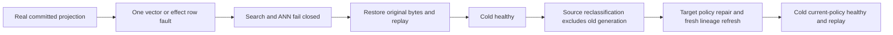

# : canonical derived-vector digest integrity

REQ-LINEAGE-001/002/003 and AC-LINEAGE-001/002/003, ADR-015/022: a derived vector entering search or an ANN seed must match its actual canonical effect, not merely an effect with a syntactically valid digest and matching receipt identity.

Source-confirmed defect: VectorProjectionEligibility.ValidateEffect checks64-hex digest shape and receipt identity but never compares the digest to the actual current vector values. Finite same-revision vector corruption or a different valid64-hex effect digest can therefore remain eligible. The selected PutVector contract has a REQUIRED long ExpectedDocumentRevision, validated against the actual document before apply. Consequently the exact original PutVector is reconstructible from lineage.TargetCollection and canonical VectorRecord; reuse UNCHANGED JsonData.Fingerprint on that exact shape. The nested PutVector also inherits the serialized init-only Mutation.Resource property. Require the existing canonical ValidateMutationStructure(Target) before fingerprinting, proving Resource equals Collection rather than silently normalizing it. Together the6 own fields and inherited Resource exactly reconstruct the accepted original fingerprint shape. No new digest domain, contract field, alias/Id, migration, compatibility fallback, provider or package is required. The same owning apply path currently reuses a previous effect receipt without validating its canonical stored vector. Require that original stored vector before idempotent effect reuse, preserving changed-request Conflict precedence.

AC-LINEAGE-DIGEST-001: actual search and AnnSeedCollector must reject both real finite vector-value drift and valid-shaped effect-fingerprint drift as exact Corruption without a partial result. Validate default/dimension/nonfinite vector input before hashing so malformed persisted vectors remain an explicit safe corruption outcome. Read-cut and byte/work limits remain unchanged.

AC-LINEAGE-DIGEST-002: each original two-argument operation first submits a genuinely malformed nested Target.Resource. Require exact canonical-owner Validation and persisted outcome/current worker epoch/incarnation, with measured+1 admitted outcome cut and complete model-domain image unchanged; never claim the first definitive failure is globally no-effect. Same failed-ID replay before/after cold preserves the full store and original failure; a distinct original healthy command continues. Each operation then seeds a genuine source document/event and target, acknowledges the complete projection receipt, then writes exactly one original row through the real storage commit. Full raw image and measured+1 cut are checked; search and ANN refusal change neither. Restore only the captured original row, require exact complete original image at+2, and verify independently literal full projected search/ANN vectors. A fresh same-effect command over the damaged finite vector refuses Corruption without storing an outcome. Restoring the original row lets that SAME formerly refused GUID commit its complete actual healthy receipt; replay does not add effects. Original successful command/full receipt replays with no effects. Same-root cold preserves original identity/vector/lineage/effect/outcome bytes and repeats healthy/replay checks.

Genuine target-policy CAS then restores classification compatibility; a fresh projection command refreshes the existing lineage and permits complete literal search/ANN output. All18 lineage fields independently match actual schema3, original source/event/reducer and classifications. A further joined same-root cold retains the refreshed lineage, complete receipt replay and healthy current-policy output. This is observable eligibility/rebuild continuation, not an assertion that source bytes or archives were purged.

Frontend/public schema/migration are N/A; this tightens existing private effect validation and operation tests. Source/self-review is not compiler/runtime evidence. No performance or power-loss claim follows.
