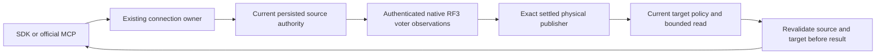

# Native ANN remote publication reads (R99)

This child refines REQ-LINEAGE-002/004/005, REQ/AC-SEARCH-003/004/005 and REQ/AC-SEARCH-ANN-WAIT-001/002/003. It adds read-only routing at the existing ConnectionReadCapabilities WaitForAnnIndex/ApproximateSearch consumer. It does not change durable ANN job execution, pending ownership, persisted formats or public request/result contracts.

| Requirement | Acceptance and original operation |
| --- | --- |
| REQ-KL097-REMOTE-001: select only the current settled publisher | AC-KL097-REMOTE-001: fresh persisted vector/field authorization, resource and consumer identity, actual logical placement and settled original InitialAnnMaintenance select its immutable NodeId. Addressed identity observations over the existing authenticated native transport must identify exactly one actual configured voter/store. Zero/multiple matches, stale placement, old pending or unknown owner refuse. |
| REQ-KL097-REMOTE-002: authorize both sides and fence every await | AC-KL097-REMOTE-002: source current principal/policy/resource/consumer/placement fences and target current persisted principal/resource/consumer/local owner fences are checked before protected decode and again after child/result await. SDK and official MCP scope-only revoke and field-only revoke refuse with complete canonical/outbox equality; persisted repairs authorize full original result/replay. |
| REQ-KL097-REMOTE-003: borrow native bounded work and lifecycle | AC-KL097-REMOTE-003: one original request expiry/CT/work owner bounds all three-voter observations, selected query, serialization, actual read records and reply imports. Measure/admit before copy; descendant caps use remaining grant after envelope charge. Cancellation/failure joins the original connection enumeration and work lease before shutdown. No public disable/default/quota/timer change. |
| REQ-KL097-REMOTE-004: preserve real migration, replay and cold ownership | AC-KL097-REMOTE-004: actual six-resource A2→A1 public reads, real MovePartition A→B, fresh B1 maintenance/new consumer and B5→B1 public reads, two same-root cold phases, original complete maintenance/seed receipts, full pages/read cuts, independent literal vectors and policy/no-effect oracles. Old A maintenance remains OwnershipLost after move; no reroute of original pending jobs. |

## Exact ownership and authority

The source captures fresh persisted authority and the current placement in one bounded native view. The same-local-group path uses the actual configured local tuple validated against current catalog; cross-group routing requires the real committed control owner directory. Destination-role stores need no fabricated control directory. Physical directory epoch remains immutable while logical placement epoch is independently verified.

Each native destination is the actual registered physical owner plus selected voter and full current SiloAddress/generation. The existing RemoteModel request/reply MAC, membership admission, unique request/connection context, receiver lease and CQRS dispatch remain the only transport. Only the exact originating local voter can be excluded by an authentic current source-store NodeId proof that it is not the retained publisher; this is not a synthetic remote observation. Other voter probes and the selected query use actual addressed native calls.

The receiver captures a local resource/consumer/policy/store fence before its signed child. It revalidates it after awaited child completion, before GrainValue decode, and before protected result encoding/signing. Source revalidation precedes native reply decode and follows its final read barrier. Fresh policy epoch belongs to current authorization; the original maintenance request remains immutable identity.

The existing generic read factory is closed to private read73. The signed private purpose authorizes only action-exclusive observation with current persisted VectorSearch and field-use authority. Precise native Graph RemoteModelGrainService→IConnectionGrain ExecuteStreamAsync registration supplements the already joined durable-job edge; default deny and all previous edges remain.

## Append-only native reservation

Actual current enum audit found GrainReadKind 0..72 and RemoteModelNativeChannel 0..1. Reserve GrainReadKind.AnnProjectionObservation=73 and RemoteModelNativeChannel.AnnProjectionObservation=2.
- kind alias keyload.ann-projection-observation.kind.v1: Identity0 / Wait1 / Approximate2.
- request alias keyload.ann-projection-observation.request.v1 IDs0 Version,1 Kind,2 exact OriginalRequest,3 MaximumReadBytes,4 MaximumRecords,5 nullable Wait,6 nullable Approximate; action-exclusive.
- result alias keyload.ann-projection-observation.result.v1 IDs0 Version,1 actual NodeId,2 actual ReadGeneration,3 nullable Wait,4 accepted read bytes,5 examined records,6 nullable full AnnSearchPage.
- server call alias keyload.server.ann-projection-observation.call.v1 IDs0 Version,1 authenticated PrincipalId,2 Observation,3 original UTC ExpiresAt.
- purpose keyload-ann-projection-observation-v1.
No persisted alias/family or public DTO changes. RemoteAnnReadFence/LocalAnnObservationFence are nonpersisted native view projections, not credentials or dispatch witnesses.

## Complete operation and explicit open gates

Source method: KeyLoad.IntegrationTests.Features.Search.RemoteAnnPublicationRf3Tests.DifferentVoterSdkAndOfficialMcpObserveActualPublicationAcrossMovePolicyRepairAndTwoColdRoots. It owns one original 12-minute linked test deadline, actual Aspire six-resource topology, signed SDK and official MCP, full canonical/outbox comparisons, real migration and two cold phases. Exact local-image admission is limited to this method. Explicit validated QueryExecutionOptions enables ANN only on this enrolled Search profile; ordinary defaults remain unchanged.

Existing native fixture restart/stop/read helpers retain all initiating and cleanup exceptions, owned roots, original all-six starts and all eighteen lock checks. New page oracle preserves complete native bytes including Position and separately verifies literal three references/revisions/JSON/redaction/scores/generation/shape and actual destination node identity. Cancellation assertion is pre-dispatch SDK cancellation only; no server cancellation or race proof is claimed.

This packet has native existing checkOnly applied=N and exact new-path NotSupported receipts. It has NOT been compiled or executed. Native UID discovery, owning build/analyzers, genuine hosted operation, source/copy-image invariance, Linux delivery, pending branch fault tests and post-await policy race qualification remain OPEN. R17/R18 failures and all previous receipts remain immutable; this candidate does not claim to repair those startup/refusal causes.

## Native work ownership refinement — R13

Decrease-only native caps and examined-record accounting live in one inline ReadExecutionBudgetNativeWork value owner under ResourceExecution/Execution. The original nonpartial ReadExecutionBudget delegates only this cohesive responsibility, retains validated options/clock/CT/read-grant ownership and every prior charge, and does not allocate a counter heap object. Unconstrained ordinary reads retain original behavior. No analyzer limit/partial/suppression change is introduced.

