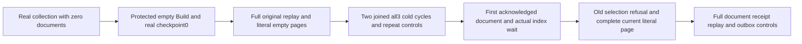

# Empty maintained text bootstrap and cold lifetime

REQ-FTS-EMPTY-MAINTAINED-001 refines REQ/AC-FTS-002/004/005 and INCREMENTAL-001/004: the original maintenance contract explicitly requires an empty terminal page to create the actual empty generation when no manifest exists. Absence of documents is not absence of an index. No fake provider, fabricated checkpoint, direct storage mutation or new empty-result fallback is admitted.

AC-FTS-EMPTY-MAINTAINED-001 maps TextEmptyMaintainedPublicTests.EmptyBootstrapRetainsOriginalReceiptAcrossTwoColdCyclesThenFirstDocumentFencesSelection, no Args, dedicated actual Aspire ClusterFixture. Configure a real collection without any document command. Official MCP protected Build must finish with zero tracked records, zero indexed/source sequence, a real checkpoint zero with full required-copy acknowledgementnowledged receipt and a verified index digest. Check every source-cut field: actual configured node/incarnation, positive position, applied/read-generation within surrounding statuses, literal schema1/tail0, positive current policy epoch and independently serialized configured-resource digest. Both SDK and official MCP selected AND unselected searches equal an independent empty RankedDocument array.

AC-FTS-EMPTY-MAINTAINED-002: replay the SAME original Build through each public client. Preserve the entire original stable result, including complete checkpoint receipt; Source is separately checked as the fresh nine-field observation using the canonical existing assertion. After EACH replay both clients' full empty pages and complete public outbox remain unchanged. Close caller owners before TWO actual all-three Kill/BeginRestart/Restart cycles. Each fresh caller repeats the complete replay/page/outbox checks with same actual node/incarnation and nondecreasing applied/read generation. This is public cluster source-defined acceptance, not raw journal, power-loss or runtime evidence.

AC-FTS-EMPTY-MAINTAINED-003: after the second joined cold cycle, publish the FIRST real document with exact literal needle JSON/revision1/full mutation receipt. Join actual WaitForIndex, then both unselected clients equal the complete independent RankedDocument including reference, revision, JSON, redaction, omitted fields, score1/61 and null explanation. The old empty selection refuses HistoryUnavailable through EACH client, immediately followed by the full current literal page and unchanged post-publication outbox. Replay the full original document receipt through EACH client and repeat those controls. No fresh-generation repair or old Build replay after corpus mutation is assumed by this scope.

Canonical Search slice: new IntegrationTests Cases/Models/Helpers/Assertions and this subdoc. Existing maintenance lifecycle cases inspected seed two bilingual records; this case starts with no document command and exercises the actual emptyPage bootstrap branch. Original fixtures, SDK, official MCP, request context, storage, scorer and bounds remain unchanged. Preserve linked execution/deadline cancellation and body-plus-cleanup ledger. No product defect is asserted.
