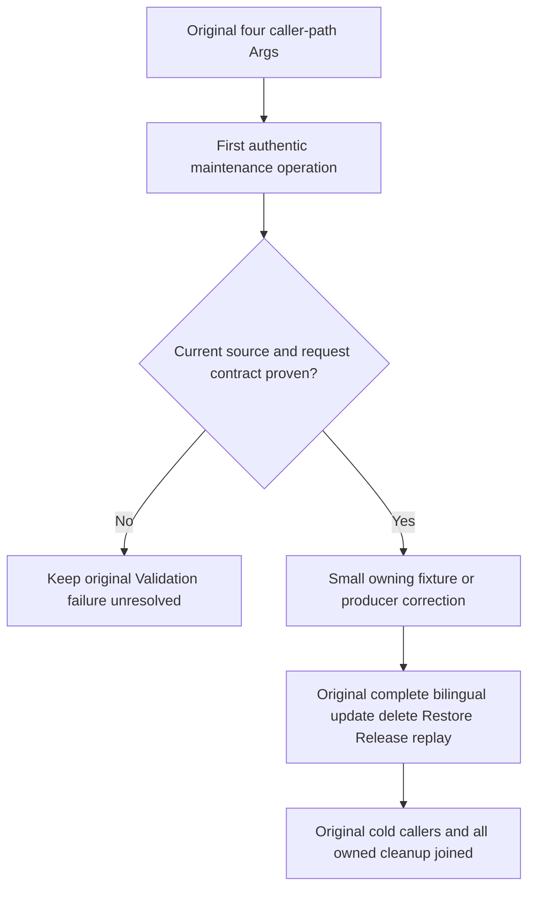

# Original text maintenance SQL-path preservation

Canonical slice: Search; canonical parent [Search](../Search.md), REQ/AC-SEARCH-005. Applicable [ADR-117](../../ADR/ADR-117-tunit-ci-entry.md) and [ADR-125](../../ADR/ADR-125-connection-owned-execution.md). This specification governs only the original `TextMaintenanceClusterTests.ProtectedTextMaintenanceReplaysBilingualUpdateDeleteAcrossAllPublicPaths` with all four unchanged Args: Sdk, Mcp, SdkSql, McpSql.

REQ-TEXT-MAINTENANCE-SQL-001 / AC-TEXT-MAINTENANCE-SQL-001: the original first Build and subsequent bilingual update/delete, Restore, Release and original receipt replay must exercise the existing current SQL maintenance operation through actual SDK SQL and official MCP SQL clients. Preserve the complete original operation outputs, literal documents, rank/pages, provider/root/session, original command identities, authorization and wrong-owner refusal. No fallback to direct SDK/MCP operation, blanket Validation acceptance, reduced syntax, role change or policy bypass is allowed. Map to the unchanged original Case and Flow/Call.

REQ-TEXT-MAINTENANCE-SQL-002 / AC-TEXT-MAINTENANCE-SQL-002: any fixture correction must be supported by authentic current producer/compiler API evidence. Keep all independent successful receipt/state/privacy/no-effect/refusal/replay assertions. If owning syntax/parameter/detail proof remains incomplete, retain the actual SDK Validation and official MCP Validation400 failures as unresolved; do not invent success or change product diagnostics from the failure alone.

If a diagnostic witness is necessary, preserve the original exception as primary and avoid caller credentials, document content, signed request and arbitrary raw SQL/error text. No new timeout, sleep, skip, count/cap change, provider substitute, dependency or public operation.

Original failure facts: run38578269537 attempt1, source319c719e6f6fa2c0fa1f8d14627a14004c5160c2; artifact11904195638. SDK SQL execution4cbbbbb4-dcef-4e11-a543-59f38afad154 fails first Flow22 through Call30 with Result.IsSuccess false/Validation. MCP SQL execution68181aaa-d677-46dd-a14c-63b0e4cbfa54 fails same Flow22 through Call36 with IsError true/Validation400. Both stdout/stderr are absent. Direct SDK and MCP original Args passed; that is source-cohort control evidence, not proof of the failed SQL request's cause.

Authored correction changes only the original Call SQL literal from `CALL keyload_search_text_maintain(@arguments)` to `EXEC keyload_search_text_maintain @arguments`. The current SqlOperationCompiler selects ScriptDOM ExecuteStatement; ScriptDomExecOperation accepts one exact public procedure identifier and one variable reference, binds the same single object parameter envelope through its descriptor, and preserves its decoded operation identity. SqlOriginalMutationIdentity permits an absent outer declared identity when the command carries its own nonempty original identity; no command identity is generated or replaced. Parameters, dictionary comparison, JsonSerializer options and original McpOfficialClient.Arguments(request) object are unchanged. The direct SDK/MCP branches, complete original Flow and Case/Args are byte-exact. No new Case. UI/benchmarks/storage format/SDK contract expansion: N/A, scope is preservation of the existing whole-operation acceptance.
