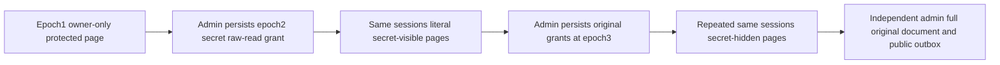

# Current raw-read grants change protected FTS projection on original sessions

REQ-FTS-RAW-READ-PUBLIC-001 refines FullTextProjection REQ/AC-FTS-002/005 and ADR-078/125. Use original TextClusterScenario with a persisted RestrictRows reader owner-a, Query/DocumentsRead and text-use grants. FieldUse and row eligibility stay valid. Epoch1 has no SecretReadGrant: SDK and official MCP must equal complete literal owner-only JSON, revision1, all three ordered redacted fields and rank1/61. The same original clients repeat both English and Ukrainian queries.

AC-FTS-RAW-READ-PUBLIC-001 maps TextRawReadPolicyPublicTests.CurrentRawReadGrantAdditionAndRemovalChangeOnlyLiteralProtectedProjectionOnOriginalSessions (one Test/no Arguments). Original authenticated policy change at epoch2 adds ONLY SecretReadGrant. Require full returned PrincipalRecord equality and complete literal secret+owner JSON with only text/embedding redacted; identical references/revision/rank and current authorized results. Do not expose secret merely because it participated in a hidden index.

REQ-FTS-RAW-READ-PUBLIC-002 / AC-FTS-RAW-READ-PUBLIC-002: restore the exact original field-grant set at literal higher epoch3. The SAME reader SDK/MCP sessions return owner-only JSON and all three ordered redactions again, twice through both needle and Kyiv queries. This is raw-read projection revocation, not FieldUse denial, credential revocation, row-owner mutation or index reset. The repeated post-removal queries must not reuse the prior secret-visible page.

REQ-FTS-RAW-READ-PUBLIC-003 / AC-FTS-RAW-READ-PUBLIC-003: after each epoch phase, independent administrator queries the unchanged exact original full document JSON at rank1/61 and reads complete public OutboxStatus before/after the read phase through both clients. Compare to the POST-policy baseline; this is public logical evidence, not raw same-cut canonical or journal no-effects. Dedicated original keyed ClusterFixture and nested RunOwnedAsync preserve real SDK/official MCP, persisted credentials, original deadline/body/disposal error ledger. No new fixture/provider/config/transport or public API.

Canonical Search map: Integration Cases/TextRawReadPolicyPublicTests, Helpers/TextRawReadPolicyPublicTrial, Assertions/TextRawReadPolicyPublicAssertions. TextClusterTests and TextAsyncClusterTests reviewed actual bodies cover static redaction and FieldUse/credential revocation, not raw-read addition/removal on the same sessions. TextRowOwnershipPublic changes row access and the protected cold slice revokes FieldUse; they remain distinct.
