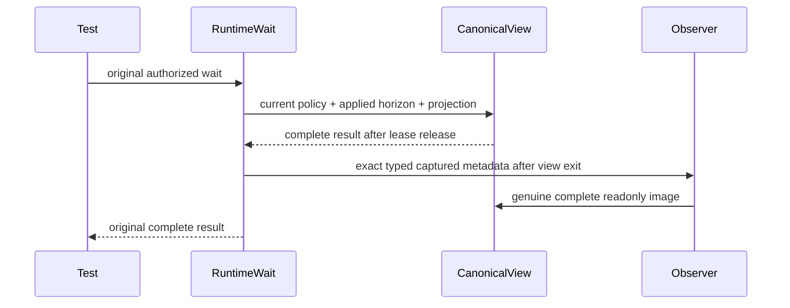

# text wait observation regressions

Future source proposal only; depends on the complete typed FTS capture/publish packet and Query27R4. Existing TextWaitForIndexTests cases remain unchanged.

REQ-FTS-WAIT-OBS-001 / AC-FTS-WAIT-OBS-001: the actual ReplicaAppliedPositionWaitFixture, applied entry, ZoneTree.FullTextSearch projection and SAME optional observer yield exact local owner/read generation/local position, independently matched original request digest, current principal/schema/policy and full applied token. Applied horizon remains distinct from physical storage position. Callback reads the genuine complete canonical store only after original owner view and provider lease release; complete image and literal Ukrainian/English ranked pages remain unchanged.

REQ-FTS-WAIT-OBS-002 / AC-FTS-WAIT-OBS-002: original wrong-incarnation/future-minimum refusals and current persisted protected-field PermissionDenied happen BEFORE observation. Compare complete original image and position after every failure; then actual healthy wait invokes exactly one typed observation and preserves token and literal page parity. Persisted grants are genuine ConfigurePrincipal operations, not trusted caller roles. All original provider/fixture cleanup is joined under primary-plus-cleanup aggregation.

Maps existing REQ-SEARCH-WAIT-001/003 and AC-ZT-003.

