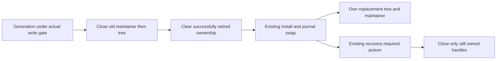
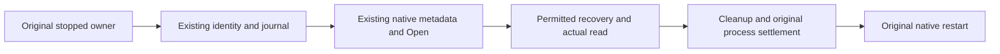
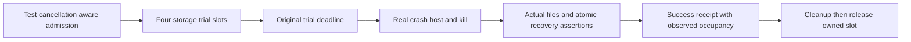
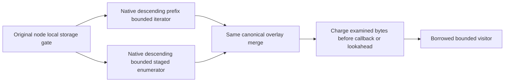
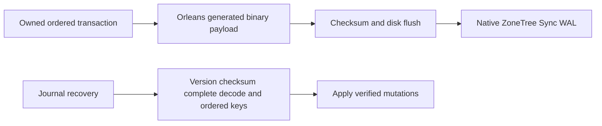
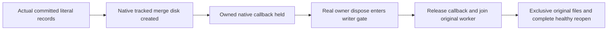

# StorageRecovery

The silo-local ZoneTree owner (an Orleans Grain Service) opens and owns the node's ZoneTree stores, atomic WAL/journals, file locks and the ordered commit/apply gate; logical partition grains route commands to it and never open files. This feature specifies the canonical key codec, node-local ownership and lifetime, journal/checkpoint recovery, scoped read cuts, the current native format and the process-kill recovery qualification. Copying a write to other nodes is an ordinary Orleans call to the ZoneTree owners on `KeyLoad:ReplicaCount` silos, acknowledged once a majority has applied it durably ([ADR-136](../ADR/ADR-136-native-orleans-partition-ownership.md), [ADR-143](../ADR/ADR-143-independent-silo-replica-topology.md)); it adds no storage format here.

Detailed contracts by topic:

- Format and identity: [CurrentFormat](StorageRecovery/CurrentFormat.md), [IdentityAuthorityAdmission](StorageRecovery/IdentityAuthorityAdmission.md), [DispatchIdentityPublication](StorageRecovery/DispatchIdentityPublication.md), [MetadataRegularFileReader](StorageRecovery/MetadataRegularFileReader.md), [OwnerLockRegularFile](StorageRecovery/OwnerLockRegularFile.md).
- Journal and checkpoint: [NativeWriteThroughJournal](StorageRecovery/NativeWriteThroughJournal.md), [JournalOriginalFailure](StorageRecovery/JournalOriginalFailure.md), [CheckpointOriginalCause](StorageRecovery/CheckpointOriginalCause.md), [SeededNativeRedoCorruption](StorageRecovery/SeededNativeRedoCorruption.md), [RecoveryFaultRootRetention](StorageRecovery/RecoveryFaultRootRetention.md).
- Read cuts: [NativeReadCuts](StorageRecovery/NativeReadCuts.md), [TransactionalReadViewOperation](StorageRecovery/TransactionalReadViewOperation.md), [CapturedReadSelectedCancellation](StorageRecovery/CapturedReadSelectedCancellation.md), [LiveRangeSelectedCancellation](StorageRecovery/LiveRangeSelectedCancellation.md), [NativeValueHeaderRefusal](StorageRecovery/NativeValueHeaderRefusal.md).

REQ-STORAGE-HOST-COMPOSITION-001 / AC-STORAGE-HOST-COMPOSITION-001: PartitionDatabaseComposition owns validation of the original host constructor inputs. PartitionHost invokes it at the same point before directory/storage acquisition, retaining the exact null checks and NodeOptions.Validate order. Ordered owner construction, rollback, materializer/verifier joins, store-close gate and all original failures remain unchanged. Existing host lifecycle, recovery and Aspire cluster whole operations plus the unchanged type200/function64 build gates verify this responsibility move; it introduces no new lifetime, operational policy or storage contract.

## Key codec and captured envelopes

The [ADR-005 validation contract](../ADR/ADR-005-canonical-keyspace-codec.md#v1-validation-and-ownership) preserves valid durable key bytes and defines explicit normalization, arity and safe malformed-input errors. The four criteria below map to the exact KeyCodec cases and to the owning codec/native storage source. A failure elsewhere in a suite cannot erase an independently verified mapped KeyCodec outcome, and the Docker/Aspire replicated-cluster, endurance and power-loss gates stay separately mandatory.

The AC-KEYCODEC-002/003 rejection flows use independent literal malformed vectors (NaN and infinity doubles, unterminated text and binary, an invalid decimal digit, a 30-digit persisted decimal). Each asserts the exact typed safe error, unchanged input bytes and an exact valid composite roundtrip after the rejection. The final decimal representability guard is a defensive path implied by the canonical coefficient/exponent/scale checks; no private hook forces it.

| Requirement | Measurable acceptance and owned TUnit mapping |
|---|---|
| REQ-KEYCODEC-001: preserve ordered v1 bytes and explicit type normalization | AC-KEYCODEC-001: original goldens and10,000 seeded decimals stay exact; an independent10,000 mixed-type/composite corpus roundtrips to the defined normalized values and sorts by a semantic oracle; negatives, valid Unicode/escaping, all type tags and extrema pass. Fractional decimal literal vectors retain their bytes and decode exactly under InvariantCulture and a custom CurrentCulture with a non-ASCII negative sign. New KeyCodecMixedCorpus/KeyCodecMixedCorpusTests, KeyCodecGoldenContractTests and KeyCodecCultureContractTests under UnitTests/StorageRecovery. |
| REQ-KEYCODEC-002: corrupted input fails through safe typed errors | AC-KEYCODEC-002: literal invalid/truncated UTF-8, escapes, scalars, bool/tags, timestamp extrema violations, decimal overflow/rounding/underflow and noncanonical numeric forms return exact Corruption; empty/unknown versions remain FormatUnsupported. New KeyCodecMalformedContractTests; no payload values in messages. |
| REQ-KEYCODEC-003: writer and reader share finite component bounds | AC-KEYCODEC-003:0,1 and256 components encode/decode exactly;257 writer input fails ResourceExhausted before encoding an unsupported component and257 persisted components fail Corruption before decoding the final malformed component. Invalid UTF-16/nonfinite input gives Validation and unsupported CLR types UnsupportedCapability. New KeyCodecInputContractTests. |
| REQ-KEYCODEC-004: native captured envelopes cannot alias canonical storage to caller-owned buffers | AC-KEYCODEC-004: actual ZoneTree staging copies input key/value before mutation/pool reuse; mutating a returned independently owned KeyValueRecord does not change committed bytes; generated existing envelope roundtrip and real reopen preserve the exact original content. New KeyCodecEnvelopeOwnershipTests, existing permanent native aliases/Ids, real provider only. |

Canonical map: shared codec/storage carriers in `Abstractions/Storage`, cohesive validation helpers in `Abstractions/StorageRecovery`, provider ownership in `Storage.ZoneTree/StorageRecovery`, and matching real-provider tests in `UnitTests/StorageRecovery`. Apply, native WAL authority and public JSON stay unchanged. UI/SDK/MCP schema work is N/A: no new wire operation.

## Exclusive node-local storage ownership

REQ-STORAGE-008 includes the exclusive physical-owner requirement. AC-STORAGE-OWNER-001 makes it measurable: while a parent owns a real current-format ZoneTreeStore, an actual Release CrashHost existing-store inspection in a separate process fails with the existing safe IOException receipt. The child and both original output readers must settle before inspection returns. Identity bytes, committed value and position remain exact, and the parent can commit and read a subsequent value. A second child is still denied while that parent is open. After actual parent disposal, child inspection and ordinary parent reopen succeed with the exact identity, updated value and position. Readable canonical journal bytes are retained across denied opens; reads are not forced through the active exclusive lock handle and asynchronously maintained physical tree files are not required to stay unchanged.

Governed by [ADR-046](../ADR/ADR-046-storage-private-owners.md). The flow is `tests/KeyLoad.UnitTests/StorageRecovery/Cases/StorageOwner/StorageOwnerProcessTests.cs`, which reuses the existing ZoneTreeExistingStoreFixture, inspector process and safe-receipt assertions and keeps the real 30-second child deadline, 8-KiB output bounds, strict protocol, outer node-owner lock and original exit/readers cleanup. It adds no fake parent rejection, child variant, production hook, swallowed failure or deadline increase. The lease, maintainer and pool requirements of REQ-STORAGE-008 are specified below; the broad AC-SQ-001..008 group is not satisfied by this criterion alone.

## Current-format storage and restore contract

The single supported native format, current restore authority, strict rejection
rules and their owning REQ/AC mappings are defined by
[CurrentFormat](StorageRecovery/CurrentFormat.md), [ADR-011](../ADR/ADR-011-current-native-format.md)
and [ADR-116](../ADR/ADR-116-first-release-current-format.md). Ordinary open,
recovery, checkpoint installation, backup and restore accept only that current
contract. Unknown or corrupt mandatory data fails closed before publication;
there is no alternate reader, conversion path or format fallback. Current-format
backup restoration creates a new authority incarnation and completes its bounded
blob-authority normalization before writable service. The source backup remains
unchanged and an incomplete restore stays paused.

The current-format positive and rejection operations map to the existing real
ZoneTree, CrashHost, RecoveryTests and Docker/Aspire SDK/MCP cases named in those
owning feature contracts. Preserve exact persisted bytes, authorization, node-local
ownership and complete process/resource settlement. Source review and development
receipts do not close the required Linux or replicated-cluster qualification gates.

## Retired checkpoint handle ownership

REQ-STORAGE-020 / AC-DBHP-009 preserves one physical owner for each successfully retired native maintainer/tree ([ADR-046](../ADR/ADR-046-storage-private-owners.md)). The failed-install scenario retains exact RecoveryRequired/warm rejection at InstallPrepared and JournalSwapped, then closes the log/store and repeats actual Dispose without redisposing retired handles. New healthy handles and directory locks keep their original lifetime. No new interface, package, format, caught cleanup error or relaxed fault oracle is permitted.

## Guarded original-store inspection

REQ-STORAGE-015 maps AC-SG009-001..004 ([ADR-059](../ADR/ADR-059-isolated-intensive-timeseries.md)). The private original-store guard rejects missing original files or changed identity before provider recovery, uses provider Open rather than OpenOrCreate, and preserves ordinary public open/codecs. Real native-file TUnit verifies identity/data/position, missing/mismatch/locked/invalid flows and normal reopen. Independent registered cleanup retains primary and cleanup failures. Every native proof uses a separately owned original inspector process and joins its exit and readers before restart, because provider partial open cannot prove handle settlement. Parent control/ACK/copy is outside this guard, and no power-loss or immutability claim is made. Ordered ownership, tests and exceptions are in ADR-059.

## Bounded real crash-trial qualification

REQ-STORAGE-014 maps AC-RC-001..004 ([ADR-035](../ADR/ADR-035-memory-performance.md)). A shared test-only four-slot admission bounds each storage CrashHost launch through real reopen, assertions and cleanup. It starts before each unchanged 15 s/20 s trial CTS, preserves 20x50 seeded crashes and all checkpoint/projection/subscription cases. Success receipt rows follow the atomic/durable assertions and add measured occupancy/peak fields. No fault point, assertion, readiness or job bound is reduced. The Linux GitHub recovery suite and 1000 successful seeded rows in that run qualify the harness; source and lifetime review explicitly cover rare exceptional permit/cleanup paths without doubles. Marker, receipt and input-read cancellations do not identify a storage defect.

REQ-STORAGE-014 / AC-RC-003 (also AC-AISQL-014): the unchanged receipt is written inside the original trial `try` immediately after the atomic/durable assertions, matching the receipt-before-cleanup order above. The original 15 s linked token, all 20x50 faults/trials, actual four-slot ownership and unconditional cleanup stay; the existing catch retains seed/trial/stage for receipt failures and any cleanup failure still fails qualification. This is test-harness ordering only: ADR-035 lifetime/test contracts suffice and no product, wire, persistence or topology change applies.

## Descending bounded borrowed ranges

REQ-STORAGE-013 / AC-RANGE-REV-001..003 ([ADR-052](../ADR/ADR-052-timeseries-bounded-aggregates.md)) accept the additive VisitReverseRange contract with the same exclusive bounds and borrowed lifetime as VisitRange. Private cursor, bounds and merge behavior are verified by real-store ReverseRangeTests, ReverseTransactionRangeTests and ReverseRangeResourceTests; interface and facade/budget forwarding stay unchanged. Native prefix-bounded NoRefresh reverse seek and native SortedSet reverse enumeration preserve staged tombstones/replacements without complete buffering. Exact observer/lookahead/cancel/early-stop and healthy-following-operation tests are mandatory, with all existing forward tests preserved. Native seek failure disposal is covered by source/lifetime review, not by an executed fake fault case.

## Killed-child file readiness

REQ-STORAGE-012 / AC-STORAGE-012 keep the killed-child filesystem readiness bound. After actual process exit, exclusive readiness covers `owner.lock`, `commands.wal` and the actual ZoneTree `tree/0.meta.wal` when present. The five-second bound, 25 ms poll, all 50 seeded trials, original trial deadlines, WAL/snapshot/atomic assertions and permanent sharing failure are unchanged. Cancellation stops before another probe; there is no retry of the recovery operation, default timeout increase or filesystem bypass.

During checkpoint installation the disposed live tree is moved aside before the InstallPrepared and JournalSwapped callbacks, so a child can exit with no tree directory. Only FileNotFoundException and DirectoryNotFoundException while opening the optional metadata WAL mean that file has no holder. `owner.lock` and `commands.wal` remain required exclusive probes; sharing violations and all other I/O errors keep the original bound. No readiness probe creates files or directories. Real missing-directory and missing-metadata-file cases assert successful readiness without recreating either path, then restore the actual store files and prove subsequent reopen and commit. Missing required ownership/journal files must still fail, and the held-file, cancel, pre-cancel and permanent-lock cases remain.

AC-REC-FUP-003 maps the two arguments of `AcStorage012_MissingRequiredOwnershipFileStillFails`. Each catches the expected exact FileNotFoundException, asserts no file creation and keeps the five-second lower / six-second upper observation assertions with 25 ms polling. Only that method carries a method-level keyless TUnit `NotInParallel`, so it does not overlap the concurrent native suite; permanent-holder timing isolation and every other case stay. A timing failure, broader serialization or weakened assertion fails the criterion. No helper, timeout or retry change is allowed.

The synchronous probe is a shared internal test helper. New real-file tests hold the metadata WAL exclusively after an actual ZoneTree store closes: the barrier must remain pending, complete only after the holder is released, reject cancellation, and fail under the same bounded permanent lock. The shared entry wrapper in RecoveryTests is retained. Product APIs, formats and permissions, frontend and dependency release are N/A; ADR-035 and ADR-041 owner/lifetime contracts suffice.

The byte readback assertions in FrameBudgetTests and PreparedTransactionTests map additionally to AC-CQ-018. Pinned TUnit array equality is reference equality, so ordered content equivalence must retain every exact byte, null failure, rejected-commit and reopen obligation.

REQ-STORAGE-010 maps AC-CQ-015 and AC-SQ-002/003/004/006/007 to the preserving storage test-source stage: the references keep the named implementation and source constraints but do not establish provider behavior or any behavioral AC-SQ criterion. REQ-STORAGE-008 owns the functional ZoneTree provider contract, including AC-SQ-008. Real frame, checkpoint, scoped-read, partition-host, lock and reopen assertions stay complete; deterministic bytes, awaited equivalent file APIs and cancellation completion satisfy the enabled policy. The journal repair retains its real synchronous `Flush(true)` barrier through an awaited truncate/flush/dispose. Explicit IAtomicStore dispatch and view identity remain tested. The exact scope and audit are in the [CodeQuality](CodeQuality.md) contract; ADR-033 and ADR-032 suffice for this test-source-only refinement.

## Requirements and acceptance map

Node-local journals, owned values, committed read cuts, checkpoint/recovery and bounded provider work. [ADR-035](../ADR/ADR-035-memory-performance.md) defines the scoped-read contract; ADR-032 records existing layout migration debt.

| Requirement | Acceptance | Tests / owner |
|---|---|---|
| REQ-STORAGE-001: budget before returned page copies; spans never escape the gate | AC-MP-002 | Real ZoneTree scoped point/range byte and lifetime cases |
| REQ-STORAGE-002: exact prefix/exclusive-bound/order/overlay semantics without global overfetch | AC-MP-002 | Real transaction replacement/deletion/insert/out-of-range cases |
| REQ-STORAGE-003: cancellation/early stop release iterator and preserve canonical data | AC-MP-002/012 | Real store cancel/visitor failure, subsequent read/commit and recovery CI |
| REQ-STORAGE-004: the silo-local ZoneTree owner owns the node's stores, locks, ordered apply and shutdown | AC-ROUTE-002 | CrashHost/Recovery and Docker replicated-cluster reopen, failover and activation-migration scenarios under [ADR-036](../ADR/ADR-036-orleans-foundation.md) and [ADR-136](../ADR/ADR-136-native-orleans-partition-ownership.md) |
| REQ-STORAGE-008: cohesive private provider owners meet numeric gates without changing storage/caller contracts | AC-SQ-001..008 | [ADR-046](../ADR/ADR-046-storage-private-owners.md); real lifetime tests; exact-source runtime qualification is a separate gate |
| REQ-STORAGE-009: validation and apply share one private mutation projection per staged generation | AC-PSW-001..004, AC-MP-006/012 | [ADR-035](../ADR/ADR-035-memory-performance.md); PreparedTransactionTests plus existing FrameBudget, recovery and replicated-cluster proof |
| REQ-STORAGE-011: startup identity metadata is finite and failed read releases physical ownership | AC-BSM-001/003/005 | [ADR-048](../ADR/ADR-048-bounded-storage-metadata.md), Metadata* real-file constructor/restore/reopen checks under BackupRestore |
| REQ-STORAGE-012: killed-child readiness includes the real metadata WAL when present, permits only precise sanctioned metadata absence, and preserves cancellation and the original failure bound | AC-STORAGE-012 | `tests/KeyLoad.RecoveryTests/StorageRecovery/Cases/KilledProcessFileReadinessTests.cs`: actual closed-store pending/release, cancellation, pre-cancellation, permanent-lock, missing optional directory/file without creation and missing required file cases; `RecoveryTests.cs` retains every process-kill scenario |

Ownership: common public storage contracts stay in Abstractions/Storage; provider helpers in Storage.ZoneTree/StorageRecovery, with tests mirroring that name in UnitTests/RecoveryTests. The silo-local ZoneTree owner (Grain Service) composes the node's store and its journal/apply lifetimes under [ADR-036](../ADR/ADR-036-orleans-foundation.md) and [ADR-136](../ADR/ADR-136-native-orleans-partition-ownership.md). Grains receive non-owning engine/coordinator references and never dispose or reopen those files. ZoneTreeStore remains the public composition facade; private partial behavior lives under StorageRecovery and BackupRestore according to [ADR-046](../ADR/ADR-046-storage-private-owners.md), which accepts one runtime plus real StorageRecovery initialization, journal, view/transaction/range and checkpoint owners (BackupRestore owns the separate local backup component). No schema, UI, public, format or business-authorization change applies, and no numeric exception is authorized.

The prepared-write contract removes the duplicate mutation projection. Only transaction-private prepared arrays are cached; accepted Stage/Reset invalidate them, rejected admission preserves the prior valid set, and Stage retains caller-array ownership copies. WAL/apply/fault order and bytes remain exact.

Real ZoneTree tests accompany provider repairs; TUnit/MTP, process recovery and replicated-cluster qualification come from exact-source Linux runs. Counters describe logical examined work; physical I/O and native allocation need separate measurement. Gates and fault semantics cannot be relaxed for throughput.

## Null tombstone versus empty value

REQ-STORAGE-006/009, AC-STORAGE-006, AC-PSW-002..004 and AC-ROC-002/004/005 keep the canonical nullable mutation distinction: an empty value remains a value while Delete remains a tombstone, and no stored bytes are reclassified. The CLR byte-array projection in ZoneTreeTransaction.PrepareChanges uses an explicit null for Delete. `TombstoneValueTests` use an actual store and first prove staged/committed owned and borrowed reads, empty Put versus Delete, exact WAL/base64/null bytes, the frame limit, ordered range, WAL reopen and snapshot record count/reopen. Cache/copy/flush/apply order and NullValueOverheadBytes=2 (a four-byte null replaces two value quotes) are preserved ([ADR-035](../ADR/ADR-035-memory-performance.md) and ADR-041). Qualification requires exact-source unit, process recovery and replicated-cluster SDK/MCP evidence; the projection alone proves no power-loss guarantee or performance gain.

## Storage, journal and recovery contract

Actors: the node-local PartitionHost, canonical apply/read callers and the recovery/backup operator. Actual source: [ZoneTreeStore](../../src/KeyLoad.Storage.ZoneTree/ZoneTreeStore.cs), [runtime](../../src/KeyLoad.Storage.ZoneTree/StorageRecovery/Execution/ZoneTreeStoreRuntime.cs), [checkpoint manager](../../src/KeyLoad.Storage.ZoneTree/StorageRecovery/Recovery/ZoneTreeCheckpointManager.cs), [KeyCodec](../../src/KeyLoad.Abstractions/Storage/Serialization/KeyCodec.cs), [storage contracts](../../src/KeyLoad.Abstractions/Storage/Contracts/). One physical owner holds the lock, the journal/read-apply gate and the immutable returned values; migrating grains never open the tree.

| Requirement | Acceptance / flows | Test mapping |
|---|---|---|
| REQ-STORAGE-005: journal/checkpoint recovery preserves one complete acknowledged process cut | AC-STORAGE-005: a real process kill at the prepare/publish/install boundaries recovers one whole cut without a partial transaction; a torn tail has declared handling, a corrupt complete frame fails closed; a validated snapshot is never mixed with older state | Existing `FiftySeededRealProcessCrashesPreserveAtomicTransactions` (StorageRecoveryProcessTests), `ProcessKillDuringCheckpointPublicationRecoversOneCompleteGeneration`, `CorruptCompleteFrameFailsClosedInsteadOfBeingDiscardedAsATornTail` in [StoragePublicationRecoveryTests](../../tests/KeyLoad.RecoveryTests/StorageRecovery/Cases/StoragePublicationRecoveryTests.cs) |
| REQ-STORAGE-006: the canonical key/envelope/owned-value format has stable ordering and scope | AC-STORAGE-006: golden keys, escaped UTF-8 components, signed/decimal ordering and scope do not collide; an invalid or corrupt format is rejected and borrowed spans never escape the gate | Existing `GoldenKeysRemainStable`, `TenThousandSeededDecimalKeysRoundTripAndSortNumerically`, `StringsUseUtf8OrdinalOrderingAndEscapedComponentsDoNotCollide` in [KeyCodecTests](../../tests/KeyLoad.UnitTests/StorageRecovery/Cases/KeyCodec/KeyCodecTests.cs); scoped-read cases AC-MP-002 |
| REQ-STORAGE-007: current-format readers reject unsupported or corrupt persisted data before effects | AC-STORAGE-007: real current-format open, recovery, checkpoint install and backup/restore accept supported records; unknown/corrupt mandatory versions fail closed with original bytes and authority unchanged; no conversion or fallback reader is invoked | Existing current-format ZoneTree, RecoveryTests and BackupRestore real-operation cases under [CurrentFormat](StorageRecovery/CurrentFormat.md), [ADR-011](../ADR/ADR-011-current-native-format.md) and [ADR-116](../ADR/ADR-116-first-release-current-format.md) |

ProcessDurable and QuorumProcessDurable describe the verified declared process failure model; `LocalDurable`/`QuorumDurable`, power-loss and endurance are not accepted from process-kill source or test names. The full acknowledgement barrier is [ADR-003](../ADR/ADR-003-durability-ack-barrier.md); committed read views are [ADR-004](../ADR/ADR-004-committed-read-views.md); the versioned keyspace is [ADR-005](../ADR/ADR-005-canonical-keyspace-codec.md); backup/log retention is [ADR-008](../ADR/ADR-008-backup-log-retention.md), [BackupRestore](BackupRestore.md).

Current-code journal, compaction, checkpoint and scoped-visitor changes require exact delivered-source evidence. Source and recovery evidence is qualified through the required TUnit, actual child-process recovery and cluster suites. Maintenance automation and power-loss gates remain explicitly pending. Provider/container composition has one owner; new helper or test scopes do not change the format without an ADR contract.

## Orleans binary atomic WAL

[ADR-057](../ADR/ADR-057-orleans-atomic-wal.md) accepts REQ-STORAGE-015..019 and AC-WAL-001..005. Current commands.wal mutation payloads use generated Orleans binary serialization with WAL signature 4, identity epoch 7 and checkpoint 5 under [CurrentFormat](StorageRecovery/CurrentFormat.md). Native ZoneTree raw-byte Sync WAL and the atomic journals retain their current contracts. Unsupported or corrupt mandatory frames fail closed; no alternate decoder or fallback reader is used. The closed native ReadOnlyMemoryOfByteCodec registration keeps nullable value bytes raw rather than using the generic per-byte codec. Fresh normal/scalar, process recovery, replicated-cluster, comparative performance, power-loss/endurance, numeric coverage and independent resource evidence remain required.

|Requirement|Acceptance/test trace|
|---|---|
|REQ-STORAGE-015 binary mutation codec|AC-WAL-001 real-store binary/empty/delete roundtrip and reopen|
|REQ-STORAGE-016 exact bounded payload|AC-WAL-002 FrameBudgetTests plus PreparedTransactionTests cache/replacement/reset/rejected-stage|
|REQ-STORAGE-017 safe replay|AC-WAL-003 checksum/full-consumption/shape/order and unsupported-format rejection; OrleansWalSuccessorTests verifies last legal sequence, terminal overflow rejection, unchanged journal/identity, no premature apply and released ownership; existing real commit crash cuts remain mandatory|
|REQ-STORAGE-018 current-version admission and restore|AC-WAL-004 current checkpoint/empty/refusal and checkpoint install/restore identity preservation|
|REQ-STORAGE-019 authentic qualification|AC-WAL-005 full Release/formatter/governance and exact-SHA GitHub unit/process-recovery/cluster SDK+MCP; speed and power-loss unclaimed|

Complete-frame length mismatch (REQ-STORAGE-017 / AC-WAL-003): `NativeStoreOpenPreflightTests.R12Ac002CompleteCorruptionRejectsBeforeAnyProviderFileChanges` has direct-open and real CrashHost-inspector arguments for an otherwise complete current WAL frame whose declared payload length is one byte shorter than its actual serialized payload. Both paths return the existing exact `ErrorCode.Corruption`, preserve the complete provider file/tree hash inventory and release the owner lock. The test begins with an actual committed ZoneTree record and a valid preceding frame; it adds no frame-size limit and changes no reader behavior. The short-header case is covered by `R12Ac002IncompleteCurrentTailIsOnlyTruncatedByOrdinaryRecovery`, an incomplete-tail recovery case rather than a corruption oracle; existing truncation and committed-prefix assertions are unchanged.

No new UI/API/model format applies.

### Case-to-acceptance clarifications

The protected-principal cases in `tests/KeyLoad.UnitTests/StorageRecovery/Cases/Partition/PartitionHostRecoveryTests.cs` exercise the real pending-image path, which rejects missing/modified protected state on repeated host-open attempts and accepts a valid protected principal after installation. These cases support REQ-STORAGE-004 for the silo-local owner's verified pending-image recovery and ownership path. They are local host/store evidence, not majority-acknowledgement or cluster evidence, and are not generic format-corruption cases.

`OfflineRegularFileEntryTypeTests`, `OfflineRegularFileIdentityTests`, `OfflineRegularFileLockTests` and `OfflineRegularFileDuplicateLockTests` carry the obsolete source label `AC-EPOCH-012`. Their observed regular-entry, identity, BCL lock-interoperation and native-handle lifetime behavior is supporting primitive evidence for REQ-STORAGE-015 / AC-SG009P-001..004. They do not invoke the guarded Release CrashHost protocol and cannot establish the complete AC-SG009P process, strict-request, receipt or original-reader settlement contract by themselves.

REQ-STORAGE-015 also maps AC-SG009P-001..004 ([ADR-059](../ADR/ADR-059-isolated-intensive-timeseries.md)). The canonical directory is lexical normalized ordinal equality, without a symlink/rename resistance claim. Every guard test invokes the genuine Release CrashHost using bounded private JSON and actual failure/data facts; original process exit and both pipe drains precede outer-lock release and ordinary reopen. The cancellation case observes the original ready child, kills/reaps it and checks data after normal reopen. This helper is not the native benchmark inspector/control/copy oracle.

## Event append seeded crash cuts

REQ-STORAGE-006/007 and AC-STORAGE-006/007 are preserved through the exact seven native during-append process cuts and original child/readers/store-lock ownership frozen in [EventStreams](EventStreams.md) and ADR-002. The recovered doc/event/head/dedup/queue/outbox/receipt and same-ID/healthy-follow-up assertions use real ZoneTree and current serialization. No timeout change, multi-lane or power-loss claim follows.

## Native store gate diagnostic

REQ-SERIES-022 / AC-SERIES-022 and REQ-STORAGE-GATE-001 / AC-STORAGE-GATE-001 define a native per-open-store gate diagnostic. ZoneTreeGateSnapshot carries only the existing ephemeral read SessionId and the native ReaderWriterLockSlim.WaitingWriteCount as WaitingWriters. The scalar counts all pending write-gate users, not only commits; it is not a receipt, readiness/authority token, consistent multi-field cut or durability proof. No key, principal, credential, path, payload, callback, event handler, exported metric label or unbounded history exists. Sampling acquires no store gate, scans no records, mutates no storage and allocates no retained collection; the owner must remain open through sampling and cleanup. No HTTP/SDK/MCP diagnostic route is added. Native storage owns this observation; Orleans still owns actual requests and node-local storage/commit authority.

Whole flow: seed and refresh a literal real bucket; hold its existing authorized budgeted SampleRollupReader inside the actual store Read callback and retain only a detached literal result. Submit exactly one actual stable-ID Drop on a joined native worker. Under the unchanged five-second scope bound, observe same-session WaitingWriters>0 while the first read gate remains held; only then release and join the actual reader and writer. Verify the first complete literal bucket, the exact native drop receipt kind/revision, unchanged raw/ID/sequence/floor authority, the revision tombstone, stable-ID replay with unchanged full bytes/position, and a genuine CAS recreate/read healthy continuation. The condition is actual queued native writer work, not Task.IsCompleted, a pre-call signal or a scheduling delay. Full bytes inside the held gate equal the pre-drop cut. Native observations and controller/worker errors settle before owned store disposal; primary and cleanup failures are retained.

## Topic purge crash cuts

REQ-EVENT-RETENTION-004 / AC-EVENT-RETENTION-004: the real CrashHost first acknowledges purge through source position 1, then arms the existing native CanonicalCrashBoundary for exactly the next Store.Commit position of immutable purge-through 2. Two seeds admit either success (paused checkpoint 3) or exact ResourceExhausted rejection (paused checkpoint 1). Kill only the owned original process after its native phase marker; join original exit and both bounded readers, prove exclusive native locks and reopen the actual ZoneTree. HeaderWritten/PayloadWritten are pre-flush boundaries; JournalFlushed is after the native durable flush returns and before native apply, not inside an OS flush syscall; MutationApplied0 and ApplyCompleted are actual native apply cuts. A pre-flush cut may recover the old or the whole new cut; a post-flush cut must recover the complete success or rejected receipt, never partial model changes.

The independent oracle requires literal head/events/source positions/digests/doc/queue/paused checkpoint plus the original acknowledged seed receipt, canonical command fingerprint/receipt, exact committed clock and stable same-ID replay with full-store byte equality. Fresh identical/conflicting EventID errors remain distinct. Appending, reading, queue claim and a final native reopen follow. No new product seam, provider, journal, format, whitelist, sleep, wider deadline or retry-to-green; process kill is not power-loss proof. The scenario lives in CrashHost EventStreams and RecoveryTests EventStreams with the existing process/readers/cleanup helpers.

## Composite range and unique-index process cuts

REQ-DSTORE-002 / AC-DSTORE-002 and AC-DSTORE-COMPOSITE-PROCESS-001 preserve the equality/range/composite/partition-unique scope. A real four-process CrashHost matrix verifies inserted, replaced, patched, deleted and tombstoned documents, complete composite/ordered-score/unique native index images in two atomic partitions, literal membership and native exclusive-after-key ranges. Composite equality must report the genuine declared composite index; native range Scan proof is distinct from query-planner inequality seeks. A mixed document/event/enqueue unique conflict rolls back every effect; its persisted failure and the successful acknowledged receipt replay unchanged after the crash with complete store-byte and position invariance. A fresh command follows recovery and a fourth reopen preserves it.

The matrix reuses the JournalFlushed cut, acknowledged first kill, original child stdout/stderr and joined cleanup/deadlines. Parent literal tuples are independent of observed index values; the native public KeySpace encodes the specified literal keys and never calls the index mutation implementation. No provider doubles, fallback or retry-until-pass. ADR-002 owns command replay; ADR-011 owns atomic journal/recovery.

## Native maintenance lifetime

REQ-STORAGE-MAINTENANCE-JOIN-001: the node-local ZoneTree owner joins its actual tracked native merge thread before releasing tree/journal/owner file handles (disposal waits for jobs). Read-cut join alone does not prove maintenance completion. No product API, timer, dependency, format or public boundary changes.

AC-STORAGE-MAINTENANCE-JOIN-001: NativeMaintenanceLifetimeTests seeds complete independent literal byte records through real atomic Commit, updates/deletes through another Commit, and starts the existing native maintainer EvictToDisk. Observe native OnDiskSegmentCreated (actual disk record serialization completed on the merger thread), hold only that native callback under the existing ten-second lifetime bound, start real owner Dispose, observe the actual same-owner queued writer under a real Read, then its acquired writer gate before releasing the merge callback. Dispose must remain incomplete only after those native observations. Release and join the original Dispose, observe the SUCCESS terminal native merge and stopped original thread, open every original file exclusively, reopen the same native owner with the same position and full literal scan, perform a healthy real Commit and reopen to its complete expected bytes. A pre-call Task state, native Start callback, sleep, padded corpus or getter-only check cannot substitute.

One real physical runtime/maintainer is used (ZoneTreeStoreRuntime and ZoneTreeStore internal composition); there is no second provider or storage owner. In the pinned ZoneTree 1.9.8 source OnMergeOperationStarted fires before the merge thread is created, so it is not the work oracle; OnDiskSegmentCreated runs on the merge worker after native disk creation, and the maintainer's Dispose waits for tracked threads. The native caller and cleanup join before closing barriers or deleting files, preserve primary plus cleanup errors and retain the root on failure. Test cancellation neither skips the join nor fabricates a successful merge.

Pinned native Maintainer.Dispose joins merge threads, but its default periodic cache-cleanup Task is not retained or awaited, so the merge case alone cannot qualify periodic-job completion. The following contract owns that remaining boundary.

REQ-STORAGE-MAINTENANCE-JOIN-002: one node-local maintenance lifetime owns every periodic cleanup task and stops/joins it before retiring the original tree, journal or owner lock, including failed construction and snapshot tree replacement. The pinned native `ZoneTreeMaintainer` is instantiated with `startJobForCleaningInactiveBlockCaches: false` before any job can start; its native automatic merge policies and tracked merge join are retained. The caller-owned periodic task invokes the public native `ReleaseReadBuffers`, `ReleaseCircularKeyCacheRecords` and `ReleaseCircularValueCacheRecords` APIs. It does not implement cache internals or introduce another storage engine. The default interval is 30 seconds and the block lifetime 1 minute. Exactly one task and timer per physical tree execute sequential sweeps without queues, request identity, payloads, authoritative state or network calls.

AC-STORAGE-MAINTENANCE-JOIN-002: a real ZoneTree operation commits independent literal records, updates/deletes them, completes native disk eviction and reads the exact disk-backed values. Observe a sweep only after all three native cleanup APIs return, then hold that completed sweep's owned callback. Start real store disposal, observe its queued writer under an actual read and its acquired write gate, and require it to remain pending until that task is released and joined. After release, require task success, exclusive access to every original file, unchanged incarnation/position and complete literal state after cold reopen, then a healthy commit and second cold reopen. Task-state inspection before the native operation, sleep, cancellation alone or a released lock does not qualify.

AC-STORAGE-MAINTENANCE-JOIN-003: inject a bounded failure at the same post-native-sweep callback, observe the original worker fault through actual store disposal, and require joined cleanup, exclusive original files, unchanged complete committed contents and a healthy cold-reopen operation. The first worker failure and any independent native merge/handle cleanup failures are retained. Cancellation ends only the timer wait; it cannot suppress a sweep failure or detach a running callback. Guarded original-store inspection starts no maintainer or periodic task.

Traceability: disposal-waits-jobs -> REQ-STORAGE-MAINTENANCE-JOIN-002 -> AC-STORAGE-MAINTENANCE-JOIN-002/003 -> ADR-046 -> `NativeMaintenancePeriodicLifetimeTests` complete operation flows. The owner-process, read-cut lifetime/budget/cancellation, merge-thread and pooled-envelope flows remain required.

AC-STORAGE-MAINTENANCE-JOIN-004: each zero, negative, sub-millisecond or above-native-range maintenance interval, and each negative or above-native-range block lifetime, rejects before creating the directory or owning files. The same previously absent path then accepts a valid central policy, a real multi-record commit, complete literal cold-reopen state with unchanged incarnation/position, a healthy additional commit and a second complete cold reopen. `ZoneTreeMaintenancePolicyTests.InvalidMaintenanceDurationsRejectBeforeOwnershipThenHealthyCommitAndColdReopen` owns all six operation flows.

Operational policy comes from the centrally bound and validated `ZoneTreeStorageExecutionOptions`: a native-range `NativeMaintenanceInterval` of at least one millisecond and a nonnegative native-range `NativeBlockCacheLifetime`, with 30-second / one-minute defaults. The typed snapshot is frozen before native ownership. Linux qualification uses `TimeProvider.System` monotonic elapsed milliseconds from its native zero epoch for the native read-buffer cutoff (.NET 10 high/low-resolution POSIX clocks share that epoch: Linux MONOTONIC/COARSE, macOS UPTIME_RAW). This disposable cache cutoff is independent of request/read-cut/commit clocks and has only native clock-resolution precision. No UTC clock, injected request clock, invented expiry or analyzer suppression is permitted. Windows epoch portability remains a distinct unqualified boundary.

REQ-STORAGE-MAINTENANCE-JOIN-003 / AC-STORAGE-MAINTENANCE-SNAPSHOT-005: every actual native store opening receives the complete centrally validated per-store execution policy, including maintenance interval and block lifetime. The direct restore authority owner therefore carries the original centrally bound IOptions from Restore into its private ApplyRestoreAuthorityState and calls the canonical public ResolveExecutionOptions before constructing the staging runtime, rather than the scalar-only WithExecutionSnapshot helper (only the resolver carries the maintenance policy). It must not manufacture an Options.Create wrapper or weaken configuration ownership (KLD0037). The maintenance lifetime freezes and validates that admitted policy before starting work. Explicit per-store frame/snapshot overrides, every effective scalar budget, validation-before-ownership, native maintenance lifetime, timer/task/merge joins, generation replacement and disposal order are preserved. No fallback or default policy, skipped maintenance, exception swallowing, new engine/provider, format, restored authority, public API or changed limit is permitted; the node-local owner and separate journals remain authoritative. The regressions are the whole native backup/restore, rejected-input then healthy restore, real CLI children, cold-reopen blob/eventing/metadata/identity flows and real recovery children; ADR-046 owns this private snapshot join and BackupRestore REQ/AC-BACKUP-001/002/003 are unchanged.

## Rollup refresh and drop process cuts

REQ-SERIES-022 / AC-SERIES-022 and [ADR-120](../ADR/ADR-120-bounded-persisted-series-rollups.md) add two real process recovery cases for bounded rollup refresh/drop. The existing CrashHost canonical JournalFlushed hold, CommandIdempotencyProcessChild original output/drain/exit ownership, StorageTrialLease and native file-release proof own four distinct child lifetimes. Kill after acknowledged revision 1, then kill the actual in-flight refresh/drop at JournalFlushed; recover revision 2 statistics or tombstone from the native current journals. Retain the complete raw sample/identity/sequence/floor bytes, independent full literal samples/statistics/metadata, exact native same-ID receipts, a changed-payload Conflict without effects and stable failed replay; then run a healthy refresh/drop/recreate to revision 5 and a separate successful reopen child. No new product diagnostics, alias, limit, timeout or retry loop and no power-loss claim. Every child and both native pipe tasks settle before cleanup; primary plus cleanup failure remains observed.

## Native ANN staged replay process ownership (AC-ANN-007)

`NativeAnnProcessRecoveryTests` owns actual child processes through the existing Aspire recovery entry and finite child/pipe/file-lock settlement. The first stage covers an acknowledged durable pending-page publication before its canonical ACK, then an actual canonical ACK killed at the original JournalFlushed boundary, followed by cold pending-array load, same-ID original receipt recovery and bounded remaining-prefix replay. A later child cold-loads the completed native graph, verifies complete literal vector records and performs a genuine healthy explicit vector mutation and replay. Pending arrays never serve readers; recovered nonempty checkpoint receipts establish progress. These process-kill cuts do not establish power-loss durability, arbitrary partial-write coverage or AC-ANN-008 public approximate search qualification.

## Native storage owner, lease and pooled-value acceptance

REQ-STORAGE-008, REQ-CUT-003, REQ-KEYCODEC-004 and REQ-STORAGE-MAINTENANCE-JOIN-001/002 retain the owner, lease, native maintainer/job and pooled-envelope criteria. AC-STORAGE-NATIVE-SUITE-001 binds the 27-case native union of KeyCodecEnvelopeOwnershipTests, NativeMaintenanceLifetimeTests, NativeReadCutBudgetTests/CancellationTests/ClockTests/ConsistencyTests/LifetimeTests/ReplacementTests, StorageOwnerProcessTests, StoreLifetimeTests, NativeMaintenancePeriodicLifetimeTests and ZoneTreeMaintenancePolicyTests. Normal and scalar each execute 27/27 without skips and settle their child exits/readers/disposal. These complete operations own real node-local files and the genuine separate CrashHost process; Docker replicated-cluster deployment is N/A to this unit lane, so the shared matrix must not build or start Docker resources for it. ADR-046 owns the storage boundary and ADR-117 the direct native TUnit entry and fixtures. The complete recovery and genuine replicated-cluster suites remain independently required.

## Native encoded-frame limit detail

REQ-SR-ENCODED-FRAME-DETAIL-001 / AC-SR-ENCODED-FRAME-DETAIL-001 retain the actual ResourceExhausted guard and limit in ZoneTreeJournalBufferWriter.Advance and use its fixed EncodedTransactionFrameLimitExceeded detail. Raw Stage keeps its original failure detail; no budget/format/recovery ordering changes. Existing FrameBudgetTests.AcWal002IncrementalFrameAccountingMatchesBinaryPayloadAtExactLimits retains every legal coalesced WAL/value/checksum and one-byte-short no-effect assertion, additionally checking the exact owning encoded detail (12 source trials). Ordinary required native recovery tests still qualify byte-identical partial-tail semantics.

## Upstream ZoneTree WAL checksum defect

REQ-STORAGE-008, AC-SQ-008 and native-WAL qualification retain the confirmed checksum findings for the pinned ZoneTree 1.9.8. The owner-authorized public report is [ZoneTree issue 182](https://github.com/ZoneTree/ZoneTree/issues/182): an ARM64 .NET 10 WAL create→dispose→software-read failure, the native byte-tail CRC overload defect and a proposed upstream patch. These are development facts, not Linux/x64, release, package, power-loss or KeyLoad acceptance proof. ZoneTree maintainers own the upstream compatibility and release decision. KeyLoad keeps its pinned published dependency and introduces no checksum fallback, migration, local package or consumer workaround; the affected WAL portability gate remains open. The report adds no implementation, schema, topology or dependency boundary (ADR-046 authority and fault contracts suffice).

## Native WAL checksum dependency and normal-path process recovery

[ADR-126](../ADR/ADR-126-current-native-zonetree-checksums.md) selects the published ZoneTree 2.0.0 with the centrally pinned System.IO.Hashing 10.0.12 and retains ZoneTree.FullTextSearch 1.0.9. REQ/AC-NATIVE-WAL-PROFILE-001/002 (cross-profile graceful reopen) are superseded by REQ/AC-NATIVE-WAL-NORMAL-001 below. REQ-NATIVE-WAL-PROFILE-003 / AC-NATIVE-WAL-PROFILE-003 map to solution restore/build/analyzers/formatter plus actual full-text indexing, search, rebuild and reopen regressions; package availability alone closes no gate. This test does not read previous native WAL formats, migrate, accept legacy `.wal_crc` or fork checksums.

REQ-NATIVE-WAL-NORMAL-001 / AC-NATIVE-WAL-NORMAL-001: SIMD execution is always on, so there is no disabled-intrinsics profile. The test requires native SIMD eligibility before opening its store and runs four real processes in seed → first-append → second-append → cold order. `NativeChecksumProfileRecoveryTests.CurrentNativeWalPreserves257RecordsAndBothAppendsAcrossFourProcesses` has zero parameters and retains the 257 exact native corpus rows, both acknowledged command/receipt/native outcome appends, original retry/conflicting-body refusal, complete persisted models/outbox, the byte-exact cold cut and the same-root identity. It is process recovery, not power-loss or performance qualification.

Seed commits 257 distinct short native UTF8 key/value rows through ZoneTreeStore.Commit and the independent document+event+queue mixed batch through the native DatabaseEngine, keeping its generated CommitReceipt/request/outbox evidence. It freezes every native key/value row in strict order, the count, committed Store.Position, NodeId/incarnation and read generation in one bounded native-generated test evidence envelope (alias `keyload.test.native.checksum-profile-cut.v1` with fields NodeId0/Incarnation1/Position2/ReadGeneration3/Rows4 and row alias `keyload.test.native.checksum-profile-row.v1` with Key0/Value1); it is test-only, not a database format or recovery authority. Each later phase reopens the same fresh current native root and verifies the exact store position, rows, node/incarnation and a non-decreasing read generation before any effect or replay; it then replays the original receipt and a changed-body Conflict, commits an independent fresh document operation (keeping its exact bytes) and freezes the new complete cut. The fourth child proves the whole cut and all 257 rows survive another same-root reopen and closes normally. Every non-seed phase verifies the entire 257-record corpus.

The parent passes only mode/root/phase (three arguments) and never writes DOTNET/COMPlus intrinsics environment; the native `Vector.IsHardwareAccelerated && (Sse2.IsSupported || AdvSimd.IsSupported)` guard runs before storage acquisition, and unavailable or disabled hardware never counts as success. Old four-argument shapes fail the strict argument-count refusal with no compatibility reader. Completion is phase-only and emitted after native store close and failure-ledger settlement. The StorageTrialLease, 90-second execution / 30-second cleanup budgets, bounded pipe readers and initiating/fatal/cleanup exceptions are unchanged. Focused run: `node scripts/Features/TestInfrastructure/run-tests.mjs --KeyLoadTests:Suite=recovery '--KeyLoadTests:Filter=/*/*/NativeChecksumProfileRecoveryTests/*' --KeyLoadTests:ReportTrx=true --KeyLoadTests:Execution:MaximumParallelTests=50`, built with the ZoneTree 2.0.0 dependency closure.

## Queue lease authority process cuts

REQ/AC-MSG-001/004/005 and REQ/AC-MSG-RETRY-ORDER/JITTER ([ADR-026](../ADR/ADR-026-fenced-delivery-inbox.md), [ADR-028](../ADR/ADR-028-persisted-scheduling-time.md)): two QueueLeaseAuthorityProcessRecoveryTests cases reuse the ordered-retry CrashHost HeaderWritten cut after an acknowledged producer/Receive. The uncommitted sealed NACK must reject an absent or foreign selected lease reference with exact Corruption detail and no whole-store, identity, cut or outcome effect, including repeated and cold calls. A single-row native repair restores the complete pre-fault image at cut+2; the same original NACK then commits its recorded jitter and exact receipt. Complete independent original and healthy messages, full body/metadata/counter/order/index checks and replay of all delivery receipts after a second joined cold owner are verified. Process lifetime, cleanup, scan and policy contracts are unchanged; process-kill is not power-loss proof.

## Blob process recovery

REQ-BLOB-001/002/004/005/007 and AC-BLOB-001/002/004/005/007 ([ADR-038](../ADR/ADR-038-chunked-blob-storage.md)). The first five scenarios preserve a previously acknowledged Blob publication (and deletion) across the unchanged independent same-store queue-lifecycle HeaderWritten kill. They prove prior-lifetime survival and reclaim integrity at an unrelated commit cut; the genuine Blob Complete/Delete commit cuts are the last scenario. The trial keeps the original 90 s trial / 30 s cleanup / 8192-byte output / 4096-row image bounds and the real joined child cleanup, runs on the normal SIMD path with the default 50-way native parallelism, and uses no mocks, shared fixture, protocol, format or bound change. Process-kill results do not establish Linux, replicated-cluster failover or power-loss qualification.

### Prior publication survival

Two native Recovery cases (missing current completed BlobState; current completed BlobState with Retired=true) preserve a previously acknowledged four-byte publication across an independent queue-lifecycle HeaderWritten process kill in the same physical ZoneTree store. The parent first creates the persisted authority; the unchanged child validates that same authority/incarnation/tenant and does not reset the store. Literal complete and partial bytes, metadata, chain hash, raw part/manifest/state and both quotas agree before and after the kill; the uncommitted queue batch has no outcome. Selected-state corruption refuses metadata/range/delete/reclaim and cached completion without any complete-store, cut or identity effect, repeatedly and after cold reopen. Repair restores exactly the one original row and the entire pre-fault image at cut+2. The original deletion/reclaim succeeds with exact receipts, counters and owned-row removal; the same upload identifier publishes fresh healthy bytes at revision 3 while old lifetime outcomes invalidate. A second cold owner preserves all final rows, bytes, identity, authority and replay receipts. Automated map: `KeyLoad.RecoveryTests.Features.BlobStorage.BlobPriorPublicationProcessRecoveryTests.PriorAcknowledgedPublicationSurvivesIndependentQueueCutThenLifetimeRepairAndReuse`, Arguments(true), Arguments(false).

### Retired part integrity

Three native Recovery cases preserve a previously acknowledged publication and deletion (revision 2 tombstone) across the same queue-lifecycle cut. Parent root principal/incarnation remain identical to the existing persisted authority; the child never resets the store. The selected faults are exactly one retired upload ordinal 0 row: missing raw part; missing part metadata; shape-valid part metadata with a SHA256 of different literal bytes. Before faults, the complete literal retired state, tombstone, raw part/manifest, both quotas and the publication/deletion receipts survive the stop. Reclaim(MaxParts 1) refuses Corruption with no partial deletion, quota, outcome, full-store, cut or identity effect, repeatedly and after the first cold reopen. Repair restores exactly that owned row and the complete pre-fault image at cut+2. The same Reclaim then releases 4 bytes / 1 version / 1 part, replays its complete receipt, leaves the tombstone and removes state/raw/manifest. Reusing the same upload identifier publishes fresh literal [9,10,11,12] bytes at revision 3 with independent hashes, full/partial/empty-tail reads, exact native state/quotas, fresh receipts and old-lifetime invalidation. A second cold owner preserves the final image, identity and the unrelated queue image / absent outcome. Map: `BlobRetiredPartProcessRecoveryTests.PriorAcknowledgedDeletionSurvivesIndependentQueueCutThenPartRepairReclaimAndReuse`, MissingRaw/MissingManifest/WrongManifestHash.

### Retired part bytes

Two cases extend retired-part integrity to an equal-length altered raw value and a shape-valid manifest declaring the wrong part length. The selected ordinal 0 raw row originally contains literal [1,2,3,4]; its equal-length alteration becomes [5,6,7,8] while the exact manifest remains. The alternative changes only the native manifest to format 1 / length 3 / the original four-byte SHA256, preserving raw bytes and every other row. Reclaim(MaxParts 1) must refuse exact Corruption repeatedly and after a cold owner with no partial deletion, quota, outcome, full-store, cut, identity or authority effect. One-row repair restores the complete image at cut+2; the same command then releases exactly 4 bytes / 1 part / 1 version with receipt replay, leaves the revision 2 tombstone, removes retired state/raw/manifest and permits same-upload-ID reuse with literal [9,10,11,12] at revision 3. Full/partial/empty-tail reads, an independent hash transcript, native counters/state/receipts and old-lifetime invalidation survive a second cold owner; the unrelated queue image and absent outcome stay exact. Map: `BlobRetiredPartBytesProcessRecoveryTests.PriorAcknowledgedDeletionSurvivesIndependentQueueCutThenByteRepairReclaimAndReuse`, AlteredRawBytes/WrongManifestLength.

### Later part faults

Two cases preserve an acknowledged two-part publication and revision 2 deletion across the same cut. The 65553-byte payload is the deterministic byte at index i = i mod 239; ordinal 0 has 65536 bytes and ordinal 1 has 17. Bounded reads independently verify every byte through two legal ranges and a boundary-crossing range. Reclaim(MaxParts 2) meets healthy ordinal 0 then a missing or equal-length altered ordinal 1 raw row. Existing DeleteParts stages raw0/meta0 deletions before reading ordinal 1; quota mutation follows successful completion of that loop. The native refusal leaves every row, raw0/meta0, both quotas, retired state/cursor, tombstone, receipts, absent outcome, authority, identity and cut unchanged, repeatedly and after a first cold owner. Exact damaged-image closure changes exactly the selected ordinal 1 raw row; one-owned-row repair restores the complete image at cut+2. The same reclaim then removes state, both raw rows and both metadata rows and releases 65553 bytes / 2 parts / 1 version exactly once with receipt replay. Reusing the upload identifier publishes literal [9,10,11,12] at revision 3 with exact full/partial/tail bytes, independent hashes, native quotas/state, fresh receipts and old-lifetime invalidation; a second cold owner preserves the complete final image, root principal/incarnation, receipts and the unrelated queue image / absent outcome. Map: `BlobLaterPartProcessRecoveryTests.PriorAcknowledgedTwoPartDeletionSurvivesIndependentQueueCutThenLaterPartRepairReclaimAndReuse`, MissingSecondRaw/AlteredSecondRaw.

### Extra part faults

Two cases extend the same two-part retired-lifetime survival to an unexpected extra owned ordinal 2 row, and preserve the 65553-byte / 2-part publication and deletion, native root/incarnation, exact head/state/manifest/raw/quota and receipts. Insert exactly one previously absent ordinal 2 raw row with literal [77,78,79], or one native part manifest format 1 / length 3 / SHA256(literal 3); both original ordinals 0 and 1 remain healthy and the whole-store image differs only by that key/value at cut+1. Reclaim(MaxParts 2) reads both healthy parts, stages all four raw/manifest deletions and the resource/global quota decrement, then ProveEmpty refuses the unexpected raw or manifest row with exact Corruption (the existing owning staged order; no failpoint is fabricated). Repeated refusal and the first cold owner preserve the complete image, both parts, the extra row, quotas (65553 bytes / 1 object / 1 version / 0 uploads), retired state/cursor, tombstone, receipts, absent reclaim outcome, cut, identity and authority. Delete-only repair of exactly the injected key restores the original image at cut+2; the same reclaim releases 65553 bytes / 2 parts / 1 version once, removes state and all raw/manifest rows with exact quotas and receipt replay, and retains the revision 2 tombstone. Same-upload reuse publishes literal [9,10,11,12] at revision 3; the extra ordinal 2 families and old ordinal 1 stay absent after healthy reuse and a second cold owner. Map: `BlobExtraPartProcessRecoveryTests.PriorAcknowledgedTwoPartDeletionSurvivesIndependentQueueCutThenExtraPartRepairReclaimAndReuse`, ExtraRaw/ExtraManifest.

### Complete and Delete publication cuts

REQ-BLOB-COMMIT-CUT-001 refines REQ-BLOB-001/002/003/004/005/007 under ADR-038 and the ADR-117 native TUnit entry. Genuine CompleteBlobUpload and DeleteBlob use their node-local ZoneTreeStoreOptions.FaultObserver stages, a selected exact next commit position, a real CrashHost child, persisted authority and joined native store ownership. A previously acknowledged literal four-byte publication and its seed receipts precede the selected command. Complete also acknowledges its new two-part 65553-byte upload before the cut; Delete targets the acknowledged published version. No unrelated queue mutation is the selected cut.

AC-BLOB-COMMIT-CUT-001 maps four Complete whole flows: HeaderWritten stops after only the frame header; JournalFlushed stops after the entire frame's synchronous flush but before materialized apply; a deterministic IOException injected through the public native FaultObserver at the selected JournalFlushed stage yields the engine UnknownWriteOutcome; and an explicit ACK path observes the actual returned native receipt before stopping. AC-BLOB-COMMIT-CUT-002 maps the same four flows to Delete. Both require the exact prior ACK, command/content/scope authority, the same node incarnation and principal across genuine process stop/reopen. HeaderWritten preserves the complete pre-command raw image/cut, rejects ResolveOutcome with the existing RecoveryRequired missing-durable-outcome result and retains the original metadata/chunks/digest/quotas. JournalFlushed and ACK recover the complete atomic effect and identical durable receipt. A caller whose child stops before ACK has an unobserved write outcome; process termination does not return an engine UnknownWriteOutcome error. Fabricated domain exceptions/results and relabelled queue cuts are forbidden; the injected IOException is scoped I/O fault injection, not a physical disk or power-loss claim.

AC-BLOB-COMMIT-CUT-003: a same-original-command retry returns the exact result and durable receipt with no replay image/cut effect, and the full independently expected metadata/state/head/raw chunks/manifests/digests/counters are verified; a persisted unauthorized principal is refused without revealing bytes or changing state. Complete preserves the old retained version bytes while publishing the exact new multipart version; Delete publishes the exact revision 2 tombstone and retains the old version until bounded reclaim. Healthy new work and a second joined cold owner preserve the exact scoped authority, receipts and independent bytes. All selected child/pipe/native handles settle and owned roots are removed within the 90 s process / 30 s cleanup bounds.

Fixture facts: the denied non-administrator principal is installed with no grants through the existing root-signed ConfigurePrincipal operation (not the initial-administrator-only Bootstrap), so these flows use direct persisted-principal authorization and do not qualify SDK credential authentication. After Blob reclamation ConfigurePrincipal retains its administrative receipt, so the continuation compares the full ConfigurePrincipal/ConfigureResource Apply and ResolveOutcome results with no row-image or cut effect, while the original Begin/Part/Complete still require TokenInvalidated. No new Core/API/storage format/dependency/provider, migration, fallback, bound or authorization change applies; ADR-038 is sufficient.

## Qualification gates

Source review, authored cases and local development runs are not qualification. The required evidence is the exact-source Linux run of the normal and scalar unit suites, the process-recovery suite and the Aspire replicated-cluster SDK/MCP suite through the native TUnit test entry, with original reports. Process-kill and restart tests do not establish power-loss durability; endurance, power-loss and performance gates remain separately open until their own evidence exists. A suite failure elsewhere does not erase an independently verified mapped criterion, and a mapped criterion does not close the whole feature.
