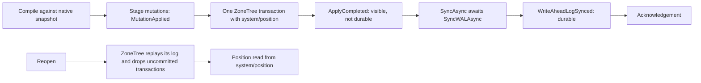
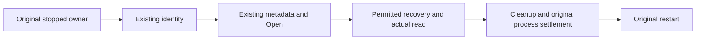
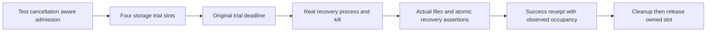
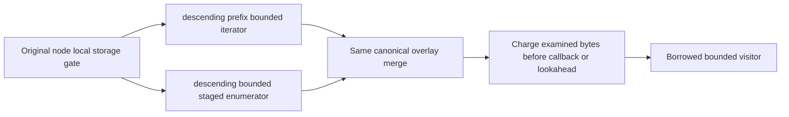
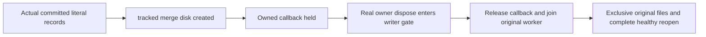

# StorageRecovery

Storage mode selects physical ownership. With `IsolatedVolumes`, a silo-local Orleans Grain Service owns that node's ZoneTree stores (each with ZoneTree's own write-ahead log), file locks and ordered apply gate; copies use typed Orleans calls to those owners. With `SharedVolume`, all silos use the configured shared paths and one ordinary database grain activation acquires the physical session; other silos call that owner. Shared storage requires `ReplicaCount=1` and never permits concurrent writers to the same ZoneTree files. The local runtime retains handles until actual borrowers join and the session closes. Orleans owns placement and activation movement; deployed shared-filesystem locking and flush behavior remain unqualified.

This feature specifies the canonical key codec, physical ownership and lifetime, ZoneTree write-ahead-log durability and recovery, scoped read cuts, the current format and process-kill recovery qualification. With isolated storage, a successful persisted receipt requires every configured copy to confirm its synced local apply and reports the actual `PersistedCopies` ([ADR-136](../ADR/ADR-136-orleans-partition-ownership.md), [ADR-143](../ADR/ADR-143-independent-silo-replica-topology.md)); storage mode adds no format here. Backup and restore of a store are specified in [BackupRestore](BackupRestore.md).

Detailed contracts by topic:

- Format and identity: [CurrentFormat](StorageRecovery/CurrentFormat.md), [MetadataRegularFileReader](StorageRecovery/MetadataRegularFileReader.md), [OwnerLockRegularFile](StorageRecovery/OwnerLockRegularFile.md).
- Read cuts: [NativeMvcc](StorageRecovery/NativeMvcc.md), [RuntimeReadCuts](StorageRecovery/RuntimeReadCuts.md), [TransactionalReadViewOperation](StorageRecovery/TransactionalReadViewOperation.md), [CapturedReadSelectedCancellation](StorageRecovery/CapturedReadSelectedCancellation.md), [LiveRangeSelectedCancellation](StorageRecovery/LiveRangeSelectedCancellation.md).
- Owner lifetime: [GrainServiceOwnership](StorageRecovery/GrainServiceOwnership.md), [OwnerAcquisitionSettlement](StorageRecovery/OwnerAcquisitionSettlement.md), [PartitionStorageStartup](StorageRecovery/PartitionStorageStartup.md), [PartitionHostApplicationLifetime](StorageRecovery/PartitionHostApplicationLifetime.md), [PartialApplicationDisposal](StorageRecovery/PartialApplicationDisposal.md), [PreStartApplicationDisposal](StorageRecovery/PreStartApplicationDisposal.md), [ProducerDirectDispose](StorageRecovery/ProducerDirectDispose.md), [PublicationBorrow](StorageRecovery/PublicationBorrow.md), [OriginalFixtureSettlement](StorageRecovery/OriginalFixtureSettlement.md).

REQ-STORAGE-HOST-COMPOSITION-001 / AC-STORAGE-HOST-COMPOSITION-001: PartitionDatabaseComposition owns validation of the original host constructor inputs. PartitionHost invokes it at the same point before directory/storage acquisition, retaining the exact null checks and NodeOptions.Validate order. Ordered owner construction, rollback, materializer/verifier joins, store-close gate and all original failures remain unchanged. Existing host lifecycle, recovery and Aspire cluster whole operations plus the unchanged type200/function64 build gates verify this responsibility move; it introduces no new lifetime, operational policy or storage contract.

## Durability and recovery

KeyLoad owns no write-ahead log, snapshot or archive format; storage and its redo log are ZoneTree's ([ADR-011](../ADR/ADR-011-current-format.md)). A store directory holds `owner.lock`, `identity.json` and the ZoneTree MVCC tree under `tree/`.

- **One redo log.** ZoneTree's write-ahead log in `WriteAheadLogMode.AsyncCompressed`, with uncompressed payloads, is the only redo log. It is configured once in `ZoneTreeTreeFactory`.
- **One transaction per commit.** `ZoneTreeStoreCommitExecution` compiles against a native snapshot and uses ZoneTree's serializable conflict handling; `ZoneTreeCommitPublication` stages one ZoneTree MVCC transaction that holds the staged mutations and the store position record under `system/position`. A commit with no mutations publishes nothing and keeps the position. `Store.Position` is read back from the tree on open. ZoneTree replays its own log when it opens and drops a transaction whose commit never reached the log.
- **Visible, then durable.** A commit is visible when `Commit` returns and durable only after the next `IAtomicStore.SyncAsync`, which awaits ZoneTree's `SyncWALAsync`. `DatabaseEngine.Apply` does not sync. Every acknowledgement path awaits the sync before it reports success: `PartitionStorageGrainService.ApplyBatchAsync` (one sync per batch), the silo-local `SiloCommandCoordinator` path, `LocalStorageCommitCoordinator` and `EmbeddedCoordinator`. Disposing a store flushes ZoneTree's log.
- **Honest read cuts.** A read may observe a visible commit that is not yet synced. A process crash before its sync can lose that commit; no acknowledgement was sent for it.
- **Failure.** A failed commit publication or sync leaves an unknown outcome: the store answers `UnknownWriteOutcome`, refuses later reads and commits with `RecoveryRequired` and recovers by reopening. The same command ID retries safely.

The crash observer reports three stages (`CommitStage`): `MutationApplied` after each mutation is staged into the ZoneTree transaction and before its commit; `ApplyCompleted` after the transaction committed and the position was published (visible, not yet durable); and `WriteAheadLogSynced`, emitted by `SyncAsync` after the sync with the position it covered. A real process kill at `MutationApplied` recovers the transaction absent; at `ApplyCompleted` it recovers wholly present or wholly absent; at `WriteAheadLogSynced` it recovers present. Process kill is not power-loss proof.

| Requirement | Acceptance / flows | Test mapping |
|---|---|---|
| REQ-STORAGE-005: ZoneTree write-ahead-log recovery preserves one whole cut and every acknowledged commit | AC-STORAGE-005: a real process kill at each crash stage recovers one whole cut without a partial transaction: absent after `MutationApplied`, either whole cut after `ApplyCompleted`, committed after `WriteAheadLogSynced`; acknowledgements are sent only after the sync | `StorageRecoveryProcessTests.FiftySeededRealProcessCrashesPreserveAtomicTransactions` (20 batches of 50 seeded trials over the three stages and three mutation indices) in [StorageRecoveryProcessTests](../../tests/KeyLoad.ProcessRecoveryTests/StorageRecovery/Cases/StorageRecoveryProcessTests.cs); the domain process-recovery suites below |
| REQ-STORAGE-006: the canonical key/envelope/owned-value format has stable ordering and scope | AC-STORAGE-006: golden keys, escaped UTF-8 components, signed/decimal ordering and scope do not collide; an invalid or corrupt format is rejected and borrowed spans never escape the gate | Existing `GoldenKeysRemainStable`, `TenThousandSeededDecimalKeysRoundTripAndSortNumerically`, `StringsUseUtf8OrdinalOrderingAndEscapedComponentsDoNotCollide` in [KeyCodecTests](../../tests/KeyLoad.FunctionalTests/StorageRecovery/Cases/KeyCodec/KeyCodecTests.cs); scoped-read cases AC-MP-002 |
| REQ-STORAGE-007: current-format readers reject an unsupported or corrupt store identity before effects | AC-STORAGE-007: real current-format open, recovery and backup/restore accept current stores; an unknown or corrupt identity fails closed with the original bytes and authority unchanged; no conversion or alternate reader is invoked | `StoreIdentityVersionRejectionTests`, `RuntimeJournalReaderFenceTests`, `MissingIdentityTests` and the BackupRestore `ZoneTreeBackupTests` under [CurrentFormat](StorageRecovery/CurrentFormat.md), [ADR-011](../ADR/ADR-011-current-format.md) and [ADR-116](../ADR/ADR-116-first-release-current-format.md) |

`ProcessDurable` describes the verified declared process failure model; `LocalDurable`, power-loss and endurance are not accepted from process-kill source or test names. The full acknowledgement barrier is [ADR-003](../ADR/ADR-003-durability-ack-barrier.md); committed read views are [ADR-004](../ADR/ADR-004-committed-read-views.md); the versioned keyspace is [ADR-005](../ADR/ADR-005-canonical-keyspace-codec.md); backup cuts and log retention are [ADR-008](../ADR/ADR-008-backup-log-retention.md) and [BackupRestore](BackupRestore.md).

## Key codec and captured envelopes

The [ADR-005 validation contract](../ADR/ADR-005-canonical-keyspace-codec.md#v1-validation-and-ownership) preserves valid durable key bytes and defines explicit normalization, arity and safe malformed-input errors. The four criteria below map to the exact KeyCodec cases and to the owning codec/storage source. A failure elsewhere in a suite cannot erase an independently verified mapped KeyCodec outcome, and the Docker/Aspire replicated-cluster, endurance and power-loss gates stay separately mandatory.

The AC-KEYCODEC-002/003 rejection flows use independent literal malformed vectors (NaN and infinity doubles, unterminated text and binary, an invalid decimal digit, a 30-digit persisted decimal). Each asserts the exact typed safe error, unchanged input bytes and an exact valid composite roundtrip after the rejection. The final decimal representability guard is a defensive path implied by the canonical coefficient/exponent/scale checks; no private hook forces it.

| Requirement | Measurable acceptance and owned TUnit mapping |
|---|---|
| REQ-KEYCODEC-001: preserve ordered v1 bytes and explicit type normalization | AC-KEYCODEC-001: original goldens and 10,000 seeded decimals stay exact; an independent 10,000 mixed-type/composite corpus roundtrips to the defined normalized values and sorts by a semantic oracle; negatives, valid Unicode/escaping, all type tags and extrema pass. Fractional decimal literal vectors retain their bytes and decode exactly under InvariantCulture and a custom CurrentCulture with a non-ASCII negative sign. KeyCodecMixedCorpusTests, KeyCodecGoldenContractTests and KeyCodecCultureContractTests under StorageRecovery. |
| REQ-KEYCODEC-002: corrupted input fails through safe typed errors | AC-KEYCODEC-002: literal invalid/truncated UTF-8, escapes, scalars, bool/tags, timestamp extrema violations, decimal overflow/rounding/underflow and noncanonical numeric forms return exact Corruption; empty/unknown versions remain FormatUnsupported. KeyCodecMalformedContractTests; no payload values in messages. |
| REQ-KEYCODEC-003: writer and reader share finite component bounds | AC-KEYCODEC-003: 0, 1 and 256 components encode/decode exactly; 257 writer input fails ResourceExhausted before encoding an unsupported component and 257 persisted components fail Corruption before decoding the final malformed component. Invalid UTF-16/nonfinite input gives Validation and unsupported CLR types UnsupportedCapability. KeyCodecInputContractTests. |
| REQ-KEYCODEC-004: captured envelopes cannot alias canonical storage to caller-owned buffers | AC-KEYCODEC-004: actual ZoneTree staging copies input key/value before mutation/pool reuse; mutating a returned independently owned KeyValueRecord does not change committed bytes; generated existing envelope roundtrip and real reopen preserve the exact original content. KeyCodecEnvelopeOwnershipTests, existing permanent aliases/Ids, real provider only. |
| REQ-KEYCODEC-005: decode text without unnecessary intermediate buffers and retain owned binary results | AC-KEYCODEC-005: `KeyCodecInputContractTests` preserves empty text, long Unicode, consecutive escaped zeros and the following component; changing the encoded key or a decoded binary result cannot change the other owned bytes. After warmup, 512 decodes of the fixed six-text-component key allocate less than 1,024 bytes per decode on the executing thread. This is an allocation bound, not a latency or cluster claim. |

Canonical map: shared codec/storage carriers in `Abstractions/Storage`, provider ownership in `Storage.ZoneTree/StorageEngine`, and matching real-provider tests in `FunctionalTests/StorageRecovery`. Apply, the write-ahead log and public JSON stay unchanged. UI/SDK/MCP schema work is N/A: no new wire operation.

## Exclusive node-local storage ownership

REQ-STORAGE-008 includes the exclusive physical-owner requirement. AC-STORAGE-OWNER-001 makes it measurable: while a parent owns a real current-format ZoneTreeStore, an actual compiled existing-store inspection in a separate process fails with the existing safe IOException receipt. The child and both original output readers must settle before inspection returns. Identity bytes, committed value and position remain exact, and the parent can commit and read a subsequent value. A second child is still denied while that parent is open. After actual parent disposal, child inspection and ordinary parent reopen succeed with the exact identity, updated value and position. The identity bytes are retained across denied opens; reads are not forced through the active exclusive lock handle and asynchronously maintained physical tree files are not required to stay unchanged.

Governed by [ADR-046](../ADR/ADR-046-storage-private-owners.md). The flow is `tests/KeyLoad.FunctionalTests/StorageRecovery/Cases/StorageOwner/StorageOwnerProcessTests.cs`, which reuses the existing ZoneTreeExistingStoreFixture, inspector process and safe-receipt assertions and keeps the real 30-second child deadline, 8-KiB output bounds, strict protocol, outer node-owner lock and original exit/readers cleanup. It adds no fake parent rejection, child variant, production hook, swallowed failure or deadline increase. The lease, maintainer and pool requirements of REQ-STORAGE-008 are specified below; the broad AC-SQ-001..008 group is not satisfied by this criterion alone.

## Current-format storage and restore contract

The single supported format, its strict rejection rules and their owning REQ/AC mappings are defined by [CurrentFormat](StorageRecovery/CurrentFormat.md), [ADR-011](../ADR/ADR-011-current-format.md) and [ADR-116](../ADR/ADR-116-first-release-current-format.md). Ordinary open, recovery, backup and restore accept only the current store identity; ZoneTree validates its own tree and backup files. An unknown or corrupt identity fails closed before ZoneTree opens or changes the tree; there is no alternate reader, conversion path or format fallback. Restore creates a new node identity, incarnation and signing key and starts with dispatch paused; the source backup remains unchanged.

The current-format positive and rejection operations map to the existing real ZoneTree, process-recovery and Docker/Aspire SDK/MCP cases named in those owning feature contracts. Preserve exact persisted bytes, authorization, node-local ownership and complete process/resource settlement. Source review and development receipts do not close the required Linux or replicated-cluster qualification gates.

## Guarded original-store inspection

REQ-STORAGE-015 maps AC-SG009-001..004 ([ADR-059](../ADR/ADR-059-guarded-original-store-inspection.md)). The private original-store guard rejects missing original files or changed identity before provider recovery, uses provider Open rather than OpenOrCreate, and preserves ordinary public open/codecs. Real file TUnit verifies identity/data/position, missing/mismatch/locked/invalid flows and normal reopen. Independent registered cleanup retains primary and cleanup failures. Every proof uses a separately owned original inspector process and joins its exit and readers before restart, because provider partial open cannot prove handle settlement. Parent control/ACK/copy is outside this guard, and no power-loss or immutability claim is made. Ordered ownership, tests and exceptions are in ADR-059.

`OfflineRegularFileEntryTypeTests`, `OfflineRegularFileIdentityTests`, `OfflineRegularFileLockTests` and `OfflineRegularFileDuplicateLockTests` provide supporting primitive evidence for REQ-STORAGE-015 / AC-SG009P-001..004 through actual regular-entry, identity, BCL lock-interoperation and handle lifetime observations. They do not invoke the guarded inspector process protocol and cannot establish its complete strict-request, receipt or original-reader settlement contract by themselves.

REQ-STORAGE-015 also maps AC-SG009P-001..004 ([ADR-059](../ADR/ADR-059-guarded-original-store-inspection.md)). The canonical directory is lexical normalized ordinal equality, without a symlink/rename resistance claim. Every guard test invokes the genuine compiled inspector process using bounded private JSON and actual failure/data facts; original process exit and both pipe drains precede outer-lock release and ordinary reopen. The cancellation case observes the original ready child, kills/reaps it and checks data after normal reopen. This helper is not the benchmark inspector/control/copy oracle.

## Bounded real crash-trial qualification

REQ-STORAGE-014 maps AC-RC-001..004 ([ADR-035](../ADR/ADR-035-memory-performance.md)). A shared test-only four-slot admission bounds each storage recovery process launch through real reopen, assertions and cleanup. It starts before each unchanged trial deadline and preserves the 20x50 seeded crashes and all projection/subscription cases. Success receipt rows follow the atomic/durable assertions and add measured occupancy/peak fields. No fault point, assertion, readiness or job bound is reduced. The Linux GitHub recovery suite and 1000 successful seeded rows in that run qualify the harness; source and lifetime review explicitly cover rare exceptional permit/cleanup paths without doubles. Marker, receipt and input-read cancellations do not identify a storage defect.

REQ-STORAGE-014 / AC-RC-003 (also AC-AISQL-014): the receipt is written inside the original trial `try` immediately after the atomic/durable assertions, matching the receipt-before-cleanup order above. The original linked trial token, all 20x50 faults/trials, actual four-slot ownership and unconditional cleanup stay; the existing catch retains seed/trial/stage for receipt failures and any cleanup failure still fails qualification. This is test-harness ordering only: ADR-035 lifetime/test contracts suffice and no product, wire, persistence or topology change applies.

## Descending bounded borrowed ranges

REQ-STORAGE-013 / AC-RANGE-REV-001..003 ([ADR-052](../ADR/ADR-052-timeseries-bounded-aggregates.md)) accept the additive VisitReverseRange contract with the same exclusive bounds and borrowed lifetime as VisitRange. Private cursor, bounds and merge behavior are verified by real-store ReverseRangeTests, ReverseTransactionRangeTests and ReverseRangeResourceTests; interface and facade/budget forwarding stay unchanged. prefix-bounded native MVCC reverse seek and SortedSet reverse enumeration preserve staged tombstones/replacements without complete buffering. Exact observer/lookahead/cancel/early-stop and healthy-following-operation tests are mandatory, with all existing forward tests preserved. seek failure disposal is covered by source/lifetime review, not by an executed fake fault case.

## Killed-child file readiness

REQ-STORAGE-012 / AC-STORAGE-012 keep the killed-child filesystem readiness bound. After actual process exit, exclusive readiness covers `owner.lock` and the actual ZoneTree `tree/0.meta.wal` when present. The five-second bound, 25 ms poll, all seeded trials, original trial deadlines, atomic assertions and permanent sharing failure are unchanged. Cancellation stops before another probe; there is no retry of the recovery operation, default timeout increase or filesystem bypass.

A killed child can exit before ZoneTree created its tree directory or metadata log. Only FileNotFoundException and DirectoryNotFoundException while opening the optional metadata log mean that file has no holder. `owner.lock` remains a required exclusive probe; sharing violations and all other I/O errors keep the original bound. No readiness probe creates files or directories. Real missing-directory and missing-metadata-file cases assert successful readiness without recreating either path, then prove a subsequent reopen and commit. A missing required ownership file must still fail, and the held-file, cancel, pre-cancel and permanent-lock cases remain.

AC-REC-FUP-003 maps `AcStorage012_MissingRequiredOwnershipFileStillFails`. It catches the expected exact FileNotFoundException, asserts no file creation and keeps the five-second lower / six-second upper observation assertions with 25 ms polling. Only that method carries a method-level keyless TUnit `NotInParallel`, so it does not overlap the concurrent suite; permanent-holder timing isolation and every other case stay. A timing failure, broader serialization or weakened assertion fails the criterion. No helper, timeout or retry change is allowed.

The synchronous probe is a shared internal test helper. Real-file tests hold the metadata log exclusively after an actual ZoneTree store closes: the barrier must remain pending, complete only after the holder is released, reject cancellation, and fail under the same bounded permanent lock. Product APIs, formats and permissions, frontend and dependency release are N/A; ADR-035 and ADR-041 owner/lifetime contracts suffice.

The byte readback assertions in PreparedTransactionTests map additionally to AC-CQ-018. Pinned TUnit array equality is reference equality, so ordered content equivalence must retain every exact byte, null failure and reopen obligation.

REQ-STORAGE-010 maps AC-CQ-015 and AC-SQ-002/003/004/006/007 to the preserving storage test-source stage: the references keep the named implementation and source constraints but do not establish provider behavior or any behavioral AC-SQ criterion. REQ-STORAGE-008 owns the functional ZoneTree provider contract, including AC-SQ-008. Real scoped-read, partition-host, lock and reopen assertions stay complete; deterministic bytes, awaited equivalent file APIs and cancellation completion satisfy the enabled policy. Explicit IAtomicStore dispatch and view identity remain tested. The exact scope and audit are in the [CodeQuality](CodeQuality.md) contract; ADR-033 and ADR-032 suffice for this test-source-only refinement.

## Requirements and acceptance map

Node-local ZoneTree stores, owned values, committed read cuts, write-ahead-log recovery and bounded provider work. [ADR-035](../ADR/ADR-035-memory-performance.md) defines the scoped-read contract.

| Requirement | Acceptance | Tests / owner |
|---|---|---|
| REQ-STORAGE-001: budget before returned page copies; spans never escape the gate | AC-MP-002 | Real ZoneTree scoped point/range byte and lifetime cases |
| REQ-STORAGE-002: exact prefix/exclusive-bound/order/overlay semantics without global overfetch | AC-MP-002 | Real transaction replacement/deletion/insert/out-of-range cases |
| REQ-STORAGE-003: cancellation/early stop release iterator and preserve canonical data | AC-MP-002/012 | Real store cancel/visitor failure, subsequent read/commit and recovery CI |
| REQ-STORAGE-004: the silo-local ZoneTree owner owns the node's stores, locks, ordered apply and shutdown | AC-ROUTE-002 | Process-recovery and Docker replicated-cluster reopen, failover and activation-migration scenarios under [ADR-036](../ADR/ADR-036-orleans-foundation.md) and [ADR-136](../ADR/ADR-136-orleans-partition-ownership.md) |
| REQ-STORAGE-008: cohesive private provider owners meet numeric gates without changing storage/caller contracts | AC-SQ-001..008 | [ADR-046](../ADR/ADR-046-storage-private-owners.md); real lifetime tests; exact-source runtime qualification is a separate gate |
| REQ-STORAGE-009: staging keeps one private mutation projection per staged set | AC-PSW-002..004, AC-MP-006/012 | [ADR-035](../ADR/ADR-035-memory-performance.md); PreparedTransactionTests, PreparationOwnershipTests plus existing recovery and replicated-cluster proof |
| REQ-STORAGE-011: startup identity metadata is finite and failed read releases physical ownership | AC-BSM-001/003/005 | [ADR-048](../ADR/ADR-048-bounded-storage-metadata.md); MetadataEntryOpenTests real-file bound, missing-input and reopen checks |
| REQ-STORAGE-012: killed-child readiness includes the real metadata log when present, permits only precise sanctioned metadata absence, and preserves cancellation and the original failure bound | AC-STORAGE-012 | `tests/KeyLoad.ProcessRecoveryTests/StorageRecovery/Cases/KilledProcessFileReadinessTests.cs`: actual closed-store pending/release, cancellation, pre-cancellation, permanent-lock, missing optional directory/file without creation and missing required file cases; `StorageRecoveryProcessTests.cs` retains every process-kill scenario |

REQ-STORAGE-009 has the following current acceptance criteria. These are storage-operation contracts; local cases alone do not close process-recovery or cluster qualification.

| Acceptance | Observable contract and existing cases |
|---|---|
| AC-PSW-002 | Replacement, deletion and reset preserve the final ordered mutation set, empty-value/tombstone distinction and copied caller buffers. A preparation fork reads its parent's staged image; resetting the child restores that inherited image without changing the parent. `AcPsw002ReplacementDeletionResetAndCallerBuffersKeepFinalMutations` and `ForkSeesParentStageAndResetRestoresInheritedImage` exercise these contracts. |
| AC-PSW-003 | Discarded preparation preserves the original failure, committed records and position. A reset to an empty set commits nothing and keeps the position. Escaped or foreign-thread preparation is refused before its callback runs. `AcPsw003ResetToEmptyCommitsNothingAndDoesNotAdvancePosition`, `DiscardedPreparationNeverPublishesAndPreservesOriginalFailure` and `PreparationEscapesAndForeignThreadsRefuseBeforeCallback` retain their exact conservation and healthy-follow-up assertions. |
| AC-PSW-004 | Preparation and transaction views belong to their synchronous callback and original thread. Entering store preparation while the caller already holds its read, commit or apply gate is refused before the nested callback and before publication. `PreparationEscapesAndForeignThreadsRefuseBeforeCallback` and `NestedStorePreparationRefusesOwnedReadAndWriteGatesWithoutPublication` compare the complete literal image and position and then perform a healthy real commit. Existing tombstone and reopen cases preserve exact bytes. |

Ownership: common public storage contracts stay in Abstractions/Storage; provider helpers in Storage.ZoneTree/StorageEngine, with tests mirroring that name under FunctionalTests/StorageRecovery. The local physical session composes the store and its apply lifetime under [ADR-036](../ADR/ADR-036-orleans-foundation.md) and [ADR-136](../ADR/ADR-136-orleans-partition-ownership.md). Isolated storage binds that session to the silo-local Grain Service; shared storage binds it to the ordinary owner's activation lifetime. Logical callers receive bounded operations, never transferred file handles. ZoneTreeStore remains the public composition facade; private behavior lives under StorageEngine and Restore according to [ADR-046](../ADR/ADR-046-storage-private-owners.md). No schema, UI, public, format or business-authorization change applies, and no numeric exception is authorized.

Only transaction-private prepared arrays are cached; accepted Stage/Reset invalidate them, and Stage retains caller-array ownership copies. Apply/fault order and bytes remain exact.

Real ZoneTree tests accompany provider repairs; TUnit/MTP, process recovery and replicated-cluster qualification come from exact-source Linux runs. Counters describe logical examined work; physical I/O and allocation need separate measurement. Gates and fault semantics cannot be relaxed for throughput.

## Null tombstone versus empty value

REQ-STORAGE-006/009, AC-STORAGE-006, AC-PSW-002..004 and AC-ROC-002/004/005 keep the canonical nullable mutation distinction: an empty value remains a value while Delete remains a tombstone, and no stored bytes are reclassified. The CLR byte-array projection in ZoneTreeTransaction.PrepareChanges uses an explicit null for Delete. `TombstoneValueTests.AcPsw002EmptyPutAndDeleteRemainDistinctThroughStageCommitAndReopen` uses an actual store and proves staged/committed owned and borrowed reads, empty Put versus Delete, ordered range and reopen. Cache/copy/apply order and NullValueOverheadBytes=2 (a four-byte null replaces two value quotes) are preserved ([ADR-035](../ADR/ADR-035-memory-performance.md) and ADR-041). Qualification requires exact-source unit, process recovery and replicated-cluster SDK/MCP evidence; the projection alone proves no power-loss guarantee or performance gain.

## Event append seeded crash cuts

REQ-STORAGE-006/007 and AC-STORAGE-006/007 are preserved through the five during-append process cuts (`WriteAheadLogSynced`, `MutationApplied` at three mutation indices and `ApplyCompleted`) and the original child/readers/store-lock ownership frozen in [EventStreams](EventStreams.md) and ADR-002. The recovered doc/event/head/dedup/queue/outbox/receipt and same-ID/healthy-follow-up assertions use real ZoneTree and current serialization. No timeout change, multi-lane or power-loss claim follows.

## Store gate diagnostic

Native concurrency protocol (REQ-STORAGE-GATE-001 / AC-STORAGE-GATE-001): ZoneTree owns read snapshots, optimistic commit conflicts and physical write synchronization. KeyLoad adds no reader/writer lock or writer semaphore. `CommitGateOrderingTests.NativeReaderAndWriterProceedIndependentlyAndTheReaderKeepsItsOriginalSnapshot` requires a reader to finish while a writer is held inside compilation, then the writer to commit while another reader remains held. The original reader still sees its original snapshot; a fresh reader sees the committed value. Physical owners join borrowers before native handles close.

The adapter retains at most one resource-routing decision inside an immutable `ZoneTreeOperationContext`, bound to that native snapshot and complete encoded resource scope. It retains no data records, changes no engine cache, and resolves writable catalog routing normally. Every reused decision still validates the complete encoded key. `NonTransactionalReadRoutingTests` covers repeated and alternating plain/MVCC reads, malformed tails and healthy follow-up; the literal key-codec corpus checks both materialized decoding and allocation-free validation. This does not strengthen the explicit nontransactional-table contract.

REQ-SERIES-022 / AC-SERIES-022 require a held native snapshot to keep its original time-series rows while a writer completes. There is no application gate diagnostic or waiting-writer counter. `SampleRollupLeaseDropTests.AcSeries022NativeSnapshotDoesNotBlockDropThenReplaysAndRecreatesHealthyBucket` preserves exact old/current results, original replay, healthy recreation and joined cleanup.

Whole flow: seed and refresh a literal real bucket; hold its existing authorized budgeted SampleRollupReader inside the actual store Read callback and retain only a detached literal result. Submit exactly one actual stable-ID Drop on a joined worker. Under the unchanged five-second scope bound, observe same-session WaitingWriters>0 while the first read gate remains held; only then release and join the actual reader and writer. Verify the first complete literal bucket, the exact drop receipt kind/revision, unchanged raw/ID/sequence/floor authority, the revision tombstone, stable-ID replay with unchanged full bytes/position, and a genuine CAS recreate/read healthy continuation. The condition is actual queued writer work, not Task.IsCompleted, a pre-call signal or a scheduling delay. Full bytes inside the held gate equal the pre-drop cut. observations and controller/worker errors settle before owned store disposal; primary and cleanup failures are retained.

## Topic purge crash cuts

REQ-EVENT-RETENTION-004 / AC-EVENT-RETENTION-004: the real recovery process first acknowledges purge through source position 1, then arms the existing CanonicalCrashBoundary for exactly the next Store.Commit position of immutable purge-through 2. Two seeds admit either success (paused checkpoint 3) or exact ResourceExhausted rejection (paused checkpoint 1). Kill only the owned original process after its phase marker at `MutationApplied`, `ApplyCompleted` or `WriteAheadLogSynced`; join original exit and both bounded readers, prove exclusive locks and reopen the actual ZoneTree. A `MutationApplied` cut recovers the old cut; an `ApplyCompleted` cut recovers the old or the whole new cut; a `WriteAheadLogSynced` cut must recover the complete success or rejected receipt, never partial model changes.

The independent oracle requires literal head/events/source positions/digests/doc/queue/paused checkpoint plus the original acknowledged seed receipt, canonical command/receipt, exact committed clock and stable same-ID replay with full-store byte equality. Fresh identical/conflicting EventID errors remain distinct. Appending, reading, queue claim and a final reopen follow. No new product seam, provider, format, whitelist, sleep, wider deadline or retry-to-green; process kill is not power-loss proof. The scenario lives in the process-recovery EventStreams slice (`TopicPurgeProcessRecoveryTests`) with the existing process/readers/cleanup helpers.

## Composite range and unique-index process cuts

REQ-DSTORE-002 / AC-DSTORE-002 and AC-DSTORE-COMPOSITE-PROCESS-001 preserve the equality/range/composite/partition-unique scope. A real four-process recovery matrix verifies inserted, replaced, patched, deleted and tombstoned documents, complete composite/ordered-score/unique index images in two atomic partitions, literal membership and exclusive-after-key ranges. Composite equality must report the genuine declared composite index; range Scan proof is distinct from query-planner inequality seeks. A mixed document/event/enqueue unique conflict rolls back every effect; its persisted failure and the successful acknowledged receipt replay unchanged after the crash with complete store-byte and position invariance. A fresh command follows recovery and a fourth reopen preserves it.

The matrix reuses the `WriteAheadLogSynced` cut, acknowledged first kill, original child stdout/stderr and joined cleanup/deadlines. Parent literal tuples are independent of observed index values; the public KeySpace encodes the specified literal keys and never calls the index mutation implementation. No provider doubles, fallback or retry-until-pass. ADR-002 owns command replay; ADR-011 owns the commit and recovery contract.

## Maintenance lifetime

REQ-STORAGE-MAINTENANCE-JOIN-001: the node-local ZoneTree owner joins its actual tracked merge thread before releasing tree/owner file handles (disposal waits for jobs). Read-cut join alone does not prove maintenance completion. No product API, timer, dependency, format or public boundary changes.

AC-STORAGE-MAINTENANCE-JOIN-001: MaintenanceLifetimeTests seeds complete independent literal byte records through real atomic Commit, updates/deletes through another Commit, and starts the existing maintainer EvictToDisk. Observe OnDiskSegmentCreated (actual disk record serialization completed on the merger thread), hold only that callback under the existing ten-second lifetime bound, start real owner Dispose, observe the actual same-owner queued writer under a real Read, then its acquired writer gate before releasing the merge callback. Dispose must remain incomplete only after those observations. Release and join the original Dispose, observe the SUCCESS terminal merge and stopped original thread, open every original file exclusively, reopen the same owner with the same position and full literal scan, perform a healthy real Commit and reopen to its complete expected bytes. A pre-call Task state, Start callback, sleep, padded corpus or getter-only check cannot substitute.

One real physical runtime/maintainer is used (ZoneTreeStoreRuntime and ZoneTreeStore internal composition); there is no second provider or storage owner. In the ZoneTree source reviewed when this contract was recorded, OnMergeOperationStarted fires before the merge thread is created, so it is not the work oracle; OnDiskSegmentCreated runs on the merge worker after disk creation, and the maintainer's Dispose waits for tracked threads. The caller and cleanup join before closing barriers or deleting files, preserve primary plus cleanup errors and retain the root on failure. Test cancellation neither skips the join nor fabricates a successful merge.

Pinned Maintainer.Dispose joins merge threads, but its default periodic cache-cleanup Task is not retained or awaited, so the merge case alone cannot qualify periodic-job completion. The following contract owns that remaining boundary.

REQ-STORAGE-MAINTENANCE-JOIN-002: each physical owner creates native maintainers with `CreateMaintainer()` for the MVCC and plain trees. ZoneTree owns merge scheduling, inactive block-cache cleanup and tracked merge joins. KeyLoad owns no second timer, cleanup sweep or cache-lifetime option. Session close joins borrowers and retained visitors before disposing native maintainers, trees and the physical owner lock. Complete delivered-source and deployed-filesystem qualification remains separate.

AC-STORAGE-MAINTENANCE-JOIN-002: a real Orleans-hosted database executes authorized resource configuration and a durable command, retaining the exact original receipt, literal committed data and same-command replay oracle. Observe a timer sweep only after all three cleanup APIs return, capture its actual `IGrainContext` through the accessor, and require reference equality with the physical session's owner. Hold that post-sweep callback, start actual Generic Host shutdown and require shutdown to remain pending until the callback is released. Require joined close, exclusive access to all original files, then verify the original receipt, unchanged replay cut and committed data through two cold starts of the same files. Sleep, cancellation alone, a task-state census or a released lock does not qualify.

AC-STORAGE-MAINTENANCE-JOIN-003: inject a bounded failure at the same actual post-sweep callback and observe the original exception identity through real shutdown and disposal. Retain independent merge/handle failures, stop the timer without detaching its current callback, prove exclusive access to the original files, then verify healthy same-root cold replay. A failed close retains the owner's conservative root-release state. Guarded original-store inspection starts no independent maintainer or periodic job.

Traceability: disposal-waits-jobs -> REQ-STORAGE-MAINTENANCE-JOIN-002 -> AC-STORAGE-MAINTENANCE-JOIN-002/003 -> ADR-046 -> `MaintenancePeriodicLifetimeTests` complete operation flows. The owner-process, read-cut lifetime/budget/cancellation, merge-thread and pooled-envelope flows remain required.

AC-STORAGE-MAINTENANCE-JOIN-004: each zero, negative, sub-millisecond or above-range maintenance interval, and each negative or above-range block lifetime, rejects before creating the directory or owning files. The same previously absent path then accepts a valid central policy, a real multi-record commit, complete literal cold-reopen state with unchanged incarnation/position, a healthy additional commit and a second complete cold reopen. `ZoneTreeMaintenancePolicyTests.InvalidMaintenanceDurationsRejectBeforeOwnershipThenHealthyCommitAndColdReopen` owns all six operation flows.

Native maintainer defaults own cache cleanup policy. The real held-merge disposal case still requires the original merge to settle before files can reopen; it does not infer power-loss behavior or a throughput improvement.

REQ-STORAGE-MAINTENANCE-JOIN-003 / AC-STORAGE-MAINTENANCE-SNAPSHOT-005: every actual store opening receives the complete centrally validated per-store execution policy, including maintenance interval and block lifetime. `ZoneTreeStore.RestoreAsync` therefore receives the original centrally bound `IOptions<ZoneTreeStorageExecutionOptions>`, validates it before it creates the destination, and opens the restored store for its dispatch-pause commit through the canonical `ResolveExecutionOptions`. It must not manufacture an Options.Create wrapper or weaken configuration ownership (KLD0037). The maintenance lifetime freezes and validates that admitted policy before starting work. No default policy, skipped maintenance, exception swallowing, new engine/provider, format, public API or changed limit is permitted. The regressions are the `ZoneTreeBackupTests` restores, the real CLI children and the cold-reopen eventing/identity flows in [BackupRestore](BackupRestore.md); ADR-046 owns this composition join.

## Rollup refresh and drop process cuts

REQ-SERIES-022 / AC-SERIES-022 and [ADR-120](../ADR/ADR-120-bounded-persisted-series-rollups.md) add two real process recovery cases for bounded rollup refresh/drop. The existing recovery process `WriteAheadLogSynced` hold, CommandIdempotencyProcessChild original output/drain/exit ownership, StorageTrialLease and file-release proof own four distinct child lifetimes. Kill after acknowledged revision 1, then kill the actual in-flight refresh/drop at `WriteAheadLogSynced`; recover revision 2 statistics or tombstone from ZoneTree's log. Retain the complete raw sample/identity/sequence/floor bytes, independent full literal samples/statistics/metadata, exact same-ID receipts, a changed-payload Conflict without effects and stable failed replay; then run a healthy refresh/drop/recreate to revision 5 and a separate successful reopen child. No new product diagnostics, alias, limit, timeout or retry loop and no power-loss claim. Every child and both pipe tasks settle before cleanup; primary plus cleanup failure remains observed.

## ANN staged replay process ownership (AC-ANN-007)

`AnnProcessRecoveryTests` owns actual child processes through the existing Aspire recovery entry and finite child/pipe/file-lock settlement. The first stage covers an acknowledged durable pending-page publication before its canonical ACK, then an actual canonical ACK killed at the `WriteAheadLogSynced` boundary, followed by cold pending-array load, same-ID original receipt recovery and bounded remaining-prefix replay. A later child cold-loads the completed graph, verifies complete literal vector records and performs a genuine healthy explicit vector mutation and replay. Pending arrays never serve readers; recovered nonempty checkpoint receipts establish progress. These process-kill cuts do not establish power-loss durability, arbitrary partial-write coverage or AC-ANN-008 public approximate search qualification.

## Storage owner, lease and pooled-value acceptance

REQ-STORAGE-008, REQ-CUT-003, REQ-KEYCODEC-004 and REQ-STORAGE-MAINTENANCE-JOIN-001/002 retain the owner, lease, maintainer/job and pooled-envelope criteria. AC-STORAGE-EXECUTION-SUITE-001 binds the case union of KeyCodecEnvelopeOwnershipTests, MaintenanceLifetimeTests, ReadCutBudgetTests/CancellationTests/ClockTests/ConsistencyTests/LifetimeTests, StorageOwnerProcessTests, StoreLifetimeTests and native maintainer disposal cases. Each executes without skips and settles its child exits/readers/disposal. These complete operations own real node-local files and the genuine separate inspector process; Docker replicated-cluster deployment is N/A to this unit lane, so the shared matrix must not build or start Docker resources for it. ADR-046 owns the storage boundary and ADR-117 the direct TUnit entry and fixtures. The complete recovery and genuine replicated-cluster suites remain independently required.

## Upstream ZoneTree WAL checksum finding

REQ-STORAGE-008 and AC-SQ-008 retain the confirmed checksum findings recorded against ZoneTree 1.9.8, the version pinned at that time. The owner-authorized public report is [ZoneTree issue 182](https://github.com/ZoneTree/ZoneTree/issues/182): an ARM64 .NET 10 WAL create→dispose→software-read failure, the byte-tail CRC overload defect and a proposed upstream patch. ZoneTree 2.0.0 and later compute the checksum portably ([ADR-126](../ADR/ADR-126-current-zonetree-checksums.md)). These are development facts, not Linux/x64, release, package, power-loss or KeyLoad acceptance proof. KeyLoad keeps its pinned published dependency and introduces no checksum fallback, migration, local package or consumer workaround.

## WAL checksum dependency and normal-path process recovery

[ADR-126](../ADR/ADR-126-current-zonetree-checksums.md) selects the published ZoneTree, ZoneTree.FullTextSearch and System.IO.Hashing packages at the versions centrally pinned in `Directory.Packages.props`. REQ-EXECUTION-WAL-PROFILE-003 / AC-EXECUTION-WAL-PROFILE-003 map to solution restore/build/analyzers/formatter plus actual full-text indexing, search, rebuild and reopen regressions; package availability alone closes no gate. This test does not read previous log formats, migrate, accept legacy `.wal_crc` or fork checksums.

REQ-EXECUTION-WAL-NORMAL-001 / AC-EXECUTION-WAL-NORMAL-001: SIMD execution is always on, so there is no disabled-intrinsics profile. The test requires SIMD eligibility before opening its store and runs four real processes in seed → first-append → second-append → cold order. `ChecksumProfileRecoveryTests.CurrentWalPreserves257RecordsAndBothAppendsAcrossFourProcesses` has zero parameters and retains the 257 exact corpus rows, both acknowledged command/receipt/outcome appends, original retry/conflicting-body refusal, complete persisted models/outbox, the byte-exact cold cut and the same-root identity. It is process recovery of ZoneTree's own log, not power-loss or performance qualification.

Seed commits 257 distinct short UTF8 key/value rows through ZoneTreeStore.Commit and the independent document+event+queue mixed batch through the DatabaseEngine, keeping its generated CommitReceipt/request/outbox evidence. It freezes every key/value row in strict order, the count, committed Store.Position, NodeId/incarnation and read generation in one bounded generated test evidence envelope (alias `keyload.test.execution.checksum-profile-cut` with fields NodeId0/Incarnation1/Position2/ReadGeneration3/Rows4 and row alias `keyload.test.execution.checksum-profile-row` with Key0/Value1); it is test-only, not a database format or recovery authority. Each later phase reopens the same fresh current root and verifies the exact store position, rows, node/incarnation and a non-decreasing read generation before any effect or replay; it then replays the original receipt and a changed-body Conflict, commits an independent fresh document operation (keeping its exact bytes) and freezes the new complete cut. The fourth child proves the whole cut and all 257 rows survive another same-root reopen and closes normally. Every non-seed phase verifies the entire 257-record corpus.

The parent passes only mode/root/phase (three arguments) and never writes DOTNET/COMPlus intrinsics environment; the execution `Vector.IsHardwareAccelerated && (Sse2.IsSupported || AdvSimd.IsSupported)` guard runs before storage acquisition, and unavailable or disabled hardware never counts as success. Other argument shapes fail the strict argument-count refusal. Completion is phase-only and emitted after store close and failure-ledger settlement. The StorageTrialLease, 90-second execution / 30-second cleanup budgets, bounded pipe readers and initiating/fatal/cleanup exceptions are unchanged. Focused run: `node scripts/Features/TestInfrastructure/run-tests.mjs --KeyLoadTests:Suite=process-recovery '--KeyLoadTests:Filter=/*/*/ChecksumProfileRecoveryTests/*' --KeyLoadTests:ReportTrx=true --KeyLoadTests:Execution:MaximumParallelTests=50`, built with the centrally pinned ZoneTree dependency closure.

## Queue lease authority process cuts

REQ/AC-MSG-001/004/005 and REQ/AC-MSG-RETRY-ORDER/JITTER ([ADR-026](../ADR/ADR-026-fenced-delivery-inbox.md), [ADR-028](../ADR/ADR-028-persisted-scheduling-time.md)): two QueueLeaseAuthorityProcessRecoveryTests cases reuse the ordered-retry recovery process `MutationApplied` cut at mutation index 0 after an acknowledged producer/Receive. The uncommitted sealed NACK must reject an absent or foreign selected lease reference with exact Corruption detail and no whole-store, identity, cut or outcome effect, including repeated and cold calls. A single-row repair restores the complete pre-fault image at cut+2; the same original NACK then commits its recorded jitter and exact receipt. Complete independent original and healthy messages, full body/metadata/counter/order/index checks and replay of all delivery receipts after a second joined cold owner are verified. Process lifetime, cleanup, scan and policy contracts are unchanged; process-kill is not power-loss proof.

## File metadata and physical recovery

ManagedCode.Storage owns physical file bytes; ZoneTree owns file metadata and
provider references under [ADR-038](../ADR/ADR-038-chunked-blob-storage.md).
Physical-object backup/restore, reopened metadata references, publication cuts and
cleanup require end-to-end evidence with the selected provider. These gates remain
open.

## Qualification gates

Source review, authored cases and local development runs are not qualification. The required evidence is the exact-source Linux run of the unit suites, the process-recovery suite and the Aspire replicated-cluster SDK/MCP suite through the TUnit test entry, with original reports; Linux GitHub qualification of the ZoneTree write-ahead-log and backup design is pending. Process-kill and restart tests do not establish power-loss durability; endurance, power-loss and performance gates remain separately open until their own evidence exists. A suite failure elsewhere does not erase an independently verified mapped criterion, and a mapped criterion does not close the whole feature.
