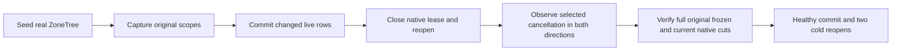

# Frozen scoped-read selected cancellation

Parent: [StorageRecovery](../StorageRecovery.md). Applicable native-cut and frozen-closure contract: [ADR-097](../../ADR/ADR-097-native-read-cut-leases.md); owner refactor: [ADR-046](../../ADR/ADR-046-storage-private-owners.md); test entry: [ADR-117](../../ADR/ADR-117-native-tunit-ci-entry.md). Applies to KL-004 and the existing native captured-read contract; no storage format, public API, clock, admission limit or dependency change.

REQ-CUT-004: A frozen forward/reverse traversal observes the original supplied cancellation token after each external observer and visitor callback. A callback selecting cancellation cannot authorize delivery of another row or return a successful early-stop result.

AC-CUT-004: Capture original exact/prefix scopes from a genuine native ZoneTree cut, mutate the live store, close the native lease and reopen the store. For each traversal direction exercise pre-cancellation, cancellation in the actual byte observer, and cancellation in the first actual visitor with both stop/continue results. Require the exact original cancelled token; pre-cancellation delivers/observes zero rows, observer cancellation delivers zero and observes one, visitor cancellation delivers/observes exactly one independently specified original row. Successful repeated frozen reads still expose the original values and absence, while full current native records/identity/position remain unchanged by every rejected traversal. Commit an independent healthy record and verify the complete current state through two cold reopens while the frozen scope remains unchanged. Observe the original operation failure before each original lease/view/fixture cleanup failure.

The authored case is source only until Main compiles and executes it. Native unit evidence is not process-kill, power-loss, Docker RF3, SDK/MCP, performance or whole-task acceptance. The storage provider is unchanged; this repairs KeyLoad's own frozen callback boundary.

