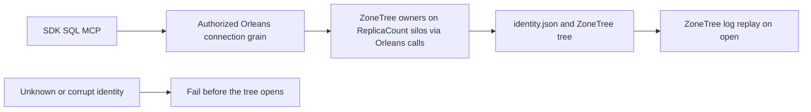

# StorageRecovery: current format

Accepted current-product contract under [ADR-116](../../ADR/ADR-116-first-release-current-format.md) and [ADR-011](../../ADR/ADR-011-current-format.md). The root owner super rule governs separately requested migration or legacy work. Qualification requires real operations against the current source and format.

## Contract and ownership

A store is `owner.lock`, `identity.json` and the ZoneTree MVCC tree under `tree/`. KeyLoad owns only the identity envelope and the records it writes through ZoneTree; ZoneTree owns the format of its tree, its write-ahead log and its backups. The store position is the record `system/position`, written in the same ZoneTree transaction as every commit. There is no KeyLoad journal, checkpoint, snapshot or archive format.

`identity.json` is a generated Orleans `StoreIdentity` payload inside a magic-tagged envelope with a SHA-256 checksum. The current reader is capability 1 (`StoreReaderContract.RuntimeJournal`) with identity magic `0x364449444C4B`, data epoch 8 and KeyCodec v1. Create fresh stores with capability 1 explicitly; a deserialized absent field must remain an unsupported capability 0, never inherit a permissive constructor default. Keep StoreIdentity Id8 unchanged. Ordinary open, recovery, backup and restore require the current identity and reject an unsupported or corrupt one before ZoneTree opens or changes the tree; startup validates the already-current physical store without modifying it. No old-format reader, automatic conversion, unmarked-store promotion, dual magic reader or runtime fallback exists. Current outcome records and locators retain their identity and integrity checks; unknown scope for a current rejected operation remains an actual current outcome.

REQ-STORAGE-IDENTITY-AUTHORITY-001 / AC-STORAGE-IDENTITY-AUTHORITY-001 implement REQ-STORAGE-021 / AC-EXECUTION-002 for the identity domain: a checksum-consistent identity must have a nonempty node and incarnation, a 32-byte signing key, a nonnegative ReadGeneration and a defined DurabilityProfile. A violation is `Corruption`; an unknown magic, epoch, codec version or capability is `FormatUnsupported`. No current test isolates the negative-read-generation and undefined-durability cases; that acceptance is open.

Replicated-cluster test preparation builds and verifies only the current server image. Its receipt binds the actual source, image digest and the Aspire-owned resources; it has no historical-image prerequisite. The current-image control must perform real SDK/MCP operations and verify state; rejected operations must leave state unchanged. CI retains the current build and every current required suite.

Current-format restore remains a real product operation with a new identity and paused dispatch ([BackupRestore](../BackupRestore.md)). Current-format crash recovery remains mandatory. SQL/client interoperability, Orleans activation migration and protocol rejection are distinct active requirements.

## Requirements, acceptance and tests

| Requirement | Measurable acceptance and verification |
|---|---|
| REQ-STORAGE-007: qualify the first-release format | AC-EXECUTION-001: real current writes, close/reopen with ZoneTree log replay, backup and restore preserve exact records, identity authority and position. `RuntimeJournalReaderLifecycleTests.Ac001BornCurrentStoreReplaysBacksUpRestoresAndContinues`, `DiskDeletionTests.DiskDeletionKeepsExactRowsAcrossTwoReopens`, `PreparedTransactionTests` and the process-recovery crash matrix. |
| REQ-STORAGE-021: strict format admission | AC-EXECUTION-002: real store opens reject an unknown identity magic, version or reader capability and a corrupt identity with typed safe errors; original files and state remain unchanged. `StoreIdentityVersionRejectionTests.UnsupportedIdentityVersionFailsBeforeTreeMutation`, `RuntimeJournalReaderFenceTests` and `MissingIdentityTests`. |
| REQ-EXECUTION-004: no migration or legacy execution | AC-EXECUTION-004: the actual AppHost recovery model starts its current runner without historical probe resources, old-source archives, old-server image preparation or prior-format environment/settings; profile loading accepts only its current contract and has no conversion command; current outcomes use only outcome and current locators. Static CI governance inventories verify removed paths, separately from functional proof. |
| REQ-EXECUTION-005: current recovery resources settle | AC-EXECUTION-005: real process kills and restart preserve one whole cut and every acknowledged commit; all owned processes/readers/resources settle and failures remain visible. Existing process-recovery and cluster shutdown cases remain mandatory. |
| REQ-EXECUTION-006: cleanup does not remove active safety | AC-EXECUTION-006: complete enabled build, formatter, analyzers and relevant unit/recovery/cluster suites pass; functional coverage retains current production contributors and excludes removed code. No manufactured coverage or acceptance closure. |
| REQ-EXECUTION-007: admit only the current physical node layout | AC-EXECUTION-007: actual owner startup rejects unknown root entries or links before initial root/lock/store mutation; complete original state and permissions remain unchanged. Known current partial layouts remain admissible, owner exclusion is retained, and removal of only the test-owned invalid input permits a healthy current write/reopen. Current process and cluster qualification remains required. |

## Rollout and rollback

No live user directory or persisted data is deleted. Rollback is a source revision, never a format downgrade or an old binary over current data. A future released-format upgrade needs separate owner direction. Frontend and new public SDK/MCP schemas are N/A: no new product operation or dependency is introduced.

## Current recovery execution model

Recovery's actual AppHost model contains only its recovery runner and has no historical-image prerequisites; the infrastructure model check is retained without replacing real process-recovery evidence. Shared recovery cleanup and file-inventory helpers are named by their actual responsibility. Actual child exit/readers/disposal, failure aggregation, owned-root cleanup, file digests and handle-release proofs stay in their current callers.

## Current identity admission

REQ-STORAGE-021 / AC-EXECUTION-002: only the current identity envelope is accepted. An unsupported magic, epoch, codec version or reader capability fails `FormatUnsupported` before the tree opens and before restore creates a destination; an invalid checksum or identity domain is `Corruption`. There are no obsolete signature constants, old-format recognition branches, alternate reader or converter. Guarded unknown-identity inputs use an arbitrary unsupported future version, not an earlier product representation, and keep real child/lock/pipe settlement.

## Current node-root admission

REQ/AC-EXECUTION-007 under ADR-116 define one strict current root inventory: optional regular `node.owner.lock` and optional non-link directories `database`, `search-indexes`, `ann-indexes`, `text-projections`, `text-online`, `derived-user-analytics` and `backups`. `PartitionRootAdmission` owns that inventory; each directory's internal contents remain with its actual owner. Valid partial prefixes after interruption are admitted. Authority is not inferred from directory presence, and index/store validation is not replaced by a server filename list.

An existing root and its entries are inspected without create, chmod, delete or provider open. Unknown entries, wrong entry kinds and links reject FormatUnsupported with a static safe detail. An absent root may be created only for fresh ownership. After exclusive node ownership, the root is inspected again before opening the stores; the first-failure/cleanup aggregation is retained. Cooperating writers use the same exclusive lock. Arbitrary concurrent external filesystem replacement is not qualified by enumeration and no such protection is advertised. A race found on the second check rejects and settles the acquired owner without deleting foreign state or claiming that a newly acquired lock never existed.

Whole PartitionHost admission flows retain sentinel bytes/modes and the absence of first-check side effects, then remove only their owned invalid input and prove current write/reopen effects. Existing index restart, backup/restore and owner-lock cases remain mandatory controls. SDK/MCP and frontend schemas are N/A: this is current physical owner admission, not a new public operation or format conversion.

## Omitted current capability inputs

REQ-STORAGE-021 and AC-EXECUTION-002: an explicit zero property or JSON omission does not prove omitted fields. `RuntimeJournalReaderFenceTests.Ac002OmittedCurrentCapabilityRejectsWithoutMutationAndRecovers` uses the actual current generated Orleans payload, verifies the required field was physically omitted by a bounded current-wire test input, and retains the current envelope magic, identity fields and recalculated valid outer checksum. No prior type, binary, historical store or alternate runtime serializer is allowed. Actual store open rejects before the tree opens, releases owned handles, preserves the complete original inventory and permits a current backup, restore and healthy write/reopen afterward.

## Disposable ANN format

REQ-ANN-GEN-001/002/005 / AC-ANN-GEN-001/002/005: the current first-release node root admits one optional owned `ann-indexes` directory, separate from canonical ZoneTree and text ownership. No canonical store format is rewritten. The ANN provider has its own generated v1 root/manifest/node/header aliases, bounded framed index file and SHA-256 checksums. There is no historical ANN reader, migration, runtime fallback, JSON persistence or rebuild hidden under Load. A source without this admitted owner path fails closed; old images are not advertised as readers of this disposable format.

Each closed generation has exactly the source/owner/consumer-generation manifest and index file under an opaque generated leaf. Exclusive root owner receipt/lock, every regular-file/directory ancestor and reparse denial, bounded count/depth/bytes, create-new stage files, Flush(true), atomic same-root publication, digest-before/after-load, obsolete-generation fences and pinned-reader retirement remain mandatory. File metadata grants no persisted role, canonical acknowledgement, read authority or outcome receipt. Projection pins/checkpoints use actual freshly authorized commands through Orleans; crash recovery verifies source/consumer authority before restore/replay. Required child-kill cuts are index write, flush, manifest write, publication and checkpoint acknowledgement, each with original child/pipe/file lock settlement and independent full canonical state/receipt/healthy oracles. Process-kill evidence is not power-loss proof.

Owning contract: Search/ManagedAnn and ADR-019. Format and provider tests alone do not satisfy the global fault, endurance, replicated-cluster, coverage and performance gates.

### multi-page staged replay ownership

Before each real nonempty page checkpoint submission the node owner persists a bounded generated-pending replay record containing the actual immutable records after that page, original admitted canonical upper cut U, exact page Through P, corpus digest of those pending arrays, and the original stable-ID empty-effects checkpoint intent. P is replay progress, never relabeled as an observed canonical source cut. Pending records cannot serve readers or replace a completed generation. Resume first validates current persisted consumer/generation and reconciles the exact original nonempty checkpoint receipt through a freshly authorized Orleans call; only after the consumer checkpoint equals P may loaded arrays resume P..U. No checkpoint ACK can precede its durable pending record. A malformed/partial pending record fails closed; load never builds missing state. Original U must remain verifiable through a fresh actual canonical view before completion; changed dependency identity, missing history, or an unavailable original upper corpus yields explicit HistoryUnavailable/rebuild-required without partial output. Publication occurs only after the complete replay arrays match that real admitted upper corpus/digest. Actual multi-page process interruption before/after checkpoint ACK and reopen/resume are mandatory proof, not inferred from serialization.

## AC-ANN-008 generated public vector page contracts

Feature-owned AnnSearchContractAliases reserves generated first-release v1
identities. ApproximateSearchRequest: Id0 Version, Id1 Search, Id2 Consumer,
Id3 IndexGeneration, Id4 RequestedMode. AnnSearchPage: Id0 Version, Id1 Documents,
Id2 Position, Id3 actual Mode, Id4 CompleteTopK, Id5 IndexGeneration,
Id6 RequestedMode. AnnPageMode has its own stable generated alias. JSON remains
public HTTP/MCP/Q1; inter-grain request/reply remains generated binary.
RequestedMode is Approximate only; the completed mode is Exact or Approximate.
The existing small-set exact plan remains bounded. An approximate
search that cannot satisfy its candidate requirement within the admitted graph
budget refuses with BudgetExceeded; it does not switch to a full exact scan.
Empty eligible search retains truthful same-cut mode/completeness. No public
corpus/candidate count, digest or maintainer authority is exposed.

This additive transport changes no PackedAnn snapshot/manifest/pending v1,
canonical storage, signed outbox/fault v2 or ordinary exact Search identity.
No migration/legacy reader, Load rebuild or hidden administration exists.
Missing/stale/corrupt generations fail closed; the central gate defaults false
until execution/replicated-cluster AC-ANN-008 qualification.

## Current-format rejection with exact repair and cold continuation

REQ-STORAGE-021 / AC-EXECUTION-002, REQ-STORAGE-007 / AC-EXECUTION-001 and AC-EXECUTION-005 under ADR-116. Each rejection case below keeps its exact typed refusal (FormatUnsupported or Corruption) and the complete original file inventory byte equality, then proves a fixture-owned repair and a complete continuation. The repair is deliberate restoration of the exact bytes the fixture captured from its own original owner; it is not compatibility, adoption or a product repair API, and it never regenerates identity, rewrites tree data, converts a version or admits unsupported bytes.

Common flow: before installing the fault, capture the actual current StoreIdentity, committed position and the identity file bytes. Strict refusal preserves the entire recursive file inventory; no recovery accepts, translates or discards the corrupt input. Only after the rejected owner has disposed is the exact captured identity restored and compared for byte equality. Reopening the same owner must show every StoreIdentity field including the current reader capability, the exact original position, the independent original literal record and the absent followup; a distinct followup commit through the same ZoneTree owner increments the position by exactly one. The continuation then creates a backup of the cold source to an independently owned sibling path and restores it through the current API with a genuinely new incarnation, signing authority and NodeId with paused dispatch; the restored rows are the original records, the position record and the dispatch-pause record. Backup files are compared before and after restore; two restored cold opens verify the complete restored identity, cut and records; the original source identity, cut and records are verified separately, because a restore cannot impersonate the original authority. Every rejected owner, source owner and restored owner settles before another same-root open or fixture deletion.

| Case | Fault and extra assertions |
|---|---|
| `RuntimeJournalReaderFenceTests.Ac002ZeroOrUnknownCapabilityRejectsWithoutFileMutation` (both capability arguments), `Ac002UnsupportedIdentityMagicRejectsWithoutChangingFiles` and `Ac002OmittedCurrentCapabilityRejectsWithoutMutationAndRecovers` | Zero/unknown reader capability, unsupported identity magic, or actual generated-field omission (no alternate signer or compatibility reader). After the same-owner repair the backup holds the original raw runtime/followup rows and the position record; the restore adds the dispatch-pause record; one independent restored followup overwrite, two restored reopens, unchanged backup bytes and an unchanged source. |
| `MissingIdentityTests.AcIs004And008MissingIdentityPreservesActualTree` | A genuine raw write, then strict missing-identity FormatUnsupported with complete recursive file/directory equality and rejected-owner lock reacquisition; only the exact captured identity bytes are restored before the common continuation. |
| `StoreIdentityVersionRejectionTests.UnsupportedIdentityVersionFailsBeforeTreeMutation` | A genuine write precedes the unsupported identity version fault; the refusal oracle is bound to the complete store inventory captured after that write, and no tree bytes change during identity repair. |

Case identities, arguments, clocks, budgets, serialized fields/aliases, production code and public routes are unchanged by these continuations; they add no promotion, new identity, adopted reader, legacy fixture or alternate format. The omitted-wire, lifecycle, process recovery and replicated-cluster controls stay mandatory, and these node-local operations do not qualify public authority or power-loss durability.

## Restore absence and cold turns

REQ-STORAGE-RESTORE-PUBLIC-COLD-001 / AC-STORAGE-RESTORE-PUBLIC-COLD-001 map REQ/AC-BACKUP-002/003/004 to a public cluster restore: the independent current DocumentReadResult(null) for an acknowledged post-backup document's absence through SDK, official MCP and both SQL CALL routes, the new owner/incarnation, paused dispatch, explicit authorized resume, old token refusal, full multi-model oracles and two sequential same-root restored-target cold turns with same-ID replay of the original fresh command. No current cluster test restores node backups through those public routes; this acceptance is open. Backup and restore cancellation is specified in [BackupRestore](../BackupRestore.md).
