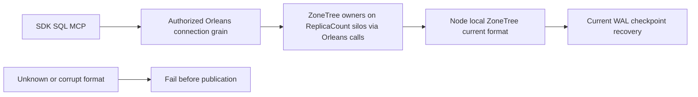

# StorageRecovery: current native format

Accepted current-product contract under [ADR-116](../../ADR/ADR-116-first-release-current-format.md). The root owner super rule governs separately requested migration or legacy work. Qualification requires real operations against the current source and format.

## Contract and ownership

Keep one current generated Orleans persistence contract over node-local ZoneTree.
Current identity epoch7, WAL4 and checkpoint5 identifiers remain exact; this
cleanup does not renumber bytes, aliases, field IDs, digests or signing purposes.
Ordinary open, replay, checkpoint install and backup/restore reject unsupported or
corrupt formats before publishing usable state. Keep atomic
journals, owner locks, ordered apply, scoped read cuts and acknowledgement from every configured copy
after durable local apply.
No old-format reader, automatic conversion or runtime fallback is supported.
New stores are born with the current required runtime-journal reader contract;
there is no unmarked-store promotion, automatic backup/marking or dual identity
magic reader. Preserve current contract value1 and serialized field IDs; missing,
zero or unknown required capabilities fail strict admission. Current outcome-v2
records and locators retain their identity and integrity checks; outcome-v1 keys,
locators and missing-field compatibility fallbacks are removed. Unknown scope
for a current rejected operation remains an actual current outcome, not legacy.

The current reader is capability1 with identity magic `0x364449444C4B`.
Create fresh stores with capability1 explicitly; a deserialized absent field must
remain an unsupported capability0, never inherit a permissive constructor default.
Keep native StoreIdentity Id8 unchanged. All production
open/write/backup/snapshot paths require the current identity. Remove the reader
publication method, automatic adoption backups and per-record legacy checks;
startup validates the already-current physical store without modifying it.
Fresh/current reopen, snapshot/backup/restore and real runtime-journal operations
must prove capability and exact state; corrupted/missing/zero/unknown capability
or magic must reject before file mutation. Use only the
current profile and centralized configuration sections, without obsolete aliases
or conversion commands.

Replicated-cluster test preparation builds and verifies only the current server
image. Its receipt binds the actual source, image digest and the Aspire-owned
resources; it has no historical-image prerequisite. The request probe captures
bounded current phase records only. Remove prior-server image producers,
preserving authorization, cancellation and joined shutdown. The current-image
control must perform real SDK/MCP operations and verify state; rejected
operations must leave state unchanged. CI retains the current build and every current required suite.

Current-format restore remains a real product operation with validated artifacts,
new incarnation and paused dispatch. Current-format crash recovery remains
mandatory. SQL/client interoperability, Orleans activation migration and native
protocol rejection are distinct active requirements; this correction does not
remove them.

## Requirements, acceptance and tests

| Requirement | Measurable acceptance and verification |
|---|---|
| REQ-STORAGE-007: qualify the first-release format | AC-NATIVE-001: real current writes, close/reopen, WAL replay, compaction and checkpoint install preserve exact records, identity authority and applied cut. Retain `RecoveryTests`, `FrameBudgetTests`, `PreparedTransactionTests` and current snapshot recovery cases. |
| REQ-STORAGE-021: strict format admission | AC-NATIVE-002: real native identity/WAL/checkpoint operations reject unknown versions, invalid checksums and complete corrupt frames with typed safe errors; original files and state remain unchanged. Retain or port the current-format rejection flows from existing storage cases without generating an old database. |
| REQ-NATIVE-004: no migration or legacy execution | AC-NATIVE-004: the actual AppHost recovery model starts its current runner without historical probe resources, old-source archives, old-server image preparation or prior-format environment/settings; profile loading accepts only its current contract and has no conversion command; native current outcomes use only outcome-v2 and current locators with no v1 fallback. Normal/scalar runners execute retained whole current flows. Static CI governance inventories verify removed paths, separately from functional proof. |
| REQ-NATIVE-005: current recovery resources settle | AC-NATIVE-005: real process kills and restart preserve one complete acknowledged cut; all owned processes/readers/resources settle and failures remain visible. Existing process-recovery, source-manifest settlement and cluster shutdown cases remain mandatory. |
| REQ-NATIVE-006: cleanup does not remove active safety | AC-NATIVE-006: complete enabled build, formatter, analyzers and relevant normal/scalar/recovery/cluster suites pass; native functional coverage retains current production contributors and excludes removed code and obsolete migration tests. No manufactured coverage or acceptance closure. |
| REQ-NATIVE-007: admit only the current physical node layout | AC-NATIVE-007: actual owner startup rejects unknown root entries or links before initial root/lock/store mutation; complete original state and permissions remain unchanged. Known current partial recovery layouts remain admissible, owner exclusion is retained, and removal of only the test-owned invalid input permits a healthy current write/reopen. Current process and cluster qualification remains required. |

## Rollout and rollback

No live user directory or persisted data is deleted. Rollback is a source checkpoint, never a format downgrade or an old binary over current data. A future released-format upgrade needs separate owner direction. Frontend and new public SDK/MCP schemas are N/A: no new product operation or dependency is introduced, and existing callers continue using current-format data. Obsolete old-format converters, readers and coordinators under StorageRecovery (Storage.ZoneTree and Server), historical preparation and migration process/image cases, and unit migration/probe cases stay removed; a safety primitive stays only with an actual current caller.

## Current recovery execution model

Recovery's actual AppHost model contains only its native recovery runner and has no historical-image prerequisites; the infrastructure model check is retained without replacing real process-recovery evidence. Shared recovery cleanup and file-inventory helpers are named by their actual responsibility. Actual child exit/readers/disposal, failure aggregation, owned-root cleanup, file digests and handle-release proofs stay in their current callers.

## Current WAL admission

REQ-STORAGE-021 / AC-NATIVE-002 in Storage.ZoneTree's current journal preflight, recovery and backup validation: only the current WAL and checkpoint signatures are accepted. An unsupported complete signature or identity version fails FormatUnsupported before provider opening, truncation, restore publication or canonical effects. Invalid current frame length/order/checksum remains Corruption; incomplete current tails retain the existing verified-prefix recovery contract. There are no obsolete signature constants, old-format recognition branches, alternate reader or converter. Current backups retain their exact cut, byte limits, checksum/manifest proof and all unchanged-source/destination rejection oracles (including the NativeBackupCutTests unsupported-header flow).

### Current native test inputs and operation boundaries

REQ-STORAGE-021 / AC-NATIVE-002 and the current BackupRestore roster requirements keep the native unknown-signature/version, length/order/checksum, exact-cut and whole restore rejection flows with no publication, unchanged input and healthy follow-up. Unknown complete signatures are FormatUnsupported. Corruption controls retain the accepted current signature and damage its actual fields or checksum; identity checksum controls retain the independently frozen current identity magic. Guarded unknown-identity fixtures use an arbitrary unsupported future version, not an earlier product representation, and keep real child/lock/pipe settlement.

The corrupt-checkpoint no-mutation oracle begins after the ordinary current store open/recovery has joined and ends before its normal provider disposal. It compares the complete retained native file inventory around the rejected install within that owner window, together with unchanged identity/cut/data and a healthy following install/backup/restore. Native open/close housekeeping must not be misattributed to the rejected operation or hidden by excluding authoritative files.

AC-NATIVE-002/006 observe that inventory with an internal read-only handle in `KeyLoad.Storage.IO`. The test controls the live owner and performs no concurrent writes during each inventory. Native no-follow/nonblocking open and retained descriptor/path identity checks reject non-regular or replaced inputs. The validated storage execution buffer setting is used, and every file's actual complete bytes are read without acquiring or releasing the owner's advisory lock. The competing-owner lock assertion and the original full inventory equality are preserved; locked WALs are not skipped and empty bytes are never substituted. This is deterministic test observation, not a coherent snapshot against concurrent writers or a production ownership bypass; production opens keep their lock contract. The complete maintenance/rejection/install/backup/restore/reopen operation runs through the Aspire-owned runner.

## Current node-root admission

REQ/AC-NATIVE-007 under ADR-116 define one strict current root inventory: optional regular `node.owner.lock` and optional non-link directories `database`, `search-indexes`, `ann-indexes`, `text-projections`, `native-text-online`, `derived-user-analytics` and `backups`. `PartitionRootAdmission` owns that inventory; each directory's internal contents remain with its actual native owner. Valid partial prefixes after interruption are admitted. Authority is not inferred from directory presence, and native snapshot/index/store validation is not replaced by a server filename list.

An existing root and its entries are inspected without create, chmod, delete or provider open. Unknown entries, wrong entry kinds and links reject FormatUnsupported with a static safe detail. An absent root may be created only for fresh ownership. After exclusive node ownership, the root is inspected again before opening the stores; the first-failure/cleanup aggregation is retained. Cooperating writers use the same exclusive lock. Arbitrary concurrent external filesystem replacement is not qualified by enumeration and no such protection is advertised. A race found on the second check rejects and settles the acquired owner without deleting foreign state or claiming that a newly acquired lock never existed.

Whole PartitionHost admission flows retain sentinel bytes/modes and the absence of first-check side effects, then remove only their owned invalid input and prove current write/reopen effects. Existing snapshot recovery, index restart, backup/restore and owner-lock cases remain mandatory controls. SDK/MCP and frontend schemas are N/A: this is current physical owner admission, not a new public operation or format conversion.

## Omitted current native capability inputs

REQ-STORAGE-021 and AC-NATIVE-002: an explicit zero property or JSON omission does not prove omitted native fields. The test uses the actual current generated Orleans payload, verifies the required field was physically omitted by a bounded current-wire test input, and retains the current envelope magic, identity fields and recalculated valid outer checksum. No prior type, binary, historical store or alternate runtime serializer is allowed. Actual store open rejects before journal/tree effects, releases owned handles, preserves the complete original inventory and permits a valid current restore and healthy write/reopen afterward. The generated codec's actual error is an unmeasured gate until this operation executes through the AppHost.

## Disposable native ANN format

REQ-ANN-GEN-001/002/005 / AC-ANN-GEN-001/002/005: the current first-release node root admits one optional owned `ann-indexes` directory, separate from canonical ZoneTree, atomic WAL, snapshots and native text ownership. No authoritative canonical file/reader epoch/WAL/checkpoint format is rewritten. The ANN provider has its own generated native v1 root/manifest/node/header aliases, bounded framed native index file and SHA-256 checksums. There is no historical ANN reader, migration, runtime fallback, JSON persistence or rebuild hidden under Load. A source without this admitted owner path fails closed; old images are not advertised as readers of this new disposable format.

Each closed generation has exactly the source/owner/consumer-generation manifest and native index file under an opaque generated leaf. Exclusive root owner receipt/lock, every regular-file/directory ancestor and reparse denial, bounded count/depth/bytes, create-new stage files, native Flush(true), atomic same-root publication, digest-before/after-load, obsolete-generation fences and pinned-reader retirement remain mandatory. File metadata grants no persisted role, canonical acknowledgement, read authority or outcome receipt. Projection pins/checkpoints use actual freshly authorized native commands through Orleans; crash recovery verifies source/consumer authority before native restore/replay. Required native child-kill cuts are index write, flush, manifest write, publication and checkpoint acknowledgement, each with original child/pipe/file lock settlement and independent full canonical state/receipt/healthy oracles. Process-kill evidence is not power-loss proof.

Owning contract: Search/ManagedAnn and ADR-019. Format and provider tests alone do not satisfy the global fault, endurance, replicated-cluster, coverage and performance gates.

### Native multi-page staged replay ownership

Before each real nonempty page checkpoint submission the node owner persists a bounded generated-native pending replay record containing the actual immutable records after that page, original admitted canonical upper cut U, exact page Through P, native corpus digest of those pending arrays, and the original stable-ID empty-effects checkpoint intent. P is replay progress, never relabeled as an observed canonical source cut. Pending records cannot serve readers or replace a completed generation. Resume first validates current persisted consumer/generation and reconciles the exact original nonempty checkpoint receipt through a freshly authorized Orleans call; only after the consumer checkpoint equals P may loaded arrays resume P..U. No checkpoint ACK can precede its durable pending record. A malformed/partial pending record fails closed; load never builds missing state. Original U must remain verifiable through a fresh actual canonical view before completion; changed dependency identity, missing history, or an unavailable original upper corpus yields explicit HistoryUnavailable/rebuild-required without partial output. Publication occurs only after the complete replay arrays match that real admitted upper corpus/digest. Actual multi-page process interruption before/after checkpoint ACK and reopen/resume are mandatory proof, not inferred from serialization.

## AC-ANN-008 generated public vector page contracts

Feature-owned AnnSearchContractAliases reserves generated first-release v1
identities. ApproximateSearchRequest: Id0 Version, Id1 Search, Id2 Consumer,
Id3 IndexGeneration, Id4 RequestedMode. AnnSearchPage: Id0 Version, Id1 Documents,
Id2 Position, Id3 actual Mode, Id4 CompleteTopK, Id5 IndexGeneration,
Id6 RequestedMode. AnnPageMode has its own stable generated alias. JSON remains
public HTTP/MCP/Q1; inter-grain request/reply remains native generated binary.
RequestedMode is Approximate only; the completed mode is Exact or Approximate.
The existing small-set exact plan remains bounded. An approximate
search that cannot satisfy its candidate requirement within the admitted graph
budget refuses with BudgetExceeded; it does not switch to a full exact scan.
Empty eligible search retains truthful same-cut mode/completeness. No public
corpus/candidate count, digest or maintainer authority is exposed.

This additive transport changes no PackedAnn snapshot/manifest/pending v1,
canonical storage, signed outbox/fault v2 or ordinary exact Search identity.
No migration/legacy reader, Load rebuild or hidden administration exists.
Missing/stale/corrupt generations fail closed; the central gate defaults false
until native/replicated-cluster AC-ANN-008 qualification.

## Current-format rejection with exact repair and cold continuation

REQ-STORAGE-021 / AC-NATIVE-002, REQ-STORAGE-007 / AC-NATIVE-001 and AC-NATIVE-005 under ADR-116 and [ADR-126](../../ADR/ADR-126-current-native-zonetree-checksums.md). Each rejection case below keeps its exact typed refusal (FormatUnsupported or Corruption) and the complete original file inventory byte equality, then proves a fixture-owned repair and a complete continuation. The repair is deliberate restoration of the exact bytes the fixture captured from its own original owner; it is not compatibility, adoption or a product repair API, and it never regenerates identity, rewrites journal/tree data, converts a version or admits unsupported bytes.

Common flow: before installing the fault, capture the actual current StoreIdentity, committed position and the identity file and journal bytes. Strict refusal preserves the entire recursive file inventory; no native recovery accepts, translates or discards the corrupt input. Only after the rejected owner (and any inspection handle) has disposed is the exact captured byte range restored and compared for byte equality. Reopening the same owner must show every StoreIdentity field including the current reader capability, the exact original position, the independent original literal record and the absent followup; a distinct followup commit through the same native ZoneTree owner increments the position by exactly one. After close/reopen the complete expected raw key/value inventory and both literal values are verified. The owner is then paused through the native SetDispatchPaused, a paused backup is created to an independently owned sibling path, and a restore through the unchanged current native API yields a genuinely new incarnation, signing authority and NodeId with paused dispatch and the exact original data plus the native pause authority record in one restore transaction. Backup files are compared before and after restore; two restored cold opens verify the complete restored identity, cut and records; the original source identity, cut and records are verified separately, because a restore cannot impersonate the original authority. Every rejected owner, inspection handle, source owner and restored owner settles before another same-root open or fixture deletion.

| Case | Fault and extra assertions |
|---|---|
| `RuntimeJournalReaderFenceTests.AcNative002ZeroOrUnknownCapabilityRejectsWithoutFileMutation` (both capability arguments), `AcNative002UnsupportedIdentityMagicRejectsWithoutChangingNativeFiles`, and the physically omitted current capability operation | Zero/unknown reader capability, unsupported identity magic, or actual native generated-field omission (no alternate signer or compatibility reader). After the same-owner repair a paused backup/VerifyBackup captures the two original raw runtime/followup rows; the restore shows dispatch paused and the exact three-row native inventory (two literal records plus the native pause record); one independent restored followup overwrite, two restored reopens, unchanged backup bytes and unchanged paused source. |
| `CurrentWalRejectionTests.CorruptCurrentCheckpointFailsWithoutChangingAnyStoreFile` | Genuine compacted current native checkpoint checksum corruption of one test-owned byte; exact Corruption; the whole original journal is restored byte-for-byte; identity is never modified. |
| `NativeMissingIdentityTests.AcIs004And008MissingIdentityPreservesActualTreeAndJournal` (false/true) | Genuine raw write and optional native compaction, then strict missing-identity FormatUnsupported with complete recursive file/directory equality and rejected-owner lock reacquisition; only the exact captured identity bytes are restored. |
| `CurrentWalRejectionTests.UnsupportedIdentityVersionFailsBeforeJournalMutation` | A genuine native write precedes the unsupported identity version 8 fault; the refusal oracle is bound to the complete journal captured after that write, and no journal bytes change during identity repair. |
| `CurrentStoragePreservationTests.CurrentMaintenanceCheckpointInstallBackupAndRestoreRetainCurrentFormat` | The local checkpoint install: all four StorageSnapshot fields bind to the expected source incarnation, Position 1, AppliedPosition 1 and three raw records. A successful InstallSnapshot keeps the source authority/cut and increments only ReadGeneration by one (native Compact does not). Restore with a fresh incarnation yields fresh NodeId/signing, the original codec/durability/current reader capability, paused dispatch and the preserved installed read generation; the restore transaction deletes last-applied and adds the paused state, so restored rows and cut equal the backup cut+1. |
| `OrleansWalCorruptionTests.AcWal003InvalidCurrentFrameOrUnsupportedSignatureLeavesFilesUnchanged` (three arguments) | Exact checksum/sequence/unsupported-signature frame, ErrorCode and current native serializer; the genuine empty current journal and identity are captured first; after restoration the same owner reopens at position zero with no records and commits the independent literal record (`CurrentWalFrameRepairContinuation`). |
| `OrleansWalCorruptionTests.AcWal003ChecksummedInvalidBinaryFrameFailsWithoutApplyingAnyMutation` (twelve arguments) | Every typed payload shape, checksummed-frame production, exact Corruption refusal, zero committed position and both absent-key assertions; the recovered owner closes before the continuation opens. No invalid payload is reinterpreted, no unknown file is truncated. |
| `UnsupportedWalHeaderTests.UnsupportedJournalMagicOnCurrentIdentityIsRejectedWithoutTruncation` | Genuine unsupported current journal magic; exact FormatUnsupported, no truncation and complete corrupt-file preservation; only the exact original journal bytes are restored. |

Case identities, arguments, clocks, budgets, serialized fields/aliases, production code and public routes are unchanged by these continuations; they add no promotion, new identity, adopted reader, legacy fixture or alternate format. The existing omitted-wire, lifecycle, snapshot, WAL rejection, process recovery and replicated-cluster controls stay mandatory, and these node-local operations do not qualify public authority or power-loss durability.

## Restore absence and cold turns

REQ-STORAGE-RESTORE-PUBLIC-COLD-001 maps existing REQ/AC-BACKUP-002/003/004 to AC-STORAGE-RESTORE-PUBLIC-COLD-001. The complete ClusterRestoreClusterTests restore scenarios require the independent current DocumentReadResult(null) for the acknowledged post-capture document's absence through SDK, official MCP and both SQL CALL routes, with a separate literal null Document assertion on each original response; decoding that named response as nullable DocumentResult is not the current wire contract.

The same restore operation retains its complete manifest/archive refusal, exact-byte repair, operator receipt, new owner/incarnation, paused dispatch, explicit authorized resume, old token refusal and full multi-model oracles, then executes two sequential same-root restored-target cold turns. Each turn uses the joined Aspire fixture, current persisted authorization and the original fresh command/receipt for same-ID replay; after joined Stop, every canonical image is compared against the single retained final cut. Restore is not rerun. The original caller token, parent deadline, bounds, source archives, initiating/cleanup failures and three original declarations are preserved. The ordinary stopped-store opening contract is a separate existing gate.

## Native archive cancellation

REQ-STORAGE-007/021 and AC-NATIVE-001/005, together with REQ/AC-BACKUP-001/002,
retain bounded archive cancellation, integrity and unpublished-destination
requirements. The current local storage entry points are CreateBackup,
VerifyBackup and Restore. They operate on the owning ZoneTree runtime
and its actual identity/WAL manifest, lengths, checksums and validated records.
They do not capture a second cluster catalog.

The internal file-copy, checksum, WAL-frame and checkpoint-record loops retain
their cancellation checks and validated byte bounds. Native filesystem calls,
Flush(true) and bounded frame decoding are synchronous and cannot be interrupted
mid-call. CreateNew, exact length/end-of-stream verification, lowercase SHA256,
unpublished staging and joined cleanup remain required. Original and cleanup
failures must both remain visible.

CurrentArchiveCancellationTests still requires adaptation to the current public
storage entry points before its four WAL-only/checkpoint-and-tail and
absent/existing-empty destination combinations can be executed. Required oracles
remain unchanged source/archive bytes and identity, no rejected target/staging
publication, exact original token where admitted, healthy same-path retry, new
paused restore identity, complete literal records and two joined cold owners.
No token propagation through an unexecuted public path is claimed here.

Before-work and deterministic mid-I/O cancellation, Linux execution, real process
recovery, Aspire SDK/MCP, power-loss and performance qualification remain distinct
open gates. Existing metadata, reader-capability, WAL/checkpoint/root no-mutation
and owned-file controls remain mandatory. No timing fake or production observer
is introduced to manufacture a cancellation witness.
