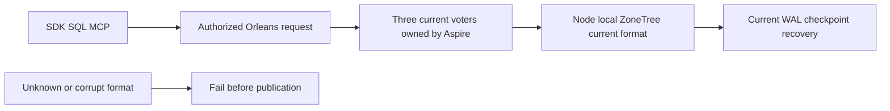

# StorageRecovery: first-release current format

Status: accepted current-product contract, 2026-10-06; implementation and
qualification pending. This is KL-043's active scope under
[ADR-116](../../ADR/ADR-116-first-release-current-format.md). The root owner
super rule governs separately requested migration or legacy work. Current
qualification requires real operations against the current source and format.

## Contract and ownership

Keep one current generated Orleans persistence contract over node-local ZoneTree.
Current identity epoch7, WAL4 and checkpoint5 identifiers remain exact; this
cleanup does not renumber bytes, aliases, field IDs, digests or signing purposes.
Ordinary open, replay, snapshot install and backup/restore reject unsupported or
corrupt formats before publishing usable state. Keep replication and atomic
journals, physical owner locks, ordered apply, scoped read cuts and RF3 barriers.
No old-format reader, automatic conversion or runtime fallback is supported.
New stores are born with the current required runtime-journal reader contract;
there is no unmarked-store promotion, automatic backup/marking or dual identity
magic reader. Preserve current contract value1 and serialized field IDs; missing,
zero or unknown required capabilities fail strict admission. Current outcome-v2
records and locators retain their identity and integrity checks; outcome-v1 keys,
locators and missing-field compatibility fallbacks are removed. Unknown scope
for a current rejected operation remains an actual current outcome, not legacy.

The current reader is capability1 with identity magic `0x364449444C4B`.
Create fresh stores with capability1 explicitly; a deserialized absent field must
remain an unsupported capability0, never inherit a permissive constructor default.
Keep native StoreIdentity Id8 and peer discovery Id7 unchanged. All production
open/write/backup/snapshot paths require the current identity. Remove the reader
publication method, automatic adoption backups and per-record legacy checks;
startup validates both already-current physical stores without modifying either.
Fresh/current reopen, snapshot/backup/restore and real runtime-journal operations
must prove capability and exact state; corrupted/missing/zero/unknown capability
or magic must reject before file mutation. The configured discovery evidence is
computed from both actual current stores, not supplied by a caller. Use only the
current profile and centralized configuration sections, without obsolete aliases
or conversion commands.

RF3 preparation builds and verifies only the current server image. Its receipt
binds the actual source, image digest and three Aspire-owned resources; it has no
historical-image prerequisite. The request probe captures bounded current phase
records only. Remove prior-server image producers and mixed-image discovery
capture, preserving real discovery admission, incompatible-capability fencing,
current physical-shard mismatch recovery, signed stale-purpose rejection,
authorization, cancellation and joined shutdown. The current-image control must
perform real SDK/MCP operations and verify state; rejected operations must leave
state unchanged. CI retains the current build and every current required suite.

Current-format restore remains a real product operation with validated artifacts,
new incarnation and paused dispatch. Current-format crash recovery remains
mandatory. SQL/client interoperability, Orleans activation migration and native
protocol rejection are distinct active requirements; this correction does not
remove them.

## Requirements, acceptance and tests

| Requirement | Measurable acceptance and verification |
|---|---|
| REQ-STORAGE-007: qualify the first-release format | AC-NATIVE-001: real current writes, close/reopen, WAL replay, compaction and checkpoint install preserve exact records, identity authority and applied cut. Retain `RecoveryTests`, `FrameBudgetTests`, `PreparedTransactionTests`, current snapshot and replica recovery cases. |
| REQ-STORAGE-021: strict format admission | AC-NATIVE-002: real native identity/WAL/checkpoint operations reject unknown versions, invalid checksums and complete corrupt frames with typed safe errors; original files and state remain unchanged. Retain or port the current-format rejection flows from existing storage cases without generating an old database. |
| REQ-STORAGE-024: incompatible peers are fenced | AC-NATIVE-003: valid current signed SDK/MCP operations succeed through actual Aspire RF3; incompatible signed purposes/capabilities cannot dispatch or alter committed state. Retain peer/request-purpose and real current RF3 caller controls. |
| REQ-NATIVE-004: no migration or legacy execution | AC-NATIVE-004: the actual AppHost recovery model starts its current runner without historical probe resources, old-source archives, old-server image preparation or prior-format environment/settings; profile loading accepts only its current contract and has no conversion command; native current outcomes use only outcome-v2 and current locators with no v1 fallback. Normal/scalar runners execute retained whole current flows. Static CI governance inventories verify removed paths, separately from functional proof. |
| REQ-NATIVE-005: current recovery resources settle | AC-NATIVE-005: real process kills and restart preserve one complete acknowledged cut; all owned processes/readers/resources settle and failures remain visible. Existing process-recovery, source-manifest settlement and RF3 shutdown cases remain mandatory. |
| REQ-NATIVE-006: cleanup does not remove active safety | AC-NATIVE-006: complete enabled build, formatter, analyzers and relevant normal/scalar/recovery/RF3 suites pass; native functional coverage retains current production contributors and excludes removed code and obsolete migration tests. No manufactured coverage or acceptance closure. |
| REQ-NATIVE-007: admit only the current physical node layout | AC-NATIVE-007: actual owner startup rejects unknown root entries or links before initial root/lock/store mutation; complete original state and permissions remain unchanged. Known current partial recovery layouts remain admissible, owner exclusion is retained, and removal of only the test-owned invalid input permits a healthy current write/reopen. Current process and RF3 qualification remains required. |

## Ordered implementation and integration

1. Root records the owner correction, requirements and ADR, and reviews exact
   consumers before releasing disjoint source scopes.
2. Production worker removes only old-format converters/readers/coordinators
   under StorageRecovery in Storage.ZoneTree, Replication and Server. Keep a
   safety primitive with an actual current caller; remove it if exclusively legacy.
3. AppHost/test worker removes historical preparation and migration process/image
   cases plus their exclusive helpers in AppHost, scripts, RecoveryTests,
   IntegrationTests and CrashHost. Shared current RF3/profile helpers remain
   until every real current consumer is preserved.
4. Unit/CLI worker removes obsolete unit migration/probe cases and exclusive
   fixtures, preserving current corruption and authorization-order operations.
   Root owns shared entry points, current-only reader/outcome/profile and prior
   KeyLoad protocol seams, public contracts, workflows,
   source/coverage inventories, policy/docs and registry joins.
5. Root reviews all guarded diffs, runs the canonical full build/format/governance,
   then actual Aspire normal/scalar/recovery/RF3 operations and Linux delivery
   gates. Source-only cleanup closes no product task.

No live user directory, persisted data or unrelated chat work is deleted.
Rollback is a source checkpoint, never a format downgrade or an old binary over
current data. A future released-format upgrade needs separate owner direction.
Frontend and new public SDK/MCP schemas are N/A: no new product operation or
dependency is introduced. Existing callers continue using current-format data.

## Current ancillary execution and owner validation

TASK-SR-CURRENT-ANCILLARY-031 removes the five exclusive prior-image scripts and
CI preparation/environment references. Recovery's actual AppHost model contains
only its native recovery runner; it has no historical-image prerequisites. Port
that infrastructure model check without replacing real process-recovery evidence.
Current shared recovery cleanup and file-inventory helpers are renamed by their
actual responsibility. Remove only the uncalled old node-settlement branch;
retain actual child exit/readers/disposal, failure aggregation, owned-root cleanup,
file digests and handle-release proofs in their current callers.

TASK-SR-CURRENT-OWNER-032 makes the existing replica membership guard mandatory
with existing hard state for every ordinary and benchmark open. Fresh stores write
both records in one atomic commit. Missing/orphan/malformed/mismatched metadata
fails before publication without adding a guard to an existing store. The guard's
current key, native alias and fields stay unchanged; decode is bounded by the
larger of the configured native collection budget and configured voter count,
so legitimate current odd production groups remain supported. Ordered voter and
incarnation validation, snapshot ownership and RF3 remain mandatory. Whole real
store create/reopen, term/vote, missing-guard rejection/no mutation and healthy
follow-up replace the exclusive marker-free production case.

The same owner task removes NodeOptions' unused discovery-timeout alias. Its peer
factory accepts only the canonical validated PeerDiscoveryOptions.ConnectTimeout.
The central pre-physical-ownership Peer.Value resolution preserves endpoint/HMAC/
replay validation and effective connect duration strictly below the replica RPC
deadline. Preserve the actual RPC/election ordering and all signing authority.
Actual configuration/owner admission flows test valid configured policy and
invalid pre-file rejection; getters are not acceptance proof. Root freezes exact
ownership, reviews guarded private packets, joins consumers and runs enabled
build/format plus Aspire whole-operation, recovery and RF3 gates.

## Current WAL admission without obsolete format inventories

TASK-SR-CURRENT-WAL-036 implements REQ-STORAGE-021 / AC-NATIVE-002 in
Storage.ZoneTree's current journal preflight, recovery and backup validation.
Only the current WAL and checkpoint signatures are accepted. An unsupported
complete signature or identity version fails FormatUnsupported before provider
opening, truncation, restore publication or canonical effects. Invalid current
frame length/order/checksum remains Corruption; incomplete current tails retain
the existing verified-prefix recovery contract. Remove obsolete signature
constants and specialized old-format recognition branches, with no alternate
reader or converter. Current backups retain their exact cut, byte limits,
checksum/manifest proof and all unchanged-source/destination rejection oracles.

The private packet owns ZoneTreePersistenceFormat.cs, ZoneTreeJournalPreflight.cs,
ZoneTreeJournalRecovery.cs, ZoneTreeBackupJournalValidation.cs and the current
NativeBackupCutTests.cs unsupported-header flow. Root joins only after full
semantic review and all base/post guards, then runs enabled canonical build,
formatting and actual Aspire current storage/backup/recovery tests. Any additional
consumer is reported before ownership expands. Source inspection closes no AC.

### Current native test inputs and operation boundaries

TASK-SR-CURRENT-FIXTURES-041 maps REQ-STORAGE-021 / AC-NATIVE-002 and the
current BackupRestore roster requirements. Remove exclusive prior-record bytes,
prior codec branches and JSON metadata representations. Keep current native
unknown-signature/version, length/order/checksum, exact-cut and whole restore
rejection flows with no publication, unchanged input and healthy follow-up.
Unknown complete signatures are FormatUnsupported. Corruption controls must
retain the accepted current signature and damage its actual fields or checksum;
identity checksum controls retain the independently frozen current identity magic.
Guarded unknown-identity fixtures use an arbitrary unsupported future version,
not an earlier product representation, and retain real child/lock/pipe settlement.

Cross-partition reverse-edge/empty-placement roster tests must seed documents
through actual authorized current Batch operations. The destination already has
its atomically registered first-write row; delivering and completing the reverse
edge, deleting the source edge and reopening must preserve the destination row
and first-seen identity. Do not insert an unregistered document as a prior-roster
positive input or promise a census/backfill. Preserve actual receiver state and
all cross-destination-effect and empty-placement assertions.

The current corrupt-snapshot no-mutation oracle begins after the ordinary current
store open/recovery has joined and ends before its normal provider disposal.
Compare the complete retained native file inventory around the rejected install
within that owner window, together with unchanged identity/cut/data and a healthy
following install/backup/restore. Native open/close housekeeping must not be
misattributed to the rejected operation or hidden by excluding authoritative files.

TASK-CURRENT-SNAPSHOT-NATIVE-FILE-067 implements this AC-NATIVE-002/006 oracle
with an internal read-only observation handle in `KeyLoad.Storage.IO`. The test
controls the live owner and performs no concurrent writes during each inventory.
Native no-follow/nonblocking open and retained descriptor/path identity checks
must reject non-regular or replaced inputs. Use the validated storage execution
buffer setting; read every file's actual complete bytes without acquiring or
releasing the owner's advisory lock. Preserve the competing-owner lock assertion
and the original full inventory equality; do not skip locked WALs or substitute
empty bytes. This is deterministic test observation, not a coherent snapshot
against concurrent writers or a production ownership bypass. Production opens
retain their existing lock contract. Root owns the API/platform join and verifies
the complete current maintenance/rejection/install/backup/restore/reopen operation
through the Aspire-owned runner after full build and formatting.

## Current node-root admission

TASK-SR-CURRENT-LAYOUT-044 implements REQ/AC-NATIVE-007 under ADR-116. Replace
specific obsolete filenames with one strict current root inventory: optional
regular `node.owner.lock` and optional non-link directories `database`, `replica`,
`snapshots`, `search-indexes` and `backups`. Their internal contents remain owned
by their existing native owners; admit valid partial prefixes after interruption.
Do not add unused names, infer authority from directory presence or recursively
replace native snapshot/index/store validation with a server filename list.

Inspect an existing root and entries without create, chmod, delete or provider
open. Unknown entries, wrong entry kinds and links reject FormatUnsupported with
a static safe detail. An absent root may be created only for fresh ownership.
After exclusive node ownership, inspect the root again before opening either
store; retain the existing first-failure/cleanup aggregation. Cooperating writers
use the same exclusive lock. Arbitrary concurrent external filesystem replacement
is not qualified by enumeration; do not advertise such protection. A race found
on the second check must reject and settle the acquired owner without deleting
foreign state or claiming that a newly acquired lock never existed.

The private worker owns only PartitionStores, a cohesive StorageRecovery root
validation helper and new real PartitionHost admission cases/fixtures. Root owns
this contract, the ADR, exact path guards, review/join and serialized native gates.
Whole flows retain sentinel bytes/modes and absence of first-check side effects,
then remove only their owned invalid input and prove current write/reopen effects.
Existing snapshot recovery, index restart, backup/restore and owner-lock cases
remain mandatory controls. SDK/MCP and frontend schemas are N/A; this is current
physical owner admission, not a new public operation or format conversion.

## Actual omitted current native capability inputs

TASK-SR-CURRENT-MISSING-043 extends REQ-STORAGE-021/024 and AC-NATIVE-002/003.
An explicit zero property or JSON omission does not prove omitted native fields.
Use the actual current generated Orleans payload, verify the required field was
physically omitted by a bounded current-wire test input, and retain the current
envelope magic, identity fields and recalculated valid outer checksum. No prior
type, binary, historical store or alternate runtime serializer is allowed.
Actual store open must reject before journal/tree effects, release owned handles,
preserve the complete original inventory and permit a valid current restore and
healthy write/reopen afterward. The generated codec's actual error remains an
unmeasured gate until this operation executes through AppHost.

For authenticated peer discovery, every cohort admission path must require the
current reader capability, including existing-catalog startup and ordinary
requests. Root review of actual native sources precedes a guarded implementation.
Real signed discovery/request/no-effects and recovered healthy SDK/MCP flows are
required; direct record construction, a fake peer or a coordinator assertion does
not qualify omitted-wire RF3 behavior. The paired-store preflight/no-mutation
contract also remains open until current native operations prove it.

## Current-reader cohort admission repair

TASK-NATIVE-CURRENT-PEER-049 maps REQ-STORAGE-024 / AC-NATIVE-003 under
ADR-116. One observation predicate requires current protocol plus reader
capability1; protocol compatibility remains a separate recorded fact. Ordinary
cohort admission, direct voter resolution and cached readiness count only voters
with that current contract and ready transport. Any observed signed non-current
capability is OwnershipLost/IncompatibleCohort, including a not-ready voter;
a current-contract but unavailable/not-ready voter retains its existing unavailable
classification. Keep configured-voter iteration, majority threshold, cache expiry,
original signing, cancellation and joined shutdown. Missing capability remains0.

Fresh native catalog bootstrap still requires every configured current voter.
An existing catalog must pass current-contract majority admission before
RuntimeJournalAdmission.Open; it does not acquire a new all-voters availability
requirement. Preserve the existing authorized catalog read, unique request grain,
startup deadline, clock and fresh-bootstrap wait. Unsupported local contract fails
strictly; only current-contract transport unavailability may remain pending.
Physical capability evidence continues to come from both validated node-local
stores, with no permissive constructor default or advertised authority override.

The worker owns only the root-guarded discovery/admission/startup paths, the
static unsupported-replica detail, supplementary signed-socket whole-operation
cases and actual RF3 positive discovery assertions. Unit endpoint controls remain
policy operations, never physical RF3 evidence; healthy current test inputs state
capability explicitly. Real SDK/MCP requests retain before-dispatch rejection,
no effects and healthy follow-up acceptance. A physically omitted-field RF3
negative requires a separate bounded server-owned native fault contract and is
still open; no fake peer, re-signing bypass or compatibility hook is admitted.
Root owns review, serial source joins, native gates and exact-source Linux proof.

## TASK-KL009-NATIVE-APPLY-SCOPE-001 (follower-owner implementation contract, 2026-10-07)

REQ-REP-APPLY-SCOPE-001 / AC-REP-APPLY-SCOPE-001 binds original KL009 to a genuine node-local canonical apply owner and real independent replica-network progress. Preserve native ZoneTree, original ordered commit/apply gates, deterministic replay, bounded admission, RF3 acknowledgements and separate authenticated request grains. This is authored acceptance infrastructure; Linux/native execution and original task closure are not claimed.

Docs-first current private-format boundary: all RequestCqrsProbe owner/arm/release/marker producers/readers select version2 and reject version1 without fallback, migration or mixed records. Original request/read phases retain exact original semantics with nullable new arm fields all null and marker EntryIndex/EntryTerm null. CanonicalJournalFlushed is Hold-only and requires complete four-scalar Partition, nonempty SourceRequestId, distinct nonempty SourceArmId and exact TargetVoter. CanonicalOutboundObserved, CanonicalIndependentAppendCompleted and CanonicalOwnerDisposed are unarmable observation-only phases. Canonical markers contain positive real entry index/term and the genuine original request actor ID. Release still addresses the exact arm/request identity. Keep original 32-arm, 400-file, 8-marker, 8192-record-byte, 1048576-aggregate-byte and depth4 ceilings, original component/principal byte bounds, hold/poll/admission/shutdown deadlines and validated configurable lower bounds. No status/receipt is invented.

Identity bridge is bounded test control, never authority: the original real BeforeSubmit Hold publishes its actual signed-voter request actor marker. While held, the fixture writes a distinct canonical arm referencing that source BeforeSubmit arm, principal, stable Batch CommandId, observed actor ID, complete partition and an explicitly observed nonleader voter. Both arms retain their original immutable bytes until joined shutdown. The actual Channel worker opens its own synchronous scope from the genuine ReplicaEntry Id/index/term and exact physical voter plus active source arm. No request ExecutionContext/AsyncLocal propagation across Channel is assumed and no synthetic actor ID is created. Actual Database.Apply retains original persisted authorization, identity/fingerprint/replay and strict clock validation; only its construction-owned native JournalFlushed FaultObserver may hold that owner. Unmatched bootstrap/recovery/job/store work has no hold and the replica store gets no callback.

Independent network evidence is produced only by actual PartitionReplicaGrainService.ExchangeAsync after peer request authentication, original readiness/admission/native endpoint validation and successful signed reply construction. Begin captures the same currently held follower owner; completion decodes only already-admitted request/result bytes and requires an accepted empty native Append, exact term and matched/next position, with prior/committed cuts covering the held genuine entry. Completion must still see that exact held scope. Failed/cancelled/rejected exchanges do not qualify. It emits one bounded presence marker, never credentials, payloads or invented counts. Actual ReplicaGrainServiceClient.InvokeAsync separately observes any external invocation originating in the explicit canonical apply scope; any such marker fails acceptance. The real native RPC boundary is used, not HTTP discovery or a replacement transport.

The leader-owned draft cannot qualify this operation: ReplicaLeader owns rounds through WaitForApplyAsync, and that waiter synchronously reads canonical LastApplied. The accepted proof therefore holds a follower, leaves leader semaphores/cancellation untouched, and avoids node Status/State calls while held (they may read LastApplied under ProtocolGate). Discovery/leader identity is captured before the hold. Original health/readiness routes remain unchanged.

Lifetime: the physical host owns bridge, real materializer worker, storage callback and DI observer. Real GrainService construction resolves the observer before accepting replica RPC, including followers without a local public request. One exact scope owns hold, origin observation and callback admission, restores its prior execution context, writes canonical-owner disposal and joins original callback lifecycle. Synchronous apply errors and scope cleanup errors both propagate, preserving original failures; no second commit, retry, lock change, cancellation clamp or timeout increase. Existing host stop cancels hold and joins callbacks/materializer before store disposal. The fixture releases both arms, joins the actual SDK operation and original request producer plus canonical owner before deleting owned controls/resources.

Whole flow: actual Aspire current-image RF3, persisted non-admin principal and document+queue scope, original SDK atomic Batch, original signed BeforeSubmit marker, native follower JournalFlushed marker carrying real entry index/term, accepted authenticated Append settlement while held, and absent canonical-origin outbound evidence. Original leader SDK receipt must be successful under unchanged deadlines. Release the exact canonical arm and join its owner; verify independent literal complete document (reference/revision/JSON/redaction/empty fields) and queue inspection metadata/body/headers through SDK and official MCP. Assert exact receipt effects and native-byte same-ID SDK/MCP replay, changed-payload conflict with unchanged public state, then distinct healthy queue continuation. This proves the full scoped public projections, not a complete raw-store image or power-loss durability.

Owned paths: Replication ClusterReplication real ApplyBatch/worker scope; Orleans ClusterReplication real GrainService incoming/outgoing transport; Server ClusterRouting existing private control codecs/lifecycle and observer composition; Server StorageRecovery physical host/native storage callback; AppHost ClusterRouting strict current owner reader; IntegrationTests ClusterRouting actual Aspire wave/probe/SDK/MCP helpers; UnitTests ClusterRouting bounded private codec-negative control. That unit codec case is supporting infrastructure, not a product coverage contributor. Root-only format/full build, genuine new census/source-image binding, focused native codec in normal/scalar, existing probe request/read/fault flows, new current-image RF3 operation and mandatory full normal/scalar/recovery/RF3 gates remain required. No numeric coverage or successful native execution is claimed. Rollback removes the same-current private diagnostics coherently; persisted database, replication/native binary/public JSON formats and authorities are unchanged.

## TASK-KL031-DISPOSABLE-NATIVE-ANN-FORMAT-001

REQ-ANN-GEN-001/002/005 / AC-ANN-GEN-001/002/005: the current first-release node root admits one optional owned `ann-indexes` directory, separate from canonical ZoneTree, atomic WAL, replication log, snapshots and native text ownership. No authoritative canonical file/reader epoch/WAL/checkpoint format is rewritten. The ANN provider has its own generated native v1 root/manifest/node/header aliases, bounded framed native index file and SHA-256 checksums. There is no historical ANN reader, migration, runtime fallback, JSON persistence or rebuild hidden under Load. A source without this admitted owner path fails closed; old images are not advertised as readers of this new disposable format.

Each closed generation has exactly the source/owner/placement/consumer-generation manifest and native index file under an opaque generated leaf. Exclusive root owner receipt/lock, every regular-file/directory ancestor and reparse denial, bounded count/depth/bytes, create-new stage files, native Flush(true), atomic same-root publication, digest-before/after-load, obsolete-generation fences and pinned-reader retirement remain mandatory. File metadata grants no persisted role, canonical acknowledgement, read authority or outcome receipt. Canonical projection pins/checkpoints remain actual signed admin operations through separate RequestGrains; crash recovery verifies source/consumer authority before native restore/replay. Required native child-kill cuts are index write, flush, manifest write, publication and canonical checkpoint acknowledgement, each with original child/pipe/file lock settlement and independent full canonical state/receipt/healthy oracles. Process-kill evidence is not power-loss proof.

Owning contract: Search/ManagedAnn and ADR-019. Source-authored format/provider tests and static ownership review do not qualify the existing global fault/endurance/RF3/coverage/performance gates.

### Native multi-page staged replay ownership
Before each real nonempty page checkpoint submission the node owner persists a bounded generated-native pending replay record containing the actual immutable records after that page, original admitted canonical upper cut U, exact page Through P, native corpus digest of those pending arrays, and the original signed empty-effects checkpoint intent. P is replay progress, never relabeled as an observed canonical source cut. Pending records cannot serve readers or replace a completed generation. Resume first validates current persisted consumer/generation and reconciles the exact original nonempty checkpoint receipt through a fresh signed child request grain; only after canonical checkpoint equals P may loaded arrays resume P..U. No checkpoint ACK can precede its durable pending record. A malformed/partial pending record fails closed; load never builds missing state. Original U must remain verifiable through a fresh actual canonical view before completion; changed dependency identity, missing history, or an unavailable original upper corpus yields explicit HistoryUnavailable/rebuild-required without partial output. Publication occurs only after the complete replay arrays match that real admitted upper corpus/digest. Actual multi-page process interruption before/after checkpoint ACK and reopen/resume are mandatory proof, not inferred from serialization or local compilation.

## AC-ANN-008 generated public vector page contracts

Feature-owned AnnSearchContractAliases reserves generated first-release v1
identities. ApproximateSearchRequest: Id0 Version, Id1 Search, Id2 Consumer,
Id3 IndexGeneration, Id4 RequestedMode. AnnSearchPage: Id0 Version, Id1 Documents,
Id2 Position, Id3 actual Mode, Id4 CompleteTopK, Id5 IndexGeneration,
Id6 RequestedMode. AnnPageMode has its own stable generated alias. JSON remains
public HTTP/MCP/Q1; inter-grain request/reply remains native generated binary.
RequestedMode is Approximate only; actual completed search may be Exact,
Approximate or ExactFallback. Empty eligible search retains truthful same-cut
mode/completeness. No public corpus/candidate count, digest or maintainer authority.

This additive transport changes no PackedAnn snapshot/manifest/pending v1,
canonical storage, signed outbox/fault v2 or ordinary exact Search identity.
No migration/legacy reader, Load rebuild or hidden administration exists.
Missing/stale/corrupt generations fail closed; the central gate defaults false
until native/RF3 AC-ANN-008 qualification. Authored source is not runtime evidence.

## TASK-KL043-CURRENT-FENCE-REPAIR-001 — exact current identity repair and cold continuation

REQ-STORAGE-021 / AC-NATIVE-002 and REQ-STORAGE-007 / AC-NATIVE-001, under ADR-116: extend existing RuntimeJournalReaderFenceTests.AcNative002ZeroOrUnknownCapabilityRejectsWithoutFileMutation (both original capability arguments) and AcNative002UnsupportedIdentityMagicRejectsWithoutChangingNativeFiles. Preserve their exact FormatUnsupported refusal and complete original file inventory byte equality. Capture actual current StoreIdentity, committed position and original identity file before changing the capability/magic. After the rejected owner has disposed, restore only those exact fixture-owned original identity bytes; require byte identity, original NodeId/incarnation/signing/durability/pause/read-generation/key-codec/format/current reader capability, exact original position and original runtime record, and absence of the followup. Commit the actual independent followup through the same native ZoneTree owner; require one exact native position increment, close/reopen, and both original/followup literal values plus unchanged full authority. No promotion, new identity, adopted reader, legacy fixture or alternate format.

Ownership: existing Unit StorageRecovery Cases/RuntimeJournalReaderFenceTests.cs and new Helpers/RuntimeJournalReaderRepairContinuation.cs only, with this feature and ADR116 append. Existing omitted-wire, lifecycle, snapshot, WAL rejection, process recovery and RF3 controls are retained. Production source, serialized fields/aliases/signatures, options/limits/timeouts, public routes, strict selectors/status/UIDs unchanged. Rollback removes this test-only continuation; immutable originals remain. Root alone joins/builds and executes native normal/scalar plus original mandatory recovery/RF3/Linux gates. This supporting node-local operation does not qualify omitted-field signed RF3 or paired-store preflight; those require their actual native boundaries and evidence. No runtime/UID/PASS claim.

# TASK-KL043-PAIRED-CURRENT-PREFLIGHT-002 — boundary proposal before implementation

REQ-STORAGE-021/024 and AC-NATIVE-002/003: CurrentFormat explicitly leaves paired-store preflight/no-mutation open. Native PartitionStores constructor admits actual node root, acquires original node.owner.lock, repeats root admission, then opens canonical completely before replica. ZoneTreeStoreInitializer.Open acquires store owner, reads actual identity, opens journal, validates prefix, opens provider, recovers/truncates valid incomplete tail and reclaims checkpoint files. RuntimeJournalStorePreparation.Prepare only checks identities after both providers open. Therefore canonical recovery effects may precede strict second-store identity refusal. This is a source-derived mechanism, not an executed failure/PASS.

## Proposed smallest owning boundary

Existing public ZoneTreeStore gains one thin void ValidateIdentityBeforeOpen(ZoneTreeStoreOptions options, IOptions<ZoneTreeStorageExecutionOptions> executionOptions), delegating a StorageRecovery-owned read-only helper. Resolve/validate SAME centrally supplied storage execution options and owner-configured incarnation/signing bytes; no fresh Options wrapper/default snapshot. Reuse actual bounded ZoneTreeIdentityFile.Read and Validate for present current identity, preserving original FormatUnsupported/Corruption/TokenInvalidated code/detail/precedence. Do not expose decoded signing bytes or a trusted capability/result. No runtime codec copy or new friend.

For absent directories, pure validation returns without creation. For an existing identity-less directory, preserve original strict fresh/partial owner semantics: only empty directory or regular zero-length canonical owner.lock may be admitted as fresh. Factor the original ownership-independent empty-directory validation from RequireEmptyOwnedDirectory rather than introducing a second inventory/validator; actual live owner-handle validation remains mandatory on real creation. Missing identity with tree/journal/foreign/tmp inputs remains original FormatUnsupported. Unknown root entries/links retain earlier PartitionRootAdmission refusal. Existing identity metadata read retains existing no-link/byte/frame/native envelope/checksum/capability guards. No repair/adoption/write/recovery/truncation/chmod/publication during this method.

PartitionStores invokes canonical then replica preflight after SAME node ownership and original second root admission, BEFORE chmod/provider opening/recovery. It supplies SAME actual per-store incarnation/signing configuration used by Open and SAME original centrally bound execution options. Reuse one feature-local store-options builder for preflight and Open; no configuration drift or new owner. Original providers still repeat native checks and acquire their original store locks. This does not promise protection against arbitrary foreign concurrent filesystem replacement. Preserve failure ledger/node ownership release and ordinary complete provider shutdown.

## Finite native whole operations

Create current canonical+replica stores using actual existing PartitionHostRecoveryFixture/HostReplicaStores (native storage/log/owner) and current production PartitionHost. Seed literal canonical data and real replica native term/log metadata, close all owners. Retain both exact identities and native positions. Append a genuinely encoded valid current successor frame only partially to canonical using existing actual native serializer/frame fixture, independently retaining complete acknowledged prefix. Change replica capability to zero/unknown or physically omit its current field using existing verified omission producer. Observe production host refusal; complete recursive pair/root inventory/bytes/modes/cuts unchanged, owner handles released. Restore ONLY exact original replica identity bytes, reopen SAME production host and require original normal canonical tail recovery, complete native replica cut/identity, real healthy command/write, close/reopen full literal values and signing/incarnation/policy authority.

Add converse canonical-invalid case with valid replica; preserve original first-store exception and no mutation of either. Cover actual current fresh/valid partial layout with existing PartitionRootAdmission and lifecycle operations, not record getters. No bogus peer/signed endpoint or RF3 claim. Omitted-native-capability signed RF3 negative remains separate OPEN: existing socket tests publish server-signed records but do not prove physically omitted field from a real current six-owner discovery producer. Any future RF3 seam needs exact original producer/MAC-bound borrowed bytes and actual native endpoint with unchanged authentication, no alternate peer/re-signing authority.

## Ownership and delivery

Potential production paths: existing Storage.ZoneTree/ZoneTreeStore.cs thin delegate; owning StorageRecovery/Storage/ZoneTreeIdentityFile.cs factored original validator; new StorageRecovery/Validation/ZoneTreeIdentityPreflight.cs; Server/StorageRecovery/Storage/PartitionStores.cs and cohesive options helper only if required. Tests: new Unit StorageRecovery Cases/PartitionPairedIdentityPreflightTests.cs and Helpers/PartitionPairedIdentityPreflightTrial.cs; existing original fixture reused. Docs CurrentFormat/ADR116 append contract before source. No KL042, connection, exception/analyzer, public protocol, serializer aliases/IDs, status/strict native UID/count changes.

Root reviews new owner API/ordering before implementation, joins guarded private packet, builds/discovers/executes native normal/scalar, full recovery and actual current-image RF3. Rollback restores source coherently and leaves actual store bytes untouched. No source-only acceptance claim.

Root approved this exact owning paired boundary after review. Final public signature: public static void ValidateIdentityBeforeOpen(ZoneTreeStoreOptions options, IOptions<ZoneTreeStorageExecutionOptions> executionOptions). Thin delegate performs no creation/provider open; Storage-owned helper resolves original central policy and invokes existing identity reader/validator. New Unit source cases exercise zero/unknown replica and zero canonical with actual valid current canonical incomplete successor, original node lock retained and whole recursive paired bytes/modes inventory. No test execution/PASS claim.

# TASK-KL043-SIGNED-NATIVE-CAPABILITY-OMISSION-002

REQ-STORAGE-021/024 → AC-NATIVE-002/003 → ADR-116. PRIVATE source implementation; fresh Linux original source/image/native UID and real SDK/official MCP Docker RF3 gates remain required.

The actual foreground credential Authenticate child is a permitted prerequisite of the original public operation. Selection requires SAME live HttpContext, original route class, actual ServerConnectionFeature.Id equal native GrainRequestContextState.ConnectionId, fresh child RequestId, Principal absent and CommandId.Empty. It borrows original cancellation and original task/connection owner. Background/no-parent/mismatched context cannot enroll. Do not add context fields, alter native cache freshness, force refresh, retry, poll or change timeouts.

In a dedicated fixture-only ephemeral protected two-RF3 profile, mount one closed private diagnostic root into the original three A voters; the other group and every ordinary profile remain unselected. Original validated RequestProbeExecutionOptions impose record/file/aggregate/JSON/text ceilings; exact private file/directory modes, regular-file/no-link admission, owner/session identities and create-only atomic Flush(true) publication remain mandatory. One arm selects source voter, target voter and SDK or official MCP route class only, never roles/credential/command authority. Original six resources, image, storage keys, persisted policies and options are unchanged.

Source callback runs after SAME native PeerSecurity.Sign before SAME Send. It records only actual nonce, server-owned HTTP trace/connection and Authenticate child IDs. Producer after successful original ValidateAsync and current native discovery serialization and before unchanged SignDiscovery may remove ONLY the actual generated field Id7 span via owning Orleans reader. Independently decode original/omitted bytes: all seven other fields equal, original capability current, omitted capability zero, actual field absent. Never copy a codec, fabricate a DTO/signature or publish raw payload/MAC.

Consumer retains unchanged VerifyDiscovery, native decode and identity validation. Its protected callback records the matching original nonce and same foreground parent/child context plus decoded zero capability. Original strict cohort admission must refuse before database command dispatch. Marker alone grants no authority/receipt or acceptance. Missing witness, cached discovery, startup refusal, background read, post-MAC mutation, observer failure or cancellation fails qualification; original errors and cleanup ledger survive.

Whole SDK and official MCP flows seed real persisted c1 credentials and complete linked native business corpus, join six processes/readers and 18 locks, retain actual original cuts, arm only the protected root, naturally cold-start the original same cohort and issue one real public command. Require causal source/producer/verified nonce witnesses, actual original refusal, no command outcome/effect and complete native/model/receipt cut allowing only proven native membership entries. Join original caller and six owners; preserve bounded original witness bytes under fixture-owned qualification artifacts, disarm exact own controls, restart SAME root/image/ports/keys and execute SAME original command successfully. Verify independent literal result, full seed SDK/MCP/Q1 reads, native original receipt and cold replay. No delayed/retried original claim or missing-marker promotion.

Ownership: Replication Identity protected handler composition; Orleans ClusterReplication Discovery borrowed callback chain; Server ClusterReplication Serialization/Execution/Validation/Configuration/Transport; existing Server ClusterRouting hosting/ClientApi configuration composition; AppHost ClusterRouting closed profile; IntegrationTests StorageRecovery Cases/Helpers/Assertions/Configuration/Contracts with original TwoRf3 wave borrowed lifecycle. No shared connection implementation, format persistence, aliases/Ids, strict task selection/status/UID/count changes. Root alone joins/builds/runs/Git. Rollback removes the coherently enrolled test profile/borrowed hooks; persisted bytes and ordinary signing behavior remain unchanged.

The actual existing OrleansNodeRequestExecutor executes EnsureCompatibleCohortAsync on the original call-local Authenticate prerequisite before invoking the same server-owned ConnectionGrain. ADR-125 governs this flow; no new activation, connection implementation, context field or authentication assertion is added. The outgoing source witness deliberately has null ProducerVoter and null RuntimeJournalReaderContract. Only the original authenticated target serialization/Id7 omission and original native consumer decode can populate the actual target/zero fields. Unselected callbacks perform bounded read-only peeks without taking the publication lock; only the exact selected native source/nonce acquires the original publication lock and complete immutable-owner inventory.

Automated source identities (not native UIDs): NativeCapabilityOmissionRf3Tests.ForegroundSdkOrOfficialMcpOmittedCapabilityRefusesThenSameOwnerRepairAndColdReplay(false), and the same method(true). Both retain the complete original linked seed and original blob receipts, exact native no-effects cut, same command repair/healthy SDK + official MCP + both Q1 routes, and cold same-receipt replay. No movement scope/strict selector or count is changed.

Joined failure cleanup retains the original diagnostic root and database roots and attempts the same bounded native inventory/copy under the original captured caller token. An already cancelled token or failed copy is an explicit cleanup failure, retained alongside the original failure; there is no replacement cleanup deadline, silent diagnostic success or root deletion. The successful repair path copies exact private owner/witness inventory into fixture-owned artifacts/qualification before deleting only its saved immutable controls and exclusive zero-length publication lock. The unchanged private snapshot/replication corpus is never exported with credentials. Natural cached discovery, missing causal witnesses and non-Windows mode/lock failures remain failed setup/qualification gates.

## TASK-KL043-CURRENT-CHECKPOINT-REPAIR-003 — actual corruption to exact repair and restored cold authority

REQ-STORAGE-007/021 → AC-NATIVE-001/002 → ADR-116/126. Extend the SAME zero-argument CurrentWalRejectionTests.CorruptCurrentCheckpointFailsWithoutChangingAnyStoreFile; no new case/Args/UID or product format. Retain genuine compacted current native checkpoint checksum corruption, exact Corruption and complete original refused file inventory unchanged. Capture actual original current identity, committed position and whole original journal before corrupting only the test-owned byte. Only after the rejected owner settles, restore those exact original journal bytes and verify byte equality; no conversion, repair API, adoption, alternative checksum or mutation of identity.

Reopen SAME original owner, verify every StoreIdentity field including current reader capability, exact original cut and independent literal key/value, absent followup; commit distinct literal followup with exact one-position increment. Close/reopen and compare complete expected native raw key/value inventory and both literal values. Pause through actual existing native SetDispatchPaused, capture actual backup cut, and CreateBackup to an independently owned sibling fixture path. Restore through unchanged current native API with genuinely new incarnation and signing authority, new NodeId, paused dispatch and exact original data plus the existing native pause authority record/one restore transaction. Compare complete backup files before/after restore. Close/reopen restored owner and verify complete actual restored identity, exact restored cut, literal original/followup and unchanged complete restored records. Original source identity/cut remain separately verified; restore cannot impersonate original authority.

Ownership: existing Unit StorageRecovery Cases/CurrentWalRejectionTests.cs and new cohesive Helpers/CurrentCheckpointRepairContinuation.cs, plus CurrentFormat and ADR116 additive appendix before C#. No production/schema/alias/IDs/default/limit/clock/policy/dispatcher or public routes change. Original strict refusal assertions stay. Fixture-owned paths/owners dispose before deletion; ordinary native50 remains. Existing paired preflight, omitted signed capability, process recovery and RF3 flows are independent mandatory gates; this native store operation does not qualify their public/RF3 authority or power-loss durability.

Verify candidate isolated build/native preview and SAME original normal/scalar case plus original CurrentStoragePreservationTests and current NativeChecksumProfileRecoveryTests four-child flows; retain source/DLL/PDB/package and original TRX identities. Delivered exact-source Linux full recovery/RF3 gates stay OPEN. Rollback removes only this test continuation, preserves immutable original failed evidence and current product bytes. Authentic059 recovery289 passed and has no current-format storage failure; this is a source-proven missing repair/continuation oracle, not a claim about an old runtime cause.

### TASK-KL043-CURRENT-MISSING-IDENTITY-REPAIR-004 — original identity repair and complete continuation

REQ-STORAGE-007/021 → AC-NATIVE-001/002 → ADR-116/126. The existing `NativeMissingIdentityTests.AcIs004And008MissingIdentityPreservesActualTreeAndJournal(false/true)` operations retain the genuine raw write and optional native compaction, strict missing-identity `FormatUnsupported` refusal, complete recursive file/directory equality, and actual rejected-owner lock reacquisition and disposal. After those original assertions settle, the fixture restores only the exact original identity bytes captured from its own original owner; it does not regenerate identity, rewrite journal/tree data, adopt foreign files, or introduce compatibility behavior.

The repaired same-root owner retains its exact original identity, reader contract, position and literal record; a distinct native write then proves healthy operation. The shared complete continuation checks every literal source/restored row, source cold reopen, paused backup, complete unchanged backup files, actual new restore identity/incarnation/signing authority, two restored cold opens and a final original-source reopen. The checkpoint repair caller preserves its original journal repair and delegates to the same unchanged continuation. Original case names, both arguments, native selection counts, quotas, cancellation and defaults remain unchanged.

Ownership/join: this test-only four-path successor follows the immutable checkpoint-repair4 proposed helper and both appended documents; its missing-identity case preimage is the current native source. All rejected owner/inspection handles settle before repair, and every source/restored owner settles before fixture deletion. Source scope is Unit StorageRecovery Cases/NativeMissingIdentityTests and Helpers/CurrentCheckpointRepairContinuation, CurrentFormat and ADR-116. Rollback removes only this appended test stage; production formats and APIs are unchanged.

Required evidence: original two arguments in normal/scalar TUnit against one frozen private image; integrated delivered-source compiler/analyzers and full Linux normal/scalar/process recovery, plus existing signed-capability public RF3 remain qualification gates. Local native-store operation evidence does not close whole KL-043 or RF3.

### TASK-KL043-CURRENT-VERSION-REPAIR-005 — unknown-version refusal over actual retained data

REQ-STORAGE-021/007 → AC-NATIVE-002/001 → ADR-116/126. Extend the original zero-argument `CurrentWalRejectionTests.UnsupportedIdentityVersionFailsBeforeJournalMutation` with a genuine original native write before its unchanged unsupported identity version 8 fault. Capture the current actual identity, committed position and complete original identity bytes from that same owner. Preserve the exact `FormatUnsupported` refusal and every original recursive file byte assertion. After the rejected owner settles, restore only those fixture-owned original identity bytes and assert exact byte equality; never rewrite journal/tree, construct replacement authority, convert a version or admit unsupported bytes.

Use the existing unchanged complete current continuation: exact original identity/reader capability/cut and literal record, absent followup, actual distinct write with one-position increment, original source cold/full inventory, genuine paused backup with complete file preservation, native new-incarnation restore, two restored cold opens with full literal records and actual authority, then original source reread. The helper prerequisite is TASK-KL043-CURRENT-MISSING-IDENTITY-REPAIR-004; append these documents after its exact postimages. Existing checksum and missing-identity cases, all original case/Args/UID/counts, production code/format/aliases/IDs/defaults/quotas/clock/auth remain unchanged.

Owned paths are Unit StorageRecovery Cases/CurrentWalRejectionTests and append-only CurrentFormat/ADR-116. Every actual open settles before repair or fixture deletion. Rollback removes only this test continuation and appendix. Required evidence is same frozen-image normal/scalar original full operation and companion refusal controls; integrated delivered-source build/formatter/analyzers and exact Linux recovery/public signed SDK/MCP RF3 remain OPEN, as does whole KL-043.

The retained-journal refusal oracle is bound to the complete actual original journal captured after the genuine write, not the former empty-store journal. No journal bytes are modified during identity repair.

### TASK-KL043-CURRENT-SNAPSHOT-AUTHORITY-006 — complete install and restored cold authority

REQ-STORAGE-007/021 → AC-NATIVE-001/002 → ADR-116/126. Strengthen the SAME zero-argument CurrentStoragePreservationTests.CurrentMaintenanceCheckpointInstallBackupAndRestoreRetainCurrentFormat, retaining its actual snapshot corruption/Corruption/full original source-file inventory and original literal point reads. Bind all four original StorageSnapshot fields to independently expected source incarnation, Position1, AppliedPosition1 and three raw records. Actual successful InstallSnapshot retains source authority/cut and increments only original ReadGeneration by1; native Compact does not increment it. Verify every current identity field and complete source raw rows, including original last-applied1.

Retain actual paused CreateBackup and compare complete recursive backup files before and after restore/healthy/cold. Restore through existing native API with a genuinely fresh chosen incarnation; require fresh NodeId/signing, original codec/durability/current reader capability, paused dispatch and preserved installed read generation. The native restore authority transaction deletes last-applied and adds paused state: require independent complete restored rows and exact backup cut+1. After original restored owner closes, commit a distinct literal native row through the same restored owner and require one-position increment. Two separate subsequent restored cold opens preserve full returned fresh authority and all exact literal rows; original source cold opens preserve source identity/cut/full rows. No dropped extra records or self-derived business oracle.

This test-only four-path successor follows version-repair3 exact appended docs, preserving all prior stages. Scope: existing Unit StorageRecovery Cases/CurrentStoragePreservationTests, new cohesive Assertions/CurrentSnapshotAuthorityAssertions, CurrentFormat and ADR-116. Source snapshot/backup/restored paths remain original independently owned siblings. Every actual open settles before another same-root open or fixture deletion. No product format/public/schema/alias/field/default/quota/clock/authority change, no migration/adoption, and no KL035 replica snapshot/tail implementation changes. Rollback removes only these added assertions and appendix.

Required evidence: private native compiler and full original normal/scalar companion operations on frozen source/images. Full integrated build/formatter/analyzers and original Linux current recovery plus signed SDK/official MCP RF3 remain OPEN; no power-loss, production or whole KL-043 qualification is inferred.

### TASK-KL043-CURRENT-FRAME-REPAIR-007 — strict native frame refusal and exact owned repair

REQ-STORAGE-021 / AC-NATIVE-002 and REQ-STORAGE-007 / AC-NATIVE-001, AC-NATIVE-005: the original three `OrleansWalCorruptionTests.AcWal003InvalidCurrentFrameOrUnsupportedSignatureLeavesFilesUnchanged` arguments retain their exact checksum/sequence/unsupported-signature frame, ErrorCode, current native serializer and case identity. Before fault installation the fixture captures its genuine empty current journal and complete identity. Strict refusal preserves the entire recursive file inventory; no native recovery accepts, translates or discards the corrupt frame. Only after the failed owner has disposed does the fixture restore the exact captured journal bytes and require the original identity bytes unchanged. The same current owner must reopen at position zero with no records, commit the independently literal original record, and continue through `CurrentCheckpointRepairContinuation.RequireCurrentAsync`: literal followup, complete raw rows, source cold, immutable backup, new restored identity, two restored cold opens and unchanged original source authority. This is fixture-owned repair of deliberately damaged bytes, not compatibility or a product repair API.

Ownership: existing StorageRecovery Cases file plus feature Helpers/CurrentWalFrameRepairContinuation.cs; existing native Storage APIs and earlier continuation are borrowed unchanged. No production/schema/alias/ID/format/default/budget/clock/timeout change. Rollback removes this additive test continuation and appendix only. Required evidence: exact guarded independent reconstruction, original three argument discovery, whole corruption/current-format normal and scalar operations, integrated Linux recovery and signed-capability SDK/official MCP RF3. Local source/build/test evidence does not close whole KL043 or the Linux/RF3 gates.

### TASK-KL043-CURRENT-PAYLOAD-REPAIR-008 — typed invalid binary payload whole-operation continuation

REQ-STORAGE-021 / AC-NATIVE-002 and REQ-STORAGE-007 / AC-NATIVE-001, AC-NATIVE-005: extend only the twelve original `OrleansWalCorruptionTests.AcWal003ChecksummedInvalidBinaryFrameFailsWithoutApplyingAnyMutation` arguments. Preserve every original typed payload shape, native serializer, checksummed-frame production, exact Corruption refusal, zero committed position and both original absent-key assertions. Capture the actual current empty journal and identity before fixture fault installation, require every recursive corrupt file unchanged on refusal, then restore only the captured journal bytes after the failed owner disposes. The existing recovered owner must close before the new continuation opens. Require original identity bytes unchanged; reuse CurrentWalFrameRepairContinuation.RequireCurrentAsync for a complete empty-record read, same-authority literal healthy native commit and the original full source/cold/backup/new-incarnation/two restored-cold model oracles. This does not reinterpret or recover any invalid payload, truncate an unknown original file, change the serialized format, or add an adoption path.

Owned source: existing StorageRecovery Cases/OrleansWalCorruptionTests.cs and Helpers/CurrentWalFrameRepairContinuation.cs. Existing 3-argument frame repair continues to write captured bytes then delegates the extracted current-open continuation; its body from actual current store open onward remains exact. No product/API/alias/Id/Args/count/clock/quota/default changes. Dependency is immutable TASK-KL043-CURRENT-FRAME-REPAIR-007. Rollback removes this additive continuation and documentation; strict negative native guards remain. Evidence requires original full corruption/current-format normal/scalar operations and exact source/PE/PDB coherence. Integrated Linux recovery and signed-capability SDK/official MCP Docker RF3, whole-task acceptance and current-source discovery remain OPEN.

### TASK-KL043-CAPABILITY-LOCAL-ADMISSION-009 — exact original public operation selection

REQ-STORAGE-024 / AC-NATIVE-003, AC-NATIVE-006 and ADR-117: allow only the existing native method `NativeCapabilityOmissionRf3Tests.ForegroundSdkOrOfficialMcpOmittedCapabilityRefusesThenSameOwnerRepairAndColdReplay` in the local-development fresh RF3 image selector. Its original false/true caller arguments, source/image/PDB/config identity and private fixture-owned Aspire startup/operations/join are unchanged. Both real SDK and official MCP operations must still prove original signed omitted Id7 refusal, full unchanged native authority/model cut (only independently validated original membership progress permitted), exact owned fault repair after all18 owner locks join, real healthy commit/exact receipt/document on all four routes, same-volume cold replay and full models. No marker or CLI selection alone qualifies it. Signed wrong-purpose RF3 remains a separate OPEN gate; current native purpose controls do not provide this public credit.

Only the exact method filter is added to existing native Node and C# selectors. Keep all GitHub provenance and ambient-image rejection, coverage/profile separation, native50 ordinary admission, heavy1 physical fixture ownership, receipt/digest/copy verification and all prior filters byte semantics. Reject class/method wildcards, prefixes, mixed filters and trailing whitespace. Extend the existing full Node CLI operation regression and preserve every old rejection; no fabricated native UID, catalog/status/count change, new image authority, timeout/health/membership/topology change. A fresh private producer image and actual copied PE/PDB/source hashes are required; same original native discovery must return both actual typed booleans. macOS before-start listener refusal is retained failure, not permission to alter Linux topology or qualification. Native RF3 executes only after heavy owner settlement and actual listener prerequisites.

Ownership: scripts/Features/TestInfrastructure/run-tests.mjs; Integration ClusterReplication/Helpers/LocalRf3ImageSelection.cs; Unit TestInfrastructure Cases/NativeTUnitSelectionTests.cs and Processes/NativeTestSelectionProcess.cs; new feature Helpers/NativeCapabilitySelectionProgram.cs factors only the new bounded CLI regression program to retain original process-owner200 limit. Existing actual signer/verification/discovery source remains unchanged. Rollback removes the single admission and supporting program/assertions. Root joins guarded append documentation and source; integrated Linux original discovery/full SDK+MCP RF3 and whole KL043 remain OPEN.

### TASK-KL043-CAPABILITY-LOCAL-IMAGE-OWNER-010 — original public fixture image ownership

REQ-STORAGE-024 / AC-NATIVE-003, AC-NATIVE-006 and ADR-117: the original capability trial must own the existing LocalRf3ImageTestSession selected by the exact admitted method, pass its verified selection into the same original TwoRf3MembershipWave, and dispose/join that session after the original seed and six-owner wave. Without selection the existing wave demands genuine GitHub receipt/source provenance; local CLI admission cannot fabricate it. This finite test-fixture repair borrows the established session API and actual image verification/build/preparation resource owner. Null remains the unchanged genuine GitHub path.

StartIfSelectedAsync uses the original linked caller/deadline token; no new timeout, clock, topology, caller authority or image fallback. The exact same preparation session remains alive through both original SDK/MCP Boolean operations and all owned stops/restarts. Every initiating/seed/wave/image cleanup failure remains in the original ServerFailureObserver ledger. Remove the image only when the actual returned wave cleanup succeeds; otherwise join preparation output/tasks and retain the image. Do not infer successful shutdown from a startup exception or missing wave. All original original-signer Id7 omission, causal marker, full unchanged native authority/model cut, exact fault repair after18 locks, receipt/business/cold assertions and Args remain byte-identical.

Ownership: StorageRecovery/Helpers/NativeCapabilityOmissionRf3Trial.cs and the narrow ClusterRouting/Helpers/TwoRf3MembershipWave.StartNativeCapabilityOmissionAsync parameter; no ordinary profile or production source change. Rollback removes only this borrowed local session wiring. Required evidence: exact private producer/source/DLL/PDB/copies, native discovery Boolean False/True, full original SDK/MCP fixture-owned Docker/Aspire execution and joined cleanup; delivered Linux and wrong-purpose RF3 remain OPEN.

# TASK-KL043-CAPABILITY-LOCAL-PROFILE-011

REQ-STORAGE-024 / AC-NATIVE-003,006 and ADR117: R120 preserved two original pre-node profile refusals. This successor admits only the existing protected native capability omission profile through the existing typed development image path. It does not convert a config image digest to RuntimeContainerImage/registry authority or synthesize GitHub identity.

Before source: TwoRf3QueryProbe keeps its original immutable runtime branch exactly; a separate local branch requires NativeDiscoveryOmission settings, no runtime image, the already validated ephemeral TwoRf3/remote-document/remote-query/protected-document/probe configuration, and the genuine LocalDevelopmentContainerImage. It calls existing RequestCqrsProbeProfile.ReadLocal, retaining original roots/session/mode validation. NativeDiscoveryOmissionProfile.Create accepts this exclusive local image shape only for its already closed selected profile; absent/mixed image inputs refuse. Ordinary local protected profiles without capability omission still refuse.

Negative enrollment controls precede code: absent omission selection, absent remote-query permission, absent protected-document selection, incomplete local image envelope, mixed ambient GitHub/local provenance and altered source/image identity must continue to refuse. Existing native selection five controls already cover ambient and selector refusal. A new whole AppHost model operation will prove exact valid protected enrollment, then omitted required configuration refusal, preserving every original file/resource-model byte. Model controls do not claim image existence, signer omission, or database operation qualification.

Actual operation gates: fresh LocalRf3ImageTestSession and original linked cancellation own preparation; existing LocalRf3ImageIdentity verifies original receipt/source/invocation/config image before startup and all six actual started containers after startup. Preserve original bool false/true SDK/MCP cases, full causal foreground witness, original omission MAC, all native no-effect cuts/18 joined locks/exact repair, four-route healthy operation, receipt replay and cold full models. R120 remains 2FAIL; no marker/admission/build discovery alone earns runtime credit. Native runtime/GitHub branch and canonical Linux provenance unchanged.

Ancestry: image-owner5 R1 remains immutable; source successor preserves its Trial/Wave ownership bytes. Main Stage50 already joined selector/WAL appendages; final docs compose against fresh main with R1 ownership append explicitly recorded, never blind refresh. Isolated owning AppHost full production build and Integration discovery must precede seal; root integrated Linux whole operation remains OPEN. Rollback removes only this narrow development enrollment while retaining all original evidence and protected runtime branch.

## TASK-KL043-CURRENT-CAPABILITY-REPAIR-COLD-012

REQ-STORAGE-007/021/024 → AC-NATIVE-001/002/003 → ADR-116. Extend only the original RuntimeJournalReaderFenceTests zero/unknown (two original arguments), physically omitted current capability and unsupported magic operations. Retain original FormatUnsupported and complete refused inventory byte equality. The omitted input uses actual native generated-field omission; no alternate signer or compatibility reader. Capture original full StoreIdentity and actual committed position before corruption, restore only exact fixture-owned identity bytes after rejected owner disposal, then require complete original authority/cut, independent original record and absent followup before the genuine healthy write.

After the original same-owner cold repair, capture genuine paused backup/VerifyBackup, exact original two raw runtime/followup rows and original native cut. Restore with a genuinely new incarnation/node/signing identity and current capability; require dispatch paused and exact three-row native inventory (two original literal records plus native system pause). Make one independent restored followup overwrite, close/reopen twice, check complete restored identity/cut/literal records, complete backup file bytes unchanged and original paused source identity/cut/records unchanged. Original case identities/Args, clocks, budgets, format/aliases and production remain unchanged. No new public fault/signing/inspection API, migration or compatibility path.

Implementation ownership: original Cases/RuntimeJournalReaderFenceTests.cs; original Helpers/RuntimeJournalReaderRepairContinuation.cs; new Helpers/RuntimeJournalReaderRepairBackupContinuation.cs, all Unit StorageRecovery. First source docs/ADR, then guarded private overlay/build/native existing preview and new-file receipt, canonical original class normal/scalar; root integration and authentic Linux/SDK/MCP/RF3/recovery remain mandatory. This native owner operation is supporting coverage; signed wrong-purpose/public capability qualification remains OPEN. Rollback removes only added continuation, preserving actual original failures, immutable source proposals and every original refusal oracle.

## TASK-KL043-CURRENT-HEADER-REPAIR-COLD-013

REQ-STORAGE-007/021 → AC-NATIVE-001/002 → ADR-116. Preserve the SAME zero-argument UnsupportedWalHeaderTests.UnsupportedJournalMagicOnCurrentIdentityIsRejectedWithoutTruncation, genuine unsupported current journal magic, exact FormatUnsupported, no truncation and complete corrupt-file preservation. Capture the actual original current StoreIdentity, journal and identity bytes before corrupting only the test-owned journal. After failed open disposal, restore only those exact original journal bytes and invoke existing CurrentWalFrameRepairContinuation: exact identity/capability/empty cut; independent literal healthy commit; same-authority cold followup; full paused backup; new node/incarnation/signing authority; two restored cold opens and complete source/backup inventories unchanged.

No new production API/codec, legacy/migration, signing seam, Args/UID/count, clocks/defaults/budgets or alternate provider. Original failure remains required before repair. Ownership is only the original StorageRecovery Unit case plus this Feature/ADR appendix. Ordered documentation dependency is immutable TASK-KL043-CURRENT-CAPABILITY-REPAIR-COLD-012; source code depends on already joined CurrentWalFrameRepairContinuation. Private native preview, existing owner compile, canonical original method normal/scalar and related current-frame flows are development evidence; integrated Linux/full recovery/public signed capability and wrong-purpose RF3 gates remain OPEN. Rollback removes only the appended continuation, preserving the original no-truncation refusal.

## TASK-KL043-CAPABILITY-STAGE-EVIDENCE-014 — original operation failure attribution

REQ-STORAGE-007/021 → AC-NATIVE-001/002 → ADR-116. The SAME original capability SDK/MCP Boolean case retains its original deadline, caller cancellation, six-owner startup, persisted authority, omission/no-effects, repair and cold healthy oracles. Its fixture records a closed original operation stage before existing awaits. On failure, one immutable bounded diagnostic is saved before cleanup, containing only the stage, selected route, actual cancellation flags and original exception types/native codes/stacks through the existing bounded privacy formatter. A distinct terminal diagnostic retains the complete original initiating/cleanup ledger after all original owned disposal awaits. Save failures append to that same ledger; no failure or missing marker becomes success. No extra readiness/query/poll/clock/default/budget/product telemetry work.

Ownership: existing StorageRecovery Helpers/NativeCapabilityOmissionRf3Trial.cs and feature Diagnostics/NativeCapabilityOperationFailureEvidence.cs; existing ClusterFailureReceipts/BoundedDiagnosticLog/RemoteTransferStartupFailureLines are borrowed unchanged. The broad SeedCreate stage is not an internal registration cause; stage evidence does not qualify omitted capability or prove the old R139 cause. Original SDK first R139 cancellation remains retained and unattributed. Native private compile and original-method current-source execution are development gates; full exact-source Linux/public capability/wrong-purpose gates remain OPEN. Rollback removes only these diagnostic assignments/helper and appendages.

R139's original MCP stack places failure inside WaveStart before it returns; retain that exact bounded fact separately from the unknown originating await. Enroll only this case's existing RemoteTransferStartupCallbacks.Failed before original startup disposal to capture the actual initiating exception once. An optional call-local test phase setter assigns closed constants before the original startup awaits; ordinary factories carry null and allocate no diagnostic callback. Original source/target/membership readiness, image checks, original token/deadline, returned Task and all cleanup ownership remain unchanged. No new resource, read, wait, retry, schema, purpose or product telemetry. The observer original CreateNew is attempted once; an outer failure cannot overwrite/retry it. Existing callback Join has no owned resources in this synchronous evidence-only fixture and is not a success/disposal witness.

## TASK-KL043-SIGNED-PURPOSE-015 protected issuer/receiver operation

REQ-NATIVE-PURPOSE-015: use only the original genuine current request issuer and receiver. The borrowed nonserialized observer is protected fixture ownership, selected one-shot by actual original foreground command/route/persisted subject and original cancellation. It cannot replace trusted roles, native signing or routing. Original scope is validated before the same single native Sign. Only Purpose is replaceable; all other original envelope fields and exact payload bytes remain unchanged.

AC-NATIVE-PURPOSE-015: receiver performs the existing full native MAC and typed decode, then the unchanged scope check must refuse. The observer is called only for the actual KeyLoadException scope refusal AFTER successful native verification; it independently compares every original immutable field and exact payload digest with issuer evidence and requires only fixed unsupported Purpose plus exact TokenInvalidated. MAC/alias/expiry/body/ID/identity mismatch never emits qualifying witness. Original guard failure plus observer failure remain aggregated, no replacement.

Implementation order: docs CurrentFormat + ADR116 first; internal interface Features/ClusterRouting/Contracts/IGrainRequestPurposeObserver; feature-local GrainRequestPurposeObservation owns pre-sign replacement and rejected scope ledger; original codec exposes only an internal init-only nullable borrowed observer, calls observation after original ValidateScope and before same Sign; original payload verification delegates to scope observation after actual database.Verify. No new aliases/Ids/enums/public surfaces. Ordinary null path retains all exact signing/verification bytes and checks, no observation allocation/IO/work.

Protected Server owner stays within already admitted NativeDiscoveryOmission fixture profile and original private mounted root/options/lock/quota/inventory, with three distinct bounded purpose arm/issued/rejected JSON files. It uses actual HTTP PrincipalItem/ServerConnectionFeature/route/original RequestAborted, SAME original foreground command ID; never invent Authenticate parent or connection context. Actual receiver compares original source-issued fingerprint and complete original fields; only native payload SHA digest is written, never payload/token/signature/credential. Issuer/receiver facts do not authorize a request. Original stop/drain disposes native codec borrowing before owner/root deletion; failures retain owner. Existing omission case and witnesses remain independent.

Supporting full native connection operation will prove real command refusal before any routed effect, whole canonical bytes/position unchanged, exact repair then same connection healthy command/receipt replay, close/drain and cold native records. Genuine six-owner SDK false/MCP true variant additionally requires full pre-cut/no-effect/repair/current auth/Q1/all6 state/two cold/native receipt and cleanup. Existing public routes, original Args/IDs/12min/default50, configured bounds and native Graph permissions unchanged. Linux RF3 remains OPEN until actual original cases execute. Heavy1 currently root-owned; no launch here.

Rollback removes only added borrowed observation/profile files and purpose cases, keeping original guards and original R139 failures. Root sole live join/build/qualification. READY6 immutable; no invented UID/PASS. Constructor/registration/shared files guarded against current native predecessors; docs explicit additive union.

TASK-KL043-SIGNED-PURPOSE-015 exact-cut refinement: The owning codec captures its original clock exactly ONCE per scope validation and passes the SAME incarnation/evaluatedAt/maximumFuture into the SAME pure GrainRequestScope.Validate. Only the MAC-verified path borrows its internal PurposeObserver. On actual KeyLoadException the observer receives this nonserialized cut and reuses the SAME native pure validator with only the known original Purpose restored; expiry/unknown alias/shape/subject/incarnation cannot qualify. No additional clock/IO/read/current policy or guard order change. Ordinary null path still executes only the original validator. This supersedes R1 receiver field-only causal observation; R1 immutable, not joined.

### TASK-KL043-SIGNED-PURPOSE-PUBLIC-016

REQ-NATIVE-PURPOSE-PUBLIC-016 / AC-NATIVE-PURPOSE-PUBLIC-016: separate protected one-shot foreground SDK/MCP purpose arm borrows original validated pre-sign/single Sign and actual MAC/decode/same-cut receiver observation. Exact original metadata and payload digest, restored-original-Purpose native scope success, full all-six no-effects, joined exact repair/current-auth/receipt/model/Q1/two-cold are mandatory. Original omission profile/Args/fields remain independent. No public/persisted schema/IDs/defaults/limits/time change or token/body export. Local supporting controls do not qualify public/Linux RF3; original R139 failures retained. Owner roles: ClusterReplication Contracts/Serialization/Execution and original codec composition, StorageRecovery fixture/callers/full healthy oracle. Root ordered join follows TASK015 producer/receiver; rollback removes purpose-only inventory/observer/cases.

Selected source and MAC-verified receiver also decode the SAME original native CommandRequest and require exact inner/outer original CommandId before purpose witness; no payload/token export or dispatch. Decode/type/body mismatch is failed qualification.

### TASK-KL043-PURPOSE-LOCAL-017

REQ-LOCAL-PURPOSE-017 / AC-LOCAL-PURPOSE-017: native local image admission adds only exact method /*/*/NativeSignedPurposeRf3Tests/ForegroundSdkOrOfficialMcpSignedPurposeRefusesThenExactRepairReplayAndTwoColdCuts. Original native CLI five-suite selection/args/default50, four near-match refusals and full ambient GitHub/receipt/coverage/benchmark/wrong-suite negative matrix stay mandatory. Same typed immutable local image/source/session/invocation/six-started image checks and heavy1 joined cleanup; no wildcard/UID or GitHub authority change. Local supporting/metadata proof does not qualify actual public/Linux RF3. Ordered source prerequisite TASK016 public profile; root main join guarded, rollback removes only new exact selector/control.

## TASK-KL043-SNAPSHOT-FENCE-018: original snapshot authority refusal and same-owner cold continuation

REQ-STORAGE-007/021/024 and AC-NATIVE-001/002/003: deepen the SAME original CheckpointTests.ReplicaInstallReplacesOldKeysPreservesNodeIdentityAndRejectsStaleScope operation. Preserve genuine native install, exact stale OwnershipLost and foreign-incarnation TokenInvalidated. Both rejected original calls must retain complete recursive owner files, full current identity/reader capability, exact committed position, original snapshot bytes and independent installed rows. After actual original target/outsider disposal, require the same target identity and literal two-row cut; perform one healthy literal commit, close, and require two same-root cold opens with complete three-row data and obsolete-key absence. Feature-local CurrentSnapshotFenceAssertions and CurrentSnapshotFenceContinuation own the oracle. No production format, authority, API, IDs, Args, quotas, clock or deadline change; rollback is source-only. Canonical normal/scalar existing-method operations are development evidence; full current Linux/process/RF3 and whole KL043 acceptance remain required.

## TASK-KL043-PURPOSE-FIXTURE-019: complete exact method admission

REQ-STORAGE-024 and AC-NATIVE-003/006: canonical CLI method admission is not the fixture image owner admission. Add exactly the public17 signed-purpose whole-method filter to existing LocalRf3ImageSelection.ReadNativeArgumentsIfSelected alongside every unchanged current capability/retained/null-service method. Preserve exact native argument shape/order/enabled value, bounds, ambient coverage/GitHub/local provenance refusals and null ordinary path. Existing public17 SDK/MCP bool whole flows and local7 full CLI positive/negative controls remain the regression; no synthetic identity or getter case, wildcard, image authority conversion, default or clock change. Actual immutable local image/six-owner public body and delivered Linux qualification remain OPEN until original execution.

## TASK-KL043-PURPOSE-UNIT-CENSUS-020: original operation contributor admission

REQ-STORAGE-024 and AC-NATIVE-003/006: enroll only the actual native NativeSignedPurposeOperationTests.OriginalSignedPurposeRefusesBeforeRoutingThenSameOwnerRepairReplayAndTwoColdCuts whole operation as a functional contributor after fresh complete normal/scalar discovery and independently source-bound PE/PDB observation. The operation owns genuine original signed-envelope refusal, exact same-cut causal witness, persisted owner/result/receipt repair, healthy continuation and two real same-root cold opens; no property, getter, load or metadata-only case receives contributor credit. Preserve every existing functional and required control instance, its classification and original refusal evidence. Add the single discovered case to exactly one existing functional group, retain the five groups and all exclusion controls, refresh only actual source digests/native ranges, then run the unchanged strict full-census validator. Native UID/display/span/count come from the original current assembly, never source-argument arithmetic or private stale images. Ordinary native parallelism stays50; discovery is not execution, numerical coverage, public/Linux RF3, or whole KL043 acceptance. Root owns the finite JSON enrollment and native reconciliation; rollback removes only this new contributor/group entry, without deleting original observations or relaxing validation.
