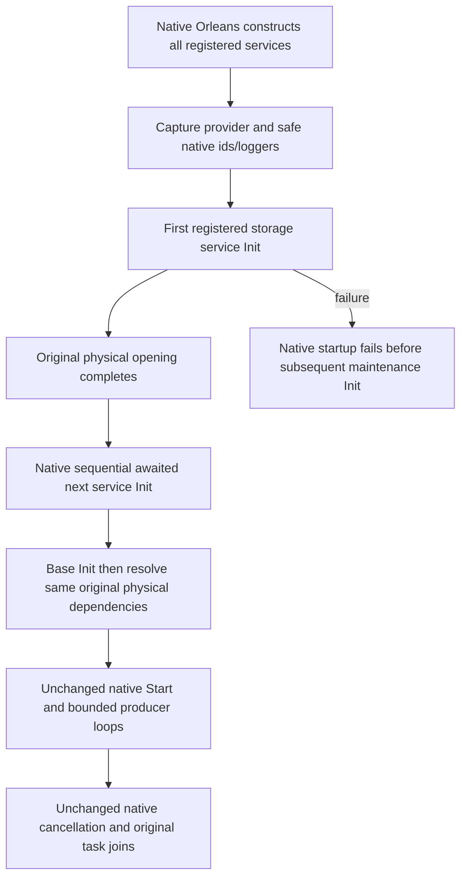
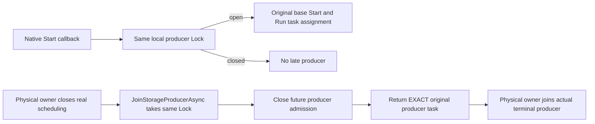

# Deferred native maintenance service dependencies

REQ-PHOST-MAINTENANCE-001 / [ADR-136](../../ADR/ADR-136-native-orleans-partition-ownership.md) / KL-008 and KL-018: Orleans eagerly constructs all registered native GrainServices before the sequential awaited Init loop. RecurringDueGrainService, SampleChunkGrainService and AnnProjectionGrainService constructors capture only native identity/silo/loggers and the actual silo provider. Constructor resolution must not borrow an unpublished DatabaseEngine or ReplicaConsensus and must not open physical files.

AC-PHOST-MAINTENANCE-001: the product registers the real storage GrainService FIRST. Native Silo.CreateGrainServices awaits RegisterGrainService for each registered service, which awaits that service's queued Init. Therefore a successful storage Init completes the one original opening before a subsequent maintenance Init runs. Each maintenance Init awaits its existing base initialization, then resolves the SAME existing database/consensus/factory/clock/options/runtime admission dependencies from the same provider. The three maintenance constructors and Init methods have no publication-interface dependency, custom wait, completed-task stand-in, alternate opening, fallback, scheduler, timer or provider.

AC-PHOST-MAINTENANCE-002: the original StartInBackground base-start, RunAsync invocation and original task assignment sequence is preserved inside the added same-lock producer fence described below. Original Stop, Run, leader/read barriers, discovery, signed coordinator dispatch, poll/cadence, creator reauthorization, task joins and helper/error bodies remain byte-identical. If storage Init fails, native sequential startup stops before maintenance Init. Before successful Init the original nullable producer remains absent; Stop preserves its original base-only path. Public service interfaces, grain identities, registration and serialization contracts do not change.

The pinned native ordering is [Orleans v10.4.0 Silo.CreateGrainServices/RegisterGrainService](https://github.com/dotnet/orleans/blob/v10.4.0/src/Orleans.Runtime/Silo/Silo.cs#L210-L227). The native prerequisite is explicit storage-FIRST product registration, not an assumed order between separately subscribed lifecycle callbacks. Server-side GrainServices which initialize through other same-stage callbacks retain the actual original publication contract under their separate ownership.

This conditional stage does not claim native Orleans startup, RF3 admission or full joined-shutdown qualification. Root's lower physical-close gate remains HOLD pending its complete request/derived-producer closure revision; this packet does not make native borrowers safe by itself. C owns genuine native service startup/partial-start/close tests. B's separate immutable application-owner Unit family covers direct native file/canonical lifetime. Main alone chooses coherent adoption and executes compiler, native Unit, recovery and RF3 gates. No SourceN review counts as runtime acceptance.

## Physical close producer fence and borrowed consensus

REQ-PHOST-MAINTENANCE-003 / AC-PHOST-MAINTENANCE-003: each of these same three actual GrainServices has one local Lock protecting the entire original StartInBackground synchronous prefix, RunAsync invocation and original task assignment. JoinStorageProducerAsync takes that SAME lock, closes future producer admission and returns the EXACT existing loop/producer task. It never calls Stop, creates a proxy task, starts work, cancels a different owner, resets a deadline or replaces native scheduling. Task.CompletedTask is used only for a never-started producer under the closed fence, including a subsequent native Start callback which must not start a late loop. Original Stop, Run and their helper bodies remain byte-identical.

REQ-PHOST-MAINTENANCE-004 / AC-PHOST-MAINTENANCE-004: ReplicaConsensus is an application-owned IAsyncDisposable. Each deferred Init obtains the SAME borrowed instance by invoking the actual Func<ReplicaConsensus> alias, avoiding a second raw disposable DI capture. DatabaseEngine is not IDisposable. RuntimeJournalAdmission is independently native-DI-created by AddSingleton<RuntimeJournalAdmission>, so its direct resolution remains the original native owner's lifetime. Native factory/clock/options dependencies remain unchanged. No wrapper or duplicate resource is added.

The physical-close integrator must first close actual scheduling/request admission through its owning APIs and join the original producers; JoinStorageProducerAsync alone does not cancel a running producer or prove node work has drained. Root's strengthened lower-close gate and companion4's exact Func alias composition remain separately mandatory future dependencies. Standalone B Unit owners with no native node do not qualify live native borrower closure.

