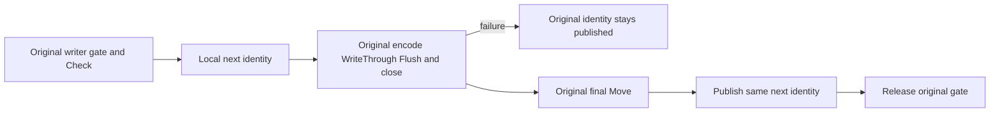

# Durable dispatch identity publication

Canonical [StorageRecovery](../StorageRecovery.md), applicable [ADR-046](../../ADR/ADR-046-storage-private-owners.md) and [ADR-116](../../ADR/ADR-116-first-release-current-format.md). This is the existing IAtomicStore.SetDispatchPaused identity-file operation, not the separate persisted system dispatch command or public authorization contract.

REQ-IDENTITY-PUBLISH-001: Under the original writer gate and runtime.Check, compute the requested StoreIdentity without publishing it. Invoke the SAME identity writer with unchanged IdentityBufferBytes, generated envelope/checksum, WriteThrough temporary stream, synchronous Flush(true), joined stream disposal and final File.Move(overwrite). Publish runtime.Identity only after this original writer returns successfully. Preserve original errors and release the same gate.

AC-IDENTITY-PUBLISH-001: BOTH pause and resume directions must fail on a genuine fixture-owned identity.json.tmp DIRECTORY. Require the actual UnauthorizedAccessException, exact pre-operation live identity and original identity bytes, full literal committed key/value and position. Remove only that owned blocking directory; the same requested operation then succeeds with independently expected identity and file bytes. Commit one real fresh canonical row and verify the complete two-row literal cut.

AC-IDENTITY-PUBLISH-002: Dispose original owner and reopen the same root twice. Both opens require the full original identity with only the requested DispatchPaused bit changed, the complete independently expected original+fresh rows in order and exact position2. Each body, original store close and fixture cleanup is separately retained by existing ServerFailureObserver; no new timeouts, fake provider/tasks or syscall injection.

Actual writer boundary: temporary FileStream is disposed before File.Move, and no further code/cleanup follows the move within Write. This correction addresses the deterministic pre-Move directory failure; it does not claim arbitrary filesystem rename failure disambiguation, power-loss atomicity or post-Move fault qualification, and adds no speculative poison/reset. Existing checkpoint generation poison/error behavior is separate and unchanged here. Existing format, read generation, ownership, journals and public wire operations remain unchanged.

Tests are genuine store/filesystem operation regressions; Linux execution and storage/recovery/replicated-cluster qualification are separate gates. UI/SDK/MCP N/A for this private storage stage.
