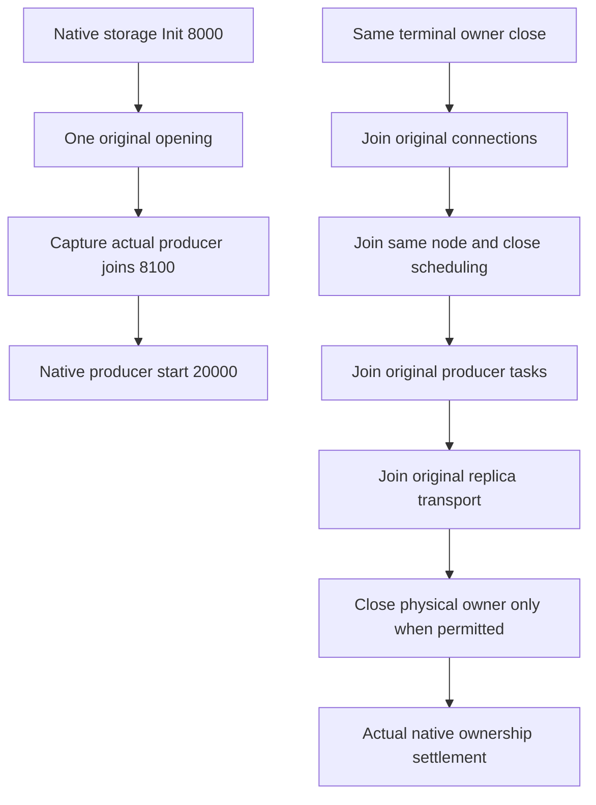

# Silo-local physical storage lifetime

Implements the physical-publication portion of [ADR-136](../../ADR/ADR-136-native-orleans-partition-ownership.md) and existing KL-008/018. Prepared source does not qualify runtime execution.

REQ-STORAGE-NATIVE-OWNER-001: the original awaited storage Grain Service `Init` calls the same memoized `PartitionHostApplicationOwner.OpenAsync`. The original native telemetry initializer runs immediately before physical opening; the superseded application preopen helper is deleted. Constructors do not borrow unpublished storage. The publication contract exposes the original `Opening` task. Waiting callers may cancel their own wait without canceling acquisition. Native registration is explicitly storage first: Orleans constructs its service collection, then sequentially awaits each initialization.

REQ-STORAGE-NATIVE-PRODUCERS-001: at `AfterRuntimeGrainServices` (8100), capture bound join methods of the three actual recurring, chunk and ANN services already constructed and initialized at native 8000. This precedes their native Active start at 20000. Capture neither opens storage nor starts producers. Each join closes the same lock used by its synchronous start prefix and actual task publication, then returns its original task. Completion without an original task means no producer started under that closed fence. A failed start before 8100 cannot have reached native Active.

REQ-STORAGE-NATIVE-CLOSE-001: one memoized terminal application-owner close observes original opening, closes and joins its captured connection registry, stops the same node to close actual journal scheduling admission and join node borrowers, fences and joins all three original producer tasks, joins the retained original replica transport, and only then disposes physical storage. A failed or unknown connection, node, producer or transport join denies physical close and retains root ownership. Request-frame count alone cannot grant release. The late callback at `RuntimeStorageServices - 1` (5999), after the native 6000 replica drain, delegates to this same terminal owner. It does not repeat a different close sequence. Generic DI fallback enforces the same gate. Original opening is observed even when borrower permission is denied. Close memoization yields before acquiring external locks to avoid owner/node lock inversion.

The complete unified-host batch must join its captured administration, graph, model, movement, jobs and request owners in their native shutdown sequence. A canceled wait, proxy disposal, or same-stage callback order does not establish settlement. The real PartitionHost retains its transfer-verifier and ordered protocol/apply/log/store joins. Cleanup never resolves services or starts a new runtime. Native maintenance Run/Stop bodies and signed replica RPC methods remain unchanged.

REQ-STORAGE-NATIVE-DI-001: remove DI aliases returning borrowed disposable physical children. Native `Func<T>` accessors capture the same actual object once when first resolved after publication and return it without later provider lookup or `Borrow`. Genuinely DI-created native owners retain ordinary ownership. The application owner and publication interface alias the same guarded idempotent owner. Optional trailing node, connection-registry and transport arguments preserve standalone physical-owner units without those native borrowers; production DI supplies the same inert registered instances.

`Opening`, `Closing`, `StorageProducerJoins` and `CanReleaseRoot` expose original tasks and actual ownership settlement. A faulted outer partial-start close may contain the original native Silo Stop rejection while the physical owner is actually released; tests must preserve and verify that original failure explicitly. Neither a completed task nor expected startup failure proves native silo termination.

AC-STORAGE-NATIVE-OWNER-001 covers genuine original owner acquisition/close, canonical records, lock refusal and same-root reopen. AC-STORAGE-NATIVE-OWNER-002 covers actual native publication followed by a genuine later-start OS lock failure, exact original failure retention and same-root signed healthy/read/replay/two-cold continuation. Additional generic-DI regressions cover direct production application disposal after partial startup and after actual native producers start. These native component cases do not replace official SDK/MCP, process-recovery or Aspire Docker RF3 Linux gates. Compiler, analyzer, discovery and runtime qualification remain open.

