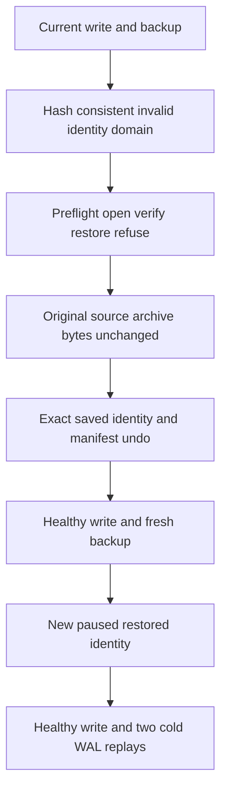

# Current identity authority domain admission

REQ-STORAGE-IDENTITY-AUTHORITY-001 / AC-STORAGE-IDENTITY-AUTHORITY-001 implement
REQ-STORAGE-021 / AC-EXECUTION-002 under [ADR-116](../../ADR/ADR-116-first-release-current-format.md).
A hash-consistent current identity must have nonnegative ReadGeneration and a
defined DurabilityProfile. Unknown enum values are corruption; existing defined
profiles remain supported. No format, field ID, alias, capability or version changes.

The existing MetadataFormatTests identity test retains all thirteen original
argument names and behavior, adding NegativeReadGeneration and UndefinedDurability.
Those two arguments own a real current source, actual WAL commit and backup.
They change only the identity payload and matching checksums, then invoke
public identity preflight, actual owner open, VerifyBackup and Restore. Each must
return the owning Corruption detail before source/archive byte mutation or target
publication. Complete bounded source/archive files and staging absence are checked.
Only exact saved identity and manifest bytes are restored after refused owners join.

The same source retains its full identity/cut/data, performs a fresh literal execution
write and produces another real verified archive. Actual restore yields new identity
and paused dispatch. A fresh restored write and two further source/restored
cold WAL owners verify full literal records, positions and every identity field.
These are raw storage operations, not acknowledged database command replay or cluster.

Every owner body and disposal failure is retained. Failed disposal retains
its actual owner reference; any failure retains the test root and prevents further
opening. Root deletion is admitted only after the entire operation and owned closes
succeed. No unconditional MetadataBackupFixture disposal is used in the two new paths.

Docker/Aspire SDK/MCP, Linux and process/power-loss qualification are separate
gates retained by [CurrentFormat](CurrentFormat.md).

Constructor refusal is observed separately from disposal: a returned owner always
fails the refusal oracle, closes exactly once, and remains referenced if close
fails. Original/post-undo cut reads use that same explicit owner lifetime. No
disposal exception can stand in for constructor refusal; all independent file
oracles still run before a combined failure blocks rollback and reopening.
