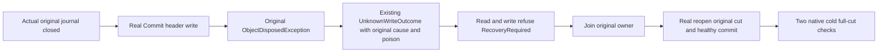

# Original journal publication failure

Canonical [StorageRecovery](../StorageRecovery.md), applies [ADR-003](../../ADR/ADR-003-durability-ack-barrier.md), [ADR-046](../../ADR/ADR-046-storage-private-owners.md), and [ADR-116](../../ADR/ADR-116-first-release-current-format.md). Implements the prior Root-frozen journal original-cause requirements.

REQ-JOURNAL-CAUSE-001: Keep the existing UnknownWriteOutcome code/detail, poison transition, header/payload synchronous writes and Flush(true), ordered apply/position and gate/error telemetry. Retain the actual exception caught by Publish beneath the existing typed failure using the existing Errors.Fail(code, detail, cause); never manufacture a provider or outcome.

AC-JOURNAL-CAUSE-001: Acquire the actual native ZoneTreeStoreRuntime with resolved original options and its actual facade. The existing fixture has genuinely committed the independent original key/value at position1; verify it before failing. Dispose the SAME original runtime.Journal FileStream, and attempt one real Commit. The first actual header Write must produce the actual ObjectDisposedException beneath exact UnknownWriteOutcome. Identity, original identity file, journal bytes and local position remain unchanged. Original owner is poisoned; both subsequent Read and Commit reject exact RecoveryRequired before their delegates run.

AC-JOURNAL-CAUSE-002: Join original poisoned owner disposal and protect any acquired runtime if facade construction fails. Reopen the SAME root, require complete original identity, full single literal row and position1, then genuinely commit the independently specified healthy second row. Full literal ordered2rows, position2 and complete identity must survive original healthy close and two additional native same-root reopens. Observe body, each original owner close, pending runtime and fixture cleanup separately with the existing ordered ServerFailureObserver.

This is a real owned native handle failure, not a power-loss/IO hardware/RF3/SDK/MCP claim. The test neither installs a fake provider nor replaces the journal field or adds a hook/timer. Existing Runtime constructor and FailedOpen cleanup findings remain separate; no synthetic dual failure is introduced. Root alone integrates tracked source and qualifies compiler/style/Linux full original storage/recovery/RF3. All execution/whole-task gates remain OPEN.
