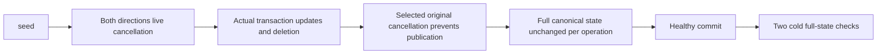

# Live and staged range selected cancellation

Owning [StorageRecovery](../StorageRecovery.md), [ADR-046](../../ADR/ADR-046-storage-private-owners.md), [ADR-097](../../ADR/ADR-097-read-cut-leases.md), [ADR-117](../../ADR/ADR-117-tunit-ci-entry.md). Distinct from frozen captured-view cancellation: this owns only live ZoneTreeRangeReader and ZoneTreeRangeWork.

REQ-LIVE-RANGE-CANCEL-001: Every original byte observer and borrowed-record visitor selecting cancellation must be followed by the original token check before the next delivery or successful stopped-by-visitor result. Preserve original gate, execution/staged merge ordering, limit/lookahead, inclusive work accounting and synchronous iterator disposal. No timeout reset, provider injection, persisted format or cancellation platform.

AC-LIVE-RANGE-CANCEL-001: Seed actual rows. Exercise live and genuine staged transaction forward/reverse range calls with pre-cancellation, baseline observer cancellation, visitor cancellation with both stop and continue. Also select cancellation at the actual staged work observer AFTER baseline charge: it must observe two work entries and deliver zero, unlike old code's staged delivery. Baseline observer is an already-correct control, not a claimed defect. Visitor stop must throw the exact supplied cancelled token rather than old successful stop. Independently verify the first delivered original/staged literal row, complete unchanged canonical rows/identity/position after EACH rejected operation, and rollback of staged writes including an out-of-range point deletion. Then publish a real healthy command and verify the full state through two genuine same-root cold opens.

No fabricated error or task; no performance, power-loss or full-task qualification claim follows, and the Linux/process/replicated-cluster/coverage gates are separate.
