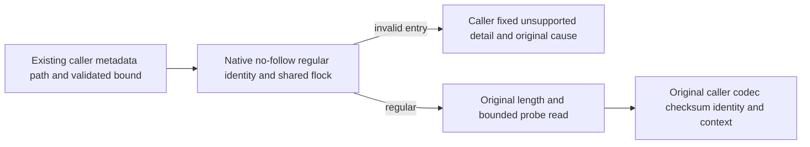

# Native regular-file metadata reader

Canonical [StorageRecovery](../StorageRecovery.md), sharing the existing [BackupRestore](../BackupRestore.md) metadata consumer contract. Applies [ADR-046](../../ADR/ADR-046-storage-private-owners.md) and [ADR-116](../../ADR/ADR-116-first-release-current-format.md).

REQ-METADATA-ENTRY-001: Generic ZoneTreeMetadataFile.Read must open existing metadata through the actual native no-follow, nonblocking, retained regular-file identity primitive using the same validated streamBufferBytes, FileAccess.Read and FileShare.Read. No create/truncate, new ABI/provider, new byte limit, runtime fallback or checksum/context bypass.

REQ-METADATA-ENTRY-002: Preserve both original length checks, maximumBytes+one-probe allocation/read and exact caller-specific oversize FormatUnsupported detail. Preserve existing callers' missing-file/directory domain-code mappings, current codec/version/checksum and full identity/manifest/context checks. The existing native errno2 factory uses FileNotFoundException for missing paths; arbitrary direct generic missing-ancestor BCL subclass parity is not claimed. Current identity callers have validated existing store roots, while backup/catalog/slot prior attribute checks or original missing-path catches retain their domain refusal. Map only own IO invalid-entry FormatUnsupported to the caller's unsupportedDetail, retaining its actual original cause. Unsupported native capability and changed-entry Corruption propagate unchanged. Native shared flock may deny a genuinely exclusively held metadata file; this matches the intended original read-sharing contract, and does not open any owner lock/journal as observation.

AC-METADATA-ENTRY-001: In a real seeded fixture, replace only identity.json with an actual FIFO and invoke the existing genuine CrashHost inspector. It must return fixed FormatUnsupported with original child/reader/outer-owner settlement. Parent never opens/reads FIFO content. Same entry's native identity/mode and directory names remain exact; repair the original identity file, compare every original store byte, then require two genuine child cold opens and normal full identity/value/position reopen. Existing process deadline/kill/join is unchanged, so old blocking Read cannot hang the parent indefinitely.

AC-METADATA-ENTRY-002: A symlink to the fixture's actual hidden valid native identity must also refuse. Old code follows it and can accept identical identity; this is a distinct actual-old-code-failing control without manufactured payload/provider. Target bytes stay exact; no race is fabricated. Exact original identity repair gives the same full healthy continuation.

AC-METADATA-ENTRY-003: A genuine regular native identity read at its actual byte length succeeds with exact bytes; one-under bound refuses with exact original FormatUnsupported/detail; a missing existing metadata path remains FileNotFound and is never created. No mutation; same original cold continuation. Existing malformed/checksum/version/catalog/source-slot tests remain mandatory, not newly qualified by source conservation.

Six current call sites are preserved: Identity.Read; BackupRestoreFiles.ReadManifest and ReadAndVerifyIdentityFile; CatalogBackupMetadataFile.ReadVerified and ManifestDigest; RestoreSlotAdmissionOwner.Read. Metadata writers finish private CreateNew/tmp write+flush before these reads. Journal copy/validation, snapshot/checkpoint I/O and raw observations are outside this patch.

Dependency: selected R107 restore-slot owner's IO-owned OfflineNativeErrors.IsInvalidEntry predicate. Do not silently overwrite its other factory predicates; Main composes exact current IO body. No dependency on R106 Name override or its new tests. SourceN only; native/compiler/format/Linux original recovery and full BackupRestore qualification OPEN. UI/SDK/MCP N/A: private node-local metadata admission. No original failed-open cleanup masking claim.
