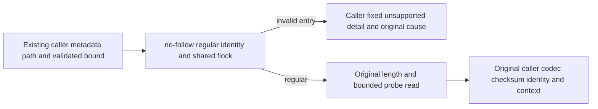

# regular-file metadata reader

Canonical [StorageRecovery](../StorageRecovery.md); [BackupRestore](../BackupRestore.md) restore reads the backed-up identity through the same reader. Applies [ADR-046](../../ADR/ADR-046-storage-private-owners.md) and [ADR-116](../../ADR/ADR-116-first-release-current-format.md).

REQ-METADATA-ENTRY-001: Generic ZoneTreeMetadataFile.Read must open existing metadata through the actual no-follow, nonblocking, retained regular-file identity primitive using the same validated streamBufferBytes, FileAccess.Read and FileShare.Read. No create/truncate, new ABI/provider, new byte limit, runtime fallback or checksum/context bypass.

REQ-METADATA-ENTRY-002: Preserve both original length checks, maximumBytes+one-probe allocation/read and exact caller-specific oversize FormatUnsupported detail. Preserve the identity caller's missing-file/directory domain-code mapping and current codec/version/checksum and full identity checks. The existing errno2 factory uses FileNotFoundException for missing paths; arbitrary direct generic missing-ancestor BCL subclass parity is not claimed. Store startup has validated the existing store root before the read; restore reads the backed-up identity before it creates the destination. Map only own IO invalid-entry FormatUnsupported to the caller's unsupportedDetail, retaining its actual original cause. Unsupported capability and changed-entry Corruption propagate unchanged. shared flock may deny a genuinely exclusively held metadata file; this matches the intended original read-sharing contract, and does not open any owner lock as observation.

AC-METADATA-ENTRY-001: In a real seeded fixture, replace only identity.json with an actual FIFO and invoke the existing genuine RecoveryProcess inspector. It must return fixed FormatUnsupported with original child/reader/outer-owner settlement. Parent never opens/reads FIFO content. Same entry's identity/mode and directory names remain exact; repair the original identity file, compare every original store byte, then require two genuine child cold opens and normal full identity/value/position reopen. Existing process deadline/kill/join is unchanged, so old blocking Read cannot hang the parent indefinitely.

AC-METADATA-ENTRY-002: A symlink to the fixture's actual hidden valid identity must also refuse. Old code follows it and can accept identical identity; this is a distinct actual-old-code-failing control without manufactured payload/provider. Target bytes stay exact; no race is fabricated. Exact original identity repair gives the same full healthy continuation.

AC-METADATA-ENTRY-003: A genuine regular identity read at its actual byte length succeeds with exact bytes; one-under bound refuses with exact original FormatUnsupported/detail; a missing existing metadata path remains FileNotFound and is never created. No mutation; same original cold continuation. Existing malformed/checksum/version tests remain mandatory, not newly qualified by source conservation.

The one current call site is `ZoneTreeIdentityFile.Read`, used by store startup and by restore for the backed-up identity. The identity writer finishes its private temporary write and flush before replacing the file. ZoneTree tree and backup I/O and raw observations are outside this contract.

Dependency: the IO-owned OfflineErrors.IsInvalidEntry predicate; its other factory predicates are not overwritten. Linux recovery and full BackupRestore qualification are separate gates. UI/SDK/MCP N/A: private node-local metadata admission. No failed-open cleanup masking claim.
