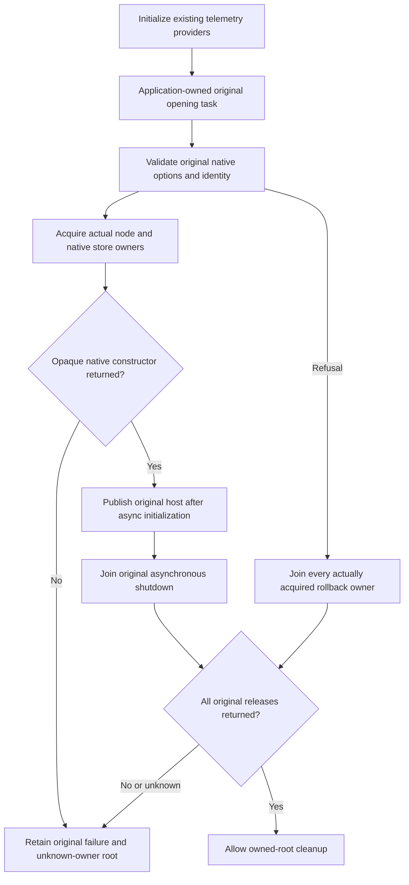

# Native owner acquisition and original settlement

The node-local ownership boundary in [StorageRecovery](../StorageRecovery.md)
keeps the original native acquisition, rollback and shutdown outcomes. This
correction does not change storage bytes, canonical authority, journals or
transport schemas. It follows the silo-local owner contract in
[ADR-136](../../ADR/ADR-136-native-orleans-partition-ownership.md),
[ADR-046](../../ADR/ADR-046-storage-private-owners.md)
and the native test entry in [ADR-117](../../ADR/ADR-117-native-tunit-ci-entry.md).

## Owning requirements

- **REQ-NATIVE-OWNER-001:** One internal `NativeStorageOwnerSettlement` describes
  exactly one real native open. Before an opaque tree, maintenance or embedded-cache
  constructor runs it records a pending construction. Only that constructor's actual
  return clears pending. Closing known returned handles does not prove release of
  an unpublished opaque owner. Reusing an acquisition ledger is refused.
- **REQ-NATIVE-OWNER-002:** Native construction cleanup preserves the original
  exception and each independent acquired-handle cleanup exception. It keeps the
  existing failed-open journal-before-tree and normal tree-before-journal ordering.
  A failed close never discards its original handle reference as successful release.
- **REQ-NATIVE-OWNER-003:** The first admitted native store close retains its exact
  terminal failure or actual successful return. Repeated calls observe that original
  result. Current-thread native traversal and read/write-gate recursion are checked
  before waiting for the disposal lock, with admission rechecked inside the lock.
  A rejected live-lease/reentrant preflight does not start or poison a close.
- **REQ-NATIVE-OWNER-004:** `PartitionHost.OpenAsync` owns asynchronous construction
  and actual awaited rollback. The old synchronous internal construction entry and
  its blocking async-cleanup joins are removed. Known returned stores and every
  independent derived owner remain in their original cleanup order.
- **REQ-NATIVE-OWNER-005:** The existing application owns one original opening task
  and one original shutdown task. It initializes the same telemetry providers before
  physical allocation. DI borrows only the already-published original host and fails
  closed before publication. There is no duplicate service container, second host,
  synchronous task-result fallback, caller-selected clock or alternate transport.
- **REQ-NATIVE-OWNER-006:** Native test owners register the attempt before invoking
  the real factory, retain original tasks, and join independent body and cleanup
  failures. Directory cleanup requires all original attempts to be released.
  Exception codes, a null constructor result, available file locks and a later
  disposed-flag no-op do not authorize cleanup. Known preflight refusals remain
  repairable because the actual owning stages record no pending opaque constructor
  and successful cleanup of every returned handle.

The ledger records the actual KeyLoad ownership path. It does not prove that an
opaque upstream constructor which failed before returning released its internals,
prove a native memory/disk bound, replace persisted database authorization, or
provide a new readiness capability. Unknown ownership remains a failed/open gate.

## Existing whole-operation regression mapping

| Criterion | Genuine existing operation and preserved oracle |
| --- | --- |
| AC-NATIVE-OWNER-001 — refused bootstrap and healthy recovery | `PartitionHostRecoveryTests` keeps all original missing/modified/valid protected-principal cases, original applied/log cuts and persisted node/read-generation identities across recovery attempts. The staging source and target owners now retain independent failures. |
| AC-NATIVE-OWNER-002 — actual same-volume refusal, repair and reopen | `PartitionRootAdmissionTests` and `PartitionRootAdmissionSpecialEntryTests` retain original unknown file/directory/link, wrong-kind, non-directory root, foreign target, held regular owner and native FIFO refusals, exact bytes/Unix modes, and healthy native writes/reopen. |
| AC-NATIVE-OWNER-004 — real concurrent shutdown and reentrant refusal | `NativeReadCutLifetimeTests.AcCut003ShutdownCancelsAndJoinsTraversalBeforeReopen` waits on the actual original lease cancellation, calls reentrant `Store.Dispose` from that still-active original visitor and requires the existing native refusal. The original traversal/disposer tasks must then join, the original record/identity/cut survive, and the healthy write survives the original second cold reopen. Its original ten-second join observation and original tasks remain unchanged. No private hold, clock, synthetic fault or counter is added. |
| AC-NATIVE-OWNER-005 — all current application owner paths | Normal `ServerApplication` and its stopped cold owners use the actual asynchronous opening boundary. Original signed/public operations, source identities, shutdown deadlines and replicated-cluster oracles remain separate mandatory execution gates. |

The test-owned native cut fixture also registers acquisition before native open,
rolls back a known returned owner if list publication fails, refuses another open
while any prior acquisition is unknown, and retains the original failure/root.
The extraction of native shutdown joining and directory filesystem operations keeps
original inputs and independent expected values while satisfying the existing
method/type limits.

## Verification boundary

Strict full solution build, formatting, the focused Unit/native recovery operations,
native application/SDK/MCP replicated-cluster tests and exact-source Linux
qualification are separate gates. No constructor or disposal failure is
fabricated and no power-loss or performance claim is made. The real reentrant
operation can expose a deadlock in an incorrect implementation; retaining its
original tasks remains mandatory.
