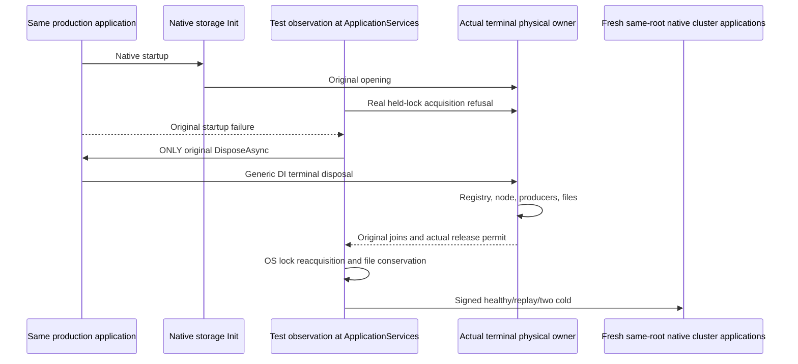

# Generic application disposal after native partial startup

This native regression covers [ADR-136](../../ADR/ADR-136-native-orleans-partition-ownership.md) and the ownership contract in [StorageRecovery](../StorageRecovery.md). Existing signed connection semantics remain [ADR-125](../../ADR/ADR-125-connection-owned-execution.md); native TUnit ownership follows [ADR-117](../../ADR/ADR-117-native-tunit-ci-entry.md).

## Operation and independent oracles

The case calls the existing production `ServerConfiguration.BuildAsync` with the original native localhost selection and physical-owner settings. It creates no alternate host builder, provider or transport. The same native ApplicationServices observation performs the real second `node.owner.lock` acquisition after successful native storage Init. The original startup task must fail with that exact actual IOException. Before/after complete bounded canonical records, full native identity and physical position are compared inside the same original store read gate. Unexpected startup errors are preserved before proof errors; they are not replaced by a missing-observation assertion.

Before invalidating the provider, the test captures the actual owner, borrowed node, registry and the three actual native grain services. Two authoritative files—`identity.json` and `commands.wal`—are read with an aggregate bound derived from the original native database profile. Actual FileStream reads allocate only their bounded declared lengths, reject an additional byte, retain the original token, and record read and separate disposal failures in order. Private bytes are compared as booleans, never emitted in assertions. Disposable native tree files are not an invariant.

The only shutdown call initiating cleanup is the original `WebApplication.DisposeAsync`. There is no preceding application Stop, borrowed-node Stop, registry shutdown, producer join or fixture wrapper close. The terminal owner must perform registry → node → three native producers → physical host cleanup. The test requires its captured original Closing and node Closing to succeed, full actual `CanReleaseRoot` and joined node work, and exactly three retained original task references. Only after completed disposal does it compare these references with each actual native service's already-fenced JoinStorageProducerAsync result. It does not invoke registry methods to repair missing cleanup. Actual release is additionally tested by reacquiring the original OS node lock, with the returned handle disposed independently; both authoritative files must remain byte-identical.

The same original root/settings then enter the existing native multi-node fixture. Unchanged reviewed helpers perform a genuine signed ConfigureResource and Batch write, signed minimum-token read, full independent process-durable receipt, empty private CompositionReferences, exact replay and two actual same-root restarts. Full identity and whole literal document/receipt oracles repeat after both restarts. Original body, file reader, direct disposal and assertion errors retain ordering. Unknown ownership or any failure retains the directory and attaches the existing bounded failure-root evidence; no cleanup success is inferred from a faulted task.

## Qualification boundary

Mandatory complete case: `PartitionStorageNativeApplicationDisposeTests.ActualGenericApplicationDisposeAfterNativePartialStartupRetainsOwnersThenSignedReceiptThroughTwoColdStarts`.

The fault occurs at stage10000 before Active20000. Native GrainService.Start/background producers have not started; the three genuine retained join results may therefore be CompletedTask for never-started producers. This case does **not** qualify LIVE producer shutdown; the distinct `PartitionStorageNativeProducerDispose*` family owns that gate. Nor does this prove native `SiloTerminated`: pinned native Silo.Dispose suppresses the Starting-state Stop refusal, unlike explicit hosted application Stop. The separate wrapper partial-start case owns its original native Stop-error oracle.

These are real in-process native server/physical-group operations, not Aspire Docker cluster or public SDK/official MCP qualification. Linux runtime, native OS behavior, deadline fit and the broader recovery/endurance gates are separate. Original tokens, limits, resource ownership and the existing native restart/shutdown budgets are unchanged.
