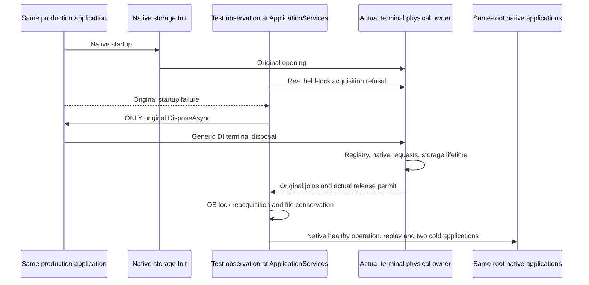

# Generic application disposal after native partial startup

This native case covers [ADR-136](../../ADR/ADR-136-native-orleans-partition-ownership.md) and the ownership contract in [StorageRecovery](../StorageRecovery.md). Connection ownership follows [ADR-125](../../ADR/ADR-125-connection-owned-execution.md), and native TUnit ownership follows [ADR-117](../../ADR/ADR-117-native-tunit-ci-entry.md).

## Operation and independent oracles

The case calls production `ServerConfiguration.BuildAsync` with the shared `RequestCqrsHostedProfile` and native localhost membership. One silo and one persisted copy are configured. The original arguments, native identities, physical directory and port are frozen for all applications. The native ApplicationServices participant performs a real second `node.owner.lock` acquisition after successful storage Init. The original startup task must fail with that exact IOException. Complete bounded canonical records, full storage identity and physical position are compared before and after the refusal under the same storage read gate. Unexpected startup errors remain before proof errors.

Before invalidating the provider, the test captures the actual physical owner, node and connection registry. The canonical store's `identity.json` and `commands.wal` are read with one aggregate byte bound from the actual database profile. FileStream reads allocate only their bounded declared lengths, reject an additional byte, retain the caller token, and preserve read and independent reader-disposal failures. Private bytes are compared as booleans and never emitted in assertions. Derived native tree files are not an invariant.

The only shutdown operation initiating cleanup is the original `WebApplication.DisposeAsync`. No application Stop, node Stop, registry shutdown or storage-lifecycle call precedes it. Actual owner Closing and node Closing must succeed, native request work and the complete node lifetime must be joined, and `CanReleaseRoot` must be true. The test does not invoke registry methods to repair missing cleanup. After successful disposal and release permission, it reacquires the existing OS node lock and disposes that handle independently. Both canonical authority files must remain byte-identical.

The same original arguments and root then enter the shared native healthy-operation helper. Native ConfigureResource and Batch commands, a connection-grain CQRS minimum read and exact replay must preserve the independent complete `ProcessDurable` receipt, one persisted copy, empty private CompositionReferences, whole literal document and raw persisted StoredOutcome bytes. Replay cannot advance the canonical or physical cut. Two actual cold applications repeat full storage identity, receipt, outcome, minimum-read and release assertions. Original body, file-reader, direct-disposal and assertion errors remain observable. Any failure retains the directory and attaches its bounded root path to the original failure; a faulted cleanup task never implies release.

## Qualification boundary

Existing mandatory case: `PartitionStorageNativeApplicationDisposeTests.ActualGenericApplicationDisposeAfterNativePartialStartupRetainsOwnersThenCanonicalReceiptThroughTwoColdStarts`.

The fault occurs during ApplicationServices before Active. The case does not prove shutdown of active background stateless-worker work; the distinct `PartitionStorageNativeProducerDispose*` family owns that gate. Native silo termination is also separate from the physical-owner release permit. The explicit partial-start Stop case in [PartitionStorageNativeStartup](PartitionStorageNativeStartup.md) owns the exact native Starting-state Stop-error oracle. This case observes only the original generic disposal and its real terminal outcomes.

This source adaptation has not yet been compiled or run. It describes native single-silo production composition and physical-file checks. Aspire cluster operations, public SDK/official MCP interoperability, abrupt process recovery, power loss, Linux runtime, native OS behavior, deadline fit and broader recovery/endurance remain independent open gates. The configured startup timing, original cancellation, resource limits and joined cleanup remain required.
