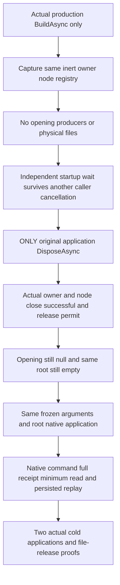

# Native production application disposal before startup

REQ-PHOST-PRESTART-001 / AC-PHOST-PRESTART-001 derives from [ADR-136](../../ADR/ADR-136-native-orleans-partition-ownership.md) and the physical owner lifetime in [StorageRecovery](../StorageRecovery.md). Build the actual production `ServerConfiguration.BuildAsync` with the shared `RequestCqrsHostedProfile`, native localhost membership and original caller token. Configure one silo and one persisted copy. Freeze the original arguments, native identities, port and physical directory for every application in this case. Never invoke application Start, node Start, owner Open or GrainService Init during the pre-start phase. Capture the same actual physical owner, inert node and connection registry before disposal. Their constructors must not acquire storage.

REQ-PHOST-PRESTART-002 / AC-PHOST-PRESTART-002: owner Opening and Closing and node Closing are initially null, and native runtime publication remains absent. The test-owned parent root is empty; its physical node directory, `node.owner.lock` and canonical store directory are absent. Invoke only the actual application `DisposeAsync` and retain its original Task and every terminal fault. Afterwards actual application disposal, original physical-owner Closing and original node Closing must have completed successfully. Native request work and the complete node permit must be joined, and owner `CanReleaseRoot` must be true. Opening remains null. The same bounded parent-root inventory and physical absence checks must still pass.

The pre-start trial never invokes registry Shutdown, node Stop, owner Dispose or late lifecycle Stop to repair missing production cleanup. The registry is the captured inert singleton. Its successful join is covered by the production owner's composite `CanReleaseRoot` permit. Node Closing, RequestWork and HasJoinedRequestWork observations refer to their real original owners. Native silo termination is not asserted for this never-started application.

Before disposal, retain an independent `WaitForNativeStartupAsync` projection. A second projection is canceled with its selected caller token; it must become canceled with that exact token while the independent projection remains pending. Generic application disposal must terminate the original independent wait with the actual `OwnershipLost` routing-unavailable error. Cancellation of one wait cannot start the silo or complete another wait. Every healthy application also retains a pending startup projection before native startup and requires successful completion after application and node startup.

REQ-PHOST-PRESTART-003 / AC-PHOST-PRESTART-003: after the complete pre-start proof, open production native applications with the same frozen arguments and physical directory. Reuse the existing Healthy, Read and Protocol operation owners. Native ConfigureResource and Batch commands must produce the independently specified complete receipt, one persisted copy, empty private CompositionReferences and the whole literal Document through the actual connection-grain CQRS minimum read. Capture the complete real store identity and raw persisted StoredOutcome bytes. Original-command replay must preserve that receipt, prepared command, exact outcome bytes and unchanged canonical and physical cuts. Perform both cold applications and repeat the complete identity, receipt, minimum-read and replay assertions. Successful generic disposal, original owner/node close, actual joined request work and exclusive owner-lock release are required before every subsequent open.

The existing test is `PartitionStorageNativePreStartDisposeTests.ProductionApplicationDisposedBeforeStartNeverOpensPhysicalStorageThenSameRootsSupportCanonicalReplayAndTwoCold`, with no Args. It is distinct from the after-Init lifecycle fault case in [PartitionStorageNativeStartup](PartitionStorageNativeStartup.md) and the already-started worker case in [NativeProducerDirectDispose](NativeProducerDirectDispose.md). Original body, disposal and proof errors remain observable; an unexpected failure retains the owned root. The test deletes its root only after every healthy native application has joined and released its files.

This source adaptation has not yet been compiled or run. It does not qualify public SDK/official MCP interoperability, an Aspire cluster, abrupt process recovery, power loss, Linux endurance or performance. Those independent gates remain open.
