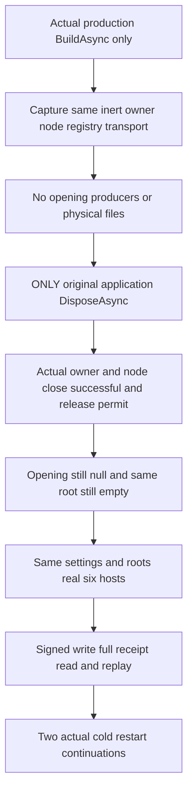

# Native production application disposal before startup

REQ-PHOST-PRESTART-001 / AC-PHOST-PRESTART-001 derives from [ADR-136](../../ADR/ADR-136-native-orleans-partition-ownership.md), KL-008/018 and the physical owner lifetime in [StorageRecovery](../StorageRecovery.md). Build the actual production ServerConfiguration.BuildAsync with the original fixed six-owner settings, native loopback primary and original caller token. Never invoke application Start, node Start, owner Open, GrainService Init or a replacement host during this pre-start phase. Capture the SAME actual owner, inert node, connection registry and transport before disposal. Their constructors must not acquire storage.

REQ-PHOST-PRESTART-002 / AC-PHOST-PRESTART-002: Opening, Closing and StorageProducerJoins are initially null and native runtime publication remains absent. The settings-owned root is empty; every one of the six physical node directories, node.owner.lock, canonical and replica directories is absent. Invoke ONLY the actual application DisposeAsync and retain its original Task and every terminal fault. Afterwards actual application, original physical-owner Closing and original node Closing must have completed successfully; native request work and the complete node permit must be joined and owner CanReleaseRoot must be true. Opening and StorageProducerJoins remain null: there is no fabricated completed storage opening. The same bounded root inventory and physical absence checks must still pass.

The test never invokes registry Shutdown, transport Stop, node Stop, owner Dispose or late lifecycle Stop to repair missing production cleanup. Registry and transport are captured inert singletons. Their actual successful joins are covered by the production owner's source-bound composite CanReleaseRoot permit, not invented per-child task observations. Read-only node Closing/RequestWork/HasJoinedRequestWork observations refer to their real original owners. Native Silo termination is not asserted for this never-started application.

REQ-PHOST-PRESTART-003 / AC-PHOST-PRESTART-003: after that complete proof, reuse the SAME settings and root paths through the existing real six-host fixture. Execute the unchanged C225 signed ConfigureResource and Batch, independent full quorum receipt/private CompositionReferences, whole literal signed Document read, exact original command replay and unique log entry checks. Perform both existing native cold restarts and repeat full receipt/read/replay. Exact future Healthy/Read/Protocol definitions are reused once, not cloned. This native component flow does not replace public SDK/official MCP, Docker/Aspire RF3, process-crash, Linux endurance or performance qualification.

The sole new test is PartitionStorageNativePreStartDisposeTests.ProductionApplicationDisposedBeforeStartNeverOpensPhysicalStorageThenSameRootsSupportSignedReplayAndTwoCold with no Args. It is distinct from C's after-Init lifecycle fault and A's already-started real maintenance producers. Original body, Dispose and proof errors remain ordered; unexpected failure retains owned roots, and the existing host owner deletes roots only after actual joined healthy closure. No source review qualifies the runtime/compiler/deadline gates, which remain OPEN.
