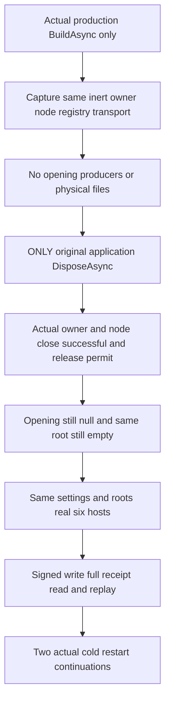

# Native production application disposal before startup

REQ-PHOST-PRESTART-001 / AC-PHOST-PRESTART-001 derives from [ADR-136](../../ADR/ADR-136-native-orleans-partition-ownership.md), KL-008/018 and the physical owner lifetime in [StorageRecovery](../StorageRecovery.md). Build the actual production ServerConfiguration.BuildAsync with the original fixed six-owner settings, native loopback primary and original caller token. Never invoke application Start, node Start, owner Open, GrainService Init or a replacement host during this pre-start phase. Capture the SAME actual owner, inert node, connection registry and transport before disposal. Their constructors must not acquire storage.

REQ-PHOST-PRESTART-002 / AC-PHOST-PRESTART-002: Opening, Closing and StorageProducerJoins are initially null and native runtime publication remains absent. The settings-owned root is empty; every one of the six physical node directories, node.owner.lock, canonical and replica directories is absent. Invoke ONLY the actual application DisposeAsync and retain its original Task and every terminal fault. Afterwards actual application, original physical-owner Closing and original node Closing must have completed successfully; native request work and the complete node permit must be joined and owner CanReleaseRoot must be true. Opening and StorageProducerJoins remain null: there is no fabricated completed storage opening. The same bounded root inventory and physical absence checks must still pass.

The test never invokes registry Shutdown, transport Stop, node Stop, owner Dispose or late lifecycle Stop to repair missing production cleanup. Registry and transport are captured inert singletons. Their actual successful joins are covered by the production owner's source-bound composite CanReleaseRoot permit, not invented per-child task observations. Read-only node Closing/RequestWork/HasJoinedRequestWork observations refer to their real original owners. Native Silo termination is not asserted for this never-started application.

REQ-PHOST-PRESTART-003 / AC-PHOST-PRESTART-003: after that complete proof, reuse the SAME settings and root paths through the existing real six-host fixture. Execute the unchanged C225 signed ConfigureResource and Batch, independent full quorum receipt/private CompositionReferences, whole literal signed Document read, exact original command replay and unique log entry checks. Perform both existing native cold restarts and repeat full receipt/read/replay. Exact future Healthy/Read/Protocol definitions are reused once, not cloned. This native component flow does not replace public SDK/official MCP, Docker/Aspire RF3, process-crash, Linux endurance or performance qualification.

The sole new test is PartitionStorageNativePreStartDisposeTests.ProductionApplicationDisposedBeforeStartNeverOpensPhysicalStorageThenSameRootsSupportSignedReplayAndTwoCold with no Args. It is distinct from C's after-Init lifecycle fault and A's already-started real maintenance producers. Original body, Dispose and proof errors remain ordered; unexpected failure retains owned roots, and the existing host owner deletes roots only after actual joined healthy closure. No source review qualifies the runtime/compiler/deadline gates, which remain OPEN.

## Original native startup publication

REQ-PHOST-PRESTART-004 / AC-PHOST-PRESTART-004: a genuine DI-owned OrleansNode
wait requested before post-active bootstrap publication remains pending without
opening storage or starting another host. Canceling one actual caller wait must
preserve its exact cancellation token and leave an independent original wait
pending. Only the original application DisposeAsync closes an unpublished
startup: the independent wait then refuses with the exact native
OwnershipLost/configured-owner-unavailable contract, while every existing
never-opened file/owner proof still holds.

REQ-PHOST-PRESTART-005 / AC-PHOST-PRESTART-005: before starting the existing healthy
six-owner fixture, retain the actual prepublication waits from all six original
DI nodes. Start and join the original wrapper startup tasks, then join every
original wait and require successful terminality. A failed actual start cancels
only helper-owned caller waits and preserves all original task errors before
existing outer-owner cleanup. Signed operations, full independent receipts,
models and both cold continuations remain unchanged.

The production publication rendezvous announces the SAME original bootstrap
Task under the existing lifecycle lock before its registered start signal.
It never starts work, retries a probe, changes endpoints/expiry/deadlines or
replaces native membership. Stop-before-Start terminates an unpublished value
without creating an unobserved faulted publication task; each caller still sees
the typed refusal. A faulted waiter retains all actual original bootstrap fault members,
not only an exception unwrapped from its caller-bounded observation. An actual
canceled caller observation remains canceled; the original startup and its
errors stay owned by the existing node lifecycle. If original application
disposal fails before publication closes, only its test-owned caller wait is
canceled and joined into the complete failure ledger. Pending-shape assertion
failures and synchronous Start creation failures likewise still join every
original test-owned waiter. No manual Stop repairs an application disposal.

Original R407 receiver evidence refused at NativeStartup with neither deadline
nor stopping canceled. That logged stage also includes the subsequent native
replica prerequisite; it does not uniquely identify the runtime throw branch.
The source publication gap is independently verified and corrected here.
These criteria map to the SAME original PreStartDisposeTests whole operation
and its native startup-wait assertions. Required exact-source compiler, runtime,
Linux and Aspire RF3/public SDK/official MCP qualification remain open.
