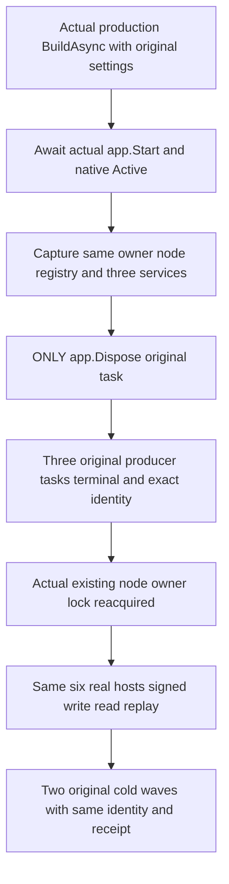

# Live native storage producers under direct application disposal

REQ-PHOST-LIVE-DISPOSE-001 / [ADR-136](../../ADR/ADR-136-native-orleans-partition-ownership.md): the original production WebApplication must settle its three live native maintenance producers before releasing node-local storage even when the sole external cleanup operation is app.DisposeAsync. No manual pre-Stop, producer Join, owner Dispose, lower-lifecycle invocation or new cancellation source may make the tested path pass.

AC-PHOST-LIVE-DISPOSE-001: build the actual production ServerConfiguration.BuildAsync with unmodified ControlledPartitionMovementNativeHostSettings.Arguments(0) and its actual native localhost primary. Release owned listener reservations and await original app.StartAsync. This reaches native Active and the actual three GrainService Start calls; pinned GrainService.Start invokes StartInBackground synchronously before returning completion. Capture the original owner, node, registry and actual three IGrainService objects before the provider is disposed. Before close the original opening succeeded and owner.StorageProducerJoins remains null. No Node.Start/database bootstrap or quorum-ready claim is made in this primary-only phase.

AC-PHOST-LIVE-DISPOSE-002: invoke only original app.DisposeAsync and retain its actual Task and every native failure. Afterwards require successful original app and owner close, actual borrower/physical release permission and exactly three owner-retained terminal producer tasks. Only AFTER close invoke each actual service JoinStorageProducerAsync and require reference identity with the owner's corresponding retained task and terminal success. Reacquire the actual existing node.owner.lock using native FileMode.Open/FileShare.None, without creating a substitute lock. A missing file fails rather than creating proof. No fake tasks, provider or clock is used.

AC-PHOST-LIVE-DISPOSE-003: reopen the SAME settings/roots in the genuine existing six-host native production fixture. Use the exact C225 signed healthy write/read/replay helper with independently retained logical ReplicaEntry.Index, full receipt/private-reference and literal document oracles; preserve original identity. Perform two actual same-volume full six-host cold restarts and replay the exact same command/receipt after each. This is native component testing, not Docker/Aspire RF3, power-loss or public SDK/MCP qualification. Original native runtime profile, SIMD, tokens, shutdown bounds and all failures remain protected.

First-phase native primary membership is independent of fixed database RF3 and six-owner physical-registration readiness. R407 reached actual primary-only Active and invoked generic application disposal, then failed the transport drain as described below; the corrected exact-source operation and healthy/two-cold continuation still require a successful rerun. Source presence cannot qualify all original tasks as joined. Any unjoined application/storage state retains its existing root; failure does not delete unknown owners. The canonical application owner/DI fallback and stable same-owner Func factories remain required integrated dependencies. C225 partial-start expected-stop-refusal flow is separate and is not invoked by this test.

## Native framework escalation and the retained transport drain

The actual R407 active application-disposal operation exposed a distinct shutdown-token defect: native Orleans reached transport stage 6000 with its framework escalation token already cancelled. ReplicaTransportLifecycle started and joined the actual endpoint StopAsync(None), but retained cancellation of a caller-wait wrapper in its one memoized shutdown. The later physical owner re-observed that poisoned drain and correctly refused storage release. This was not an original endpoint failure.

The native transport lifecycle callback now joins the same original StopAsync(None), as required for mandatory borrower settlement before storage stage 5999. It changes no original endpoint/discovery drain, native shutdown bound, public StopAsync caller-cancellation behavior, producer joins or physical release gate. Every actual original endpoint/discovery error remains terminal and still blocks physical release. No cancellation exception is caught or discarded by this repair.

The existing ReplicaTransportShutdownWholeFlowTests executes its complete real native lifecycle operation with both ordinary and already-cancelled framework tokens. Each branch retains the two actual cancellation-callback failures by reference, proves discovery exits before endpoint completion, requires original blocked tasks to remain pending until released, checks the complete unchanged native store/cut, and performs the existing fresh native-owner signed operation/full receipt/document/replay continuation. The original ActualActiveNativeApplicationDisposeJoinsThreeOriginalStorageProducersBeforeSameRootsHealthyTwoCold remains unchanged as the direct application-disposal regression. Source preparation is not a successful rerun; exact-source runtime and Linux qualification remain open.
