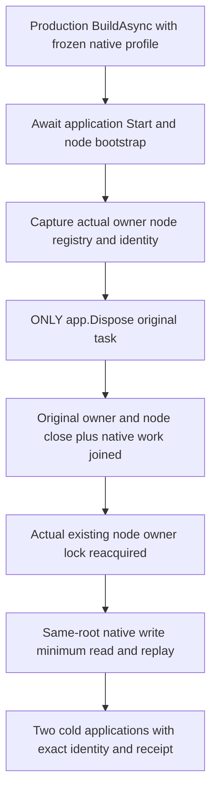

# Active native worker lifetime under direct application disposal

REQ-PHOST-LIVE-DISPOSE-001 / [ADR-136](../../ADR/ADR-136-native-orleans-partition-ownership.md): the production WebApplication must join actual native worker and request lifetimes before releasing silo-local storage when the only external shutdown operation is `app.DisposeAsync`. Application Stop, node Stop, registry shutdown and owner/lower-lifecycle disposal cannot precede the tested cleanup.

AC-PHOST-LIVE-DISPOSE-001: use production `ServerConfiguration.BuildAsync`, the shared `RequestCqrsHostedProfile`, native localhost membership and an existing canonical OS temporary ancestor. Freeze the arguments, native identities, root and port for one silo and one persisted copy. Await the actual application Start and node Start. Successful node bootstrap awaits the native messaging, time-series and ANN StatelessWorker Wake calls through their shared identity helpers; activation registers the native timers. Capture the actual physical owner, node, connection registry and complete store identity. Opening must have succeeded, owner/node Closing must remain absent, and the node must report its actual joined silo reference and completed database startup.

AC-PHOST-LIVE-DISPOSE-002: invoke only the original `app.DisposeAsync` and retain its actual Task and every failure. Application disposal, original owner Closing and node Closing must complete successfully. Actual request work must be joined, the node's complete joined-work flag must be true, and the owner must grant `CanReleaseRoot`. Reacquire the existing `node.owner.lock` with FileMode.Open/FileShare.None, then independently dispose that handle. A missing lock fails. The case observes the native lifetime owners and does not introduce per-worker join tasks or activation-count oracles.

AC-PHOST-LIVE-DISPOSE-003: reopen production native applications with the same frozen arguments and physical root. Reuse the existing healthy-operation helper for a literal document, complete independently expected receipt, one persisted copy, empty private CompositionReferences and the connection-grain CQRS minimum read. Preserve the original full storage identity, exact prepared command and persisted outcome bytes. Both cold applications repeat identity, receipt, minimum-read, replay and physical-release assertions. Replay must leave canonical and physical cuts unchanged. Any original startup, disposal, assertion or independent cleanup failure fails the case and retains its root.

Existing case: `PartitionStorageNativeProducerDisposeTests.ActualActiveNativeApplicationDisposeJoinsNativeWorkBeforeSameRootHealthyTwoCold`. This source adaptation has not yet been compiled or run. It requires real native activation and shutdown; source inspection alone does not prove joined tasks or file release. It does not qualify buffered-event delivery, arbitrary worker counts, an Aspire cluster, public SDK/MCP interoperability, abrupt process recovery, power loss or performance. The partial-start expected-Stop-refusal case remains separate.
