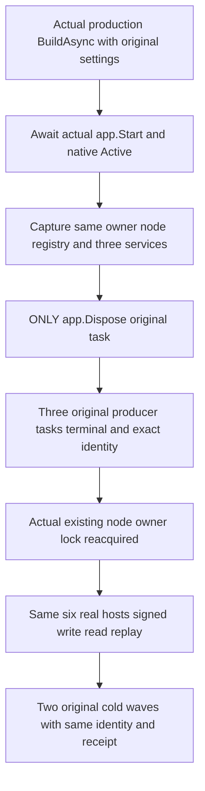

# Live native storage producers under direct application disposal

REQ-PHOST-LIVE-DISPOSE-001 / [ADR-136](../../ADR/ADR-136-native-orleans-partition-ownership.md): the original production WebApplication must settle its three live native maintenance producers before releasing node-local storage even when the sole external cleanup operation is app.DisposeAsync. No manual pre-Stop, producer Join, owner Dispose, lower-lifecycle invocation or new cancellation source may make the tested path pass.

AC-PHOST-LIVE-DISPOSE-001: build the actual production ServerConfiguration.BuildAsync with unmodified ControlledPartitionMovementNativeHostSettings.Arguments(0) and its actual native localhost primary. Release owned listener reservations and await original app.StartAsync. This reaches native Active and the actual three GrainService Start calls; pinned GrainService.Start invokes StartInBackground synchronously before returning completion. Capture the original owner, node, registry and actual three IGrainService objects before the provider is disposed. Before close the original opening succeeded and owner.StorageProducerJoins remains null. No Node.Start/database bootstrap or quorum-ready claim is made in this primary-only phase.

AC-PHOST-LIVE-DISPOSE-002: invoke only original app.DisposeAsync and retain its actual Task and every native failure. Afterwards require successful original app and owner close, actual borrower/physical release permission and exactly three owner-retained terminal producer tasks. Only AFTER close invoke each actual service JoinStorageProducerAsync and require reference identity with the owner's corresponding retained task and terminal success. Reacquire the actual existing node.owner.lock using native FileMode.Open/FileShare.None, without creating a substitute lock. A missing file fails rather than creating proof. No fake tasks, provider or clock is used.

AC-PHOST-LIVE-DISPOSE-003: reopen the SAME settings/roots in the genuine existing six-host native production fixture. Use the exact C225 signed healthy write/read/replay helper with independently retained logical ReplicaEntry.Index, full receipt/private-reference and literal document oracles; preserve original identity. Perform two actual same-volume full six-host cold restarts and replay the exact same command/receipt after each. This is native component testing, not Docker/Aspire RF3, power-loss or public SDK/MCP qualification. Original native runtime profile, SIMD, tokens, shutdown bounds and all failures remain protected.

First-phase native primary membership is independent of fixed database RF3 and six-owner physical-registration readiness. Source shows localhost primary and no expected-six membership setting; actual primary-only Active/runtime fit remains unexecuted. Source presence cannot qualify all original tasks as joined. Any unjoined application/storage state retains its existing root; failure does not delete unknown owners. Root's complete owner/DI fallback and companion4 stable same-owner Func factories are mandatory future integration dependencies. C225 partial-start expected-stop-refusal flow is separate and is not invoked by this test.
