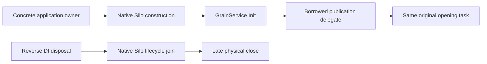

# Native publication borrowing

REQ-NATIVE-PUBLICATION-001: resolving the same silo-local physical publication through DI must not acquire another physical owner or transfer disposal ownership. Native grain services keep the original `IPartitionStoragePublication` interface, original opening task, cancellation and initialization sequence. A cached `Func<IPartitionStoragePublication>` borrows the concrete owner; its registration captures that same owner once inside the delegate factory, while the returned delegate is not disposable.

REQ-NATIVE-PUBLICATION-002: normal native lifecycle keeps DurableJobs at Active before the late physical close. Generic DI disposal must not bypass that ordering by capturing the physical owner again through a later publication alias. No additional scheduler, preparation lease, manager wrapper or public contract is introduced.

AC-NATIVE-PUBLICATION-001 maps to `PartitionStoragePublicationBorrowTests.UnstartedNativeContainerDisposalPreservesBorrowedOwnerAndCompleteCanonicalCommitAcrossTwoColdOwners`: a test-owned real physical owner is registered as an externally owned instance with actual `HostBuilder.UseOrleans` and production `PartitionStorageRegistration.Register`. Resolving publication returns that exact owner and original opening task. Disposal of this unstarted native container must leave the external owner open. A genuine atomic canonical byte commit, exact value, position, complete bounded native rows and full identity are then retained through two joined same-root cold owners; final known shutdown permits root removal. Unknown acquisition/close or failed assertions retain the original root and all body/cleanup failures.

This is an actual DI/physical-storage regression, not a started-silo, native-job settlement, RF3 acknowledgement, public SDK/MCP, power-loss, performance or readiness proof. The fixed private row is a native storage control, not an independently acknowledged database operation. Existing constructor-cycle cancellation and original native storage/application-disposal whole cases remain required. Source preflight does not qualify compiler/runtime acceptance; exact-source native execution remains OPEN.

The causal source investigation is retained separately: the former interface factory returned the same IAsyncDisposable owner after Silo capture; native DI could capture it a second time and dispose it before native lifecycle. Native barrier/read locks protect their active operations but do not prove an unregistered preparation continuation joined. This change preserves existing native lifecycle ownership instead of adding a parallel drain mechanism.

Applicable decisions: [ADR-136](../../ADR/ADR-136-native-orleans-partition-ownership.md), [ADR-117](../../ADR/ADR-117-native-tunit-ci-entry.md). Feature: [StorageRecovery](../StorageRecovery.md). Source-only candidate; no runtime result is claimed.
