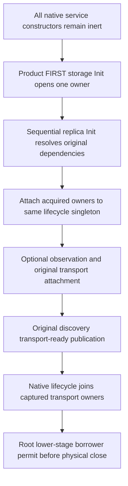

# Native replica service initialization ownership

REQ-PHOST-REPLICA-001 / [ADR-136](../../ADR/ADR-136-native-orleans-partition-ownership.md): native Orleans eagerly constructs all Grain Services before sequentially invoking their Init methods. PartitionReplicaGrainService therefore captures only native identity, silo, logger and the actual provider. Its constructor must not resolve or open the endpoint, database, discovery or authentication chain.

AC-PHOST-REPLICA-001: product composition registers PartitionStorageGrainService FIRST. Orleans awaits that service's original Init opening before invoking replica Init. Replica Init then resolves the safe lifecycle singleton, the original endpoint/discovery/authentication and native discovery owner; it immediately attaches acquired owners before the optional observation or transport attachment can fail. No publication waiter is required by this replica constructor. Root's publication contract remains available to actual server observers, and is not deleted.

AC-PHOST-REPLICA-002: the existing Unit RequestCqrsCohortNativeConfigurator and Recovery PeerDiscoveryNativeConfigurator each register ONE concrete ReplicaTransportLifecycle singleton and its ILifecycleParticipant alias resolving that SAME instance. Their existing real fixture.CreateNode acquisition occurs only when native Init first resolves the existing endpoint. They do not invent a completed storage-publication Task, alternate store or eager constructor compatibility overload. Existing real node ownership and disposal remain unchanged; these fixtures do not prove the product storage Grain Service topology.

AC-PHOST-REPLICA-003: preserve complete native exchange/discovery identity, signature, bounds, error and observation behavior. Native6000 transport shutdown retains only captured owners, and the lower storage-close callback must genuinely join that same original drain before physical disposal. Partial Init before attachment must not acquire owners during cleanup. Root's whole node-stop/borrower-permit/DI fallback gate remains explicitly OPEN; this child stage does not close it.

Verification maps to the unchanged existing ReplicaTransportShutdownFlow full native cancellation/error-vector/healthy continuation plus C's genuine native service startup/partial acquisition/close family and B's real storage-owner failure flows. Source alone is not compiler, runtime, same-root reopen, SDK/MCP RF3 or Linux acceptance. No timeout, payload, storage format, authentication or scheduler contract changes.

AC-PHOST-REPLICA-004: replica Init invokes the native DI-resolved Func<IReplicaEndpoint> only during Init. Product composition supplies the same physical owner endpoint through that borrowing factory. Both existing native test configurators expose their same original Consensus through Func<IReplicaEndpoint>, so DI owns only the delegate and never treats the borrowed endpoint as a disposable singleton. No endpoint is resolved from cleanup; lifecycle still holds only actual attached owners. Replica Init likewise invokes Func<ReplicaEnvelopeAuthenticator>; product composition forwards to the SAME genuine DI-owned native authenticator, while each native fixture delegate borrows its SAME original node-owned authenticator without registering that disposable object as a DI-owned alias. Native discovery runtime construction/retention and all original exchange signatures remain unchanged.

The existing native fixture ReplicaSiloDiscoveryClient and ReplicaGrainServiceClient registrations invoke their actual native constructors with the same borrowed authenticator delegate, configuration, discovery state, clock, provider, oracle and native options. This preserves DI construction after removing the raw borrowed authenticator registration; it does not add a client, provider or alternate wire path. Runtime discovery still receives node.Authentication directly from the same actual fixture owner.
