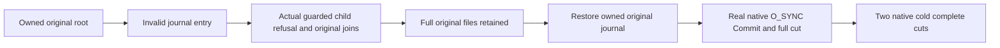

# Native write-through journal admission

[StorageRecovery](../StorageRecovery.md), proposed [ADR-135](../../ADR/ADR-135-native-write-through-journal-admission.md), [ADR-003](../../ADR/ADR-003-durability-ack-barrier.md), [ADR-046](../../ADR/ADR-046-storage-private-owners.md), [ADR-116](../../ADR/ADR-116-first-release-current-format.md).

REQ-NATIVE-JOURNAL-001: Preserve original WriteThrough open semantics in addition to existing native no-follow, nonblocking, regular-handle/path identity and flock ownership. Preserve existing share/buffer/Name and original write/flush/replay ordering. Correct the confirmed KeyLoad ARM64 no-follow ABI mapping (0x8000 versus x64 0x20000), preserving every other selected default flag. Native existing opening never creates/truncates; only initial missing inspection in normal OpenOrCreate permits original exclusive BCL WriteThrough creation. No retry/follow fallback.

AC-NATIVE-JOURNAL-001: Read actual native file status flags, compare full O_SYNC with same-OS original BCL WriteThrough handle, require native nonblocking bit and actual Linux architecture-selected no-follow bit, plus original absolute journal Name. A held journal excludes an independent exclusive native open with the actual Win32-wrapped EWOULDBLOCK code (Linux11/mac35); unexpected returned owners close separately so disposal cannot masquerade as the original open refusal. Execute real canonical healthy Commit, full independent literal rows/identity/position and two same-root native cold opens with matching original flags each time. No measured durability or speed claim.

AC-NATIVE-JOURNAL-002: Separate genuine symlink/FIFO/missing-original journal fixtures invoke ONLY the actual bounded existing-store-inspect Release RecoveryProcess with original outer owner/readers. Require fixed FormatUnsupported for invalid type, original FileNotFound with no creation for missing guarded input. Every original native file byte is conserved because rejection occurs before tree open; the hidden original journal is read instead of the FIFO/link. Restore only the owned entry after actual child settlement, then execute the same native healthy continuation/two cold cuts. Unknown child settlement prevents restoration/reuse/root deletion. All original error/cleanup objects remain in ordered ledgers.

Native/Linux ABI, filesystem, recovery, replicated-cluster and coverage qualification are separate gates.
