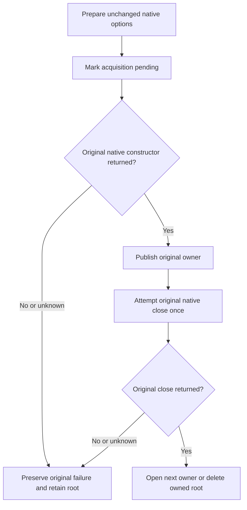

# Original native fixture settlement

This test-infrastructure correction preserves the original runtime-journal,
scoped-range and transactional-read operations. It changes neither the product
storage contract nor the test declarations. See [StorageRecovery](../StorageRecovery.md)
and [ClusterRouting](../ClusterRouting.md). [ADR-046](../../ADR/ADR-046-storage-private-owners.md) defines native private storage ownership; [ADR-117](../../ADR/ADR-117-native-tunit-ci-entry.md) preserves actual test resource and execution ownership.

## Requirements and operation evidence

- **REQ-FIXTURE-SETTLEMENT-001:** The runtime-journal fixture marks acquisition
  before the native constructor, publishes the returned owner before engine setup,
  and joins a known returned owner if subsequent initialization fails. Constructor
  and reopen errors retain their original identity alongside independent cleanup
  errors. A failed or unknown native acquisition prevents deletion.
- **REQ-FIXTURE-SETTLEMENT-002:** Reopen and final cleanup reuse the original close
  terminal. A later native disposed-flag no-op is never new evidence of a successful
  first close. Successful cycles still reopen and delete normally. The scoped-range
  owner follows the same original-close rule.
- **REQ-FIXTURE-SETTLEMENT-003:** The transactional read fixture first joins its
  original `TestDatabase` through the existing `JoinOwnedResources` contract. It
  then owns only the current cold store. Each cold constructor is marked pending
  before invocation and each current native store is closed once. Failed acquisition
  or close prevents the harness from deleting the original directory. No shared
  `TestDatabase` implementation or lifecycle helper is changed.
- **REQ-FIXTURE-SETTLEMENT-004:** The opaque journal payload comparison preserves
  every byte and its order. Pinned TUnit 1.74.0 defaults collection equivalence to
  `CollectionOrdering.Any`; the existing assertion now explicitly selects
  `CollectionOrdering.Matching`.

The unchanged `RuntimeJournalReopenTests.CommittedNativeHeaderAndOpaqueChunksSurviveStoreReopen`
operation creates the native journal, appends the original 90,000-byte patterned
payload, reopens the real store, reads all original bounded pages and verifies the
original revision and delete result. `ScopedRangeTests.AcMp002RangeRespectsBoundsLimitAndVisitorStop`
retains its original real-store bounded range, visitor-stop and accounting oracles.
`TransactionalReadViewWholeOperationTests.NativeSnapshotPausedWithinScanAllowsAtomicDocumentIndexWriterThenRefusalCancellationHealthyReplayAndTwoCold`
retains original concurrent scan/write, refusal, cancellation, healthy continuation,
receipt replay and two actual cold-store reopen operations.

## Verification boundary and remaining owner criterion

Source inspection and the cached native numeric/nesting preflight do not prove
compiler binding, execution, a native failed-close outcome or Linux qualification.
The original selected operations must execute after integration. No synthetic
constructor/dispose failure or test-only fault counter has been added.

**OPEN — HostRecovery original async owner settlement:**
`PartitionHostRecoveryFixture.OpenHost` returns the real async-disposable
`PartitionHost` to several external `await using` callers. Its synchronous outer
cleanup has no exposed original-shutdown witness. The nested `HostReplicaStores`
constructor/disposal can also mask independent failures. These are concrete owning
criteria requiring a separate coherent lifecycle correction. This packet does not
change their API, treat root retention as success, infer a close from lock availability,
or add a synchronous wait. Directory-only fixtures (`CurrentStorageFixture`,
`RuntimeJournalReaderFixture`, `WalFileFixture`) expose paths/options or native owners
to external scopes; this bounded inventory does not qualify their entire caller
lifecycle. `MetadataEntryOpenOwner` already uses a sticky uncertainty ledger and
refuses directory cleanup when its existing owner/inspection settlement is unknown.
