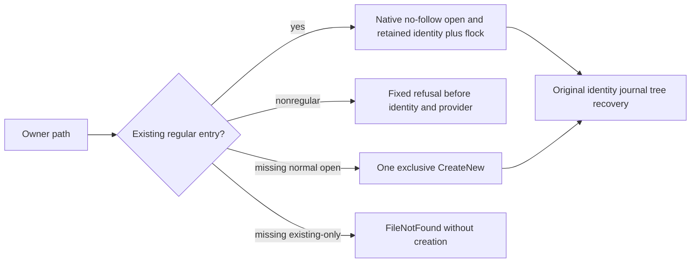

# Native owner-lock regular-file admission

Canonical slice: [StorageRecovery](../StorageRecovery.md). Applies [ADR-046](../../ADR/ADR-046-storage-private-owners.md) and [ADR-116](../../ADR/ADR-116-first-release-current-format.md).

REQ-OWNER-ENTRY-001: Existing node-local owner.lock must be a retained, identity-verified regular file opened without following a symlink or blocking on a special file, using the existing supported-platform OfflineRegularFile primitive. Existing-only inspection never creates it. Normal missing-file creation uses one retained exclusive CreateNew handle; a concurrent creator fails closed without retry/fallback.

REQ-OWNER-ENTRY-002: Preserve the absolute file Name required by the existing empty-store identity validation. Thread the original path through existing internal transfer methods; no native ABI, storage format, alias, authority or disposal-order change. New private creation retains ordinary BCL ownership. Existing native flock and same disposal task remain unchanged.

AC-OWNER-ENTRY-001: Genuine seeded stores with a symlink owner entry and a directory owner entry refuse normal provider open and the actual existing-store CrashHost child with fixed FormatUnsupported. Actual child exit and both readers settle. Repair the original owner entry, compare every original store entry byte, then require two genuine child cold opens and normal reopen with full identity/signing-key/value/position.

AC-OWNER-ENTRY-002: Missing existing-only owner file produces FileNotFound without creation; repair preserves complete files and the same healthy continuation. Fresh creation and a preexisting empty regular owner file both permit native identity creation, real commit, exclusive second-open refusal and identity-preserving reopen. The preexisting-empty case specifically exercises the native stream Name override.

AC-OWNER-ENTRY-003: New test body and fixture cleanup use the existing ordered ServerFailureObserver. No artificial task/provider failure, timeout, quota, process variant or raw diagnostic payload is added. Existing FailedOpen cleanup masking remains a separate unresolved source finding; this patch does not claim to fix it.

[Microsoft FileStream.Name](https://learn.microsoft.com/en-us/dotnet/api/system.io.filestream.name?view=net-10.0) declares a virtual absolute-path property. The implementation binds it to the original validated absolute path before borrowing the handle. OfflineRegularFile remains limited to little-endian Linux/macOS x64/arm64; Linux execution and the lock/process/recovery/replicated-cluster suites are separate gates. No Windows ABI adoption or provider-root-cause claim. UI/public SDK/MCP N/A: private node-local ownership only.

## Actual owner settlement before continuation and root cleanup

REQ-OWNER-LIFETIME-001 / AC-OWNER-LIFETIME-001: the SAME original StoreOwnerEntryTests four declarations retain the complete symlink/directory/missing refusal→repair→two real child cold opens→native identity/value/position checks and fresh/preexisting-empty exclusive-owner flows. Test-owned actual owner references remain tracked until their original Dispose returns successfully. A failed original create-owner Dispose forbids the later ReadAsync; a failed cold-read owner Dispose forbids recursive deletion of the outer fixture root, including its fresh/empty-owner children. Any unknown close/acquisition state remains sticky, with roots retained and original failures reported. A repeated no-op Dispose, successful open/read or a failure counter is never proof of closure.

Each actual owner still receives its independent cleanup attempt once, even when a body assertion or another owner cleanup already failed. Primary and cleanup failures retain their original identities/order through ServerFailureObserver. Root deletion is permitted only with no retained actual owner and no uncertain settlement. Original normal refusal assertions, full unchanged files, child process exit/readers and complete reopened identities/signing key/value/position remain; no fake owner, fault injection, close seam or disposal success is manufactured. The existing shared fixture remains unchanged. No dispose-failure, Linux, power-loss or replicated-cluster proof is claimed.
