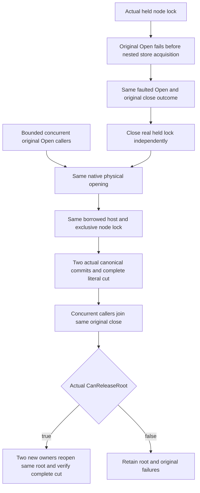

# Physical application owner native lifetime

REQ-PHOST-UNIT-001 / [ADR-136](../../ADR/ADR-136-native-orleans-partition-ownership.md) / KL-008 and KL-018: one application owner publishes one original physical opening, lends the same host, and joins one memoized close before releasing native file ownership. This new Unit family uses actual PartitionHost, canonical ZoneTree Commit, real native files and the existing validated server test options; no silo, alternate provider, synthetic delay, mock or RF3 receipt is introduced.

AC-PHOST-UNIT-001: concurrent bounded callers invoke OpenAsync, Borrow, then DisposeAsync in separate phases. Every original opening/closing Task and borrowed host must have identical identity. This does not claim a controlled pause inside native open, or simultaneous mixed open/close scheduling. Before publication Borrow refuses; after shutdown Borrow and Open refuse. Actual native exclusive node lock excludes another real FileStream while the host is open. Only an error observed from the actual constructor is accepted; any returned competing handle is independently closed and makes the exclusion assertion fail, so a cleanup IOException cannot masquerade as acquisition refusal.

AC-PHOST-UNIT-002: full bounded bootstrap cut is frozen before two independently literal binary records are committed. Each returned proposed local position must equal original position plus one. The complete original rows plus the exact new key/value rows, complete native identity and position must survive two new owners reopening the same root, including journal recovery. Local storage commit return is not a command/RF3 receipt, and reopening is not a process crash or power-loss test.

AC-PHOST-UNIT-003: an actual exclusive node.owner.lock handle rejects original native acquisition with IOException before canonical/replica creation. Failed Open remains the SAME faulted Task; no host is published. Closing observes that same expected original failure and actual CanReleaseRoot; the retained real handle is closed independently. A NEW owner then performs the entire healthy same-root flow. This qualifies only pre-nested-owner acquisition failure, not partial derived-owner construction.

The ordered failure ledger retains body errors before independent close errors. Only the exact expected opening error may be consumed again during memoized failed close; other errors remain. Root removal is permitted only after all actual owner settlement flags allow release and the flow is fully successful. Unexpected failure retains evidence. No private worker Task identity, native-replica bootstrap, SDK/MCP, real-process, RF3, compiler or Linux runtime qualification is claimed by this source packet.

New tests: PartitionHostApplicationLifetimeTests.ConcurrentOpenBorrowAndDisposeRetainOneNativeOwnerAndBothCommittedRowsAcrossTwoReopens and HeldNativeNodeLockRejectsMemoizedOpeningThenNewOwnerRecoversTheSameRoot. Both have no Args. Root-owned future application-owner APIs Opening and CanReleaseRoot are explicit dependencies; Main alone chooses adoption and execution.

