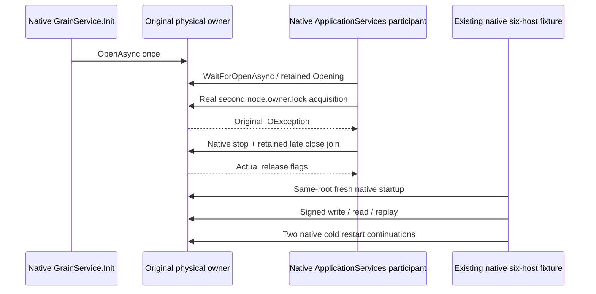

# Native partition-storage partial startup and retained healthy ownership

This is a conditional KL-008/018 regression for [ADR-136](../../ADR/ADR-136-native-orleans-partition-ownership.md) and [FoundationDelivery](../RepositoryGovernance/FoundationDelivery.md) REQ-FOUNDATION-009. It preserves the [ClusterRouting](../ClusterRouting.md) signed operation contract and [ADR-125](../../ADR/ADR-125-connection-owned-execution.md) connection ownership. Source preparation does not qualify execution.

The same native application host owns its silo and physical partition. `PartitionStorageGrainService.Init` is the only component that initiates physical opening. A test-owned native lifecycle participant runs at ApplicationServices after RuntimeGrainServices. It awaits the published original opening through the cancellation-only publication projection, borrows the actual host, then attempts a real FileStream acquisition of that host's already-held node.owner.lock. The IOException is an actual OS/library acquisition refusal triggered by the test participant, **not** a failure of storage Init itself.

The participant retains the actual opening, callback and refused constructor exception. Complete bounded canonical records, full identity and physical position are captured before and after the failed acquisition under the same actual storage read gate. Every byte is compared without exposing private identity or record values in diagnostics. Failed startup must contain that same original exception, with no unrelated failure accepted as the expected lock refusal.

Native lifecycle stop can log and suppress callback errors. The selected unified native-host close first joins its original startup, closes and joins actual node borrowers, stops the same application, then observes its retained late-storage fallback. It permits DI application disposal only after actual original Closing is terminal and CanReleaseRoot is true. The trial retains and joins that same original host close task and re-observes the same memoized late close and owner Closing. The deliberately failed ApplicationServices callback leaves native Silo in Starting, so native hosted Stop refuses before its lifecycle drain. The wrapper close must retain that real InvalidOperationException; a successful wrapper close is not asserted. Before consuming that expected original stop outcome, the trial requires the exact native exception type, full fixed Starting-stop message and null InnerException for every leaf, the complete original partial-refusal cut proof, actual owner CanReleaseRoot, successful original maintenance producer joins and host IsJoined. The memoized late-storage and physical-owner close tasks must both complete successfully: they do not invoke native Silo.Stop. Only the outer wrapper close may contain the exact expected native partial-stop error. Every lower/owner fault, cancellation, unrelated outer fault and failed permit remains an original failure. No SiloTerminated observation is asserted. Unknown release retains the root. Original body and independent cleanup failures remain in order. If proof of the expected startup refusal fails, the complete actual original startup failure vector is retained first, followed by proof and cleanup errors; it is consumed only after the full genuine-refusal proof succeeds.

After the partial owner is joined, the existing native six-host fixture opens the same settings and roots. A genuine signed ConfigureResource and Batch command produce one literal document. Its full expected quorum-process-durable receipt uses the actual original ReplicaEntry logical Index, independently specified mutation values and empty private CompositionReferences. A real signed minimum-token Document read returns the whole literal document. Replays preserve the same complete receipt and exactly one original log entry. Two actual same-root native restarts repeat the full identity, receipt and signed-read oracles.

The mandatory case is `PartitionStorageNativeTests.ActualNativeStoragePublicationThenLockFailureJoinsAndSameRootsRetainSignedReceiptThroughTwoColdStarts`. This family uses actual native servers and physical groups, not Docker. It does not qualify Aspire RF3, public .NET SDK/official MCP interoperability, process crash, power loss or storage-init failure after partial file acquisition. Those distinct gates remain mandatory. Existing fixture tokens, limits and shutdown budgets are retained; runtime fit and original Linux qualification remain open.

## Original native partial-stop error boundary

REQ-PHOST-PARTIAL-STOP-001 / AC-PHOST-PARTIAL-STOP-001: the actual partial callback and full Before/After native cut must be proved before any expected close error is consumed. Host close is the SAME memoized original Task and must be faulted with at least one exact native partial-stop leaf. Root lower-close and owner Closing are observed as actual original tasks and must complete successfully; every error from them is retained and cannot be consumed as the expected outer-wrapper stop refusal. Every consumed outer-wrapper close leaf must have exact System.InvalidOperationException type, the full source-defined Starting-stop message and null InnerException. Aggregate wrappers are inspected without dropping empty aggregates. A different failure is never admitted by a substring, broad exception catch, cancellation token or exception-type assignability.

All original close faults are retained first if either refusal or release proof fails; proof errors follow. Only after the entire proof succeeds may those exact expected native stop outcomes be consumed. Original physical release comes from actual node/request/connection/transport/storage settlement flags and the retained original maintenance tasks; it does not imply native Silo termination. The existing signed healthy same-root continuation and two actual cold restarts remain mandatory and unchanged.

The native source law is [pinned Silo.StopAsync](https://github.com/dotnet/orleans/blob/d114d7522a53b8cce4c6b97d44293e5c7273d766/src/Orleans.Runtime/Silo/Silo.cs#L268-L284), [SiloHostedService](https://github.com/dotnet/orleans/blob/d114d7522a53b8cce4c6b97d44293e5c7273d766/src/Orleans.Runtime/Hosting/SiloHostedService.cs#L22-L32), and [.NET 10.0.10 Host attempted-start/stop](https://github.com/dotnet/runtime/blob/v10.0.10/src/libraries/Microsoft.Extensions.Hosting/src/Internal/Host.cs#L195-L269). This is a whole-flow test-oracle correction, not an observed native runtime or upstream defect. Exact compiler/native/Linux/OS shutdown and Silo-termination gates remain OPEN.
