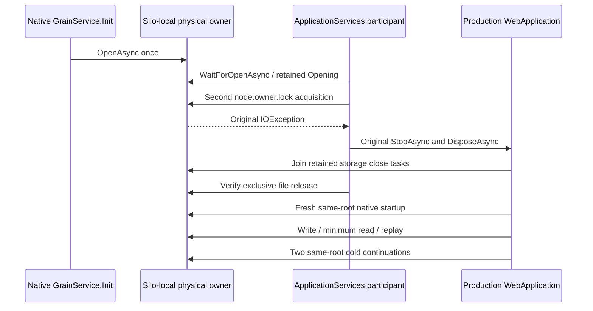

# Native partition-storage partial startup and retained healthy ownership

This case covers [ADR-136](../../ADR/ADR-136-native-orleans-partition-ownership.md)
and [ADR-125](../../ADR/ADR-125-connection-owned-execution.md) connection ownership.
Its source uses the production `ServerConfiguration.BuildAsync`, native Orleans
localhost membership, and the shared `RequestCqrsHostedProfile`. One native silo
and one persisted copy are configured. The same frozen arguments, physical root
and native identities are reused for each cold application.

`PartitionStorageGrainService.Init` initiates physical opening. A test-owned
native lifecycle participant runs at ApplicationServices after
RuntimeGrainServices. It awaits the published original opening, borrows the
actual host, then attempts a real FileStream acquisition of that host's held
`node.owner.lock`. The original IOException comes from that second acquisition;
the storage opening itself must succeed.

The participant retains the actual opening, callback and refused constructor
exception. Complete bounded canonical records, full identity and physical
position are captured before and after the refusal under the actual storage
read gate. Every byte is compared without exposing private identity or record
values in diagnostics. Failed startup must contain the same original exception.

The trial joins actual node request work, observes the original
`WebApplication.StopAsync` task, then observes the retained
`PartitionStorageLifecycle.StopAsync` and physical-owner `Closing` tasks. The
deliberately failed ApplicationServices callback leaves the native silo in
Starting, so native hosted Stop refuses before its lifecycle drain. Only that
exact outer stop refusal can be consumed after the full refusal and release
proof. The two storage close tasks must succeed and retain their original task
identities. Actual generic application disposal must also succeed. A separate
exclusive owner-lock acquisition proves file release before a healthy application
opens the same root. Unknown release or any independent cleanup failure retains
the root and fails the case.

The healthy application submits native ManagedCode commands for ConfigureResource
and Batch through the actual coordinator. One literal document produces an
independently specified complete `ProcessDurable` receipt with one persisted
copy and empty private CompositionReferences. A real connection-grain CQRS
minimum-token Document read returns the full literal document. Replay preserves
the original complete receipt, prepared command and raw persisted `StoredOutcome`
bytes without advancing either the canonical sequence or physical position.
Two actual cold applications repeat the complete identity, receipt, outcome,
minimum-read and release oracles on the same files.

The existing mandatory case is
`PartitionStorageNativeTests.ActualNativeStoragePublicationThenLockFailureJoinsAndSameRootsRetainCanonicalReceiptThroughTwoColdStarts`.
This source adaptation has not yet been compiled or run. The native single-silo
lifecycle and cold-file case does not qualify Aspire cluster operations, public
.NET SDK/official MCP interoperability, abrupt process recovery, power loss or a
storage-init failure after partial file acquisition. Those gates remain open.
Existing configured startup timing, resource limits and cancellation are retained.

## Original native partial-stop error boundary

REQ-PHOST-PARTIAL-STOP-001 / AC-PHOST-PARTIAL-STOP-001: prove the actual callback
and full Before/After native cut before consuming an expected stop error. The
original application Stop task must be faulted with at least one exact native
partial-stop leaf. Every consumed leaf must have exact
`System.InvalidOperationException` type, the complete source-defined Starting-stop
message and null InnerException. Aggregate wrappers are inspected without
dropping empty aggregates. A different failure cannot be accepted through a
substring, exception assignability or cancellation.

The original lower-close and owner Closing tasks must complete successfully.
Repeated access must return those same retained tasks. Their errors cannot be
consumed as the outer stop refusal. Actual `CanReleaseRoot`, joined native request
work, successful application disposal and the exclusive owner-lock probe prove
release. This does not imply native silo termination. If either refusal or
release proof fails, original faults remain alongside proof and independent
cleanup errors. The healthy continuation and both cold applications remain
mandatory.

The native source boundary is [pinned Silo.StopAsync](https://github.com/dotnet/orleans/blob/d114d7522a53b8cce4c6b97d44293e5c7273d766/src/Orleans.Runtime/Silo/Silo.cs#L268-L284),
[SiloHostedService](https://github.com/dotnet/orleans/blob/d114d7522a53b8cce4c6b97d44293e5c7273d766/src/Orleans.Runtime/Hosting/SiloHostedService.cs#L22-L32),
and [.NET 10.0.10 Host attempted-start/stop](https://github.com/dotnet/runtime/blob/v10.0.10/src/libraries/Microsoft.Extensions.Hosting/src/Internal/Host.cs#L195-L269).
The original task/error assertions define this case's required behavior; they
are not evidence of a verified upstream defect or an executed runtime result.
