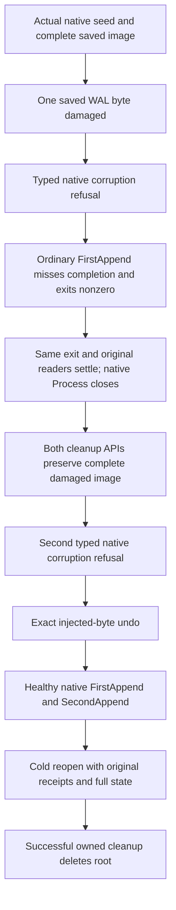

# Original recovery failure retains its native root

REQ-RECOVERY-CLEANUP-001: a known initiating failure or any process/reader/close/file-readiness/native-handle error prevents root deletion. The same actual child, original exit observation and original readers settle through their existing owners; a completed process alone is not reader settlement. Unknown reader work prevents raw Process disposal. All original bounds, caller cancellation and clocks remain unchanged.

REQ-RECOVERY-CLEANUP-002: preserve the original failure objects and every independent cleanup failure. The seeded operation passes its actual failure context and reconciles only reference-equal helper rethrows; it never blindly flattens an original aggregate. Native fatal-first ordering remains authoritative. Blob cleanup retains the full original drain Task fault vectors, cancels its SAME linked reader token only after an initiating failure and joins the SAME original tasks under its existing cleanup deadline. No new reader/process/provider or replacement wait is a join proof.

REQ-RECOVERY-CLEANUP-003 / AC-RECOVERY-CLEANUP-001 maps to [RecoveryFaultRootRetentionTests.ActualFailedNativeAppendRetainsDamagedRootThenExactUndoHealthyReplayAndCold](../../../tests/KeyLoad.RecoveryTests/StorageRecovery/Cases/RecoveryFaultRootRetentionTests.cs) and [its whole-operation owner](../../../tests/KeyLoad.RecoveryTests/StorageRecovery/Scenarios/Faults/RecoveryFaultRootRetentionFlow.cs). Seed the actual existing native checksum-profile corpus and capture the complete original WAL/files. Corrupt only the saved frame byte. The existing typed CorruptionRefusal operation succeeds before and after one failed ordinary FirstAppend attempt.

That failed attempt must have clean native startup, a live original caller deadline, exactly the actual EOF-before-required-completion exception object, independently observed natural nonzero process exit before kill-only cleanup, both original readers and exit settled, and the actual native Process closed. Independent errors, output overflow, cancellation or unexpected startup failure fail the case. Missing completion/nonzero exit is not a typed Corruption reply or exclusive root-cause proof. Retain this failed attempt in an actual closed-field JSON sidecar linked to the original native evidence containing SIX successful phase receipts. The same failed child remains owned by the RunAsync attempt until original bounded cleanup has run; any unsettled child is retained by its actual failure.

Call both shared cleanup boundaries with that SAME actual failure. The entire bounded damaged file inventory must remain unchanged afterward. Undo only the injected fault using the exact captured WAL bytes; this is test-owned rollback, not product corruption repair. Execute the original healthy FirstAppend, SecondAppend and Cold phases with full native corpus, triad, receipt/replay and authority oracles. Preserve all six original successful phase receipts and the separate failed attempt. Only a fully successful final cleanup may delete the root. Directory deletion itself is not an atomic recovery operation.

The existing [SeededWalCorruptionWholeProcessTests](../../../tests/KeyLoad.RecoveryTests/StorageRecovery/Cases/SeededWalCorruptionWholeProcessTests.cs), document/index/time-series/ANN, messaging, event-projection, text-projection and blob process operations remain required. This bounded helper correction does not qualify RF3, power loss, endurance, every failed native Dispose or a full product task. [ADR-117](../../ADR/ADR-117-native-tunit-ci-entry.md) retains native TUnit ownership; [StorageRecovery](../StorageRecovery.md) retains current-format authority. Compiler/analyzers, actual new-case discovery, process execution and Linux qualification remain OPEN until original Main-owned evidence exists.
