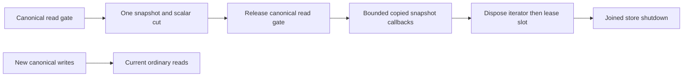

# RuntimeReadCuts within StorageRecovery

A provider-owned, runtime-only snapshot lease ([ADR-097](../../ADR/ADR-097-read-cut-leases.md)). The existing synchronous `IAtomicStore.Read` view and borrowed bytes still cannot escape their callback. This primitive supplies capture and lifetime only; online index delta retention, catalog publication and restart recovery are outside it.

The silo-local Grain Service reads the canonical sequence directly from the supplied read view. An absent sequence record denotes the initial zero cut; malformed bytes retain their rejection. It captures the store identity and any local storage position under that same gate. A callback must not call `DatabaseEngine.LastApplied` or enter another `Store.Read`, because those operations acquire the store gate again.

The index builder scans while the canonical read gate is held, and copying an entire database would add unbounded retained memory. The native MVCC engine provides read-only snapshot transactions. One finite provider-owned lease owns its transaction and iterator, with copied callback bytes and explicit shutdown joining. It introduces no other database and does not move storage ownership.

`DatabaseEngine.ReadStoredCommand` selects the exact persisted outcome by principal,
command identity and atomic scope under one synchronous read gate. It validates
the current principal, original content fingerprint, outcome incarnation and
scope before returning the owned prepared command and its canonical sequence.
A fresh identity with no persisted outcome returns null. Cancellation is checked
inside the gate before lookup and before returning; this does not interrupt an
already running lock acquisition. The retained-command cases use 65 real
commits, unchanged whole-store images, exact command bytes, changed-content
refusal, prepared-command corruption and repair, healthy follow-up and two cold
opens. Full unit execution and delivered-source qualification remain open.

## Concurrent document and index scan

REQ-CUT-005 and **AC-CUT-DOCUMENT-INDEX-SCAN-001** strengthen the concurrent-scan criterion. One real ZoneTree/TestDatabase read
callback must scan canonical document records and their declared scalar index
under the existing committed read gate while an actual independent database
writer attempts one atomic replacement/delete/insert batch. A bounded real
callback barrier holds that scan; the writer reaches its operation boundary and
remains pending until the gate is released. Every copied old document JSON,
revision, tombstone/index membership and captured cut must match an independent
literal reference model. After releasing the barrier, join the original scan and
writer tasks, require the complete successful batch receipt, and scan the exact
new document/index state and new cut. Close/reopen and a fresh valid command must
preserve that state and prove continued store usability.

The whole-operation case owns its finite barriers, cancellation, original tasks,
copied callback bytes and store directory. Release barriers and join both original
tasks on every failure path, retaining primary and cleanup failures. No sleeps as
the sole overlap oracle, detached timeout tasks, fake provider, production hook,
write bypass, assertion weakening or unbounded materialization is allowed.
No borrowed view/span or iterator may escape its callback. Keep persisted
authorization and the production document/index mutation path intact.

The overlap flow is the unchanged committed-view/lifetime boundary of ADR-004 and ADR-097: no new persisted format, public API, dependency or topology, and frontend/SDK/MCP additions are N/A. It does not measure snapshot/segment-movement overhead at the required scales; those remain separate measurements.

| Requirement | Acceptance and mapped real-provider TUnit tests |
|---|---|
| REQ-CUT-001: capture one exact canonical cut | AC-CUT-001: capture only from this runtime's live `Read` callback while its read gate is held; lease captures Position and scalar format/key-codec/node/incarnation/durability/pause/read-generation fields from that cut, excluding signing material. Later committed insert/update/delete leaves the old snapshot exact while a fresh ordinary read sees all changes. `ReadCutConsistencyTests`. |
| REQ-CUT-002: finite admission and work | AC-CUT-002: one snapshot lease per runtime; a second capture fails ResourceExhausted without opening a iterator. Positive finite record/byte/duration limits are validated before capture. Each advance, examined key/value and delivered callback is charged before copying/delivery; cancellation and elapsed checks precede and follow calls. Exact record/byte saturation, cancellation and a following healthy lease are covered by `ReadCutBudgetTests`. |
| REQ-CUT-003: owned bytes and runtime lifetime | AC-CUT-003: CurrentKey/CurrentValue are immediately copied before user callbacks; logical values are the exact native MVCC values. No view/iterator/memory/signing key is returned. Only one active traversal uses a lease; concurrent/reentrant traversal fails explicitly. Sequential prefix visits preserve the same snapshot and cumulative limits. Dispose closes admission and joins actual traversal/leases before tree shutdown, releases the iterator and its snapshot transaction before the slot, and preserves primary plus cleanup failures. Repeated disposal never releases a live iterator's slot or closes a settled handle again. Whole-tree snapshot installation rejects ResourceExhausted before mutation while a lease is active; ordinary compaction preserves the leased tree. Actual callback overlap, store shutdown, cancellation, replacement rejection and reopen are covered by `ReadCutLifetimeTests` and `ReadCutReplacementTests`. |
| REQ-CUT-004: exact provider limitations and unchanged authority | AC-CUT-004: capture uses the pinned native `BeginReadOnlyTransaction()` snapshot and its iterator. It is not restartable or a token authority. No WAL, canonical record, format, public wire, cache authorization or write acknowledgement changes. Complete Aspire unit/scalar/recovery/cluster and exact-source Linux gates remain required. |

## Shutdown, reopen and state preservation

The AC-CUT-003 shutdown/reopen oracle captures the actual committed bytes, position and complete StoreIdentity before shutdown. After joined disposal and reopen it asserts those exact values, including signing-key bytes; a non-null reopened value alone does not establish state preservation. It then commits and reads a distinct healthy value, reopens again and asserts the updated value and position with unchanged identity. Every original callback, task, cancellation, deadline and cleanup assertion is preserved, and there is no fake failure, new hook or duplicate shutdown scenario. The helper-only aggregate-exception test is not a product-operation contributor.

Capture is synchronous and native snapshot acquisition and `Next` have no
cancellation API. Elapsed checks detect and reject overruns after those calls;
they do not interrupt a blocked call or promise a hard wall-time bound.
Never detach a task or abandon it with a second timeout. Cancellation is
cooperative between actual calls, and cleanup joins the original work.
This limitation is explicit and does not satisfy a future hard-deadline criterion.

If iterator disposal fails, keep the actual iterator and the runtime's
active lease slot owned. Do not clear the sole handle, admit another lease or
permit tree replacement. A later disposal attempt joins any original traversal
and retries that same unsettled handle; concurrent disposers observe the current
attempt's actual completion. Preserve the original operation and cleanup failures.
Only successful disposal clears handle ownership and releases the slot.
An elapsed-budget error reported after successful cleanup must not retain a
closed handle. Scalar cut construction precedes iterator creation, so a
failed allocation cannot lose an iterator created just before attachment.

An elapsed limit is one lease-lifetime failure (AC-CUT-002/003): observing that same expired limit during traversal and joined disposal retains the same exception identity instead of manufacturing two independent failures. Independent execution, callback and cleanup failures remain separate. The required oracle is exactly BudgetExceeded, released admission and a healthy following real lease; no timeout, bound or assertion is weakened.

A synchronous cleanup wrapper rethrows a single outer aggregate around the original exception (AC-CUT-003); capture retains its direct inner exception object without Flatten, including an empty or nested original aggregate. disposal counts that retained failure before clearing the actual iterator or slot. A real-exception retention regression tests this helper only and does not claim an injected provider failure. Every concurrent traversal fixture releases its real barrier and explicitly joins its original task even when an assertion fails, retaining both observation and cleanup failures through the existing test failure observer, without broad swallowed catches. No fake iterator, diagnostic suppression or reduction of original assertions or timing is permitted.

Runtime shutdown joins these leases before cache closing or tree disposal.
Failed lease cleanup closes only new lease admission and leaves the actual tree,
cache and owner handles available for joined shutdown retry. It must not continue
tree disposal after that error. Dispose invoked by a thread holding this runtime's
read/write gate rejects before changing admission or waiting, preserving health.

Required limits have exact ceilings: MaxElapsed is positive and at most one
minute, MaxRecords is positive and at most5,000,000, and MaxExaminedBytes is
positive and at most1 GiB. The elapsed clock starts immediately before capture
and never resets for another prefix visit; idle expiry rejects the next traversal
before advancement. No timer may dispose an actively borrowed iterator.
Sequential prefix visits may seek within the same snapshot, with one active
traversal at a time. Record, examined-byte and advance counts remain
cumulative across every visit, including repeated rows; returned visit counters
describe those cumulative totals. The elapsed clock never resets. A caller's
per-visit oracle compares a count delta against its latest delivered rows.
One-slot admission bounds iterator count; it does not establish an RSS bound or
bound the size of all disk segments pinned by a snapshot. Those separate
provider resource and future retention criteria remain open.

`InstallSnapshot` replaces the tree. Under its existing write gate, after
normal health and stale-cut validation and before copying a staging file or
invoking fault/publication callbacks, it checks the lease lifecycle and rejects
ResourceExhausted while a lease is active. It must not wait under that gate or
enter the replacement poison-on-failure block for this admission rejection.
The write gate prevents a new capture during replacement. The rejection leaves
identity, read generation, journal, caches and current health unchanged; disposing
the lease permits the same verified snapshot to install. `Compact` uses
`replaceTree:false` and remains permitted. Real-provider tests prove the old cut
survives compaction and later writes, as well as rejected and successful snapshot
installation. No state monitor spans operations, callbacks or joining.

Layout: the read-cut helpers live under Storage.ZoneTree `StorageRecovery/{Models,Validation,Queries,Lifecycle}` with an internal `ZoneTreeStore.CaptureReadCut(view, limits, cancellationToken)` join and `ZoneTreeStoreRuntime` lease shutdown joins; `ZoneTreeCheckpointManager` carries the minimal pre-mutation `InstallSnapshot` admission join. `ZoneTreeReadCutLimits` is pure data validated in Validation; `ZoneTreeReadCut` is pure scalar data; `ZoneTreeReadCutLease` owns capture, bounded forward prefix visitation and disposal. The IAtomicStore/IKeyValueView public contracts are unchanged, the visitor delegate belongs to Queries (never Models), and lease lifetime state is split into Lifecycle helpers when the 200-code-line type ceiling requires it. Delivery order is finite admission and capture validation, exact snapshot and scalar cut capture under the existing gate, off-gate copied bounded visitation, then joined disposal for normal and guarded runtimes.

A snapshot alone does not provide online indexing. That requires capturing applied/source/policy/schema and outbox head in the same callback, a bounded retention pin before writes/purge proceed, contiguous delta replay, validation of a new cut, atomic catalog publication and recovery or retirement of interrupted generations. Existing synchronous ITextProjection callers, administration and canonical records cannot silently change, and copying the entire corpus or claiming that a snapshot alone completes online indexing is rejected. Frontend/SDK/MCP additions are N/A here: no new caller operation. Rollback stops and drains runtime-only leases before removing the helper; persisted user data and format remain unchanged.

## Public retained-reader storage ownership

Original REQ/AC-CUT-001..004 additionally map to the public retained-reader flow in [OnlineGenerationLifetime](../Search/OnlineGenerationLifetime.md) under ADR-097/095/125. ZoneTreeReadCutLease adds internal point lookup and borrowed callback visitation only while its original traversal is active; existing copied VisitPrefix callers remain unchanged. Storage-owned bounded captured scopes distinguish actual absence from unadmitted keys and admit every owned key/value/capacity before copying. The fully owned read-only closure may outlive its joined snapshot; no live view or snapshot remains after slot release, while its same selected FTS reader stays independently leased through the real caller operation. The original one-snapshot/default budget/deadline/format and node-local ownership are exact. This is a runtime-only adapter with no migration or public API.

## Captured scope and point admission

REQ/AC-CUT-001..004 and ADR-097 map to two real-ZoneTree operation regressions in `CapturedReadScopeTests`. The first captures present values, an observed absent key and a prefix, then commits live update/delete/insert, joins the snapshot and original owner, and retains the exact original captured bytes and absence through a cold live open; unadmitted point/range access returns HistoryUnavailable without changing the current store, and fresh live reads and a healthy write succeed. The second exhausts exact point-byte admission before callback delivery, joins the lease, opens a healthy lease and verifies the unchanged cold records. They exercise the accepted runtime adapter and add no storage, authorization, format or public contract. Source review identifies a coverage gap, not an upstream ZoneTree defect.

Complete Aspire unit/scalar/recovery/replicated-cluster and exact-source Linux qualification remain separate gates.
