# Transactional read-view operation

[RuntimeReadCuts](RuntimeReadCuts.md), [StorageRecovery](../StorageRecovery.md) and ADR-004 retain their full committed-view, budget, lifetime and qualification contracts. This operation adds coverage to the existing gate/snapshot implementation; it introduces no product hook, provider, snapshot mode, raw-storage bypass or fallback.

```mermaid
flowchart LR
 Seed[Real indexed document command] --> Snapshot[Capture native MVCC snapshot under the read gate]
 Snapshot --> Hold[Off-gate scan pauses after first copied row]
 Hold --> Writer[Concurrent atomic overwrite/delete/insert]
 Writer --> Current[Writer finishes; fresh point and index reads see full new cut]
 Current --> Refuse[Concurrent traversal and second snapshot refuse]
 Refuse --> Resume[Release original scan; every old row remains exact]
 Resume --> Cancel[Joined disposal and real cancellation refusals]
 Cancel --> Healthy[Fresh lease; healthy command and replay]
 Healthy --> Cold[Two independently joined same-root cold owners]
```

| Requirement | Acceptance and whole-operation oracle |
|---|---|
| REQ-TRANSACTIONAL-CUT-001 A snapshot preserves one complete committed cross-key cut | AC-TRANSACTIONAL-CUT-001: `TransactionalReadViewWholeOperationTests` creates the original actual indexed documents and verifies every document and old/gone/new/keep/healthy index membership through the existing independent literal oracle. Capture one genuine snapshot and all eight scalar cut fields. Its original scan stops after the first delivered row, rather than after completing the scan. A separate real command overwrites one document, deletes another and inserts a third atomically while that snapshot remains held. |
| REQ-TRANSACTIONAL-CUT-002 Off-gate snapshot visitation permits real writer progress | AC-TRANSACTIONAL-CUT-002: await the original writer's complete receipt before releasing the held scan. Verify all receipt fields, every hidden CompositionReferences field and the entire fresh document/index golden. The complete original scan then returns every exact pre-write key/value row, with original cut, full count and advance count. No mixed document/index batch is permitted. This is actual operation overlap, not a lock-count or Task.IsCompleted witness. |
| REQ-TRANSACTIONAL-CUT-003 Read concurrency and cancellation remain bounded and fail closed | AC-TRANSACTIONAL-CUT-003: while the original visitor is paused, a concurrent traversal and a second snapshot capture must independently return the exact existing ResourceExhausted details, without another callback or store effect. Real pre-cancelled capture and cancellation from the first traversal callback must produce OperationCanceledException; traversal binds the actual lease cancellation token. Disposed leases refuse OwnershipLost before callback. No unexpected successful lease is orphaned. A subsequent healthy lease reads the entire current cut. The one-slot iterator policy proves admission count, not total segment-pinning RSS. |
| REQ-TRANSACTIONAL-CUT-004 Failure and task ownership outlive assertions | AC-TRANSACTIONAL-CUT-004: release the real visitor barrier and join both original scan and writer tasks even after an initiating assertion fails. Dispose the exact original lease after traversal settlement. Keep refusal checks, whole-image conservation, all nine identity fields and position checks in independent failure-ledger responsibilities. Callback bounds reuse the original ten-second operation controls; lease elapsed bounds remain one minute. No timing delay manufactures a race. |
| REQ-TRANSACTIONAL-CUT-005 Healthy continuation, replay and cold recovery preserve the committed view | AC-TRANSACTIONAL-CUT-005: execute one healthy indexed document command with its independently authored full receipt. Replay both original command GUIDs and compare complete receipts, hidden references, exact originally saved outcome bytes, every final row, position and nine identity fields. Both original same-root cold owner attempts run independently after closing the prior store. All cold handles and original store settle before fixture directory cleanup. |

The Unit whole-class selector is `TransactionalReadViewWholeOperationTests`. Retain the original `DocumentIndexCommittedScanTests`, all `ReadCutConsistencyTests`, `ReadCutLifetimeTests`, `ReadCutCancellationTests`, `ReadCutBudgetTests`, `ReadCutReplacementTests`, `ReadCutCleanupTests`, `ReadCutClockTests` and `CapturedReadScopeTests`; retained query-read-cut, document session, process recovery and real Aspire cluster .NET/official MCP suites remain mandatory.

Complete Linux current-source Unit/process/replicated-cluster runs and snapshot/segment-movement overhead are separate gates. This operation makes no speed, allocation, RSS, power-loss or production-readiness claim; overhead qualification requires matched Linux measurements and profiling. Cross-partition/global ordering is not implied. SDK/MCP schema additions are N/A for an internal read-view test; actual public clients remain covered by their original required operations. No confirmed upstream ZoneTree defect is claimed without actual failure evidence.
