# stored value header refusal

Owning [StorageRecovery](../StorageRecovery.md), [ADR-003](../../ADR/ADR-003-durability-ack-barrier.md), [ADR-046](../../ADR/ADR-046-storage-private-owners.md), [ADR-097](../../ADR/ADR-097-read-cut-leases.md), [ADR-117](../../ADR/ADR-117-tunit-ci-entry.md).

REQ-EXECUTION-HEADER-001: A nondeleted stored value must have the current live marker before logical payload slicing, copying, observer/reader delivery, cache publication or checkpoint mutation construction. marker0 tombstones remain governed by the deletion predicate; do not turn absent/deleted records into visible errors. Existing captured-read marker guards stay unchanged. No format, alias, new provider, fallback, cache policy, WAL or synchronous durability change.

AC-EXECUTION-HEADER-001: Start the real journal-seeded store and actual acquired runtime/facade with cold point-cache admission. Before ANY point read of the original key, under the original write gate use genuine Tree.Upsert with nonempty invalid marker2 plus the original logical payload. Both owned/borrowed public point reads and both range directions must refuse Corruption, with zero observer/reader/visitor disclosure. Exact invalid bytes, original full identity, identity file, commands.wal and position1 remain unchanged after each rejection. This is deliberate corruption input, not an observed spontaneous upstream defect.

AC-EXECUTION-HEADER-002: Actual CreateSnapshot must refuse the same invalid marker before copying it into persisted mutations; it cannot return a successful complete snapshot. The original CreateNew writer may leave a partial owned output. Actual VerifySnapshot must refuse that incomplete output; delete ONLY this owned closed output after its original calls settle. Live canonical identity/journal/position stay unchanged. Do not invent atomic path publication or new cleanup semantics.

AC-EXECUTION-HEADER-003: Join original owner, reopen the SAME real root so original commands.wal replay re-applies the genuine committed key with live header. Require complete independently expected original row/full identity/position1, then a genuine healthy canonical write and complete two-row position2. Verify successful public owned/borrowed point reads and a complete valid snapshot/verification with independent position2/count2/applied0/incarnation expectations before the two cold reopens. Verify full two-row identity/position through TWO additional cold opens, with every original body/owner/output/fixture error retained and CanAdvance gating reuse and root deletion.

```mermaid
flowchart LR
 Seed[Original genuine journal row] --> Execution[Owned gate marker2 Upsert]
 Execution --> Reads[Point and bidirectional range refusal]
 Reads --> Snapshot[Snapshot and incomplete output refusal]
 Snapshot --> Join[Join original owner]
 Join --> Replay[Real journal replay restores original row]
 Replay --> Healthy[Canonical healthy commit]
 Healthy --> Cold[Two full same-root cold cuts]
```

The empty value path may fail in IsDeleted before these readers and is explicitly unqualified here. good-cache hits bypass raw tree validation; this trial deliberately performs no point read before corrupting an uncached original runtime and does not claim detecting external corruption hidden behind an existing valid cache hit. Linux, process, replicated-cluster, coverage, performance and power-loss gates are separate.
