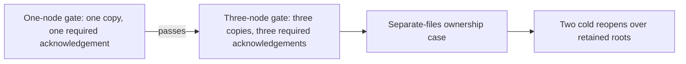

# functional development topology

Parent specification: [StorageReplication](../StorageReplication.md). Cluster concept: [ADR-136](../../ADR/ADR-136-orleans-partition-ownership.md); silo and copy counts: [ADR-143](../../ADR/ADR-143-independent-silo-replica-topology.md).

The functional fixture selects `--KeyLoadTests:FunctionalNodeCount=1` or `=3` in its own AppHost builder, together with explicit `KeyLoad:Ephemeral=true` and an absolute fixture-owned `KeyLoad:DataRoot`. This is not a test-runner flag. Ordinary composition still uses the default of three copies. Benchmark selection and private fault/probe profiles cannot be combined with this selection.

The AppHost resource loop creates exactly node1 for the first gate, or node1/node2/node3 for the second. Each server has its own ZoneTree roots, its own Orleans silo (Orleans owns all clustering), HTTP readiness and connection-owned public request execution. No hidden silos or independently started server resources are introduced. The AppHost/fixture owns all resource startup, readiness, client/process shutdown and retained-root decisions.

The one-node profile runs one copy and requires one persisted acknowledgement. The three-node profile requires all three configured copies. Receipts use `ProcessDurable` with independent `PersistedCopies` values of 1 or 3, checked against each fixture's configuration. A missing required copy blocks successful writes. Available owners may still return earlier committed data after membership settles. Each gate uses its own fresh data root.

Local development image preparation admits only the two exact selectors:

- `/*/*/FunctionalDatabaseGateTests/SingleInstanceRunsEveryModelThroughSdkMcpAndSqlWithPersistedUsers`
- `/*/*/FunctionalDatabaseGateTests/ThreeNodeClusterRunsSameEveryModelScenarioThroughSdkMcpAndSql`

The runner executes the first gate alone, then the second only after the first passes. A class wildcard is not enrolled. Image provenance/receipt validation and conflicting GitHub/local image guards remain in force.

The AppHost validates both positive counts before allocating resources, requires `ReplicaCount <= SiloCount`, and rejects conflicting functional/benchmark selections. Actual SDK/MCP/SQL scenarios remain the separate runtime qualification.

## Physical file cases, owner direction 2026-10-16

The functional qualification includes two distinct requested layouts. The shared
layout means the same physical directory and the same ZoneTree files in separate
silo processes. Giving each silo a child directory on one disk does not prove
that layout.

| Case | Required evidence | Current boundary |
|---|---|---|
| Separate files for each silo | Actual Aspire mounts, distinct persisted store identities and physical file identities; SDK/MCP/SQL model operations, receipt replay and two joined cold reopens over the retained roots. | Supported topology; physical-file runtime qualification is open. |
| All silos read the same live ZoneTree files | Actual same-file identity across the processes plus a supported coherent open/read/write, recovery and ownership contract, followed by the complete public operation flow. | Positive qualification is open. The pinned engine and current owner do not provide this mode. |

ZoneTree 2.0.1 is bound to source commit
`ec774af2223bd87457a0aa985908f0b4e508e4c8`. Its ordinary
[loader](https://github.com/ZoneTree/ZoneTree/blob/ec774af2223bd87457a0aa985908f0b4e508e4c8/src/ZoneTree/Core/ZoneTreeLoader.cs#L132-L190)
opens writable metadata/recovery state; it exposes no qualified whole-tree
read-only open for concurrent independent processes. The selected execution
[sync WAL](https://github.com/ZoneTree/ZoneTree/blob/ec774af2223bd87457a0aa985908f0b4e508e4c8/src/ZoneTree/WAL/Sync/SyncFileSystemWriteAheadLog.cs#L55-L62)
uses `FileAccess.ReadWrite` with `FileShare.None`. Individual segment read sharing
does not establish a coherent cross-process database contract. KeyLoad acquires
its exclusive `node.owner.lock` before opening identity, either store or recovery.

A separate whole-operation ownership guard exercises real competing server
containers against the same live owner directory. Aspire owns their explicit
startup and shutdown. A bounded `IOException` identifying `node.owner.lock`, the
storage-open stack, nonzero process completion and absence of readiness
must prove the refusal; an arbitrary startup error or timeout does not qualify it.
The three original copies must retain their exact data and receipts, accept
healthy SDK/MCP/SQL continuation, and complete the same two cold reopens. These
contenders are diagnostic resources, not additional copies.

That expected refusal is protection evidence only. It does not satisfy the
requested successful shared-files case, permit weaker locks, establish independent
replica copies, or authorize a replacement engine, compatibility path or format
migration. Keep the positive case visibly open until its actual storage contract
and complete runtime evidence exist.

REQ-FILES-001 requires physical independence of the store files of every copy.
REQ-FILES-002 retains the requested literal same-file shared-directory mode as an
open capability, rather than substituting child directories. AC-FILES-001 maps
physical identities, complete public operations and both retained-root cold cuts
to `FunctionalFileOwnershipClusterTests.DistinctFilesRetainAllModelsAcrossCompetingOwnersAndTwoColdReopens`.
AC-FILES-002 requires all competing diagnostic processes and readers to settle
with the exact exclusive-owner refusal before healthy-owner release.
AC-FILES-003 requires a supported coherent same-file engine contract and actual
positive public-operation evidence; no current test result closes that criterion.

The exact local selector for AC-FILES-001/002 is
`/*/*/FunctionalFileOwnershipClusterTests/DistinctFilesRetainAllModelsAcrossCompetingOwnersAndTwoColdReopens`.
