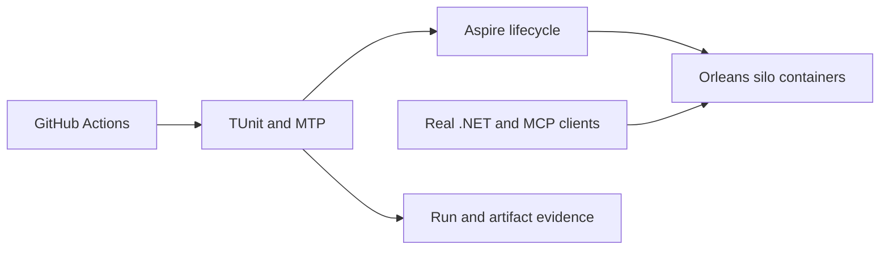
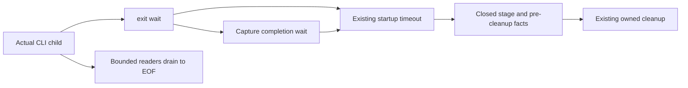
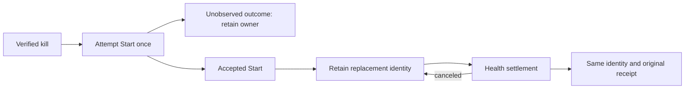
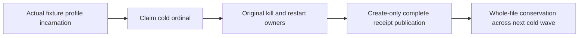

# TestInfrastructure

TestInfrastructure owns how KeyLoad is verified. Tests are TUnit on Microsoft.Testing.Platform. The Aspire AppHost owns the Docker cluster resources, their readiness, test-runner dependencies, execution, scoped fault injection through Aspire-owned resource commands and joined shutdown. The cluster is configured by `KeyLoad:SiloCount` (Orleans silos) and `KeyLoad:ReplicaCount` (copies of each partition; 1 is the default and it never exceeds the silo count). A write is sent through ordinary Orleans calls to the ZoneTree owners of those copies and is acknowledged after every configured copy confirms durable local apply; membership, discovery, placement and activation movement belong to Orleans ([ADR-036](../ADR/ADR-036-orleans-foundation.md), [ADR-136](../ADR/ADR-136-orleans-partition-ownership.md), [ADR-143](../ADR/ADR-143-independent-silo-replica-topology.md)). Cluster tests drive the database through the real .NET SDK and the official MCP C# SDK client, and every owned resource is cleaned up.

## Test framework and real-cluster tests

| Requirement | Acceptance and observable evidence |
|---|---|
| REQ-TEST-001: TUnit and Microsoft.Testing.Platform are the sole .NET test framework/runner. | AC-TEST-001: all test projects compile and run with TUnit; no xUnit/VSTest package or attribute remains; migrated assertions preserve every original scenario. |
| REQ-TEST-002: real replicated-cluster tests launch Docker containers under Aspire and invoke the real .NET SDK and official MCP SDK clients. | AC-TEST-002: CI captures the configured number of independent silo containers (3 by default), stable persisted directories, SDK/MCP success/denial flows and node kill/restart with rejoin. |
| REQ-TEST-003: generated lock files, local data, secrets, logs and test artifacts do not enter Git or the Docker context. | AC-TEST-003: tracked-file inventory and ignore checks reject these outputs; central NuGet versions remain pinned. |

Slice map: tests mirror their product slice; shared fixture/lifecycle infrastructure remains at test project roots. Shared CI/.gitignore/.dockerignore are integration-owned infrastructure. Production data/API/GUI: N/A, this framework migration adds no domain behavior. Blobs and MCP coverage must not be reported complete from framework migration alone.

Traceability: AC-TEST-001 maps to all invoking test projects, AC-TEST-002 to IntegrationTests and ComparisonHost, AC-TEST-003 to source/ignore checks. Delivered-source qualification comes from Linux GitHub runs; local runs and development builds are development evidence. Coverage and complexity policy cannot be claimed satisfied without measured configured gates.

Test report retention (REQ/AC-TEST-001/002/005, AC-MP-012): CI retains the actual root TestResults reports from TUnit alongside each existing scoped report glob. Comparison test reports use a separate comparison-test-results artifact so the measured comparison-suite archive keeps its existing contract; no test, timeout, gate, permission, measured-report schema or ignore rule changes. Retention cannot convert failing or unexecuted tests to success.

## Test entry and suite selection

[ADR-117](../ADR/ADR-117-tunit-ci-entry.md) defines the test entry: TUnit/Microsoft.Testing.Platform runs directly after build. CI starts it through the shard runner `scripts/Features/TestInfrastructure/ci-test-shards.mjs` ([CI shards and lanes](#ci-shards-and-lanes)), local runs select a closed suite through `scripts/Features/TestInfrastructure/run-tests.mjs`, and the TUnit fixtures own the Aspire testing builder, resource startup, readiness, discovered endpoints, real clients and joined shutdown. Unit and recovery suites use the same entry without acquiring a cluster topology. The closed suites are `analyzers`, `unit`, `recovery`, `cluster`, `comparison` and `site`.

The production ASP.NET Core host uses the `KeyLoad` assembly as its application
identity, including when an in-process test owns the host lifetime. Static asset
discovery therefore uses the server's copied manifests. Storage inspection starts
the referenced recovery assembly from its actual compiled location; it never
selects a different build configuration by constructing a `bin/Release` path.

Real process-recovery scenarios live directly in `KeyLoad.ProcessRecoveryTests`, under their feature and role folders. Its `Program.cs` passes ordinary arguments unchanged to the generated Microsoft.Testing.Platform application helper. An explicit `--recovery-process` argument selects a child scenario in that same test assembly. Existing fault phases, acknowledgement markers, exit codes, physical-file checks, abrupt termination and joined process/readers remain observable. Parent tests launch the actual assembly; no additional host project or replacement test runner is involved. Process-kill evidence remains separate from power-loss qualification.

| Requirement | Acceptance | Tests / evidence |
|---|---|---|
| REQ-TEST-009: closed suite selection maps to TUnit execution | AC-TEST-009: each closed suite selects the correct TUnit project, arguments, results directory and optional original TRX/Cobertura settings; unknown or explicit-empty suites, invalid bounded paths, incomplete coverage settings and mixed benchmark modes reject before resources; benchmark modes are excluded from test-suite selection | Current TUnit selector and original suite reports |
| REQ-TEST-010: test entry preserves outcomes and bounded lifetime | AC-TEST-010: nonzero/failed-start/missing-exit/cancel/timeout cannot count as success; stop/disposal always run; every existing CI suite and artifact remains | source lifetime review and actual Linux CI runner exit/status evidence |
| REQ-TEST-011: the replicated cluster is owned once and startup failure releases resources | AC-TEST-011: the test fixture's Aspire application owns the configured Docker silo nodes (`KeyLoad:SiloCount`, with `KeyLoad:ReplicaCount` copies; 1 is the default) and discovered SDK/MCP endpoints, with no idle duplicate nodes; every partial start is disposed before deleting only its owned directory | real Aspire model tests, ClusterFixture source lifetime review, actual Docker cluster/recovery artifacts |

Partial-start cleanup: every Build, image check, Start, profile or readiness failure disposes everything the fixture acquired, preserving the original failure alongside cleanup failures, and deletes only the fixture's owned data directory. Arguments are individual process arguments, never shell text; paths and filters are bounded to 4096 characters without NUL characters, and optional filters are development selection, never a complete qualification claim. Required CI suites set `KeyLoadTests:ReportTrx=true`; an omitted report setting cannot qualify original TRX retention.

Canonical source: `scripts/Features/TestInfrastructure/run-tests.mjs` selects the closed TUnit suite. IntegrationTests owns the real Aspire AppHost lifecycle through `TUnit.Aspire` and retains process readiness, abrupt-fault and joined-cleanup evidence.

### Logger model-control selection

The DIAG-003/005/006 model-control tests build the same real `AddProject<KeyLoad>` graph as ordinary startup and dispose it without starting resources. Invalid explicit control values, nested selections, benchmark selections, missing data roots and non-ephemeral control requests reject before creating resources or files. Container-image selectors are not part of this process graph.

The logger-control fixture maps to the DIAG-003/005/006 contract in [CqrsRequestV2](OrleansExecution/CqrsRequest.md) and ADR-082. Only its explicit true-only selector composes the authoritative cluster resource model and returns after Build before RunAsync. logger operations and original task joins remain real; startup/readiness/Docker/database cluster are N/A for this control. The ordinary ClusterFixture and Wave paths remain mandatory cluster evidence. The testing wrapper owns final application disposal after reader settlement; inherited image/provenance settings are permitted, selected workload modes reject.

`LoggerModelControlSelectionTests` is a UnitTests model-isolation regression for this exact selector. It exercises the real distributed-application builder, options admission, `AddKeyLoad` composition, built cluster model, owned directories, resource annotations and joined application disposal. Incompatible selections must reject before resources or the owned DataRoot exist. This case maps to DIAG-003/005/006 composition isolation only; it does not start resources, observe logger streams, execute database operations, contribute product functional coverage, or qualify Docker/cluster. The unchanged logger whole flows and separate cluster gates remain mandatory.

The rejection matrix also covers `Ephemeral=false` and a blank DataRoot. For all rejected selections, observe the unchanged resource count and absent root before cleanup. Preserve the primary admission/assertion failure, delete only the unique root in `finally` if an unexpected failure created it, retain deletion failures after the primary, then verify the root is absent. This test-only refinement changes neither selector behavior nor product cleanup.

## Scoped fault injection and container lifecycle ownership

All test container lifecycle and fault orchestration runs through the AppHost-owned resources and Aspire resource commands ([ADR-117](../ADR/ADR-117-tunit-ci-entry.md)). Test callers do not invoke engine CLI commands to run, start, restart, stop, kill or remove containers and create no independent cleanup containers. A genuine SIGKILL fault is a bounded command registered on the exact owned ephemeral test resource and invoked through `ResourceCommandService`; a graceful Stop is never substituted for it. Fault commands stay absent from ordinary product and comparison resources unless a separately authorized test-only composition selects them. The AppHost owns the selected resource identity, process and output-reader settlement, readiness, restart and shutdown; read-only container inspection may remain bounded identity evidence but is not lifecycle ownership.

## Explicit local image preparation for the replicated cluster

REQ-TEST-015 / AC-TEST-015 extends the [ADR-117](../ADR/ADR-117-tunit-ci-entry.md) test entry with an explicit `KeyLoadTests:LocalClusterImage:Enabled=true` development mode, accepted only with `Suite=cluster` and an explicit nonblank bounded development filter. Following ADR-117, image preparation is bounded prerequisite work for the TUnit fixtures; it cannot launch an outer AppHost test runner or execute database workloads. The tested child AppHost owns the configured Docker silo nodes (`KeyLoad:SiloCount`; 3 is only the default), readiness, discovered SDK/MCP endpoints, scoped faults and complete shutdown; no idle outer cluster is created. Unknown, non-cluster, protocol-cohort or mixed GitHub/local modes reject before resources. Missing image configuration continues to fail closed in the default mode.

The producer builds the repository server Dockerfile using its actual effective COPY inputs, names, modes and bytes, `.dockerignore` and pinned base digests. It first creates an invocation-owned immutable build-context snapshot of exactly those inputs and builds Docker from that snapshot. It validates the two context COPY declarations separately from the exact internal `COPY --from=build` stage copy; an unsupported Dockerfile or ignore declaration rejects before building. Admission charges at most 20,000 input files and 512 MiB of aggregate bytes before reading or retaining their contents; hashing and copying stream one admitted file at a time. The captured snapshot digest binds the actual Docker build input, including modes; before/after hashes of a mutable checkout alone are insufficient. The producer records a bounded canonical input fingerprint, unique invocation tag, actual local Docker image config ID and a custom input label in a separate `local-development` receipt. A dirty working tree is identified by these inputs, never a fabricated GitHub revision. The config ID is not a registry manifest digest. Before startup, the child verifies receipt schema/bounds, current input fingerprint, actual image ID/label and every modeled node tag. After startup it verifies each owned container's actual image config ID. StartAsync schedules resources asynchronously; await the existing healthy readiness of every node resource within the unchanged two-minute fixture startup token before inspecting their actual config IDs. Both local-image and coverage started-image verification follow that readiness, and all public SDK/MCP operations remain after verification. Do not treat host StartAsync return as proof that Docker has created containers or add a separate retry/deadline. Missing, oversized or malformed receipts, changed inputs, wrong tags/labels/IDs and conflicting proof selectors fail before database effects.

Build failure prevents runner execution. Every failure/cancellation joins the owned producer, runner and child resources. Image cleanup occurs only after owned nodes stop, targets only this invocation's unique tag and rechecks image ID/label before removal; no force deletion, pruning or unrelated-resource cleanup. Cleanup validates the immutable owned receipt, tag, label, image ID and absence of every running or stopped container using that image; a subsequent checkout edit does not prevent cleanup of its proven owned tag. Current checkout input validation remains mandatory before database startup. Cancellation, output-limit failure and timeout signal only the owned process, escalate within a bounded grace period and join its actual exit and both original stream readers. The context snapshot is removed after producer settlement; receipts and a bounded original Docker build-output tail remain available for diagnosing failure. Retain the original development receipt and test reports. Local results cannot qualify delivered-source Linux CI, registry image provenance or website metrics; the existing GitHub image producer and verifiers remain mandatory and unchanged.

Under the same REQ/AC-TEST-015 contract, `local-image-process.mjs` already selects the Docker executable; the owned-image container query in `local-server-image.mjs` must pass only `ps` and its bounded arguments, never a second executable token. Verify the full owned-image prepare, identity verification, cleanup and repeated-absence cleanup operation. Keep receipt/label/config-ID checks, zero running or stopped referencing containers, non-force removal and all original process/reader joins. This local tooling operation does not qualify database cluster, Linux delivery or coverage.

The REQ/AC-TEST-015 snapshot and cleanup contract is realized in `scripts/Features/TestInfrastructure/local-image-context.mjs`, `local-image-snapshot.mjs`, `local-image-process.mjs` and `local-server-image.mjs`, with the filesystem regression in `tests/KeyLoad.FunctionalTests/TestInfrastructure/Cases/LocalCluster/LocalClusterImageContextSnapshotTests.cs`. Admit each metadata entry and its bytes before retaining it; use bounded directory enumeration rather than an unbounded readdir array. Track exclusive staging ancestors for standalone COPY files separately from the unchanged canonical digest entries. The Node regression includes that real COPY path and an actual over-limit rejection followed by unchanged input and healthy capture. Build-output retention uses the existing65,536-byte per-stream cap and a separate invocation-owned `<receiptPath>.build-output.json` file with only original stdout and stderr tail bytes encoded as base64. Write it exclusively after the original producer and both readers settle, on success or failure, before snapshot cleanup; retain its write failure alongside the original failure. No receipt field changes. Only Docker build uses tail retention; introspection keeps its strict output-limit rejection. A reader fault or signal immediately terminates only the owned child, arms the existing kill grace and joins all original work while preserving failures. The C# Node fixture has a60-second operation deadline,8-KiB drained output bounds, owned-child termination and original reader/exit joining. Preserve the operation failure with every cleanup failure; attempt both snapshots and parent cleanup. The C# caller creates the private unique filesystem root, supplies it to Node, and removes only that owned root after original process/readers join, including timeout and reader-failure paths where Node cannot reach its own finally. First admit the exact existing input metadata and limits, then stream admitted regular files into an exclusive invocation context with no-follow/stat checks, preserving paths and file/directory modes. Hash the bytes actually copied; retain no unbounded array of input buffers. Build Docker only from this context, join the original producer and readers, and remove only the owned snapshot after settlement. Image cleanup uses original receipt/daemon identity rather than mutable checkout bytes; startup verification still rejects changed current inputs. The real TUnit/Node filesystem flow rejects a symlink without publishing a partial snapshot, creates the bounded context, changes the original input, verifies the frozen copy/digest/modes, cleans it and successfully repeats the operation. No fake Docker, source-text tests or bound change. An actual prepared image then verifies real Aspire cluster clients/cleanup; filesystem proof alone cannot qualify Docker or Linux delivery. Dependencies, receipt schema, default GitHub path and database contracts remain unchanged.

The slice spans AppHost Features/TestInfrastructure local settings, prerequisite and cleanup; StorageReplication/Resources local image selection; the scripts/Features/TestInfrastructure bounded producer; and separate IntegrationTests StorageReplication local verification and AppHost model regressions. Request admission belongs to Validation and invocation construction to Execution; obsolete executable copies under Models are removed. SIGTERM/kill helpers use generated LibraryImport with AllowUnsafeBlocks enabled only in KeyLoad.AppHost.csproj and KeyLoad.ClusterTests.csproj. This does not enable unsafe code solution-wide or suppress analyzer diagnostics. Tests use the actual Aspire builder to prove dependency ordering and absence of outer nodes; parser/input tests cover negative cells without pretending to prove Docker creation. Real Docker/Aspire SDK and official MCP evidence must prove image identity, every configured node and cleanup. Frontend, production data/API changes and local comparison mode are N/A for this infrastructure stage. Current-image proof remains mandatory; local image preparation never skips or substitutes current-format recovery, SDK/MCP or replicated-cluster cases.

### Default CI image path

REQ/AC-TEST-011/015 retains the two existing image-proof modes. An earlier Linux CI run failed before startup because the local-only IntegrationTests helper treated the shared server image reference as an explicit local selector. A server reference also belongs to the default authenticated GitHub mode and cannot select local provenance by itself.

LocalClusterImageIdentity enters its local verification only when a local provenance or local receipt selector is present. With both absent it leaves the default path to the existing strict RuntimeContainerImage parsing, exact-source GitHub receipt and modeled image checks. Preserve every local provenance/receipt/tag/input/config-ID check and reject incomplete or conflicting local selectors. Do not add fallback proof, synthesize a receipt, accept mutable images or change the actual Docker/Aspire cluster topology.

Existing genuine default-CI and explicit-local cluster operation flows provide the positive/negative evidence; source review alone does not qualify either mode. The ADR-117 ownership and proof contracts remain unchanged.

### Exact local selection and local-image provenance

REQ/AC-TEST-015 and REQ/AC-TUNIT-ENTRY-006: the local-development image mode admits only closed exact filter literals, each a whole test class, a whole-class union or one exact method. The Node selector and the fixture's argument reader accept the same literals; wildcard, prefix, partial, reordered, appended, whitespace and method-only near misses, and inherited GitHub, coverage, benchmark or wrong-suite identity, are refused before any resource is created. Admission only selects existing TUnit cases; it creates no UID, no GitHub identity and no qualification, and a selected case still runs through the real Aspire topology, SDK and official MCP clients with joined cleanup.

When a verified local image is selected, restart and failure receipts record `SourceSha=null` and the separately named `LocalBuildInputDigest`, `LocalImageInvocationId` and `LocalImageConfigId`; a build-input digest is never a Git SHA. A missing, corrupt or substituted receipt or image is refused, with no ambient reread and no fallback. The ordinary non-local path keeps its Git SHA acquisition and GitHub source/run/attempt/PDB/DLL/image gates.

On cancellation the local image verifier emits exactly one allowlisted phase marker (DockerContext, DockerEndpoint, DockerOs, Receipt, BuildInputs, ImageInspect, Identity or Complete) after joining its original process and readers, so the failure receipt names the interrupted step without raw Docker output, identities, paths or environment.

Run-owned failure receipts live under the actual TUnit ResultsDirectory of their own run; a foreign root on the same owner is refused, and the existing 32-receipt ceiling, 80-line/8192-byte bound and privacy clipping are unchanged.

### Serial bounded current-input reading

REQ-TEST-015 / AC-TEST-015 retain the existing immutable local-image build-context and current-input verification operation.

The owning local-image-snapshot.mjs reader may replace each per-file ReadStream with serial FileHandle.read using one reused 65,536-byte buffer, matching the observed existing ReadStream chunk size. Preserve exact sorted header/digest bytes, complete file contents including empty and multi-chunk files, O_NOFOLLOW, original pre/post handle and path identity/stat/size checks, all existing file/entry/byte admission, directory/scaffold closure, initiating and close failures, and the original 30-second verifier. No parallelism, timeout, input selection, receipt/schema/identity or Docker admission change. Snapshot creation and its original copied-stream ownership remain unchanged.

The original AcTest015LocalImageBuildUsesImmutableAdmittedFilesystemSnapshotAndCleansItBeforeReuse adds actual multi-chunk and empty filesystem inputs, independent full-byte snapshot oracles before and after checkout mutation, and joined cleanup, preserving all original symlink/overflow/no-effect/mode/refusal checks and its case identity. Retain old/new exact current-source digest observations and execute the real operation through canonical execution50/SIMD-enabled entry. A healthy prerequisite is not authorization or replicated-cluster acceptance by itself; delivered Linux/source-image/coverage gates remain distinct.

## process settlement and CI suite budget

REQ/AC-TEST-015 requires the local-image lifetime helpers to await already completed original exit/stdout/stderr tasks on every observation-loop entry. A completed reader fault immediately starts owned failure cleanup. Cleanup sends SIGTERM, allows the existing one-second grace and kills only the original owned tree if actual exit remains pending. Five seconds is a failed-cleanup escalation threshold, never successful settlement: record the timeout, retry the owned kill when necessary, await actual exit, then close only still-pending owned pipe handles and await both original readers. Preserve the primary failure before cleanup failures. Never release process/context/application owners while original tasks are unsettled or use a detached continuation as settlement. tests cover an already faulted reader while the child remains alive and cancellation after actual readiness; explicit temporary-directory helpers delete only after process settlement and preserve deletion failures.

Local image cleanup joins in TestSuiteApplication only after actual AppHost stop and producer/runner settlement, under a separate45-second cleanup token, before output settlement and application disposal. Preparation output is included only for explicit local mode. Default GitHub image selection and the full replicated-cluster gates remain mandatory.

REQ/AC-TEST-010 also requires bounded GitHub job time. Build and Tests splits the suites into the sharded jobs described in [CI shards and lanes](#ci-shards-and-lanes): each unit shard and the analyzers-and-recovery job has 30 minutes, each Aspire topology shard 55 minutes with a 45-minute deadline per lane process, and the Build job 30 minutes. No individual suite deadline, required check, artifact or failure predicate is removed. A failed, timed out or cancelled suite, lane or shard remains failed/unqualified, and an unfinished shard cannot qualify the run.

AC-TEST-010 requires original per-suite MTP/TRX evidence from every required CI suite. Its Aspire caller explicitly enables `KeyLoadTests:ReportTrx=true`; an omitted report setting, absent report, cancelled suite or failed runner cannot establish qualification. A missing full-suite TRX receipt is an evidence gap, never a pass.

## Prompt termination on owned Aspire failure

[ADR-086](../ADR/ADR-086-aspire-terminal-failure.md) defines the private lifecycle repair for owned terminal Aspire failures. Dashboard-disabled CLI warnings alone are not topology failures and are not inferred from CLI text; outcomes come from the original TUnit reports.

| Requirement | Acceptance and evidence |
|---|---|
| REQ-TEST-012: owned terminal Aspire failures stop waiting promptly | AC-TEST-012: a runner's FailedToStart, RuntimeUnhealthy, Finished/Exited without an original exit code, or a required long-lived dependency's terminal state fails its workload without consuming the suite deadline; genuine notification tests settle within five seconds of publication |
| REQ-TEST-013: completion and planned fault contracts remain intact | AC-TEST-013: expected WaitForCompletion exit is allowed; nonzero/missing completion exit fails; healthy/running and transient health snapshots continue waiting; no dependencies remains valid; guards are canceled and joined before intentional comparison node kill/restart assertions |
| REQ-TEST-014: original outcome, ownership and cleanup remain intact | AC-TEST-014: runner exit codes, startup exceptions and cancellation remain failures where applicable; AppHost stopping cancels waits; every notification task is canceled/joined, existing diagnostics and stop/disposal remain; unrelated database cells are unaffected |

Aspire lifecycle helpers live in `build/KeyLoad.AppHost/TestInfrastructure`. Distributed product tests use the shared TUnit Aspire fixtures in IntegrationTests. Real resource failure and joined-cleanup evidence remain separate from source/model inspection.

## Central TUnit admission

REQ-TEST-016 / AC-TEST-016 requires every Aspire-owned TUnit runner to receive its execution `--maximum-parallel-tests` argument from centrally bound and validated `IOptions<TestExecutionOptions>`. `KeyLoadTests:Execution:MaximumParallelTests` defaults to50 for ordinary functional tests and accepts only1–50. Comparison selections require1 and reject a larger explicit value before startup per [TUnitEntry](TestInfrastructure/TUnitEntry.md#requirements-and-acceptance). zero/unlimited, negative and above-ceiling values fail before resources are added. Preserve each test's own worker count, workload, deadline and assertions, all required suites and original exit reports. The setting must flow to the actual runner command, including configured non-default values; inherited TUnit environment variables cannot override that validated command argument. This does not cap GitHub benchmark matrices or change measurement workloads. Heavy functional load/mixed-ingestion cases require a separate exclusive selection and stay outside coverage; their real complete-flow qualification remains open under REQ/AC-TUNIT-ENTRY-014.

Aspire model tests map default/configured forwarding, boundary and malformed configuration rejection to AC-TEST-016. Full unit/recovery/cluster and exact-source Linux reports remain required. [ADR-113](../ADR/ADR-113-centralized-runtime-options.md) owns the central options standard; the AppHost owns Configuration/Execution/Validation/Hosting propagation and its focused model regressions.

### Current normal-only suite composition

SIMD is mandatory in every product and test run. TestSuiteProtocol and ProjectForSuite admit only analyzers/unit/recovery/cluster/comparison/site; any other suite name is unknown and refuses before resource creation. TestSuiteResources has no runner-disabled-intrinsics branch: 50 slots for ordinary tests and exclusive scheduling for heavy tests, explicit supported parallelism, comparison isolation of one test at a time, all project/argument/TRX/coverage/path selection and genuine Aspire preparation, readiness, clients and shutdown are retained. There is no ignored alias, scalar alternate or limits/configuration fallback.

### Single normal (SIMD) profile for functional coverage

REQ-CQ-SIMD-PROFILE-001 requires a single current normal profile with SIMD enabled, exact normal/full-group/recovery/cluster source-bound inventories, and closed refusal of scalar inputs without evidence replacement. AC-CQ-SIMD-PROFILE-001 maps to the existing complete ProductionSourceManifestOperationTests operation, current CLI profile refusal controls, full report/descriptor merge and delivered normal functional collection; all must preserve thresholds and genuine shutdown. ADR-117 owns this profile schema and admission rule; no compatibility reader accepts older receipts.

Current profile inventory becomes unit normal full census plus exactly five disjoint normal functional groups, recovery, all 11 cluster contributors and unchanged required ordinary controls. Contributor registry is independently frozen 49 Unit +1 recovery +11 cluster =61; remove only 49 scalar duplicates. Exact remaining operation identities/requirements/modules/state descriptions stay unchanged. The three real test images Unit/Recovery/Integration remain independently source/PDB/compile-receipt bound; redundant scalar Unit reference disappears.

Current descriptor unitCensus has exactly normal, run-status exactly one full normal +five groups, suiteRuns exactly five groups +recovery +cluster; unknown scalar keys, suites, status and profiles reject before file acquisition under exact-key guards. Task Profile ValidateSet accepts normal only. Reject an inherited disabled-intrinsics environment before launching normal work and restore the original environment in finally; scalar receipts are never accepted through a compatibility reader.

All remaining report/TRX UID, source/PDB/image equality, maximumParallelTests50, create-only, file/byte/path/reparse/inventory/refusal/disposal/charged reads and 80/70/90/noDecrease/repeated-input gates remain unchanged. No successful coverage or task acceptance from source/discovery or partial SELECT.

Whole regression: existing ImagesProduceClosedManifestAndRejectTamperingWithoutReplacingEvidence performs prepare/full literal inventory and compile identity checks, failed edited input unchanged, exact repair/healthy verify and create-only refusal. Deepen same operation with actual unsupported scalar contributor/image manifest refusal and unchanged exact repair; no property-only tests. Existing report merge/repeated input/read confinement/process settlement/cluster contributor controls remain in complete selected normal operation set. One complete owning batch compile/normal execution after all edits; root integrates then delivered Linux required. No new scalar runs.

## CI shards and lanes

[ADR-148](../ADR/ADR-148-parallel-ci-shards.md) defines the Build and Tests layout. `scripts/Features/TestInfrastructure/ci-test-shards.json` is the one manifest of shards; `ci-test-shards.mjs` reads it (`matrix`, `run`, `verify`, `inventory`), and its source scan (`ci-test-inventory.mjs`) needs no build. The Release workflow calls Build and Tests through `workflow_call` and publishes only after it succeeds.

| Job | Contents | Filter and concurrency |
|---|---|---|
| Build | governance, website source inventory, static shard partition check, `dotnet build KeyLoad.slnx -warnaserror` | none |
| Named functional operation groups | the namespaces listed for the shard | one process per namespace selected by its descriptive group ID, `/KeyLoad.FunctionalTests/<namespace>/*/*`, `--maximum-parallel-tests 10` on local and CI runners |
| Analyzers and process recovery | compiler analyzers, then process crash recovery | `/KeyLoad.AnalyzerTests/*/*/*` and `/KeyLoad.ProcessRecoveryTests/*/*/*` |
| Named cluster capability groups | one or two lanes per runner | each lane is its own `dotnet test` process, `--maximum-parallel-tests 1 --timeout 45m`, class or method alternation under `/KeyLoad.ClusterTests/*/` |
| Verify test partition | every shard's TRX artifact | `ci-test-shards.mjs verify TestResults` |

Every test job runs `dotnet build KeyLoad.slnx --configuration Release -warnaserror`, because tests read compiled outputs of projects their test project does not reference: ProductionSourceManifestOperationTests reads the image of every solution project, and ColdBootstrapSdkTests launches the CLI from the selected configuration. Local development uses the SDK default Debug configuration. Each job writes original TRX reports below its test assembly's `bin/Release/net10.0/ci-results/<suite>/<shard>/<lane or namespace>` and uploads them even when tests fail. The filters pin the assembly segment, so process recovery tests registered by the functional host run only in the process crash recovery shard.

The manifest balances whole test classes across thirteen cluster jobs and twenty-five lanes using original Linux case durations. Lane isolation kinds and the two-cluster bound stay explicit; browser classes retain their browser-enabled runner. Additional jobs can wait for runner capacity, so this layout balances the existing lanes instead of depending on twenty cluster jobs being admitted together. Actual wall time requires a complete Linux run of this partition.

A lane runs one test at a time, so it holds at most one 3-node cluster at a time and a 4-vCPU runner holds two. Lane kinds keep that bound: `shared-readers` and `shared-exclusive` lanes use one keyed shared cluster and create no clusters of their own; `own-clusters` and `functional-gate` lanes use no shared key; `isolated-clusters` lanes hold the other keyed clusters and tests without a cluster. Each lane process has its own keyed shared cluster, so a test that kills or restarts nodes affects only its own lane. Playwright is installed only on the shards that the manifest marks `playwright`.

The official MCP test client pins the requested protocol revision. Discovery uses the SDK's existing overall initialization timeout and the original caller token. The separate short detection probe is disabled through `DiscoverProbeTimeout = Timeout.InfiniteTimeSpan`, so a slow discovery response during a real silo fault is governed by that existing initialization budget. Protocol validation and the complete SDK/MCP result assertions remain required.

| Requirement | Acceptance and evidence |
|---|---|
| REQ-TEST-SHARD-001: every test class of the analyzer, unit, recovery and Aspire topology projects runs in exactly one shard or lane. | AC-TEST-SHARD-001: `verify` (run by Build) rejects a namespace or class in no shard, a class or method listed twice, a listed class or method absent from the source, a non-unique class name (filters match case-insensitively), an excluded `HeavyLoad` class in a lane and a split class with an unassigned method. |
| REQ-TEST-SHARD-002: a runner holds at most two concurrent clusters. | AC-TEST-SHARD-002: `verify` rejects more than `lanesPerRunner` lanes in a shard, a shared lane with several keys or own clusters, an own-cluster lane with a shared key, and a lane that runs several tests at once while it contains disruptive or own-cluster classes. |
| REQ-TEST-SHARD-003: the executed reports prove the partition. | AC-TEST-SHARD-003: `verify TestResults` (run by Verify test partition) rejects a test identity in more than one report, an inventory class or split method that never ran, a class that ran in a suite it does not belong to, a class that ran outside its shard or lane, and a suite without reports. |

Add a new test class by naming it in one lane or by placing it in a listed namespace; `inventory <suite>` prints the cluster each class uses, whether it stops, kills or restarts nodes, and its current lane.

## Build and Tests boundary

REQ-TEST-PIPELINE-001: Build and Tests runs solution builds, repository checks and KeyLoad functional analyzer/unit/scalar/recovery/cluster tests only. Benchmark sessions execute only from `benchmarks/KeyLoad.ComparisonHost` in the separate Benchmarks workflow. There is no benchmark test suite under `tests/`.

AC-TEST-PIPELINE-001: the unit assembly discovers no BenchmarkComparisons cases; the comparison assembly retains their test inventory and assertions; Build and Tests invokes no comparison suite or benchmark load-generator preparation. Benchmarks executes the transferred contracts in normal and scalar modes and retains original TRX reports. Static workflow/project inventory review is the explicit infrastructure-placement evidence exception; actual Aspire/TUnit discovery and original reports verify the runtime boundary.

## Platform, dependency and release qualification

Actors: the contributor, the CI runner, the release owner and the evidence consumer. Source/config entry points: [canonical CI](../../.github/workflows/build-and-tests.yml), [global.json](../../global.json), [central packages](../../Directory.Packages.props), dependency survey (report removed from repository), [qualification status](../implementation/status.json). Product runtime is N/A: the infrastructure starts and verifies the real product and never substitutes a demo engine.

| Requirement | Acceptance / flows | Test / evidence mapping |
|---|---|---|
| REQ-TEST-004: versions, licenses, dependencies and platforms are fixed for the delivered source | AC-TEST-004: the centrally pinned package/image inventory and source provenance match the actual restore/container; required platform jobs pass, and an incompatible, missing, or license requirement fails explicitly; free comparison engines need no Enterprise edition | Linux-only GitHub qualification; macOS local runs are development evidence only. Restore and inventory alone do not qualify the build or runtime. Original Linux receipts match central inputs but do not retain complete package-graph/archive identity. Clean delivered-source restore/execution/platform qualification remains pending. |
| REQ-TEST-005: the release manifest advertises only verified capability/guarantee gates | AC-TEST-005: all required build/analyze/format/TUnit/recovery/replicated-cluster SDK/MCP gates and the configured coverage/complexity gates pass on the exact delivered SHA; failures, unsupported and unconfigured gates remain explicitly unavailable; power-loss, endurance and fault gates are separate, and a stable release is withheld until the required evidence exists | Consolidated exact SHA/run/job/artifact release evidence; [CodeQuality](CodeQuality.md), [BenchmarkComparisons](BenchmarkComparisons.md), [ResourceExecution](ResourceExecution.md) owning checks |

Negative/edge/error flows: a skipped suite is not passing; a flaky case is a failure; a malformed or missing artifact, a mismatched SHA/profile, an unavailable engine/license/platform or a test resource startup failure never replaces the previous qualified history. An old CI run does not qualify uncommitted code, and a test method name is not a result. [ADR-031](../ADR/ADR-031-modular-all-in-one-resource-isolation.md) and [ADR-036 foundation](../ADR/ADR-036-orleans-foundation.md) fix the topology and capability scope.

Canonical restore uses the unchanged repository NuGet.Config and central pins with a private package directory, preserving the shared global cache. AC-TEST-PACKAGE-001 requires the actual restored VFS10.0.11 archive to match the authoritative exact-version NuGet catalog SHA512 and repository commit, with refreshed asset content hashes and no local feed/project reference. Rebuild and rerun affected whole-operation regressions from those published inputs. A mismatch or missing package fails; earlier local receipts remain explicitly unqualified for published dependency identity. This changes development build inputs only; runtime contracts, licensing decisions and dependencies remain unchanged under ADR-107/117.

Target maps: the shared AppHost, RecoveryProcess, fixtures and workflows are composition/infrastructure; business cases mirror the owning canonical `<SliceName>/` slice; TUnit/MTP is the single .NET framework and runner. Frontend is N/A; real first-render website evidence belongs to BenchmarkComparisons. One integration owner owns the central project, CI and resource graph; bounded test workers keep every assertion and join with real GitHub evidence. Documentation files do not start the local product and do not weaken any gate.

### Source identity and platform gate

[PlatformIdentity](TestInfrastructure/PlatformIdentity.md) is the canonical whole-task supplement to REQ/AC-TEST-004. It maps original clean restore/build, actual archive/source/license closure, managed/ownership and explicit platform dispositions. Clean delivered-source Linux evidence is a separate gate.

## Fixture lifetime and failure evidence

REQ-TEST-006 / AC-TEST-006: real shared fixture ownership transfers only after successful setup. Failure after opening a store releases it before deleting its owned fresh directory; the same path can reopen without a leaked lock. Existing supplied directories are rejected before acquisition or mutation, with their files and real active owner preserved; finally cleanup follows an attempted store disposal even when an environmental disposal failure throws. Admitted background work is released/cancelled/observed before database disposal on every path. Original ten-second admitted-search timeouts begin after cancellation/release attempts; final observation always awaits actual workers and the actual gate holder before store disposal. Real immediate/entered and repeated gate disposal cases assert subsequent real-store usability; environmental timeout/fault branches require the supplemental source audit rather than a synthetic injector. Actual invalid limits/event counts/batch configuration and same-path ZoneTree reopen are independent GitHub TUnit assertions. Environmental cleanup/ coordination failures additionally require full source lifetime review; no fake or local qualification. All existing132 methods/19 migrated roots stay preserved.

REQ-TEST-007 / AC-TEST-007 preserves failure evidence without making failed gates pass. Save the existing bounded cluster diagnostic text both as the last-failure file and as a sequential fixture-owned receipt; cap retained individual files at32, keeping the earliest failures and unchanged per-file privacy/line/byte caps. Bounded filenames contain only the sequence. Actual GitHub artifacts must retain the first replica failure before later MCP failures overwrite the last-failure view.

On comparison cleanup, stop the actual application, copy any existing complete report files using the existing helper, then delete owned temporary data. terminal state, zero exit, deadlines and all existing assertions remain required; retained report bytes are partial evidence when the test fails. Recovery runs on the Linux runner after successful build even if a preceding unit/style/analyzer step fails, with normal job failure preserved and no continue-on-error. A failed build or cancellation prevents recovery. Actual temporary-file IntegrationTests verify first/last receipt preservation, the32-file ceiling and concurrent whole-file writes; source privacy and exact-SHA GitHub first-failure/report/recovery artifacts supplement those assertions. Environmental watch/runner failures must not be replaced by mocks or counted as green qualification.

### Restart receipts

REQ/AC-TEST-007: a failed restart attempt must retain its container generation; otherwise the first receipt shows only the killed old node and later receipts a successful restoration. Capture the public Aspire current ResourceId, closed state/health, exit code and creation/start/stop timestamps before Start, after its successful command and immediately after an existing restart failure. These are sampled snapshots, not a snapshot version or proof of the transition which caused the failure. Version and readiness internals are unavailable and must not be reflected or inferred.

The failure receipt includes the existing verified pre-kill Docker ID/start time, closed failure stage/type, Start success and one immediate read-only Docker inspection of ID/status/exit/OOM/start/finish/error-present. No Docker error text, environment, properties, endpoints, credentials, arbitrary method/type text or payload is included. Only validated identifiers and timestamps are retained; unknown states/types become a fixed unavailable/other marker. At most 32 earliest restart receipts plus one latest view are retained, with80-line/8KiB UTF-8 bounds and filenames containing only the local sequence. The diagnostic has its own three-second inspection deadline after the original failure. Every path after process creation owns termination, reaping and observation of both redirected readers, including setup, wait and reader faults. Mandatory cleanup can extend wall time if operating-system termination is delayed; no hard end-to-end three-second return or detached process/reader claim is allowed. Termination checks an exit race and retries a failed live-child tree kill once; a final live-child kill error is retained through mandatory task joining. If the operating system permanently refuses termination, finite cleanup cannot be guaranteed. This environmental branch needs CI evidence or source review, never a synthetic process failure or a passing lifecycle claim. It releases/awaits its actual CLI process and redirected readers on cancellation, then rethrows the original restart exception even if diagnostic inspection or file writing fails. Existing synchronous whole-file persistence keeps its 80-line/8KiB limit; no hard three-second filesystem-latency claim or detached writer task is allowed. No Start, health, runtime identity, zero-exit, cancellation, timeout, retry count, configured-copy acknowledgement, atomicity, data or cleanup assertion changes.

ContainerRuntimeControl and the closed receipt-kind join in ClusterFailureReceipts use new StorageReplication failure-capture/projection/CLI-lifetime helpers with real temporary-file tests. Tests first prove only selected public snapshot fields survive with canary properties/env/URL/state/identifier/type rejected, whole valid bounded files preserve the first failed generation across later receipts, and32-file retention remains exact. shaped Docker records cover valid identities, safe error-presence projection and malformed ID/state/exit/OOM/timestamp fields; actual stream readers prove output is drained after its retained prefix is full. Do not fake services, Docker or process failures. The real node kill/restart scenario remains the lifecycle test; an environmental failure branch additionally requires exact-SHA GitHub artifact review and source lifetime/predicate comparison. If the next run succeeds, do not claim its unexecuted failure path qualified. ADR-035/036/039 existing privacy/lifetime contracts suffice; no product/public/dependency boundary changes.

### Comparison runner diagnostics

This is a failure-only diagnostic under REQ/AC-TEST-002/005 and AC-MP-012. Before StartAsync, passively retain at most 128 lifecycle records for the comparison runner and its eight direct wait resources. Only fixed resource names, timestamps, local observation sequence, closed state/health categories and exit code are retained. Snapshot version/readiness are internal in the pinned package and remain unavailable; do not infer or reflect them. No properties, environments, endpoints, connection strings, health descriptions, exception text or payloads. On the existing cancellation/timeout path, emit at most 80 lines/8KiB to test-runner stderr, preserving the original failure even if observation or output fails. Keep this diagnostic out of measured comparison archives and retain the eight-minute timeout and existing terminal predicate. Source privacy, memory/task-lifetime review plus actual exact-SHA GitHub resource events are the verification exception for an environmental failure path; no synthetic provider, local AppHost execution or successful-workload claim is allowed.

### Host startup diagnostics

These diagnostics refine the private real-process AC-HOST-003/007 fixture. One existing deadline covers both exit and redirected-output drain; current failure evidence does not distinguish them. Source configuration order is not a diagnosis.

Before the existing timeout cleanup, retain only a closed ProcessExit/OutputDrain stage, actual available exit state/code, closed capture-task states, capped capture lengths and boolean matches for existing static validation markers. The receipt is at most8KiB and keeps the original TimeoutException message prefix. No raw child output, exception text, arguments, environment, paths, endpoints, credentials or unknown values are logged. Diagnostic observation failure becomes a fixed unavailable marker and cannot replace the original startup timeout or caller cancellation.

Each actual StreamReader still uses4096-character reads, retains32768 characters maximum and drains the remainder. Synchronize partial-buffer observation; retain the same20-second shared startup deadline and five-second cleanup behavior. Do not add retries, serialization, sleeps, client/config reorder, product changes or new detached work. Preserve all four configuration/ordering assertions and the real cleanup test. Environmental failure/cancellation additionally needs source lifetime review and the actual GitHub failure receipt; a successful run does not qualify its unexecuted failure branch.

### Global logging EventSource scheduling

REQ-TEST-008 / AC-TEST-008 coordinates the actual global Microsoft logging EventSource across the two diagnostic suites. Listener disposal issues a Disable command; LoggingEventSource disables its global filter state even when another capture remains active. Use a single named TUnit NotInParallel key on McpTransportDiagnosticsTests and GrainFailureDiagnosticsTests, declared once in a TestInfrastructure constant. Preserve all provider/capture/filter and privacy/error/category assertions; no fake logging, sleeps, retries or production diagnostic change. Existing failing category/privacy cases and all grain diagnostics are the regression matrix. ADR039/036 existing contracts suffice; no product/API/data migration applies.

### Aspire startup stage evidence

REQ-TEST-ASPIRE-STARTUP-001: the actual replicated-cluster fixture enables the pinned Aspire profiling source for its own private random session. Before genuine AppHost Start, resolve one AppHost-DI-owned synchronous ActivityListener for only DcpEnsureKubernetesClient and DcpKubernetesApi operations. Admit activities only when their session tag equals that actual configuration. Preserve every original timeout, parallelism, image, public SDK/MCP, readiness, fault and stop/disposal contract.

REQ-TEST-ASPIRE-STARTUP-002: keep fixed-size counters, closed phase flags and only nonnegative long timings/retry counts, plus known/exists booleans. Ignore every other tag, event payload, exception message, stack, path, URL, credential, caller payload, inventory and profiling identity. Retain the first observed error/timeout projection and the latest projection, with no activity objects or per-event backlog. Save exactly two bounded lines (each less than 1,024 UTF-8 bytes) to one closed-name file in the existing original fixture results directory. Existing 32 original receipts, node fairness and 80-line/8-KiB files stay unchanged. Missing observations are explicitly unavailable and do not establish a cause.

AC-TEST-ASPIRE-STARTUP-001 maps both requirements to the unchanged genuine ClusterFixture startup, public client operations and disposal flow, including failure cleanup. The original source-bound report must retain the same first-failure projection and original startup outcome; another fixture session cannot populate it. source/lifetime/privacy review is the explicit manual verification for this environmental diagnostic boundary; actual current-image cluster artifacts and exact-source Linux execution remain OPEN. No synthetic ActivitySource, provider, Docker failure, successful lifecycle or root-cause inference qualifies it.

Slice map: Integration StorageReplication Contracts/ClusterFixtureStartupProfile owns exact pinned first-party keys; Helpers/ClusterFixtureStartupEvidence owns only bounded passive projection; existing ClusterFixtureComposition.ConfigureLogging configures this profile without enabling raw Debug logs; ClusterFixtureDiagnostics.Start resolves the observer before actual start and SaveCoreAsync writes its separate projection after the original receipt. AppHost DI disposes the listener after the unchanged genuine application shutdown. Its synchronous callback checks the same lock/disposed boundary; no background task or alternative network/lifecycle owner exists. Public API, persistence, backend, SDK/MCP and frontend changes are N/A.

### Owned preparation failure diagnostics

REQ/AC-TEST-007/010/014/015 and REQ/AC-TUNIT-ENTRY-006 cover preparation-startup failures of selected cases. Before Build, the session registers a passive host logger retaining only closed category/severity/event ID/exception kind; it never formats messages, exception text, properties, environments or endpoints. Observe actual prerequisite notifications before Start, retain at most128 records, and emit an80-line/8192-byte failure receipt before teardown. Include caller-token and ApplicationStopping states and actual prerequisite state/exit. These identify cancellation provenance; an absent original cause remains unobserved. Prime the original TestSuiteOutput subscription from actual current resource state, then keep its existing stream and joined cleanup. The producer retains its original bounded build-output sidecar under its existing contract; neither an absent stream nor a host-stop flag proves a Docker cause. Preserve primary, diagnostic and cleanup failures together. No deadline, selector, topology, provider, success predicate or qualification gate changes. The diagnostics live in the StorageReplication session and AppHost TestInfrastructure output priming.

Verification requires the original failed preparation receipt and resource logs, unchanged failure/cleanup settlement, followed by the same actual SDK/MCP workflows on the current owned image with complete cleanup. Source lifetime/privacy review supplements environmental failure evidence; no fake provider or synthetic hook qualifies startup. A successful rerun cannot erase the original failure or establish why it stopped.

### Fixture-owned preparation composition owner

REQ/AC-TEST-010/014/015 and REQ/AC-TUNIT-ENTRY-006: The fixture uses pinned Aspire13.6's existing public direct testing builder Create rather than the entrypoint-suspending CreateAsync. An AppHost-owned non-inlined composition bridge ensures stack-based DCP metadata discovery selects KeyLoad.AppHost, then invokes unchanged AddKeyLoad. The session records the actual builder immediately, extracts the original validated runner configuration, removes the recursive runner and verifies its one-prerequisite/no-container model before Build/start. No original standalone Program/TestSuiteApplication is resumed to wait on the removed tests-cluster resource. The session is the sole prerequisite execution owner. direct builder disposal owns the built application after Stop and original output joining; do not separately dispose that same application first. Keep every original primary/cleanup failure, selector, policy, producer, receipt and tag gate. Standalone suite behavior and the authenticated default image path are unchanged.

The pinned [implementation](https://github.com/dotnet/aspire/blob/v13.6.0/src/Aspire.Hosting.Testing/DistributedApplicationTestingBuilder.cs) defines direct creation, stack DCP discovery, Build and builder disposal; the suspended factory instead resumes the original entrypoint. Verification must retain the unchanged original failure and run the same actual SDK/MCP operations on its freshly owned image, proving original producer exit, exact model/container identity, readiness of every configured node and complete stop/reader/lock/tag cleanup. Linux gates remain separate. This repairs a concrete competing source owner; it does not assert the original stopping cause or claim an unexecuted green result.

### TestCluster startup first-cause evidence

REQ/AC-TEST-010 and REQ/AC-TUNIT-ENTRY-010 cover the full Unit startup/client-gateway and joined cleanup boundary. Pinned Orleans10.4 already owns file logging, and a failed full Unit run omitted those files. Failure-only bounded safe projection of the SAME cluster-ID-owned files is saved under actual TUnit ResultsDirectory after genuine joined disposal; uncertain cleanup reads no open logs. Preserve initiating plus every cleanup/capture failure, original execution50/SIMD/startup and operation deadlines, all actual clients and operations. No new logger/provider, endpoint, retry, serial execution or success inference. Limits: actual initial silo count plus client files,1MiB inspected/file,64safe header/exception events,65536UTF8output; saturation/missing/unknown are explicit. No raw messages/config/endpoints/identity/credentials/user body. New original cancelled-startup→joined evidence→fresh signed write/replay/close whole regression and all existing RuntimeConnection/RequestCqrs/RuntimeCqrs operations remain required.

Parser attachments remain bound to the same accepted header; rejected/saturated headers reset continuation identity. Under the unchanged64-event ceiling, actual failure headers may displace the last informational header, retaining exact role/offset ordering and explicit saturation. Unknown/missing evidence never establishes a startup cause.

### Owned fixture failure settlement

REQ-UNIT-OWNED-FAILURE-SETTLEMENT-001: Genuine SampleChunkPartialRetention, RemoteModelMac and ReadGrantFailureSettlement whole operations lexically own their fixture acquisition. Preserve operation exceptions before implicit disposal and all acquisition/disposal exceptions afterward, including fatal errors. Original reverse cold-store disposal and conditional original-store release remain unchanged. Owned MAC credential bytes are cleared on construction/disposal failures without touching borrowed caller bytes. ReadGrant inherits only the independently sealed CancellationToken-last constructor/caller contract; capacity, cancellation, settled grant accounting and complete images stay unchanged.

AC-UNIT-OWNED-FAILURE-SETTLEMENT-001: All original retention/merge/refusal/replay/two-cold, MAC sign/verify/privacy and read-consumer failure→retained charge→settlement→healthy→cold assertions and declarations remain unchanged. No invented failure/provider, no cap/deadline/default/protocol changes. Canonical Unit50 SIMD and exact source/image/current UID discovery remain mandatory OPEN gates.

Source map: TimeSeries/Fixtures/SampleChunks/SampleChunkPartialRetentionFixture.cs and Helpers/SampleChunkPartialRetentionFlow.cs; DocumentStorage/Fixtures/RemoteModelMacFixture.cs; ResourceExecution/Scenarios/ReadBudgets/ReadGrantFailureSettlementFlow.cs.

### Scoped task artifact retention

REQ/AC-TUNIT-ENTRY-010 and existing REQ/AC-TEST-004 require scoped task jobs to retain their original `artifacts/qualification/**` alongside discovery/execution reports, source/DLL/PDB bindings, code-quality and image receipts. A task-job upload which omits this fixture-owned directory is an artifact retention gap and cannot establish an absent observation or a failure cause; the immutable original reports and failed outcomes are preserved.

The existing bounded evidence writers retain closed status/error/numeric metadata without credentials or caller payloads; no new observation, report fabrication, parser, runtime behavior, retry, suite selection or permission is introduced. The functional workflow artifact upload adds exactly that directory, as the full replicated-cluster upload already does. Existing complete mapped operations, no-skip, source/image and joined cleanup gates remain mandatory. CI upload success does not close an operation acceptance gate.

## restart ownership and readiness evidence

REQ-REP-004 / AC-REP-004 and REQ-TEST-007 / AC-TEST-007: an actual successful Aspire Start is retained independently from its health/readiness completion. Once attempted, an unobserved Start outcome cannot be repeated; it remains owned until actual application/resource shutdown retires it. Once accepted, subsequent recovery resumes only inspection, health wait and receipt settlement under the caller's existing token/deadline. It never reissues Start because health wait was canceled. The first observed replacement ID/configured image/image ID/start timestamp is retained and exact unchanged identity is required after health, before the original receipt is published. runtime identity changing during settlement fails; no readiness success is inferred from running state. Kill cannot replace an unsettled prior restart owner. The original initiating error and all cleanup errors remain separate.

The fixture exposes a useful two-phase ownership boundary: BeginContainerRestartAsync accepts the actual Start and observes its running replacement; RestartContainerAsync settles health and receipts for the same owner. This is fixture lifecycle composition, not a product test hook. AC-REP-PARTIAL-RESTART-001: AcEvent008AcceptedRestartCancellationResumesSameReplacementAndPreservesReplay uses an actual killed node/accepted replacement, cancels at the exact-token original health-settlement admission gate, then resumes under the original operation deadline and proves the same running replacement identity, canonical SDK receipt replay, full literal SDK/official MCP aggregate state on every replica. No timer, sleep, fake resource, deadline increase or mutation retry is added. During-health scheduler timing is not claimed: the deterministic cancellation is at the explicit accepted-Start-to-health boundary.

Restart diagnostic refinement: resumed attempts explicitly record AcceptedStartRetained, never a fabricated new Start success. Begin phase failures save the original exception/category at actual StartCommand or RuntimeInspection stage; diagnostic cleanup failure is attached through the unchanged failure-retention path.

First-incarnation readiness evidence under REQ-REP-004 / AC-REP-004 and REQ/AC-TEST-007 does not change admission. For each exact Aspire discovered owned node endpoint, one GET /health/ready is awaited and its bounded response reader settled/disposed. It shares the existing three-second per-node diagnostic deadline with signed discovery, rather than granting either a second budget. Only status200,503,other HTTP status or fixed unavailable is retained; response bodies are drained within the existing8192-byte cap and never retained as readiness explanations. Server's503 body does not identify the DatabaseReady branch, so the branch remains explicitly Unobserved. No server response/auth semantics change or inferred reason is introduced.

Each existing actual ResourceId log subscription records its closed started/running/completed/canceled/faulted state plus observation timestamps of first/last received log lines. These are observer times, not invented event timestamps; observed faults are rethrown for existing joined disposal. Save snapshots this evidence without replacing its original failure. ResourceId-keyed task lifecycle is retained; no unproved reattachment is introduced. Current24-line buffers and80-line/8192-byte total artifact limits remain unchanged. Evidence groups put resource/readiness/discovery/subscription state first, followed by newest retained logs so prefix clipping cannot omit the latest signal. Existing failure markers remain.

AC-REP-READINESS-EVIDENCE-001 maps to the actual AcEvent008AcceptedRestartCancellationResumesSameReplacementAndPreservesReplay flow: canceled accepted restart saves real diagnostic evidence before recovery; after real SDK/MCP healthy replay on every node, another one-shot observation must contain HTTP200 for every owned discovered endpoint and actual log observation state. No fake response/source assertion/timer/retry/increased budget. execution and exact Linux original evidence remain pending.

REQ-REP-PARTIAL-RESTART-001 / AC-REP-PARTIAL-RESTART-001: after the one accepted Aspire Start, fixed-name container removal/recreation is an observable lifecycle transition. Successful execution `docker container ls --all --no-trunc` scoped to the exact anchored owned name may report no container until creation. The original bounded runtime observation continues under its original token, timeout and polling interval; this is not another Start or a database retry. A present observation must contain exactly one full ID and the exact name, followed by inspection of that ID; existing image/start identity and health settlement fences remain mandatory. Docker command failure, malformed or foreign identity, cancellation and cleanup failures remain failures, never absence.

## Cluster operation flows owned by the test infrastructure

### Connection execution cluster tests

ADR-125's REQ/AC-CLIENT-CONNECTION-001/002 and REQ/AC-ORL-013 reuse the existing ADR-117 TUnit-owned actual-image preparation and explicit child identity. The additional exact selector is:

    /*/*/(ConnectionClusterSequentialTests|ConnectionClusterOverlapTests|ConnectionClusterAuthorizationTests)/*

It owns all five expanded SDK/official MCP instances, including actual HTTP/2 same-connection overlap. No wildcard/subset/mixed-image or GitHub identity exception is added. ConnectionClusterScenario starts LocalClusterImageTestSession, passes its explicit Selection through RequestCqrsClusterImageProof and wave startup, verifies every modeled node tag and actual image IDs, and joins the original wave before exact-tag cleanup. Existing caller defaults remain unchanged when this selector is absent. arguments propagate explicitly without ambient image mutation. The established closed private CQRS probe profile remains required for bounded actual operation/activation witnesses. image preparation and source receipt verification precede cluster startup; no stale image, manually started nodes or local benchmark execution is admitted. All measured qualification remains original Linux GitHub evidence. Complete existing positive/ negative selection tests remain mandatory alongside the five actual cluster flows; adding selector code alone does not pass either gate.

### Pinned Aspire endpoint model

REQ/AC-TEST-001: the full Unit model/disposal flow asserts every Aspire-owned endpoint, including the HTTP/2 endpoint. Preserve genuine configured-node model construction, pinned image, identity, mount, readiness/dependency model and joined disposal checks; independently assert ordered http/silo/http2 names, original http target8080/silo11111 and actual HTTP/2 target8081, scheme, unproxied and internal visibility. Move only endpoint assertions/constants into a feature-local helper to retain the existing 200-line type bound. ADR-125 and current owned ClientApi endpoint composition define the existing contract; no topology, port, timeout or platform exception is introduced. Linux runtime acceptance remains separate.

REQ-TEST-001/011/015 and their existing ACs preserve the genuine configured-node model construction, complete endpoint assertions and joined model disposal. In ExactSelectionBuildsTheOwnedClusterModelAndSettlesDisposal the pre-DCP http2.Port is 8081, not null. No deployment port configuration changes are authorized by this test correction.

The primary project AppHost uses one HTTPS endpoint per node. Aspire allocates
its port and the silo/membership ports in ordinary and ephemeral composition.
HTTP/1.1 and HTTP/2 share TLS negotiation on that endpoint. Integration clients,
readiness checks and the CLI use the discovered HTTPS address. CI establishes
trust in the .NET development certificate before starting the real topology;
certificate verification stays enabled.

### Cold restart of every stopped node before readiness

REQ/AC-TEST-004/010/014/015 and REQ/AC-TUNIT-ENTRY-001 preserve the genuine fixture-owned Aspire cluster, same-root volumes, kill/restart receipts, SDK/official MCP/Q1 operations and joined shutdown. After stopping every node, a cold cut must not await the first RestartContainerAsync, whose actual owner waits for cluster readiness while the other nodes remain stopped (QueueLeaseClusterCold awaited it and failed). This is a test-orchestration defect, not permission to change configured-copy acknowledgement requirements, schedule deadlines or authorization.

The orchestration applies to QueueLeaseClusterCold, InboxProcessingClusterCold, QueueProducerClusterCold, SubscriptionFilterClusterCold, TargetInboxClusterCold, SampleChunkRetentionClusterCold and SampleChunkClusterCold. After the original kill-all phase, invoke the existing BeginContainerRestartAsync for every original node using the SAME caller cancellation token and existing failure ledger where applicable. Only then invoke every unchanged RestartContainerAsync and unchanged healthy-resource wait. The BeginRestart owner retains the original killed-container receipt and accepted replacement identity; subsequent RestartAsync validates and settles that same owner, readiness, original volume/image and actual restart receipt. Existing GraphIncomingPublicCold and FeedLiveClusterCold already use this ordering. Parallel Task.WhenAll and single-node/rolling helpers are outside this orchestration.

Preserve all original cases, UIDs/Args, deadlines, health predicates, per-runner50 and exclusive heavy1. Existing server lifecycle, public contracts, aliases/field IDs, storage and packages stay exact. Verification is the genuine NullSelectedService continuation through both cold cuts and public SDK/MCP/Q1 replay/claim/ACK/healthy assertions. Run the remaining affected original cold operations in exact-source Linux task/full suites; a build or supporting control cannot establish their cluster acceptance. The original failure/cleanup ledger stays unchanged. ADR-117 records this unchanged-topology orchestration contract.

### Private cold-wave scheduling

AC-TI-CLUSTER-COLD-OWNERSHIP-001: the six SubscriptionPhasePublicColdTests each own an independent actual Aspire Docker application (cluster) and two same-volume cold restarts. Use the existing TUnit NotInParallel contract for those complete private cold-wave cases, matching the established blob-cancellation ownership pattern. Preserve all original case identities, operations, readiness requirements, tokens, deadlines, SDK/official MCP assertions and joined shutdown. Other independent test classes and the separate Unit runner retain maximum50; this is no concurrency or performance qualification claim.

Sequencing the existing private topology owners admits no skipped case, fake image, relaxed health, silent retry or product deadline change; their unchanged complete operation flows repeat only after the common corrected source/image is built, and original failures remain immutable.

REQ/AC-TEST-004/010/014/015 and ADR-117: standalone SQL cold waves must retain restart evidence under the captured actual fixture profile incarnation plus a positive per-fixture cold ordinal. The stable original topic-sql-original-cold label remains the namespace prefix; exact node1/node2/node3 receipts retain the original complete JSON bodies, inspected container/image/source identities and action/readiness times. The safe canonical namespace rejects malformed or foreign path components. New owned receipts publish only after joined create-only pending-file write, flush and disposal, followed by a non-overwriting rename; collision or failure is terminal and retains original evidence. No persistence, wire, storage or authority format changes, and no compatibility fallback, are introduced.

The existing genuine ModelSqlClusterCold operation still kills all original owners, invokes every original restart concurrently with the same original token, joins every failure and waits for unchanged readiness. Before and after the next cold wave it validates the prior three complete retained files by length and whole-file hash, and captures the new three files after original restart settlement. Owner metadata is weakly bound to the actual fixture, retains only three prior hashes/lengths, and cannot substitute an unrelated profile incarnation. Existing standalone NULLS/FETCH/portal/positive-Execute whole flows remain the operation regression: original policy/refusal/repair, full literal healthy SDK/MCP/Npgsql results, original receipts and two cold waves remain unchanged.

Global NotInParallel and the shared McpCallerProtocol.FixtureKey barrier remain in place. Filename isolation alone does not prove remaining image, process, CPU, resource or fault-control isolation. Removing or narrowing a barrier requires the remaining resource audit and actual matched runtime/CPU evidence; this N-only namespace repair is neither parallel execution nor Linux qualification.

### Cold-start SDK flow

REQ/AC-TEST-010 and ADR039/117: one fresh owning ClusterFixture captures actual selected storage root and path existence immediately before creating the AppHost builder, then starts actual Aspire-owned current-image cluster resources, waits existing readiness, uses its discovered endpoint and the application-owned admin credential through `KEYLOAD_API_KEY` in the actual built CLI status child. Reuse original process reader/exit settlement policy from AppHost; no CLI build/restore, secret argument, manual Docker or deadline expansion. Persist non-admin scoped credentials through actual SDK admin calls, configure collection, derive the expected entity lifetime from that original creation command, submit name-only reads and compare the full literal document, compare complete receipt bytes for same command replay, require changed-content Conflict and unchanged full document plus original replay bytes, then healthy new-ID revision2. Await original fixture shutdown and assert only its owned root removed; primary and cleanup failures remain aggregated.

This is cold data/bootstrap proof on the replicated cluster, not proof of an unprovisioned clean operating-system machine or a single server without external services. The original clean-machine criterion additionally requires authenticated Linux runner tool/image prerequisites and actual execution evidence; the topology remains the Aspire-owned replicated cluster. Existing SdkSubmitReturnedCancellationReusesCommittedReceipt remains separate mandatory UnknownWriteOutcome recovery proof, including its retained original failure.

The fixed internal ClusterFixtureColdStartObservation records only selected Root plus actual directory/file existence after coverage root selection and argument construction, before builder/startup. No callback, fault control or caller-selected root. The whole operation requires that observation absent and exact same actual root after startup. Existing covered cluster profile remains exactly eleven selected cases; this new bootstrap case is normal cluster qualification, not currently eligible for covered selection. Register its actual case through the existing ledger: normal mode is no-op; unexpected covered selection remains rejected, with no whitelist change or coverage suppression. Constructor random root does not establish selected-root identity.

### Coverage preparation ownership

REQ-CQ-039/040 and AC-CQ-039/040 retain the closed original eleven contributor, source/DLL/PDB/image/context and collector admission. No nested empty-string normalization is authorized: nested fixture mode/source are explicitly cleared, suite is absent, and current typed image context remains strict.

The TUnit coverage preparation owner must compose the AppHost directly through the existing Aspire testing builder API, validating outer original-node selection and exact closed catalogue first, then adding the unchanged real prerequisite resources. It must never resume a standalone TestSuiteApplication after removing its runner. The fixture owns preparation start/readiness/output/stop/dispose/collector cleanup; original primary plus joined cleanup failures remain retained. No deadline, image, source manifest, public cluster topology, whitelist or thresholds change. Extend existing genuine source-preparation operation with exact old-selector rejection followed by healthy canonical-selector source admission and unchanged original manifest bytes. This admission control is supporting infrastructure evidence, not product coverage; actual covered cluster eleven original collector flows and Linux gates remain mandatory.

Supporting control owns GITHUB_SHA briefly under the existing globally nonparallel test, using only the genuine prepared source manifest revision, restores the exact prior environment in finally and propagates primary/restore failures. Production selection still checks its original environment source SHA; no bypass parameter or fabricated manifest.

Joined restoration: observe each original environment-key restore individually through existing ServerFailureObserver, continue every remaining key, retain all earlier stop/output/builder/image failures and throw only after restoration settles. Output lifetime disposal and cleanup service lookup similarly retain original failure identities. Prepare primary/cleanup aggregation remains unchanged.

### Signed public read admission cancellation (AC-ANN-008)

The actual current-image Aspire cluster wave may accept the same centrally validated QueryExecutionOptions already owned by ClusterFixture. A typed optional profile is applied before BuildAsync; null preserves every existing caller. It changes no image whitelist, authority, deadline, signed control format or covered-eleven inventory. The explicit ANN profile is disabled outside its owned scenario.

AnnPublicCancellationScenario arms the existing signed v2 AuthorizationReload read phase for one newly persisted c1-probe identity, empty command identifier, ApproximateSearch read kind and actual discovered node. It cancels the original SDK/official MCP token only after that exact signed observation; cancellation and ProducerDisposed settle before retiring the arm, rereading the full canonical literal corpus and performing healthy SDK/MCP/Q1 ANN reads. SDK read cancellation is Cancelled with no page, never UnknownWriteOutcome. Official cancellation is its actual interruption. This proves public admission cancellation only; observed-work and partial-file-write cases separately prove execution cancellation. Existing parent/wave/cleanup deadlines, original task joins, locks and primary plus cleanup retention remain unchanged. No runtime success is claimed.

Source-bound phase precision: the existing signed AuthorizationReload observation is immediately BEFORE GrainRequestAuthority.ReloadForRequest, followed by the original scope recheck and fresh persisted reload. This cancellation case proves pre-reload public read admission settlement, not completed authorization or during-index work. The ordinary healthy follow-up performs actual current persisted authorization and one-cut search; separate worker cases retain the genuine after-work cancellation oracle. No control semantics are renamed.

### Kestrel failure observation

REQ-TUNIT-KESTREL-OBSERVATION-001 / AC-TUNIT-KESTREL-OBSERVATION-001 under ADR-117 and existing ClientApi transport requirements freeze test-only bounded observations for five transport failures: KeyLoadClientNullReadTests.AllAbsentReadsRemainSuccessfulBeforeUnavailableStatusAndFullHealthyContinuation (two existing arguments), KeyLoadClientNullWriteTests.UnavailableSuccessfulWriteBodyRetainsUnknownOutcomeStableRetryAndNullableReads (two existing arguments), and KeyLoadClientTransportTests.MidBodyCancellationMapsReadFailureAndClientCanSendNextRequest. Actual Kestrel start/send/handler/response completion/cancellation records carry only closed stages/status/category and actual monotonic elapsed, ThreadPool available worker/IO threads, pending work and thread count. At most64 records, saturation explicit. No URL/path/header/body/credential/payload/caller value is inspected or emitted. The existing ephemeral loopback Kestrel/default HTTP handler chain, actual client/request tokens, five-second bounds, full original negative-to-healthy assertions and cleanup remain unchanged. The optional observation is passed only by these flows; no extra request, warmup, retry, timer, NotInParallel or product/config change. On actual failure only, emit closed JSON to original stderr before rethrowing the initiating exception; diagnostic-output failures join that same ordered ledger. Success emits nothing. This reveals observed stages only; it cannot infer thread-pool starvation or socket/JIT causation. No helper-only test or synthetic outcome qualifies the contract.

### C1 outcome cause classification

REQ-C1-OUTCOME-EXECUTION-CAUSE-001: the original C1 inspector must retain its first OpenStore failure and identify known database, serializer and runtime causes using only closed enum labels and already allowed numeric codes. AC-C1-OUTCOME-EXECUTION-CAUSE-001: unwrap only original AggregateException first members and TypeInitializationException/TargetInvocationException inner causes, within the unchanged16-level ceiling; preserve original phase, primary failure, exit, all resource joins and the256-byte canonical stderr contract. Emit no exception message, stack, path, class-name string, caller data or credential. Unknown causes remain Other and remain failures.

AC-C1-OUTCOME-EXECUTION-CAUSE-002: the existing real child-process flow must return its original closed OpenStore labels, release the original owner and then read the original literal outcome through the healthy child. All existing malformed-input, scoped-outcome, disposal and cluster persisted-revocation whole flows remain mandatory. New labels are diagnostic evidence only, never proof of an absent outcome or a reason to accept failed inspection. ADR-117 owns execution/report evidence; AC-CRS-005 retains request isolation and persisted authorization. No public/persisted/storage/package/topology boundary changes; no additional ADR is required. Fresh current-source Linux build, normal/scalar process and real cluster results remain OPEN.

### Fixture time admission

TestDatabase is the shared test owner of a genuine ZoneTree DatabaseEngine. Submit without explicit time must use existing DatabaseEngine.ApplyEmbedded, which selects final business time inside the original ordered Store.Commit callback. Submission with explicit DateTimeOffset retains public Apply and its strict supplied-clock/replay/outcome semantics. Preserve the same stable operation ID, serialization, principal, errors and one real commit; no clamp, retry, mock coordinator, new gate or fenced-manager reset. This fixture composition refines TestInfrastructure actual-operation evidence (REQ/AC-TEST-010) and ADR-028 embedded clock ordering, not cluster topology or clock qualification. RuntimeSagaTimeout shared PerTestSession fixture concurrently admits default CompleteSaga/CancelSaga/ConfigurePrincipal/revocation operations while durable-job journal removal commits; pre-gate default clock sampling can therefore race the later committed instant. Existing five actual SagaTimeoutFunctionalTests plus explicit stale-clock/ClockUncertain/replay tests, full normal/scalar and Linux gates remain required. No runtime success is claimed.

CreateWaitingSaga intent: sampled now constructs dueAt, persisted CompareExchangeSaga.Deadline and identical DueWorkHint.DueAt. It is not an externally authoritative command evaluation instant. Sample deadline construction from the owning Database.EvaluationClock, preserve unchanged DueOffset/CompletionTimeout arithmetic and the exact canonical deadline/hint. Submit without explicit time selects final operation evaluation inside existing ApplyEmbedded commit admission. Never widen deadline, clamp time, retry or reset the journal fence. Explicit-time canonical clock/replay regressions elsewhere remain unchanged. Existing five genuine SagaTimeoutFunctionalTests deadline/effect/stale/revoked/completed/canceled and healthy control-job oracles remain required.

REQ-TEST-010 / AC-TEST-010 and REQ-MSG-007 / AC-MSG-007: each actual TestCluster builder carries one private fixture-owner token in its Properties; actual ISiloBuilder.Configuration resolves only that owning fixture. A separately owned fixture cannot replace or clear another builder's owner. Register before build/start, unregister only the same owner during its original joined cleanup; startup failures retain original failure and database cleanup failures. No new product hook, alternate coordinator, timeout or provider. Existing shared PerTestSession and owned boundary fixtures keep their actual Orleans/ZoneTree lifetimes.

The parent expiry whole-flow advances the actual owning clock two minutes after the first committed claim. Its unchanged default30second lease has then expired. Canonical receive replay reauthorizes that lease (CommandOutcomes.ValidateCachedQueueReceive -> Messaging.Lease) and must return exact Rejected/LeaseExpired with null result; serializing that null as a recovered receipt was the test error. Assert complete outer/lane identity, typed failure, no stop error, unchanged original persisted ReceiveResult bytes, every store byte and position, followed by fresh healthy receive. Never extend lease or parent deadline, reset clock, disable strict validation or invent a result. Existing valid receipt replay cases remain intact.

## TUnit Aspire lifecycle

Real distributed tests use `TUnit.Aspire` 1.75.0 and `AspireFixture<Projects.KeyLoad_AppHost>`. TUnit owns shared keyed class data-source initialization and disposal; the fixture configures the AppHost and preserves bounded process-fault, readiness and joined-shutdown evidence. Tests obtain actual endpoints from the started application. Analyzer, unit, process-recovery and static-site tests remain TUnit suites with only the infrastructure their operations require. The Benchmarks workflow owns comparison measurements separately.

### Cluster startup identity and filesystem paths

REQ-TEST-011 / AC-TEST-011: the AppHost starts the configured number of real KeyLoad project processes with one shared database identity and a separate RapidMembership secret. Ephemeral applications generate their identity in memory and expose it through application DI to their owning tests. Tests do not read or write an AppHost credential profile. Persistent development runs require explicitly configured Aspire user secrets for `Parameters:incarnation`, `Parameters:signing-key` and `Parameters:admin-key`; keep these values with the corresponding database storage. Database storage ownership and handle-release guards remain with the storage runtime.

The AppHost resolves aliases in the explicitly configured `DataRoot` to a physical directory before appending node-owned paths. Runtime search/storage guards continue to reject links inside those assigned paths. `ClusterStartupPathTests` builds the real Aspire graph for one, three and five nodes through a linked parent directory, verifies exact project counts, checks that no assigned storage path has linked ancestors, and checks that startup writes no credential files. `ColdBootstrapSdkTests` exercises actual process startup, SDK and CLI operations, and joined cleanup. Graph checks and local integration execution remain separate from complete Linux cluster qualification.
