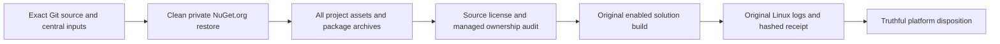

# TestInfrastructure: source identity and platform qualification

This is the canonical source-identity and platform acceptance supplement to
[REQ/AC-TEST-004](../TestInfrastructure.md), with execution under
[ADR-117](../../ADR/ADR-117-tunit-ci-entry.md) and distribution licensing
under [ADR-107](../../ADR/ADR-107-elastic-license.md).

## Scope and decision

The product requires SDK/package/source/license identities, managed/execution
separation, clean restore/build and explicit unsupported platforms. Qualification is
Linux-only, and no package lock file is generated or committed. SDK/C# and central package pins remain in global.json, Directory.Build.props and
Directory.Packages.props; this document must not duplicate their version list.
NuGet.Config selects the intended feed. Centrally declared direct and transitive
pins do not freeze every otherwise unpinned transitive archive: the actual resolved
closure and archive hashes must also accompany the source-bound CI receipt.

Actors are the contributor, Linux CI runner and evidence/release owner. Entry
points are the actual solution restore/build and TUnit selector; no product
endpoint, authorization, storage, provider or topology changes are part of this scope.
No migration, fallback, local feed or temporary project reference is permitted.

## Whole-task requirement and acceptance map

| Requirement | Acceptance and failure condition | Real evidence or explicit review exception |
|---|---|---|
| REQ-TI-PLATFORM-001: one canonical SDK/C# and direct/transitive pin manifest | AC-TI-PLATFORM-001: clean Linux x64 restore and enabled complete Release solution build succeed at the same delivered Git SHA; selected SDK, central input hashes and all actual project graph hashes are retained. A missing project, floating/direct version override, lockfile or restore/build error fails. | Original GitHub restore/build stdout and exit codes, dotnet --info, solution/project inventory and source-bound receipt. This is an infrastructure operation; getter/property or source-word TUnit tests are N/A. |
| REQ-TI-PLATFORM-002: actual package/source/license identity closure | AC-TI-PLATFORM-002: every resolved package/version has its actual archive SHA256/SHA512, NuGet feed/catalog identity, nuspec/source identity and license expression or immutable license-file identity. Missing data, cache/feed hash mismatch or mutable-only source/license identity fails closed. Declared source commit and independently bound upstream release commit remain distinguished. | Hash the actual clean restored archives; retain package metadata, included license bytes and original upstream release/tag/source witnesses. Review exception: upstream licensing identity is an artifact/primary-source audit, not a functional operation or legal compatibility opinion. |
| REQ-TI-PLATFORM-003: managed/ownership is explicit | AC-TI-PLATFORM-003: enumerate actual compile/runtime/execution/runtimeTargets and packaged tools from every project graph/archive. Bind selected RID, archive member hashes and product versus AppHost/test/benchmark consumers; include runtime/base-image requirements separately. No ANN/or managed-only claim follows from package names. | Original assets/nuspec/archive members and actual image/base-image receipts. Static audit exception; no synthetic platform test or fake runtime. |
| REQ-TI-PLATFORM-004: explicit supported/unsupported/unqualified platform disposition | AC-TI-PLATFORM-004: the matrix below identifies qualification target and limits, with Linux execution separately bound to original reports. Missing/non-Linux evidence cannot become Linux qualification; disabled intrinsics in a caller are not a supported server mode. | Actual Linux restore/build and normal/scalar receipts. Existing meaningful scalar operation cases remain the portability oracle; this task adds no property-only tests. |
| REQ-TI-PLATFORM-005: preserve distribution and dependency license identity | AC-TI-PLATFORM-005: root ELv2 operative body equals authoritative published bytes, ManagedCode remains holder/licensor, and actual newly packed/published distributions include the exact root license. Independent licenses/notices remain unchanged. Missing/different license bytes or open-source/automatic-expiry promises fail. | ADR-107's license and real distribution artifact checks. Whole release readiness remains outside this scope; artifact inspection proves packaging only. |

The rows do not require unrelated full-product endurance. The full
unit/recovery/replicated-cluster/coverage gates remain mandatory product qualification and are
not replaced by this scoped evidence.

## Platform disposition

| Platform | Current disposition | Evidence boundary |
|---|---|---|
| Linux x64 | Required qualification target; current clean delivered-source evidence is a separate gate | Actual GitHub runner OS/architecture, clean restore, complete build, package/audit and original operation reports required. Replicated-cluster servers remain real Linux Docker resources owned by Aspire. |
| Linux arm64 | Unqualified | No current task-wide restore/build/execution/runtime receipt; Linux x64 evidence does not qualify arm64. |
| macOS arm64/x64 | Development use only; unqualified for delivered product | Local checks are development evidence. macOS is not a CI qualification target; that is not evidence of runtime incompatibility. |
| Windows x64/arm64 | Unqualified | No current task-wide execution/runtime qualification. Provider-specific clock/durability/platform boundaries remain explicit in their owning features. |
| Browser/WASM, mobile and other RIDs | Unsupported distribution targets for this initial server qualification scope | No server distribution or topology is qualified for these targets. This does not assert that all individual managed SDK assemblies are intrinsically incompatible. |

No platform is advertised production-ready by this scope. .NET's
[Ubuntu installation support](https://learn.microsoft.com/en-us/dotnet/core/install/linux-ubuntu-install)
is a framework prerequisite, not KeyLoad qualification. system libraries
must come from the actual runner/base-image inventory; managed-first does not
mean the .NET runtime or test infrastructure has no dependencies.

## Verification flow

1. Capture one clean delivered-source Linux solution restore using an owned empty package directory and the unchanged NuGet.Config, preserving the shared cache. Retain all project.assets and actual archive hashes, direct/central pins, source/license witnesses and ownership. Do not emit packages.lock.json. Upstream package defects follow their owning release policy.
2. Run the actual enabled complete solution build from those same restored inputs, retaining original failure logs, together with the canonical format, governance and license packaging checks in GitHub. Failures are repaired by their actual owners; no suppression or weakened test is admitted.
3. Bind the relevant existing operation reports and the actual package/publish license artifacts. Authentication, source SHA, input/image/DLL/PDB identity, no skip and cleanup stay unchanged.
4. Promote only satisfied criteria with original source/run/attempt/job/artifact links. A clean restore without a passing build, or a cache snapshot, does not satisfy the criteria.

Negative/error review executes real rejected restore/build/artifact admissions: missing archive, wrong feed/hash/source, missing license/member or a failed build keeps the criteria open. Restore healthy exact published inputs and rerun the original operation; do not fabricate passing receipts or introduce consumer shims. No new runtime behaviour is authored, so code coverage, CRAP, mutation and new functional test creation are N/A to this documentary/audit stage. Existing relevant operation checks and mandatory final product qualification remain unchanged.
