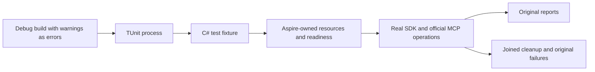

# TUnit execution

## Entry and ownership

Build development and functional tests in the SDK's default Debug configuration
with warnings as errors, then start TUnit through
Microsoft.Testing.Platform. The argument selector at
`scripts/Features/TestInfrastructure/run-tests.mjs` selects the project, filters,
results and diagnostics; it does not implement database operations.

C# fixtures create the Aspire application, await readiness, obtain its endpoints,
execute actual .NET SDK and official MCP operations, and join resource shutdown.
The AppHost owns container lifecycle and bounded fault commands. Unit and process
cases start only the resources they require. Complete source/image/DLL/PDB
identity and original reports bind a run to the tested implementation.

## Requirements and acceptance

| Requirement | Acceptance |
|---|---|
| REQ-TUNIT-ENTRY-001 | AC-TUNIT-ENTRY-001: discovery and execution use the current compiled sources and selected project. Empty selection, missing reports or nonzero exit fails. |
| REQ-TUNIT-ENTRY-002 | AC-TUNIT-ENTRY-002: fixture-owned Aspire resources, endpoints, client operations and cleanup are observed directly. Independent containers and substitute workloads cannot qualify a case. |
| REQ-TUNIT-ENTRY-003 | AC-TUNIT-ENTRY-003: concurrent cases have independent resource ownership; shared fixtures and heavy workloads retain their required exclusions. Configured slots alone do not prove measured overlap. |
| REQ-TUNIT-ENTRY-004 | AC-TUNIT-ENTRY-004: cancellation and failure join the process, both output readers, collectors and owned resources; original failure remains a failure. |
| REQ-TUNIT-ENTRY-005 | AC-TUNIT-ENTRY-005: selected-case success proves only that scope. Full solution, unit, process recovery, cluster SDK/MCP and coverage gates keep their own outcomes. |

Detailed output remains visible. Bound captured output and retain original
TRX and diagnostic artifacts without rewriting outcomes or treating skips as
passes. Coverage admission verifies the actual current test/source inventory,
source-bound images, runtime identities and joined collectors. It must not admit
stale test mappings or a successful partial run as complete coverage.

## Verification

Use the selector and its existing argument, cancellation, process-settlement
and current-source identity regressions. Public operation tests use the real
Aspire-owned topology. Exact-source Linux GitHub artifacts qualify delivery;
local runs are development evidence. Process recovery is distinct from power-loss
durability and endurance. Benchmarks execute separately on isolated runners and
are not functional coverage contributors.
