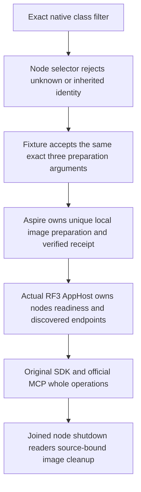

# Exact whole-class local RF3 admission

KL-080 follows [TestInfrastructure](../TestInfrastructure.md) and ADR-117. This is local development admission, not release or coverage qualification. Requirements are frozen before the additive selectors.

REQ/AC-RF3-RELEASE-001: admit exactly six individual whole-class filters and the one ordered combined filter listed below. Preserve all old filters and the sole old native text UID exception. Reject unknown, expanded, reordered combined, partial-method, whitespace, mixed coverage/benchmark and inherited GitHub/local image identities before creating resources. Never accept an arbitrary pattern or generate a UID.

`/*/*/DistributedQueryAuthorityRf3Tests/*`
`/*/*/EarlyAdmissionQualificationTests/*`
`/*/*/MetadataBootstrapRf3Tests/*`
`/*/*/QueryRuleOptimizationRf3Tests/*`
`/*/*/StrongReadSessionAbsenceRf3Tests/*`
`/*/*/TimeSeriesChunkQualificationRf3Tests/*`
`/*/*/(DistributedQueryAuthorityRf3Tests|EarlyAdmissionQualificationTests|MetadataBootstrapRf3Tests|QueryRuleOptimizationRf3Tests|StrongReadSessionAbsenceRf3Tests|TimeSeriesChunkQualificationRf3Tests)/*`

REQ/AC-RF3-RELEASE-002: the Node operation returns the unchanged exact native filter as one TUnit argument and the same three fixture preparation arguments. Defaults, native SIMD, parallelism50, deadlines, results paths, source closure, receipt labels, Docker image identity and cancellation/cleanup stay unchanged. Fixtures use original LocalRf3ImageTestSession, actual AppHost composition and verified image on each original node; a two-group operation must retain both real groups.

REQ/AC-RF3-RELEASE-003: native census is obtained from the actual rebuilt IntegrationTests DLL using its selected whole-class filter. Root retains original discovery JSON, exit, DLL/PDB/source/image identities, all parameter types/instances and TRX outcomes, then verifies exact agreement. Authored source predicts 2 Distributed, 1 Early, 1 Metadata, 4 QueryRule, 1 StrongRead and 1 TimeSeries cases (10 combined); these counts are expectations, not discovered IDs or results. No new UID, synthetic census or source-text PASS is permitted.

REQ/AC-RF3-RELEASE-004: meaningful controls exercise native Node admission/refusal/input conservation/exact repair, actual fixture admission/refusal/environment restoration, and native AppHost preparation model/resource dependency/disposal. Actual image creation, source revalidation, Docker startup/readiness/discovered endpoints, persisted credentials, SDK/MCP operations, cold recovery and joined cleanup remain the original whole-class operations and mandatory Root-executed gates. No fake Docker endpoint, stored receipt or role provider is introduced.

The original instrumented NativeCoverageRf3ContributorCatalog remains exactly 11 cases across seven classes. New selectors do not widen that cohort: DistributedQuery uses two genuine RF3 groups, and parameterized operations cannot be admitted by a method-name-only coverage receipt. Existing registration hooks are conditional on that original cohort, not evidence for these local runs. Frontend N/A: tooling admission only. Full KL080 integrated feature/performance release gates, Linux original execution, UID/source/image agreement and all native cleanup remain OPEN. Rollback removes the seven additive whitelist entries and new regression roles; no persisted format or migration changes.

## Current six-class admission successor

REQ/AC-RF3-CURRENT-001 preserves every preceding selector and additionally admits exactly these six whole classes and their one ordered combined filter:

`/*/*/SafeProjectorOperationRf3Tests/*`
`/*/*/SqlParserAdmissionRf3WholeFlowTests/*`
`/*/*/GraphSearchLineageRf3Tests/*`
`/*/*/AtomicTriadStagedRf3Tests/*`
`/*/*/CompetingInboxPublicTests/*`
`/*/*/QueueViewLeaseIsolationTests/*`
`/*/*/(SafeProjectorOperationRf3Tests|SqlParserAdmissionRf3WholeFlowTests|GraphSearchLineageRf3Tests|AtomicTriadStagedRf3Tests|CompetingInboxPublicTests|QueueViewLeaseIsolationTests)/*`

The same Node selector, fixture environment restoration and preparation-model lifecycle controls cover every new selection. They retain the original six classes and combined filter. New combined-order refusal swaps its actual first two classes; no UID is authored or inferred. AppHost model controls preserve the native nonempty-filter boundary and test mixed-identity refusal before resources, unique image prerequisite, runner dependency, native50 and joined model disposal. Actual native case census, rebuilt DLL/PDB identities, source-bound image creation, SDK/MCP RF3 operations, cold recovery and original cleanup remain OPEN until genuine Root execution; Comparison checks run only in Linux GitHub Actions. Functional coverage remains the original closed eleven-case cohort; these selectors add no coverage contributors or performance qualification.

## Native image ownership for four foundation fixtures

REQ/AC-RF3-IMAGE-OWNERSHIP-001 requires PhysicalOwnerRegistrationRf3Tests,
RemotePartitionQueryRf3Tests, RequestCqrsPhaseFaultTests and
RequestCqrsRf3FollowerRestartTests to use the existing
LocalRf3ImageTestSession before their original image proof and native startup.
The same verified Selection and original preparation owner flow into each
existing wave. Unselected GitHub receipt admission stays strict. Mixed identity,
unknown image or failed preparation cannot acquire database resources.

REQ/AC-RF3-IMAGE-OWNERSHIP-002 requires original caller/producer settlement,
joined AppHost shutdown and storage-lock checks before local image disposal.
Transfer ownership once; join a preparation which fails before transfer through
the existing never-built cleanup. Preserve original primary and cleanup failures,
all physical groups, roots and unknown-ownership retention. The existing restart,
cancellation, persisted permissions, state and complete receipt assertions remain.

REQ/AC-RF3-IMAGE-OWNERSHIP-003 admits one additional exact combined filter:

`/*/*/(PhysicalOwnerRegistrationRf3Tests|RemotePartitionQueryRf3Tests|RequestCqrsPhaseFaultTests|RequestCqrsRf3FollowerRestartTests)/*`

Node and native fixture gates must agree. The current model selection inventory
grows from fourteen to fifteen by appending that single literal; all previous
filters remain. Native Node operation controls also reject expanded/reordered/
partial/whitespace variants and unapproved individual class filters, conserve
inputs and prove the exact healthy selection afterward. Existing
NativeTUnitSelectionTests supplies four native cases for these controls.

The RF3 source declarations predict eight cases: one physical-owner operation,
two SDK/MCP remote-query argument instances, four request-phase fault operations
and one follower-restart operation. Original rebuilt native TRX and exact method/
argument identities must prove eight passed, zero failed and zero skipped.
Parameterless NotInParallel remains on all four classes and native parallelism50
is unchanged. No production code, deadline, assertion, coverage contributor or
UID changes. Source counts and reviews do not prove runtime success.

ADR-117 and the existing image ownership contracts remain sufficient: no new
product/trust/persistence/topology boundary is introduced. Root integrates the
coherent six fixture files and four selector/control files, formats them, builds
the strict solution, passes the four selection cases, then executes the eight
original RF3 operations. Local and exact-source Linux qualification are OPEN
until their own original results exist. No migration or persisted rollout is
needed; rollback reverts this coherent test-only enrollment.

## Lifetime read and preserved native Blob operation admission

REQ/AC-RF3-LIFETIME-ADMISSION-001 appends exactly two selections after the
preceding fifteen current model selections, in this order:

`/*/*/ControlledBlobLifetimeReadRf3Tests/HeldNativeRepliesRequireFreshSourceAuthorityAndSettleBeforeTwoColdBlobReadWaves`

`/*/*/(PartitionMovementBlobWireNativeTests|NativeBlobWholeParentQualificationCases)/*`

The first owns one declared READ lifetime operation under ADR-139; the second
preserves both existing named native Blob operations required by
NativeBlobWireSuccessor. The current source predicts one plus two cases, not
actual discovered UIDs or outcomes. Keep prior selectors, refusal controls,
current native SIMD, TUnit50, original deadlines and scheduling attributes.
The four existing selection/control files must agree on seventeen entries,
reject finite near-miss patterns without changing inputs or creating resources,
and repeat each exact healthy native selection after the refusals.

REQ/AC-RF3-LIFETIME-ADMISSION-002 requires NativeBlobWireWaveStartup to acquire
and transfer the existing verified LocalRf3ImageTestSession only when no
explicit Selection is supplied. An explicit selection remains borrowed; no
second image owner is created. Preserve the same six-container Aspire flags,
original observer, full native fault/effect/receipt/cold assertions and joined
image cleanup after original wave and storage-lock closure.

Root integrates this five-file qualification overlay with the complete lifetime
source, then runs strict format/build, native selection controls and the real
SDK/official MCP operations. Source review and configured admission do not pass
the operation, native 8KiB RPC, cleanup or exact-source Linux gates. No public
API, persistence format, provider, retry, timeout, UID or migration is added.
