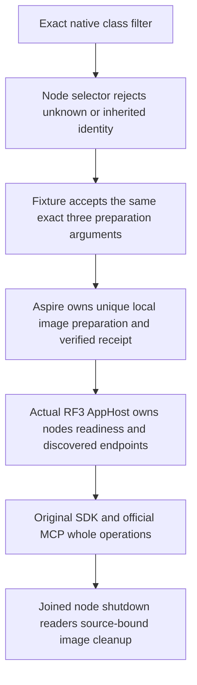

# Exact whole-class local RF3 admission

KL-080 follows [TestInfrastructure](../TestInfrastructure.md) and ADR-117. This is local development admission, not release or coverage qualification. Requirements are frozen before the additive selectors.

REQ/AC-RF3-RELEASE-001: admit exactly six individual whole-class filters and the one ordered combined filter listed below. Preserve all old filters and the sole old native text UID exception. Reject unknown, expanded, reordered combined, partial-method, whitespace, mixed coverage/benchmark and inherited GitHub/local image identities before creating resources. Never accept an arbitrary pattern or generate a UID.

`/*/*/DistributedQueryAuthorityRf3Tests/*`
`/*/*/EarlyAdmissionQualificationTests/*`
`/*/*/MetadataBootstrapRf3Tests/*`
`/*/*/QueryRuleOptimizationRf3Tests/*`
`/*/*/StrongReadSessionAbsenceRf3Tests/*`
`/*/*/TimeSeriesChunkQualificationRf3Tests/*`
`/*/*/(DistributedQueryAuthorityRf3Tests|EarlyAdmissionQualificationTests|MetadataBootstrapRf3Tests|QueryRuleOptimizationRf3Tests|StrongReadSessionAbsenceRf3Tests|TimeSeriesChunkQualificationRf3Tests)/*`

REQ/AC-RF3-RELEASE-002: the Node operation returns the unchanged exact native filter as one TUnit argument and the same three fixture preparation arguments. Defaults, native SIMD, parallelism50, deadlines, results paths, source closure, receipt labels, Docker image identity and cancellation/cleanup stay unchanged. Fixtures use original LocalRf3ImageTestSession, actual AppHost composition and verified image on each original node; a two-group operation must retain both real groups.

REQ/AC-RF3-RELEASE-003: native census is obtained from the actual rebuilt IntegrationTests DLL using its selected whole-class filter. Root retains original discovery JSON, exit, DLL/PDB/source/image identities, all parameter types/instances and TRX outcomes, then verifies exact agreement. Authored source predicts 2 Distributed, 1 Early, 1 Metadata, 4 QueryRule, 1 StrongRead and 1 TimeSeries cases (10 combined); these counts are expectations, not discovered IDs or results. No new UID, synthetic census or source-text PASS is permitted.

REQ/AC-RF3-RELEASE-004: meaningful controls exercise native Node admission/refusal/input conservation/exact repair, actual fixture admission/refusal/environment restoration, and native AppHost preparation model/resource dependency/disposal. Actual image creation, source revalidation, Docker startup/readiness/discovered endpoints, persisted credentials, SDK/MCP operations, cold recovery and joined cleanup remain the original whole-class operations and mandatory Root-executed gates. No fake Docker endpoint, stored receipt or role provider is introduced.

The original instrumented NativeCoverageRf3ContributorCatalog remains exactly 11 cases across seven classes. New selectors do not widen that cohort: DistributedQuery uses two genuine RF3 groups, and parameterized operations cannot be admitted by a method-name-only coverage receipt. Existing registration hooks are conditional on that original cohort, not evidence for these local runs. Frontend N/A: tooling admission only. Full KL080 integrated feature/performance release gates, Linux original execution, UID/source/image agreement and all native cleanup remain OPEN. Rollback removes the seven additive whitelist entries and new regression roles; no persisted format or migration changes.

## Current six-class admission successor

REQ/AC-RF3-CURRENT-001 preserves every preceding selector and additionally admits exactly these six whole classes and their one ordered combined filter:

`/*/*/SafeProjectorOperationRf3Tests/*`
`/*/*/SqlParserAdmissionRf3WholeFlowTests/*`
`/*/*/GraphSearchLineageRf3Tests/*`
`/*/*/AtomicTriadStagedRf3Tests/*`
`/*/*/CompetingInboxPublicTests/*`
`/*/*/QueueViewLeaseIsolationTests/*`
`/*/*/(SafeProjectorOperationRf3Tests|SqlParserAdmissionRf3WholeFlowTests|GraphSearchLineageRf3Tests|AtomicTriadStagedRf3Tests|CompetingInboxPublicTests|QueueViewLeaseIsolationTests)/*`

The same Node selector, fixture environment restoration and preparation-model lifecycle controls cover every new selection. They retain the original six classes and combined filter. New combined-order refusal swaps its actual first two classes; no UID is authored or inferred. AppHost model controls preserve the native nonempty-filter boundary and test mixed-identity refusal before resources, unique image prerequisite, runner dependency, native50 and joined model disposal. Actual native case census, rebuilt DLL/PDB identities, source-bound image creation, SDK/MCP RF3 operations, cold recovery and original cleanup remain OPEN until genuine Root execution; Comparison checks run only in Linux GitHub Actions. Functional coverage remains the original closed eleven-case cohort; these selectors add no coverage contributors or performance qualification.
