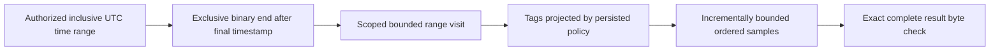
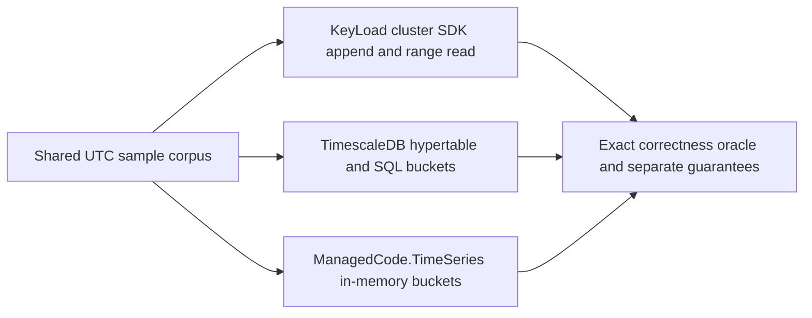
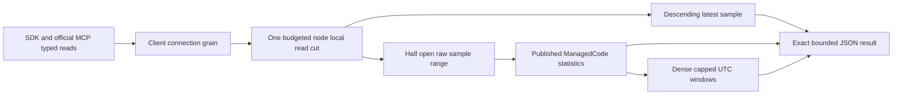
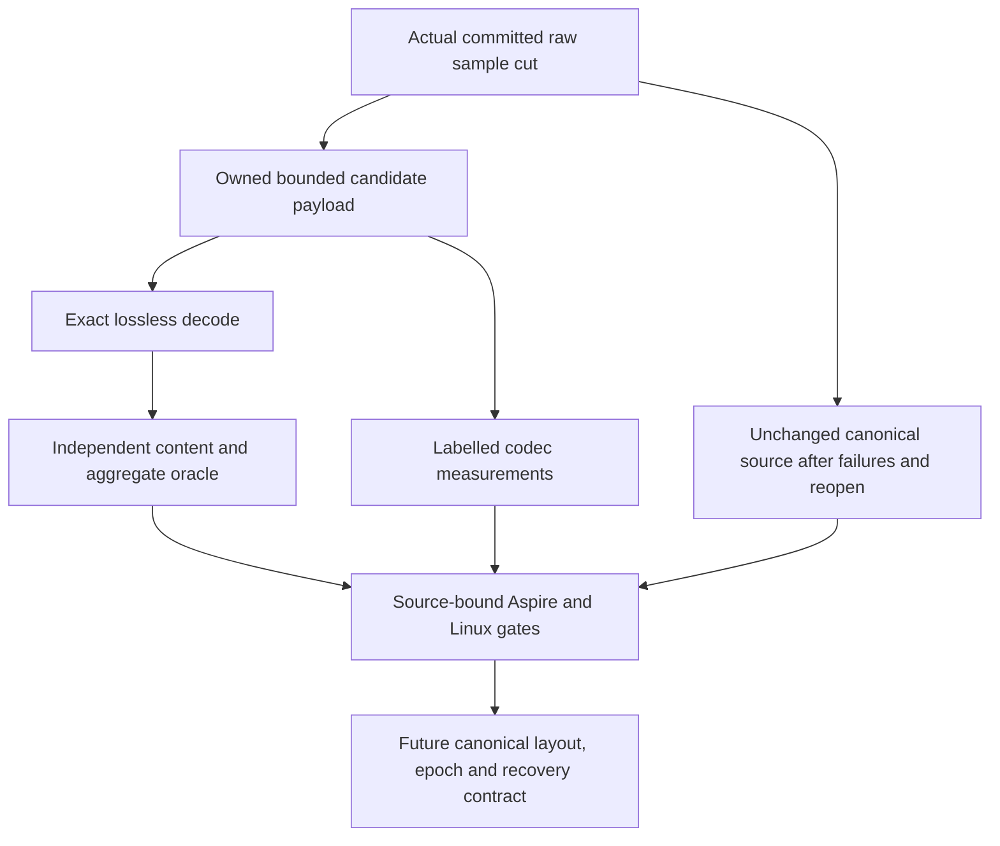

# TimeSeries

## Logged expiry stage

[ADR-073](../ADR/ADR-073-logged-series-retention.md) accepts the
following logged-expiry stage. Its predecessor requirements remain mandatory.

| Requirement | Measurable acceptance | Tests and owner |
|---|---|---|
| REQ-SERIES-013: logged monotone retention is atomic and bounded | AC-SERIES-013: only SeriesManage may submit expiry; future/backwards/invalid-page cutoffs reject without changing samples/floor; one command advances the floor and deletes <= MaximumDeletes; same-cutoff continuation and command replay preserve exact cumulative counts | SampleRetentionMutationTests, real ZoneTree; root joins cluster SDK/MCP |
| REQ-SERIES-014: every series reader obeys the same exclusive floor | AC-SERIES-014: with physically retained older records, inclusive range, latest, half-open raw aggregates and dense windows return only timestamps >= Before; equal timestamp remains visible; Min/Max/offset/empty/request-before-floor cases preserve prior boundaries and dense anchors | SampleRetentionReadTests, all four actual APIs |
| REQ-SERIES-015: late data cannot resurrect expired history | AC-SERIES-015: a new ID below Before rejects the entire mixed batch; a retained identical ID deduplicates without adding a record; changed content conflicts; equal/newer samples succeed; sample sequence and ID receipts survive purge/reopen | SampleRetentionAppendTests and actual-file reopen; root joins process recovery |
| REQ-SERIES-016: lifetime and failure contracts remain explicit | AC-SERIES-016: unknown/corrupt retention state fails closed, shared raw/result/deadline/cancel bounds hold, expiry waits for an actual read gate and leaves the following read healthy, reopen preserves floor/counts; no bucket/handle moves or ID-receipt deletion | SampleRetentionLifecycleTests, real storage gate; root recovery/cluster/format inventory |

Status: bounded inclusive range source present; additive latest/aggregate/window
source joined under ADR-052, with its delivered-SHA CI and remaining gates pending.
[ADR-035](../ADR/ADR-035-memory-performance.md) maps REQ-MP-002 to AC-MP-005/012.

| Requirement | Acceptance | Evidence |
|---|---|---|
| REQ-SERIES-001: stop at the requested timestamp end before decoding later records | AC-MP-005 | Real-store narrow range with large later values, equal timestamps and min/max/offset boundaries |
| REQ-SERIES-002: one work/cancel/deadline and complete response budget | AC-MP-005 | Small raw/result budget failures, exact serialized boundary and cancellation with a healthy following operation |
| REQ-SERIES-003: retain UTC/sequence ordering, dedup and tag projection | AC-MP-005/012 | Existing real append/dedup tests plus persisted-policy range cases |

The existing operation includes both `from` and `until` timestamps; the repair
preserves that behavior. Equal timestamps remain ordered by persisted sequence.
ReadSamplesRequest's end description must reflect the actual inclusive contract.
Schema, append, retention, rollups, public JSON and SDK shapes are unchanged.
UI: N/A. New helpers and tests mirror Features/TimeSeries/.

Tests use real ZoneTree state and TUnit/MTP. Release/static development checks are
distinct from GitHub unit/recovery/cluster SDK qualification and measured performance.

## Time series contract

Actors: sample producers, an authorized range reader and retention/rollup workers. Current API: `AppendSamples`/`SampleData` in the contracts, `ReadSamplesAsync` in the [SDK](../../src/KeyLoad.Client/TimeSeries/Transport/KeyLoadClient.cs); source GraphAndSeries. Canonical identity: partition + resource/set + series; timestamps are normalized to UTC and the sequence orders equal timestamps.

| Requirement | Acceptance / positive, negative, edge, error | Test mapping |
|---|---|---|
| REQ-SERIES-004: append preserves stable sample identity and finite numeric values | AC-SERIES-004: out-of-order input is read in UTC/sequence order; the same EventId and fingerprint is not duplicated; changed content yields Conflict; a nonfinite value is rejected without a partial batch | Existing `OutOfOrderSamplesStayOrderedAndSampleIdIsIdempotent`, `LargeFiniteVectorsAndSampleValuesRemainValidAndSimilarityDoesNotOverflow` in GraphAndSearchTests; explicit mismatch/error expansion PLANNED |
| REQ-SERIES-005: ordered inclusive ranges preserve authorization and the full response bound | AC-SERIES-005: equal/min/max timestamps, empty range, limit and exact byte boundary give a defined result; unauthorized tags are omitted or denied by policy; an exhausted or cancelled read changes no data and does not spoil the next read | Existing [TimeSeriesReadResourceTests](../../tests/KeyLoad.UnitTests/TimeSeries/Cases/TimeSeriesReadResourceTests.cs); REQ-SERIES-001–003 and AC-MP-005/012 are not replaced |
| REQ-SERIES-006: retention, aggregates, rollups and compressed chunks have separate qualified contracts | AC-SERIES-006: PLANNED real-store tests prove declared aggregation windows, late data, dedup, expiry/rebuild/recovery and bounds; the raw oracle matches the chunked representation; an incompatible encoding is rejected | PLANNED unit/recovery/resource suites; ADR-079 adds the bounded codec stage below without closing canonical chunk/recovery acceptance |

Source-present baseline: sample append/order/dedup and inclusive bounded read. Planned: automatic retention, rollups, chunk compression qualification and distributed series execution. Existing inclusive read repair keeps its wire shape; the additive aggregate/latest contract below is governed by ADR-052 and has separate pending source/qualification evidence.

Decisions: [ADR-005 keyspace](../ADR/ADR-005-canonical-keyspace-codec.md), [ADR-010 bounds/security](../ADR/ADR-010-query-budgets-security.md), [ADR-011 current format](../ADR/ADR-011-current-format.md), [ADR-116 first-release format policy](../ADR/ADR-116-first-release-current-format.md), [ADR-030 retention/restore](../ADR/ADR-030-retention-paused-restore.md). Shared codec/storage/replication integration has a single lead; feature helpers and matching tests live in `Features/TimeSeries/`. Frontend N/A. Product tests are real TUnit, process recovery and Docker/Aspire SDK/MCP on GitHub; runtime evidence for the shared source is pending.

## ManagedCode.TimeSeries and Timescale comparison

REQ-SERIES-007 / AC-SERIES-007 map to REQ-BC-026 and AC-TSC-001..006 under
[ADR-050](../ADR/ADR-050-timeseries-timescale-comparison.md) and the
[time-series comparison acceptance](../ADR/ADR-050-timeseries-timescale-comparison.md).
The profile exercises KeyLoad's persisted sample API, a real TimescaleDB hypertable and the published `ManagedCode.TimeSeries` library for in-memory bucket aggregation. REQ-SERIES-007/009/010/011 and AC-SERIES-007/009/010/011 retain their real comparison and raw/window/date-edge/budget/security regression oracles. The library is not KeyLoad's persistence layer.
Reports keep persistence, recovery, replication, and acknowledgement guarantees
distinct; the public API and existing nine-engine matrix remain unchanged. The
comparison implementation and TUnit cases compile in the full Release solution.
Container execution, test results, and exact-SHA comparison artifacts remain
pending GitHub Actions qualification.

## Bounded latest, raw aggregates and dense windows

[ADR-052](../ADR/ADR-052-timeseries-bounded-aggregates.md) is Accepted before
implementation. It freezes exact DTOs, boundary/overflow/budget/security rules,
dependencies, ordered task graph, disjoint ownership and rollback. Acceptance
and execution criteria live in this Feature and the ADR; the durable
normative contract remains the ADR and this Feature. The comparison baseline's
existing API statement above describes ADR-050; it does not erase these additive
product APIs or relabel caller-folded benchmark statistics as server measurements.

| Requirement | Measurable acceptance | Automated mapping / TASK |
|---|---|---|
| REQ-SERIES-008: bounded latest at the current committed cut | AC-SERIES-008: descending UTC/sequence identity, inclusive optional cut, absence/min/max/offset/ties, one matching committed baseline entry independent of history | SampleLatestTests; TimeSeries SDK/MCP parity; /CLUSTER-W8 |
| REQ-SERIES-009: complete raw half-open aggregate using published library | AC-SERIES-009: count/sum/min/max/raw average match independent reference for late/dedup/negative/empty/offset/date edges; null end includes MaxValue; finite overflow rejects safely | SampleAggregateTests and cluster SDK/MCP oracle; /CLUSTER-W8 |
| REQ-SERIES-010: bounded dense UTC windows | AC-SERIES-010: anchor From, positive fixed Width, empty windows, final clamping, raw weighted average, date-edge arithmetic and caller/server window cap checked before allocation | SampleAggregateWindowTests and SDK/MCP windows; /CLUSTER-W8 |
| REQ-SERIES-011: one complete operation/security budget | AC-SERIES-011: positive caller caps, charged sample lookahead fails the whole aggregate, metadata/raw/exact result bytes/deadline/cancel share one view; current SeriesRead, projected latest tags and revocation; failures preserve data and healthy next reads | SampleAggregateBudgetTests, SampleAggregateAuthorizationTests and real cluster persisted-authority cases; /CLUSTER-W8 |
| REQ-SERIES-012: typed public operations preserve real cluster request isolation | AC-SERIES-012.NET/HTTP/official MCP same results/errors/discovery schemas; old enum values preserved; genuine follower kill/restart retains results across all live replicas | TimeSeries cluster integration, typed round trips and official MCP discovery; /CLUSTER-W8 |

Slice map: Abstractions/Features/TimeSeries read/result DTOs;
Core/Features/TimeSeries private readers/accumulator and public static
TimeSeriesReadOperations facade; Client/Features/TimeSeries typed SDK;
Server/Features/TimeSeries HTTP routes. Shared OrleansExecution read-kind/dispatch,
ClientApi MCP catalog and ResourceExecution budget forwarding have one root
integration owner. StorageRecovery owns shared reverse range traversal under
REQ-STORAGE-013. Tests mirror TimeSeries in existing TUnit/MTP projects. Frontend
N/A: these typed database reads add no dedicated page. No conversion or backfill
of another sample format is supported; current sample keys/records/commits remain
unchanged under [CurrentFormat](StorageRecovery/CurrentFormat.md) and [ADR-116](../ADR/ADR-116-first-release-current-format.md).

## Lossless chunk codec qualification — ADR-079

[ADR-079](../ADR/ADR-079-lossless-series-chunk-codecs.md) freezes a private,
bounded generated-Orleans codec candidate before canonical storage integration.
Current per-sample ZoneTree rows, ID receipts, sequences, retention floors and
identity epoch7 remains unchanged. No conversion or rewrite of an earlier canonical
sample representation is supported. Codec qualification does not complete chunk acceptance: correction generations and process/cluster recovery still need their separate
current-format contract and original evidence.

Canonical samples still use their existing per-record ZoneTree representation. The measured controls cover 1/32/256 samples per batch; full database scale, current-format integration, correction recovery, cluster and exact-source Linux qualification remain required. No old-record conversion or canonical storage rewrite is supported.

| Requirement | Acceptance criterion | Planned automated evidence |
|---|---|---|
| REQ-SERIES-017: codec preserves exact ordered sample identity/content | AC-CHUNK-001: fixed and seeded 1..256-record roundtrips preserve SeriesId, EventId, exact TagsJson, local/UTC ticks, offset, sequence and IEEE bits; equal UTC ties and late sequence decreases preserve strict UTC/sequence order | SampleChunkCodec* TUnit, independent input/raw oracle including -0, subnormal, finite extremes, date edges and original offsets |
| REQ-SERIES-017: lossless text and aggregates preserve raw meaning | AC-CHUNK-002: valid Unicode and unpaired UTF16 code units survive without replacement; raw fold count/sum/min/max and all four real series-reader results remain unchanged by encoding/decoding; duplicate ID/content remains one canonical sample and changed content conflicts | SampleChunkCodec* and SampleChunkStore* real ZoneTree cases; no reassociated sums or tolerance |
| REQ-SERIES-018: counts, memory, work and failure are bounded | AC-CHUNK-003: 256 succeeds,257/empty reject as frozen; exact envelope admission/oversize and shared byte/deadline/cancellation cases fail whole before unsafe allocation; following real read succeeds and source bytes/cut/ID/sequence/floor remain unchanged | SampleChunkWire* and SampleChunkStore* real cuts, small/exact budgets, cancellation and actual reopen |
| REQ-SERIES-019: generated format has explicit integrity and compatibility | AC-CHUNK-004: permanent chunk alias/Ids/golden remain stable; checksum, truncated/trailing execution/columns, nonminimal varints, invalid offset/timestamp/sequence/order/value/text dictionary/shape reject as Corruption; unknown versions are FormatUnsupported | SampleChunkWire* structural and independent malformed fixtures |
| REQ-SERIES-019: candidate cannot become a competing authority | AC-CHUNK-005: encoding at one actual authorized source cut writes no keys/files/journals, preserves the current SampleRecord contract and exact data after failure/reopen; private buffers release to the caller and no borrowed view escapes | SampleChunkStore* plus source review; storage/replica/public operation format changes forbidden in this stage |
| REQ-SERIES-020: qualification and performance claims have actual provenance | AC-CHUNK-006: full build/formatter/governance and Aspire TUnit normal/scalar results are source-bound; labelled BenchmarkDotNet controls retain corpus/machine/source/bytes/sample/encode/decode allocations and cost; current-format integration/recovery and acceleration remain explicitly pending | /JOIN; genuine Linux CI and original artifacts required for global qualification |

Canonical slice map: Core `Features/TimeSeries/SampleChunk*`; TUnit
UnitTests `Features/TimeSeries/SampleChunk*`. Benchmark measurement is owned by
the shared [BenchmarkComparisons](BenchmarkComparisons.md) feature in
`benchmarks/KeyLoad.BenchmarkScenarios/` and uses
the existing KeyLoad.Benchmarks executable. Frontend, SDK/MCP/HTTP and
Orleans request surfaces are N/A for this transient private codec: their public
contracts are unchanged. StorageRecovery, RecoveryProcess, RecoveryTests and cluster chunk
integration are N/A for this transient codec candidate because no canonical chunk
is written; ordinary current-format integration and recovery remain mandatory
work, not waived acceptance criteria. No legacy-record conversion is
supported.

## Persisted explicit buckets

| Requirement | Exact acceptance and whole-operation tests |
|---|---|
| REQ-SERIES-021: bounded canonical persisted bucket | AC-SERIES-021: explicit nonempty half-open UTC [From,UntilExclusive) bucket, UTC-equivalent offsets share one key; no floor-rounding or tick addition/overflow; published ManagedCode.TimeSeries accumulator folds ordered raw UTC/sequence values into persisted finite sum/count/min/max and raw sequence/retention watermark; average is reconstructed by the same owned accumulator from sum/count; empty uses zero/null. SampleRollupWholeFlowTests and real SDK/MCP/SQL parity. |
| REQ-SERIES-022: revision, late correction, retention and lifecycle | AC-SERIES-022: ExpectedRevision0 creates; negative or long.MaxValue revisions reject Validation before increment, avoiding overflow; exact current revision corrects after any raw-sequence or exclusive-retention-floor change; stale snapshot read fails HistoryUnavailable until correction; From below floor rejects, equal floor allowed. Drop creates a monotone revision tombstone with no retained statistics, read returns that revision plus absent bucket, and recreate requires tombstone revision (no ABA). Matching original stable command replay returns the exact original receipt without new effects. reopen preserves stats/revision/watermark/tombstone; actual store read leases precede commit publication. |
| REQ-SERIES-023: authority and complete bounds | AC-SERIES-023: refresh requires current SeriesManage and SeriesRead; drop current SeriesManage; read current SeriesRead at the same node-local scoped cut. MaxSamples must be positive and has no server maximum ([ADR-149](../ADR/ADR-149-no-operation-limits.md)); charged overflow lookahead beyond it fails the complete atomic batch. Selected state/watermark/raw reads have no KeyLoad read-byte ceiling; generated final frame/outcome limits apply, and centrally typed MaximumRollupBuckets bounds lifetime bucket identities including tombstones. Nonfinite aggregate/unknown or corrupt typed state fails closed. Read shares the original token, explicit expiry and result budget; failed read changes no bytes/position and healthy follow-up succeeds. Replicated apply remains deterministic and finishes the existing admitted atomic log entry; it cannot introduce wall-clock mid-apply failures or rollback claims after submission. |
| REQ-SERIES-024: one public execution path | AC-SERIES-024: RefreshSampleRollup and DropSampleRollup are actual typed Batch mutations through existing SDK CommitAsync, official MCP keyload_documents_commit and SQL dialect1 CALL of that canonical commit tool. ReadSampleRollupRequest maps one added GrainReadKind through the existing separate request/read grain, typed SDK/HTTP/official MCP/on-demand schema/hints and shared SQL dialect1 CALL keyload_series_read_rollup. Raw samples/IDs/sequence/floor remain authoritative and unchanged by refresh/drop. Genuine cluster SDK/MCP complete result parity, stable command replay, persisted-policy denial, late correction and healthy continuation are required. Full SQL/TIME_SERIES SELECT syntax and protocol claims remain open. |

## After work

REQ-SERIES-023 / AC-SERIES-023 under ADR120: original caller cancellation and elapsed deadline are tested only after actual owning ZoneTree borrowed point diagnostics advance through the admitted scoped read. The permitted owning TimeProvider inspects the same real store counters at budget checks; it cancels the original token or advances only its own elapsed timestamp beyond the unchanged centrally typed cap. It cannot provide values, authorization, storage or successful results. Complete canonical bytes and position remain equal, original token or exact BudgetExceeded/detail is required, no partial SampleRollupResult exists, and a fresh budget on the same store returns the literal current bucket. query/storage providers remain genuine. No sleep, polling timeout, cap widening, parallel dispatcher or product test hook is introduced.

REQ-SERIES-024 / AC-SERIES-024 additionally exercises the unchanged original generated CommandRequest via genuine Q1 `CALL keyload_documents_commit(@arguments)` on SDK and official MCP, then canonical official MCP and SDK replay. Every returned CommitReceipt must serialize to the original bytes including position/mutation identities/revisions; independent literal complete raw SampleRecord arrays and subsequent literal rollup watermark/revision establish no duplicate effects. This uses the factory's embedded CommandRequest.commandId, never a fresh command ID or retry loop. Original execution and cluster qualification remain pending.

## Real lease drop

REQ-SERIES-022 / AC-SERIES-022 and new REQ-STORAGE-GATE-001 / AC-STORAGE-GATE-001 freeze a per-open-store gate diagnostic before implementation. ZoneTreeGateSnapshot carries only the existing ephemeral read SessionId and the ReaderWriterLockSlim.WaitingWriteCount as WaitingWriters. The scalar counts all pending write-gate users, not only commits; it is not a receipt, readiness/authority token, consistent multi-field cut or durability proof. No key, principal, credential, path, payload, callback, event handler, exported metric label or unbounded history exists. Sampling acquires no store gate, scans no records, mutates no storage and allocates no retained collection; the owner must remain open through sampling and cleanup. No HTTP/SDK/MCP diagnostic route is added. storage owns this observation; Orleans still owns actual requests and node-local storage/commit authority.

### Original process cuts

REQ-SERIES-022 / AC-SERIES-022 under ADR-120: distinguish graceful reopen from actual process termination. The existing RecoveryProcess, original CanonicalCrashBoundary and bounded joined child owner must exercise both RefreshSampleRollup and DropSampleRollup. Each case kills one child after its acknowledged revision-one refresh and a second child at the next canonical JournalFlushed before apply. Original samples/IDs/sequence/exclusive retention floor remain byte-identical. Independent literal parent assertions require all four original samples, exact half-open bucket count3/sum12/min2/max6/average4, sourceSequence4 and retention floor at From; inflight refresh recovers revision2 statistics and inflight drop revision2 tombstone. Exact original acknowledged receipt and recovered stable-ID receipt replay without new bytes/position; changed payload is Conflict with no bucket/raw effects, its original failed replay has no effects. Healthy refresh/drop/recreate reaches revision5 and a fourth distinct child reopens that complete state. Preserve current format, aliases/field IDs, original child/output/timeout bounds and primary plus cleanup failures. No production hook, migration, power-loss or qualification claim.

### Rollup process receipt oracle

REQ-SERIES-022 / AC-SERIES-022 and ADR-120 retain exact acknowledged and recovered command receipt authority. Execution `MutationReceipt` includes the normalized empty composition-reference field; generated record equality also compares its `ImmutableArray` backing storage and therefore is not a payload identity oracle after deserialization. The process parent and child compare the complete serialization of each actual mutation with an independently constructed literal expected mutation, retaining kind, resource, ID, revision and empty composition authority. This contract is qualified only when the genuine refresh/drop process flows pass. No receipt/state/deadline or binary contract changes.

## Chunk window implementation contract

Architecture §27.6: existing REQ-SERIES-017..020 / AC-CHUNK-001..006 remain unchanged transient codec controls. This stage adds REQ/AC-SERIES-CHUNK-007..012. No benchmark, power-loss, acceleration or whole-task PASS is implied by source.

007: A persisted, same-atomic-partition open window receives every new acknowledged sample in its exact half-open UTC range. Equal UTC timestamp uses actual original sample Sequence, original offset and IEEE bits; duplicate EventId retains original existing fingerprint semantics. Enrollment starts only at an admitted canonical source cut; no backfill or migration. Explicit Open rejects any preexisting raw sample in the window (no synthesized old enrollment), overlap and retained identity reuse. Fresh current persisted SeriesManage/SeriesRead and ordinary SeriesAppend remain required.

008: Seal captures exact original open rows and source watermark, writes immutable SampleChunkPayload blocks and immutable complete generation manifest in the same original apply transaction. Raw sample/id/sequence/floor remain the single canonical business authority. A late unique sample atomically appends raw data plus a bounded immutable correction block and advances the exact window revision; overflow rejects the entire attempted mutation before publication. The original sealed manifest is never patched. Same original command replay returns the actual unchanged receipt and cannot append corrections twice.

009: Background chunk maintenance (seal and merge of enrolled windows) is performed by Orleans `[StatelessWorker]` chunk-worker grains and never checks leadership, elects a leader or relies on a singleton coordinator. The buffer is disposable and confers no authority: the canonical window revision/generation/correction state in ZoneTree remains the single authority, and the stable persisted command identity makes duplicate or reordered delivery idempotent. Merge publishes a new complete immutable generation and retires bounded prior representation/corrections only in the same atomic apply transaction. No expiry renewal, caller roles, callback-only success or unpublished local provider. Worker buffering is centrally bounded; revocation refuses and retains state, exact grant repair allows genuine healthy continuation.

010: New explicit chunk-window read returns the exact complete scoped window identity/generation/revision/source-sequence/retention floor/records at one authorized owner cut. Public tag equality is one scalar JSON pointer/value comparison; field-use permission is checked before pruning and current field projection still applies to every returned sample. Manifest tags conservatively admit candidates; pruning cannot reveal denied/private tags or bypass raw-byte/record/result budgets. Selected encoded block is charged before decode/copy. Missing/corrupt/version-incompatible enrolled representation fails closed, never falls back to old raw rows. Unenrolled series continue their existing deliberate raw read API, with no legacy migration path.

011: Retention floor remains authoritative immediately. Fully expired enrolled windows retire representation only through an authorized bounded mutation; partially expired windows retain charged blocks and filter exact floor on reads. Rollup metadata retains original SourceSequence and RetentionBeforeUtcTicks; chunk-generation selection cannot move either watermark or skip late samples. Rollup refresh/drop keep original CAS and current authorization.

012: Complete normal/scalar codec+canonical lifecycle controls, original process kill/reopen at real open/append/seal/correction/new-generation publication boundaries, genuine Aspire cluster SDK/official MCP/Q1 open→append→seal→late correction→background merge→retention/rollup→cold/replay/healthy state qualify actual correctness. Overload, wrong generation, mixed-model atomic rollback, cancellation/read bounds, corrupt manifest/block, revoked/tag-denied principal must have complete cut/receipt/no-partial oracles then healthy repair. GitHub original comparable bytes/sample/rewrite cost/allocation measurements remain REQUIRED and separate; no source or BDN microcontrol promotes performance.

## identities and schemas (current product, not upgrade/fallback)

All internal fields use generated Orleans serialization. Existing SampleChunkPayload alias and Ids0..9 stay exact. Key families are `sample-chunk-window` (mutable lifecycle metadata), `sample-chunk-block` (immutable generation/ordinal), `sample-chunk-correction` (immutable actual sample sequence), `sample-chunk-manifest` (immutable generation), scoped through KeySpace.Partition with actual tenant/database/domain/partition/set/series/window. WindowId is caller-stable nonempty Guid; no hidden directory/path.

SampleChunkWindow alias `keyload.core.sample-chunk-window`: Id0 Version; 1 WindowId; 2 FromUtcTicks; 3 UntilUtcTicks; 4 Revision; 5 Generation; 6 State(Open=0,Sealed=1,Dropped=2); 7 CreatorPrincipalId; 8 SourceSequence; 9 OpenRecords; 10 CorrectionSequences; 11 MaintenanceCommandId; 12 RetentionBeforeUtcTicks. All counters checked; no current epoch stored as future authorization.

SampleChunkManifest alias `keyload.core.sample-chunk-manifest`: Id0 Version;1 WindowId;2 Generation;3 FromUtcTicks;4 UntilUtcTicks;5 SourceSequence;6 RecordCount;7 BlockDigests;8 TagJsonValues;9 RetentionBeforeUtcTicks. SHA256 binds actual complete bytes per block and actual full manifest, not authority MAC. No invented future error/message bounds.

Public four Batch mutation aliases/discriminators: OpenSampleChunkWindow / `openSampleChunkWindow`; SealSampleChunkWindow / `sealSampleChunkWindow`; MergeSampleChunkWindow / `mergeSampleChunkWindow`; DropSampleChunkWindow / `dropSampleChunkWindow`. aliases `keyload.<TypeName>`; each Id0 SeriesSet,1 SeriesId,2 WindowId; Open Id3 From,4 Until; other mutations Id3 ExpectedRevision. The original inherited Mutation Resource scope is unchanged. New read request alias `keyload.ReadSampleChunkWindowRequest`: Id0 Partition,1 Set,2 SeriesId,3 WindowId,4 TagPointer(nullable),5 TagValue(nullable),6 Limit. Result alias `keyload.SampleChunkWindowResult`: Id0 WindowId,1 From,2 Until,3 Generation,4 Revision,5 SourceSequence,6 RetentionBeforeUtcTicks,7 Records,8 CutPosition. The operation uses existing bounded SDK/MCP/Q1 read infrastructure and one appended GrainReadKind, never a second transport.

## Bounds and ordered apply

New purpose-owned properties on the existing centrally registered IOptions<TimeSeriesExecutionOptions>, retained by the existing constructor without provider defaults or per-call wrappers: maximum retained windows32, records/window4096 (=16 original256-record codec blocks), corrections/window256, pending chunk windows32. Each minimum1 and ceiling exactly its declared default. Encoded individual block remains existing8MiB; the storage frame and metadata limits can be smaller and still reject, and no KeyLoad batch-byte or read-byte ceiling applies ([ADR-149](../ADR/ADR-149-no-operation-limits.md)). Existing options/deadlines/append10000/results/reader and cluster limits are unchanged. These explicit operational caps are not RSS or performance proof.

ApplyCommittedCommand uses the original admitted operation business time and cannot introduce replica-local wall-clock/cancellation decisions after ordered admission. Existing codec read callers retain exact ReadExecutionBudget token/deadline checks. A purpose-owned value-type codec work adapter borrows that same budget for those callers; ordered canonical codec uses only deterministic already-validated record/byte limits and transaction ValidateCommit. No artificial TimeProvider, renewed token, reset deadline or cancellation swallowed before admission. Original caller token remains effective on request preparation/read/transport, while the acknowledged cluster journal remains deterministically applicable.

## Options and rollback

Rollback applies to an unpublished stage as a coherent unit only; after publishing records no format downgrade, metadata deletion, automatic raw fallback or fabricated current authority.

Chunk window bounds: MaximumChunkWindows=32, MaximumChunkWindowRecords=4096, MaximumChunkCorrections=256 and MaximumPendingChunkWindows=32 are centrally validated purpose-owned properties on the existing TimeSeriesExecutionOptions. Existing registration/OptionsFactory remains. The same original IOptions owner is retained for codec calls; no Options.Create/default wrapper. Worker hints confer no rights; creator/current state is reread at the current barrier before the batch is submitted through the normal grain -> ZoneTree owner path. The configured worker buffer and flush-interval options bound the work. A merge CAS failure is genuine persisted outcome; a revised authoritative window intent has a distinct stable command identity and cannot silently change the body under the failed ID.

## Genuine Open/Append/Correction recovery

REQ/AC-SERIES-CHUNK-007/008/012: retain the existing Seal/Merge process cases and add actual Open, initial Append and late Correction commands killed at the existing CommitStage.JournalFlushed observer. Each original prepared child configures its real resource and stores its genuine successful original outcome before the fault child starts. No window exists before Open; Append starts from the actual empty enrolled window; Correction starts from the actual acknowledged sealed two-row generation. Independent full observations include exact literal rows/window revision/generation/source sequence and raw family images.

## Complete enrolled representation and canonical watermark

REQ/AC-SERIES-CHUNK-011/012: extend genuine Aspire cluster qualification with a distinct complete SDK/official MCP/Q1 enrolled-window flow. After actual open→one original three-sample append with synchronous first-sample seal and two corrections→background merge, create the canonical rollup from the same raw authority. Partial retention removes the two equal-time original samples while leaving the late sample, preserves exact immutable generation/revision and exposes the actual floor/source sequence in every chunk read. The original rollup becomes HistoryUnavailable; a fresh floor-aligned rollup has a complete independent literal aggregate and captured canonical source/floor.

## Distinct canonical pending-window predicate

REQ/AC-SERIES-CHUNK-008/009/012: distinguish SampleChunkAppendOwner.Correct's same-series pending maintenance count from the chunk-worker buffer bound. The default retained-window maximum32 prevents a33rd Open before that predicate. Use actual validated pending1/windows2 only in the owning Unit fixture; production defaults/maxima stay unchanged. Append an optional TimeSeriesExecutionOptions input to the original TestDatabase fixture, delegate through existing UnitExecutionOptions.TimeSeriesExecution validation, and preserve every original constructor/call/default/storage owner.

### Complete file admission

REQ/AC-SERIES-CHUNK-007/008/010/012: the original five Open/Append/Correction/Seal/Merge process flows retain every complete window, literal raw row, raw family image, original acknowledged outcome, inflight receipt and second-cold replay assertion. The original failures remain FAIL evidence. `CommandIdempotencyProcess.OutputLimitCharacters` remains the unchanged stdout/stderr character quota; it is not a UTF-8 file budget. storage MaxSnapshotBytes and query-read work budgets do not bound this expanded diagnostic JSON.

### Actual persisted representation refusal and repair

REQ/AC-SERIES-CHUNK-010/012: transient codec malformed-input controls do not replace enrolled representation faults. The real authorized Unit fixture seals a complete two-row generation and commits the original late correction/receipt. Eight source-authored cuts modify only its actual persisted manifest, block or correction using the ZoneTree transaction: missing manifest/block/correction, manifest checksum, unsupported manifest version with a valid checksum, mismatched manifest generation with a valid checksum, block checksum and correction sequence. No fake provider, new limit, migration or raw fallback.

## Scoped raw refusal and exact repair

REQ-SERIES-003/004/005/008/009/010/011/013/015/016 and their existing
AC-MP-005/012, AC-SERIES-004/005/008/009/010/011/013/015/016 require canonical
sample identity and atomic corruption refusal. Source review confirms that the
range, latest, raw aggregate and dense-window readers deserialize selected raw
rows without verifying the record against the selected key. An altered
SeriesId, timestamp or sequence can therefore be consumed under another
canonical identity. Their TimeSeries-owned decoder will validate the current
typed root, required Sample, matching SeriesId, positive sequence, finite value
and exact canonical partition/set/series/timestamp/sequence key before projection
or aggregation. Use the existing key codec; keep visited scope, ordering,
retention, authorization, cancellation and complete operation budgets unchanged.
This is a KeyLoad-owned defect, not an upstream ZoneTree finding. No new public
contract, stored format, reader fallback or dependency change is introduced.

## Retained metadata refusal and repair

REQ/AC-SERIES-013/016/021/022/023 require retained floor and bucket metadata
to fail closed through actual aggregate and mutation paths. Existing
malformed/version controls and healthy reopen cases leave a complete cold
corruption/repair/replay operation gap. No additional persisted identity field
is introduced: retention has its existing key-selected scope and validated
shape; a rollup also validates its exact requested UTC endpoint identity.

## Selected manifest cold integrity

REQ/AC-SERIES-006/016 and REQ/AC-SERIES-CHUNK-010/012, ADR079 and the current enrolled chunk contract: three genuine operation cases change exactly one selected generation manifest envelope at its original owned key. The replacement has a valid original encoding and recomputed digest but a foreign WindowId, contradictory FromUtcTicks or zero SourceSequence. Existing guards must reject the selected ReadSampleChunkWindow and a captured original Merge before exposing records or publishing an outcome. No raw fallback or new production guard is introduced.

## Complete retained representation

REQ/AC-SERIES-CHUNK-008/010/011/012 and AC-CHUNK-001/002 require partial retention after a genuine sealed late correction, not only full-window retirement. A new Unit whole operation uses the existing fixture-owned monotone TimeProvider: original equal-UTC offset rows are sealed, a signed-zero late sample becomes a real correction, and expiry at exactly its UTC tick physically purges the older raw rows while retaining their immutable encoded generation. The complete original block and manifest bytes remain identical across that expiry. Actual Merge publishes the full three-row representation with current floor while authorized chunk/range/statistics expose only the exact floor-visible late sample. The expired identical IDs deduplicate without resurrecting raw rows or advancing window revision; changed content refuses with its genuine failed outcome. No command failure with a committed outcome is mislabeled full-store no-effects. Original successful and failed outcomes replay byte-exactly with full image/identity/cut unchanged.

## Two-block original process publication

AC-SERIES-CHUNK-011/012 retains every original Open/Append/Correction/Seal/Merge recovery declaration and its exact small-corpus oracles. The existing five real cases use two/three rows, so they do not establish the independently authored 257-record generation across two encoded blocks. A distinct same-partition RecoveryProcess flow uses the original producer/linked parent token/run deadline/output bounds/kill and joined pipe cleanup/file-lock readiness. Its closed child modes are routed within the owning TimeSeries helper; Program, storage format, clocks, limits and production ownership are unchanged.

## Two-block paged partial retention

AC-SERIES-CHUNK-011/012 adds the missing bounded two-page expiry operation over the independently authored 257-record generation. Each 128-delete page preserves complete original manifest/block bytes while the exclusive floor exposes only the independently literal later signed-zero row; after the first page 128 old physical rows remain hidden. Complete decoded 256+1 records, status 128/256 and HasMore, original command/results replay, expired duplicate/changed-content refusal, healthy 258 generation256+2 and two dirty plus two healthy cold owners remain full operation oracles. Original small cancellation controls are reused without claiming in-flight cancellation.

## Independently authored257 public multiblock operation and exact response conservation

AC-CHUNK-001/002 and AC-SERIES-CHUNK-010/011/012 retain all original declarations. One distinct real SDK/official MCP/SQL flow uses the same owned cluster fixture and persisted private SeriesRead|Query subject; the administrator executes every write. Independent opened0/revision1, pending257/revision259/gen1, merged260/gen2, floor128/256 and healthy258/revision261→262/gen2→3 goldens cover every full result. Each original and replay response is followed by nonrecursive full model/outbox conservation before another route; complete PermissionDenied and safe MCP detail are independent, and unconditional conservation preserves any first oracle failure.

### Exact correction capacity cold continuation

AC-SERIES-CHUNK-008/012 extend the original SampleChunkCorrectionBoundTests operation without changing its declaration or correction cap. The independently authored two initial rows plus 256 corrections still refuse the 259th raw sample at the exact correction bound. Original merge frees capacity; its full receipt and the fresh 259th append receipt use pre-operation identity, partition, epoch1, position+1, durability and literal mutation fields. Warm and two same-directory cold owners read full independent rows and replay both successful results and the original persisted refusal while conserving the complete raw image, position and identity after each replay. A first refused command may persist its original outcome; replay must not change that outcome or cut. Every opened cold store is disposed before original fixture directory deletion. Source/review is not Linux, cluster, process-kill or performance qualification.

### Selected multi-block read interruption

AC-CHUNK-003 / AC-SERIES-CHUNK-010 / AC-SERIES-CHUNK-012 reuse the original cumulative-byte whole case and its independently authored 257-row generation, subsequent 258-row healthy generation and both cold owners. In each phase, the existing budgeted selected-generation reader accepts exactly the first block key/value bytes before the existing test-owned work clock cancels the original token or expires the authored one-second read-operation deadline. Both refusals return no result; the same-owner following read returns all independent literal rows. Each trial retains complete raw image, canonical position and original receipt replay conservation even after primary assertion failure. This is store operation coverage; SDK/MCP, process interruption, Linux runtime and performance qualification remain separate gates.

### Original extrema aggregate cold conservation

REQ-SERIES-018 and REQ/AC-SERIES-CHUNK-008/009/011/012 extend the SAME original pending-window quota operation: two genuine retained windows with pending capacity1 reject a correction in the second window while the first carries maintenance. Seven original seed commands, the genuine capacity-freeing Merge and the following healthy correction have independently authored complete CommitReceipt scopes, epochs, positions, mutations and durability. Every complete two-window/raw read and original outcome replay conserves full image/cut/identity, and cold owners preserve the original execution options/clock through CreateConfiguredDatabase. Original TUnit declaration/limits/operation order and mandatory SIMD remain unchanged. store source/admission coverage does not qualify cluster, process-kill, Linux or performance gates.

REQ/AC-SERIES-CHUNK-008/011/012 strengthens the SAME original atomic append-plus-invalid-seal rollback operation. Every original successful operation has an independently authored complete CommitReceipt using its precommit canonical identity/cut and exact literal mutation result. Complete initial/healthy chunk and raw records retain equal-UTC alternate offset rows and the signed-zero correction. Two disposed same-root cold owners preserve the entire image/cut/identity, the original failed outcome and all five successful original receipts; both old declarations/Args and the neighboring enrollment flow remain unchanged. Failed outcome persistence is not mislabeled full-store no-effects, and source coverage alone does not qualify cluster/process interruption/Linux/performance.

REQ-SERIES-018 and REQ/AC-SERIES-CHUNK-007/008/011/012 extend the SAME complete pending-bound operation with the distinct enrollment quota. At the original MaximumChunkWindows2, the original two adjacent enrolled ranges are followed by a genuine third empty nonoverlapping range; Open must return the complete retained ResourceExhausted before any third window key is published. The rejected window key remains absent in every complete warm/cold model wave, with unconditional full image/cut/identity conservation even after refusal or read assertions fail. No increased cap, dropped-identity reuse or inference that Drop frees window capacity is introduced; store outcome persistence remains distinct from model no-effects. Original declarations, limits, clock/options and mandatory SIMD are unchanged, and actual Linux/cluster/process/performance gates remain separate.

REQ-SERIES-018 and REQ/AC-SERIES-CHUNK-008/010/011/012 add the distinct complete represented-record quota operation at the independently authored257-row two-block boundary. MaximumChunkWindowRecords257 accepts the complete original257-record seed/generation, then rejects the genuine258th correction with retained ResourceExhausted and unchanged full original rows/raw/representation. Bounded128/128/1 expiry pages purge all257 raw records while preserving the exact immutable manifest and both blocks; a legitimate fully expired Drop retires that representation and its old reader returns HistoryUnavailable. A genuine fresh WindowId in the next authorized range accepts global sequence258 and explicit seal under the SAME resource ceiling/clock/identity. Complete independently authored receipts, all original success/failure outcomes, old-key retirement and full current models survive two same-root cold owners with unconditional primary/conservation/disposal ledgers. This neither assumes Drop frees retained window-identity slots nor adds a product guard, larger bound, SIMD mode, library or format; actual Linux/public/process/performance qualification remains open.

### Original enrollment full half-open boundary and cold operation

AC-SERIES-CHUNK-007/008/010/012 retains the SAME original no-backfill declaration and raw initial offset rows. The original occupied-range Open refuses without publishing a window, then the original adjacent empty-range Open succeeds. A distinct overlapping empty range refuses before publication. Genuine samples at the enrolled From and exactly Until prove inclusive/exclusive UTC routing: raw authority retains both, while open and sealed window expose only the From sample with its original signed-zero bits and sequence3. Before sealing its source is3; explicit Seal captures the legitimate canonical watermark4 despite containing only sequence3. The adjacent range containing the exact Until raw sample still refuses backfill. Full four independent successful receipts and all three original failed outcomes replay warm and through two disposed same-root cold owners; every read/replay conserves complete image/cut/identity. Source-only coverage does not qualify Linux/cluster/process-kill/performance gates.

### Correction-only tag candidate and exact result admission

AC-SERIES-CHUNK-008/010/012 strengthens the SAME original open/seal/late-correction/merge lifecycle declaration and preserves its original offset/signed-zero rows, duplicate append and complete old revision/generation assertions. After the original merge, one genuine new correction has public visible23 while the selected immutable base contains only visible17. The complete tag23 read with Limit1 must return exactly the new sequence4 row despite no base manifest candidate; a tag99 miss returns the full empty header. An unfiltered Limit1 read refuses the entire four-row result as BudgetExceeded, followed by full healthy independent raw/chunk reads. Merge publishes generation3/revision8 with the same complete four records and exact tags, and repeats all predicate/result-limit oracles. All eight independently authored complete successful receipts replay warm and through two disposed same-root cold owners, preserving complete raw image/cut/identity after every response.
