# TimeSeries aggregate scan-bound public cold flow

Existing [TimeSeries](../TimeSeries.md) REQ/AC-SERIES-002/005/009/011/012 and ADR-010/052 require bounded whole aggregates, distinct inclusive range truncation, current persisted authorization and genuine SDK/official MCP parity. Existing TimeSeriesRf3ReadTests covers successful aggregate offsets, deduplication and time extremes; TimeSeriesRf3WindowTests covers healthy windows. The native SampleAggregateReader throws BudgetExceeded when its actual bounded visitor reports HasMore. SampleRangeReader legitimately returns its requested ordered prefix. This is an acceptance gap, not a new production guard or defect claim.

REQ-SERIES-AGGREGATE-SCAN-BOUND-001: with three genuine committed samples in one requested window, MaxSamples1 must return BudgetExceeded without any partial aggregate through both real callers; ReadSamples Limit1 must instead return the exact first complete projected record. Healthy current full range/latest/aggregate, administrator private-tag range and both outbox views remain identical immediately after EACH refusal, limited-range success and original receipt replay. No relaxed or newly configured limit, grant, provider, clock, raw storage write, format or serializer applies.

AC-SERIES-AGGREGATE-SCAN-BOUND-001 maps TimeSeriesAggregateScanBoundRf3Tests.AggregateScanExhaustionRefusesWithoutPartialResultWhileInclusiveRangeTruncatesAndHealthyReplaysSurviveTwoColdCycles. Seed actual protected TimeSeries resource and administrator append of literal3/7/5 at Start/Start+1/Start+2, sequences1/2/3. Real SeriesRead principal has no private-tag raw grant. Expected projected visible17 rows, latest third5 and complete aggregate3/15/3/7/5 are independent literals. Administrator controls retain complete private tags. Capture the actual outbox baseline before each settled stage. SDK and MCP refused aggregates each separately require exact BudgetExceeded/null result and immediate full controls; each limited-range success independently requires first complete literal row and immediate controls. Each SDK/MCP original successful append receipt replay requires full retained receipt equality and immediate controls. No raw image/journal no-effect proof is claimed.

After the first joined all-three-owner cold cycle, repeat the original refusal/healthy/replay controls. A genuine new administrator command appends fourth11/sequence4; take its new stage baseline only after that legitimate effect. Full literals4/26/3/11/6.5 and both original/fresh complete receipts repeat separately before and after the second joined all-three-owner cold cycle. All RequestCqrsRf3Callers.RunOwned scopes settle original SDK/official MCP transports before any cold operation. Existing ClusterFixture owns the genuine Aspire RF3 topology and final teardown. Feature-local Restart joins every original Kill/Begin/Restart operation under ServerFailureObserver; original per-test Execution.CancellationToken links to McpCallerDeadline. No new timeout or transport.

```mermaid
flowchart LR
    S[Actual RF3 protected samples and retained receipt] --> H[Literal range latest aggregate and private controls]
    H --> B[SDK aggregate MaxSamples1 BudgetExceeded]
    B --> H1[Immediate full current and outbox]
    H1 --> M[MCP aggregate MaxSamples1 BudgetExceeded]
    M --> H2[Immediate full current and outbox]
    H2 --> R[Each Limit1 range success and each receipt replay bracketed]
    R --> C1[Joined all three cold owners and repeat]
    C1 --> F[Fresh fourth sample and independent new baseline]
    F --> C2[Second joined all three cold owners and repeat both receipts]
```

Canonical role map: Cases/TimeSeriesAggregateScanBoundRf3Tests owns one declaration; Models/State retains actual commands/receipts and typed ranges; Helpers/Seed owns genuine append/credentials/receipt replay; Assertions/Assertions owns complete independent literals/public and private controls; Assertions/Refusal owns exact bounded errors and truncated-range positives; Helpers/Trial owns settled stages and callers; Helpers/Restart owns joined original container phases. Public read result JSON parity is distinct from internal native serialization and from full raw storage/journal cuts. No UID is inferred. Source N only: compiler/current-image runtime/Linux RF3, cancellation/fault/endurance/performance qualification remain OPEN. Rollback removes these seven feature-local C# roles and this subdocument.
