# Canonical sequence regression refusal and exact repair

REQ/AC-CHUNK-007/008/010/012 and AC-CHUNK-002/003 require append to preserve the
positive canonical sample sequence and enrolled correction identity. The existing
`SampleSequenceIntegrityTests.CanonicalCounterRegressionRefusesNativeAppendThenExactRepairCorrectionReplayAndTwoCold`
case retains both literal fault arguments, -1 and positive 1. Its recovery
continuation still requires adaptation to the current local Core operation path;
the declared case is not current-source execution evidence.

Append reads the original sequence and retention rows through the same atomic
transaction and uses `SampleRollupRecords.Watermark` before constructing a record
or changing chunk, raw, identity or outbox state. Missing or zero is the legitimate
empty watermark. Checked positive sequence overflow remains a refusal. An enrolled
append also requires `record.Sequence > window.SourceSequence` before publishing a
revision or correction. A sealed base at sequence 2 cannot accept correction 2
from a regressed counter of 1. Genuine outside-window sequence gaps remain legal;
`ChunkWatermarkGapTests` retains that independent healthy control.

TestDatabase owns one canonical ZoneTree store. Commands use native
`Command<DatabaseCommand>` and the normal Core atomic apply. Corruption escapes
the transaction without domain effects, a persisted command outcome or an
advanced canonical applied sequence. The required refusal oracle compares every
canonical row, physical position, identity and original outcome absence. Repeating
the same prepared command against the unchanged corrupt row must refuse again
without effects. No successful receipt is manufactured for that refusal.

Only the test-owned counter bytes are restored, after all original operation
owners settle. The same command identity and original typed business input are
then submitted through the current authorized Core path. A successful retry must
persist the real outcome and receipt exactly once. A distinct sample and native
Merge follow. Independent complete samples, sequence 4, revision 7, aggregate
count 4/sum 10/min -2/max 6/average 2.5, latest, full window, raw rows and outbox
remain the required oracles through two real same-root cold reopens. Replay must
preserve the original outcome bytes, complete receipts and canonical image.

```mermaid
flowchart LR
    Seed[Native open append seal and original receipt] --> Fault[Persist regressed counter]
    Fault --> Refuse[Atomic Corruption refusal without effects]
    Refuse --> Repair[Restore exact test-owned counter bytes]
    Repair --> Retry[Same command through authorized Core apply]
    Retry --> Healthy[Fresh unique sample and canonical merge]
    Healthy --> Cold[Complete literal oracles and two cold owners]
    Cold --> Join[Join original owners before root deletion]
```

Each open and close retains its actual `NativeStorageOwnerSettlement`. Unknown
acquisition or close keeps the root and all initiating and cleanup failures. Root
deletion follows only known successful closure. Current principal, resource,
policy and read-cut checks remain mandatory. No format, alias, field ID, default,
cap, provider, SIMD mode, aggregation algorithm or dependency changes apply.

Native source adaptation, strict build, complete operation execution, Linux,
process recovery, actual Aspire SDK/MCP and performance qualification remain open.
This local operation does not establish distributed acknowledgement or power-loss
durability. Parent: [TimeSeries](../TimeSeries.md),
[ADR-124](../../ADR/ADR-124-native-time-series-chunks.md) and
[ADR-052](../../ADR/ADR-052-timeseries-bounded-aggregates.md).
